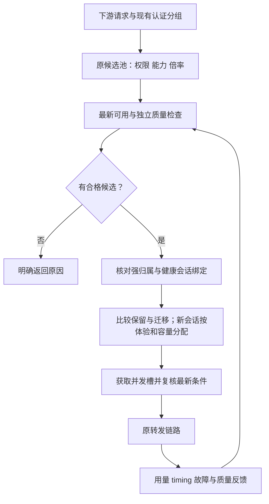

# 多供应商上游自动调度设计

| 属性 | 内容 |
| --- | --- |
| 状态 | 已授权推进本地实施；执行状态见 STATE.md |
| 更新日期 | 2026-11-03 |
| 项目 | sub2api |
| 源码基线 | `6de829fa2efa801dcf3071c4efe842198c7724be` |
| 状态入口 | [STATE.md](STATE.md) |
| 已确认决策 | [DECISIONS.md](DECISIONS.md) |

本文是本主题唯一设计与任务定义。当前进度和下一项工作只在 STATE.md 维护。
用户已授权推进本地实施、修复、本地验证及验收后本地提交；不运行 CI。本次不推送远程，未授权生产迁移或部署。
未确认参数先采用保守且可配置的局部默认值，避免扩大生产影响。

## 1. 目标与验收方向

在多个供应商、固定上游分组和 API Key 之间自动择优，让下游以固定售价规则获得质量合格、稳定、高效、缓存友好的服务。
后台替代人工频繁切换，保持已有会话连续性，并控制本地改动，便于跟进原 sub2api 仓库更新。

需要同时满足：

- 只选择当前下游产品允许倍率范围内的线路；没有合格线路时明确返回。
- 根据最新有效可用状态准入，质量状态独立判断和恢复。
- 同时评价首字、TTFT、持续输出、完成情况、负载与缓存，减少单指标误判。
- 已有健康会话保持稳定；必要切换计入冷缓存和重新预填充的损失。
- 复用原有调度、质量、计费、配置与快照机制，保留可核对的选路原因。

有限检测只能证明所测范围符合要求，不能证明模型身份或永久能力。

## 2. 范围与约束

### 2.1 已确认范围

| 主题 | 约束 |
| --- | --- |
| 下游产品 | 固定销售价格规则，档位数值可配置，讨论中的数字仅为示例 |
| 上游范围 | 使用实际绑定供应商分组的倍率和既有倍率控制，严格限制范围 |
| 无合格候选 | 明确暂不可用，不自动越倍率兜底或更改下游售价 |
| 最新监测 | 最近有效可用状态控制准入，历史可用率不替代该状态 |
| 质量 | 独立隔离与复测，低价和高缓存不能抵消质量失败 |
| 缓存 | 考虑同组账号切换损失，保护健康已有会话 |
| 上游更新 | 指跟进原 sub2api 仓库代码，优先配置和局部扩展 |

### 2.2 本期排除项

真实采购价格卡、实付对账、汇率税费、现金毛利保证及货币级缓存优化整体延期，不作为本期依赖。
本期使用 token、命中概率和时间评估缓存损失，不提前建设未来功能的空表或接口。
动态下游售价、外置转发网关和第二套长期并行调度器不进入本期设计。

## 3. 项目现状与复用边界

以下依据源码基线核对，不代表生产已开启全部能力。

| 现有能力 | 复用方式 | 需要补齐或核对 |
| --- | --- | --- |
| Account 多分组、模型范围、Group 优先账号 | 建立批准的静态候选范围 | 不因动态评分反复改分组关系 |
| 利润倍率门及抢槽后终检 | 复用倍率范围检查入口 | 手工使用 Account.RateMultiplier；自动同步还核对有效快照和实时高峰，不能混用 cost_multiplier |
| 上游倍率探测与同步 | 延续原协议、开关和快照 | 多分组及部分供应商不自动写回，需确认来源 |
| 质量隔离、复测和自动恢复 | 复用规则、历史与限制归属 | API Key 可用状态联动需补齐，OAuth 专用探针不能套用 |
| 原优先级、黏性、负载与并发 | 在原路径局部扩展 | 缓存迁移判断及共享配额需验证 |
| 请求 timing | 复用首字节、语义与可见文本事件 | 不等于已有逐线路完整聚合 |
| 原计费与 fast 行为 | 保持原计费链 | 核对账号附加倍率，避免换路改变客户单位售价 |
| 调度快照与 outbox | 复用状态传播 | 旧结果、失效快照及多实例一致性需回归 |

截图中的分组趋势和分组糖果检测只能辅助观察；分组检测由调度器选择账号，不能直接作为每个账号的隔离依据。
原倍率门存在分组读取失败后放行的缺口；D4.2 在既有门中表达配置不可用并拒绝准入，不新增平行调度器。
完整严格范围仍需核对配置新鲜度、线路倍率来源和固定售价，不能由局部修复代替。

### 3.1 D1 核对结论与本地实施基线

| 需求 | 已存在的配置/源码 | 本次确定的实施边界 |
| --- | --- | --- |
| 倍率范围 | Group 的 profit_control_enabled、profit_min_margin、profit_safety_buffer；GroupsView 已有表单 | 首期直接复用，不新增独立倍率上限；RateMultiplier 是现门输入 |
| 固定供应商组 | 现有 Account/Key、分组关联和模型范围 | 优先一个确定上游组对应一个 Account；不自动修改供应商 Key 全局分组 |
| 质量隔离恢复 | QualityPolicy 的 isolate_models/remove_models、auto_restore 和原复测上下文 | 复用，质量时间到期不放行；API Key 不采用 OAuth 状态探针 |
| 性能排序 | priority_scheduling_v1 支持分组、模型、样本、分位数、体验/负载/成本与延迟降权 | 复用原配置；首期延迟用降权而非短阈值硬停，不把历史评分当可用状态 |
| 黏性保护 | 高级调度的 sticky weighted 开关会将 response/session 绑定纳入打分 | 首期保持健康会话硬黏性，新的缓存软迁移策略后续在同入口补齐 |
| 共享并发 | AcquireAccountSlot 使用 accountID 作为并发键 | 同一 Account 多下游组已共享；重复 Key 建多个 Account 不共享，D2 必须明确该缺口 |
| 最新可用联动 | 分组监测不绑定账号，OAuth 5xx 触发不适用于 API Key | D3 补账号/模型最新有效可用证据、API Key 触发与独立恢复 |
| 倍率终检 | 有倍率门才进入 profitControlVetoLatest；缓存失败可回源数据库 | 缓存及数据库都失败不能使用旧选号对象放行；独立修复任务 D4.1 |
| 前端与更新兼容 | 已有分组、优先级、质量和监测页面；主链支持选择结果携带门 | 局部修改既有入口与表单，不重写核心计费、不新增平行调度器 |

配置例值只用于表达，不写入生产：下游倍率 D=0.15、margin=0.20、buffer=0，可表达 U<=0.12。
这不证明跨供应商真实成本等价；无法确定上游组或倍率来源的线路先留在检测/人工确认范围。
默认不新增采购价格、账单、共享密钥复制或全局供应商切组能力。

## 4. 对象与数据归属

| 对象 | 含义与约束 |
| --- | --- |
| 供应商 | 钱包、主体、服务故障域和共享限制 |
| 线路 | 本项目能确定选中的上游分组、端点、凭据与协议组合，首期尽量对应现有 Account |
| 凭据 | 复用现有 Key 安全存储；同 Key 多线路共享额度，不重复放大并发 |
| 下游产品 | 现有 Group，包含固定售价、模型/fast 能力、倍率边界与调度策略 |
| 缓存域 | 具有缓存共享证据的范围；未知共享关系按跨域处理 |
| 请求归属 | 复用 session hash、response ID 和工具任务拥有者 |

供应商没有可靠的固定组选择能力时，其内部多个组只能作为一个不透明线路观察。
优先独立 Key 或既有可靠请求级选择，避免修改 Key 全局默认分组影响在途请求。
现有 AccountOpsGroup 是站点/上游用户维度的运维归组，不是 Key 级共享额度或缓存域证据；
不能直接复用其 ID 作为限额键，也不能仅因两个 Account 同组就认为缓存共享。

### 4.1 New API 固定分组证据（D2.2）

库存掩码仅用于定位候选，不证明完整 Key 归属。唯一掩码候选和人工选择候选都须经原 Key 揭示接口完整比对；库存已返回精确完整 Key 时不额外揭示。空值、仍为掩码、接口失败或完整值不符均拒绝保存/有效探测；多个候选仍须人工选择，不自动猜选。
授权预览与持久快照共用固定分组倍率规则。归属核验和分组适用性独立：归属通过可保存绑定，不合格分组不显示有效倍率但保留已核验钱包；归属或请求失败清除倍率数据、成功时间、有效期及钱包有效状态，恢复成功后重建，不回显密钥。
绑定 Key 的声明分组必须非空、非 auto、长度不超过 128 字节，且其倍率为有限数、位于原展示值域 [0, 1000000]。
未提供 route_groups 的旧库存沿用声明分组；提供单个路由时必须与声明分组精确相同。
异组、空路由、多路由（包括重复项）或 cross_group_retry 均不足以证明固定分组，不取其他组倍率替代。
探测写回时以当前结果替换旧快照：不合格时状态为 unsupported/unsupported_group，不保留旧倍率与有效期；余额仍独立展示。
恢复同组且证据合法后恢复 OK。分组声明始终是 group 范围证据，不自动成为 token 同步依据，不改写 Account.RateMultiplier 或上游 Key 配置。
此项只核查现有库存返回的固定分组证据，不代表已实现请求级强制选组、共享 Key 限额或跨账号缓存域识别；这些仍属于 D2 剩余范围。

### 4.2 协议线路身份与旧证据失效（D2.3）

探测身份除平台、账号类型、代理、Key、base_url 和请求头覆写外，也包括 api_base_urls、api_protocol、account_mode；这些字段可改变协议或实际端点。
单账号身份比较、批量编辑的清除意图、CRS 合并和 New API 绑定指纹使用同一字段清单，防止一条编辑/同步路径保留另一线路的证据。
身份变化时清除受管探测快照，保留用户的探测/同步开关；自动同步账号没有新有效证据时由既有倍率门拒绝准入。
单账号保存相同身份值不主动清除；批量编辑无法逐行比较旧值，显式提交这些字段（包括 null）时沿用保守清除策略。
CRS 仍拒绝导入远端受管快照。数据库原全凭据 CAS、事务/outbox 和更保守的凭据变更清除保持，不以服务层身份判断缩小持久化边界。
已存在上述协议字段的 New API 账号，其旧指纹在代码升级后失效，需要通过现有配置入口重新核验绑定；没有这些字段的账号指纹保持。
此项不证明多个协议端点具有相同计价/分组/缓存域，也不实现请求级强制选组或共享 Key 限额。

### 4.3 自适应账号探测与授权目标（D2.4）

自适应多协议账号的账号级计费观察使用实际 Chat Completions 基址，与 GetOpenAIBaseURL 的协议地址优先级一致，包含按模型分流的供应商。
原生计费探测和 New API 管理站点解析共用 upstreamBillingProbeBaseURL；NewAPIAccountSite 保留原站点规范化规则和租户路径。
授权验证、同站点账号列表、绑定探测及数据库保存时的站点校验共用该解析，禁止原始 base_url 把授权或证据归到旧主机。
api_base_urls 单独提供地址时不再错误要求旧 base_url；非自适应账号、原官方域跳过策略和 OpenAI 默认探测语义保持。
旧绑定站点与实际生效站点不一致时需要重新核验；不迁移授权密文到另一主机，不自动修改上游 Key 或下游售价。
此项只纠正账号级观察目标，不将 Chat Completions 的证据扩展为所有协议/模型的计价证明；跨协议准入归属仍需后续验收。

### 4.4 共享 Key 并发规则与接线边界

用户已确认：同一上游 API Key 单独配置一个共享总上限，各 Account 原并发限制同时保留。
总上限不是账号并发的最小值、最大值或总和，不按下游产品分组重复计算。
共享策略应由 Key 维度的单一配置表达，不能复制到各账号的 extra 后由各请求自行决定上限。
账号引用同一策略时，跨账号、下游分组及实例合计占用该额度；本地 HTTP/SSE 与 Responses WS 的 HTTP 桥接使用以下统一配置，前端管理与 Live/区域接线仍待验收。

首期配置位于 `gateway.upstream_key_concurrency`，同一 Key 以最终出站凭据去空白后 SHA256 的小写摘要定位，`limits` 保存共享上限，`revision` 保存递增策略版本。
不保存第二份明文 Key，不把账号、下游分组、供应商倍率、端点或协议加入额度键；同一凭据通过多个账号/协议入口发送仍共用额度。摘要只用于限额，不证明跨协议计价或缓存共享。
复用现有 HTTPUpstream 的 Do/DoWithTLS，按实际请求的 Bearer/Token、X-Api-Key、Api-Key、X-Goog-Api-Key 与 key/api_key 查询凭据取槽，重复凭据只计一次。
账号/用户原槽位保持；HTTP 共享 Key 维度在真正出站前抢槽，满额不发送网络请求，沿原有受限重选返回 503，不记录为供应商/代理健康故障。
HTTP/SSE 槽位持有至响应体 EOF/错误/Close；请求取消主动关闭响应体并回收本次成员，多凭据部分失败回收已取成员，重复 Close 不重复释放。
独立 Redis `concurrency:upstream_key:*` namespace 使用服务器时间、30 秒租约、5 秒续租；本地 19 秒所有权看门狗在租约被别人复用前取消请求，续租仅更新现存成员，禁止恢复已删除成员。
Lua 原子校验策略版本和完整 limits 摘要；同版本不同配置、旧版本、Redis 不可用明确拒绝。降低上限保留原槽位，已有流完成，新申请按新上限判断；同版本配置必须在所有服务实例一致。
首次启用、删除规则或关闭功能前须停止接流并排空旧流量，因为此前无限制请求未持共享租约；变更版本必须递增，回滚配置也使用新版本，不清空 Redis 规避版本栅栏。
当前配置由进程启动加载，不承诺在线热更新；revision=0 且空 limits 为旧行为，revision>0 且空 limits 可发布有版本的规则移除。
明确兼容边界：配置该模式时 HTTP-to-WS 转换回落 HTTP；直接 Responses WS ingress 复用既有 HTTP/SSE bridge，每轮使用最终出站凭据取槽，空闲连接不持共享槽位。账号显式关闭 WS 仍生效，原每轮准入与完成回调保持；智能协议的 ws/auto/shadow 也不绕过该约束。桥接上游必须支持 Responses HTTP/SSE，不将 HTTP 接口视为与原生 WS 同价或共享缓存的证据。
桥接各轮的共享额度/策略失败保持本地 503 准入错误，不包装成供应商 502；发送后的租约失效仍不作为可安全重放的准入失败。原生上游 WS 租约、受限 Key 的 realtime 与区域 SQL/本地快照仍未接通，后两者明确拒绝。尚未覆盖自定义签名/非标准鉴权、绕过 HTTPUpstream 的出站及跨请求后台任务，D2 父验收保持未完成。

请求须同时满足账号额度与 Key 总额度；只占一维或结果不明确时，按本次精确成员清理，不能清空账号/Key 下其他请求。
等待重试、取消、抢槽终检、WebSocket 每轮和 Live 交接都必须保持同一共享归属，长请求须维持有效所有权。
共享额度使用独立上游凭据命名空间，不能复用表示下游用户 Key 的 concurrency:api_key，也不能把哈希塞入 accountID。
区域运行需沿既有受信任快照与额度权威接线；缺少受控共享额度能力时明确拒绝，不回源主库或静默退化成账号额度。
额度身份与缓存域证据分开：同 Key、同站点或同 AccountOpsGroup 均不自动证明缓存共享。

本地并发入口已补齐账号/用户申请返回错误后的精确回收尝试，成功路径与错误路径共用释放逻辑；
清理保留区域路由上下文、脱离请求取消并受 5 秒超时约束，失败保留原申请错误和原租约过期兜底。
这减少已占槽而回包丢失造成的虚假满载；清理失败或迟到写入仍需依赖后续租约/交接设计，不能视为共享额度已完成。

### 4.5 请求与静态凭据绑定

API Key 账号的静态 api_key 纳入既有线路指纹；替换、清空或移除后，旧选号对象和已建立 WS 连接的绑定失效。凭据只进入内存中的指纹计算，不写日志或另存明文。
OAuth 的 access_token/refresh_token 等轮换字段仍按原规则排除，不把正常刷新误判为购买线路变化；受管授权连接继续执行原连接绑定规则。
这保护的是本地静态凭据与账号行的一致性，不证明供应商内部固定分组、跨协议同价或缓存域，也不修改供应商 Key 的全局配置。

## 5. 倍率准入与固定售价

当前利润门使用上游账号倍率 U、请求有效下游倍率 D 与既有 margin/buffer 配置：

```text
U <= D × (1 - margin - buffer)
```

该式是倍率准入规则，不代表已经核验的真实采购毛利。
优先用原配置表达边界；确有独立上限需求再补可选字段，并与现有边界取更严格值。

- 记录固定上游组、倍率来源、同步状态、更新时间及账号当前倍率。
- 不能使用多分组最小倍率代表当前请求；跨供应商、模型、fast 的倍率需确认可比性。
- 未知或失效倍率等待确认，不自动当作便宜路线；未开启原同步开关时不擅自开启。
- 倍率变化按下游产品分别重新求值，不因一个产品不符合就全账号停用。
- 换路线不回写下游售价、折扣、高峰或 fast 设置；核对 Account.GroupRateMultiplier 等影响项保持一致。
- 固定单位价格仍随实际用量产生不同总账单，缓存变化不得通过篡改 usage 隐藏。

### 5.1 自动同步倍率准入（D2.1）

在线候选、抢槽后终检和 profit-preview 共用 `profitControlAccountRateAt`，请求路径不发起探测，不写回账号倍率。
仅 API Key 且原 `upstream_billing_probe_enabled`、`upstream_billing_rate_sync_enabled` 两个开关同时开启时使用同步证据；
手工账号、OAuth、仅观察探测或同步未实际开启的账号沿用保存倍率，手工免费倍率 0 仍合法。

自动同步账号的本次 U 为：

```text
U(attemptAt) = max(accounts.rate_multiplier,
                   snapshot.resolved_rate_multiplier × upstream_peak(attemptAt))
```

保存倍率作为保守下限，声明值仍使用原同步写回的合法值域和四位精度检查；拒绝 0、舍入为 0、超出同步上限及非有限声明。
`upstreamBillingRateAt` 复用原时区与峰时段算法，只接收确定单组的 token 范围；不以 multi_group 的最低倍率或 New API 的 group 范围声明代替。
`effective_rate_multiplier` 是探测当时的值，不用它冻结高峰；U 使用当前尝试时刻，D 继续冻结于请求/WS turn 的 pricingAt。

快照须为 OK，received_at 与 last_attempt_at 必须存在、非零且不晚于本次尝试，fresh_until 必须严格晚于本次尝试。
缺失、失败、unsupported、过期、未来时间、非法倍率或高峰配置统一返回 `profit_upstream_rate_unavailable`，不退回旧基础倍率。
原探测仍按原调度独立复测；有效快照恢复后重新参与倍率检查，不附加永久停用或更改会话绑定。
沿用原仓库的身份 CAS、同步写回、outbox 和快照结构，不新增 schema；历史有效快照不强制要求 `synced_rate_multiplier` 字段。

预演保留 `account_rate` 的保存倍率含义，新增 `effective_upstream_rate` 表达本次 U；证据失效时省略有效倍率并返回
`rejected_upstream_rate_unavailable`。文本输出同时显示两种倍率并统计新拒绝分类；观测通过既有采样日志增加独立累计计数。
该子任务只补齐原自动同步的准入链路；固定线路协议、重复 Key 共享额度和缓存域证据继续由 D2 其余范围验收。

### 5.2 账号与分组配置终检

抢槽后账号终检的本地实现：已有倍率门时，缓存读取失败先回源数据库；最终读取报错或账号消失，返回
`profit_account_refresh_failed` 否决，由原 handler 释放槽位、排除该候选并受原重选预算约束。
不复用旧选号对象放行，不提前写响应或覆盖黏性绑定。未装门请求保持原行为。
D4.1 只处理已装门后的账号刷新；D4.2 则补齐装门前读取失败、空对象和错组结果：
门携带配置不可用状态，统一返回 `profit_group_config_unavailable`，而不是把阈值设为 0 或直接卸门。
免费账号同样拒绝，跨组不继承其他组的阈值，终检不以账号刷新覆盖配置失败原因。
WS 每轮通过既有 Lite 读取接口重新读取实际调度组的策略：主节点读取主库，区域节点读取本地区域配置，不因认证分组 ID 相同而沿用连接旧策略。收紧、放宽、关闭和重新开启在轮次边界生效；读取报错、空对象或错组时安装拒绝门，即使旧认证快照显示关闭也不放行，恢复后重新装门。每轮重新冻结 pricingAt，认证计费分组与售价快照保持；策略组的新售价字段不覆盖该快照。HTTP 同一请求的 failover 继续复用请求门，不在重试中途改变阈值。
已知关闭/不适用的分组、显式非 token 范围保留原行为；OpenAI 未挂接调度快照且无有效上下文分组的内部调用保留原兼容边界，不作为生产严格范围保证。
这些修复不证明缓存一定实时；完整严格范围仍由 D4 验收。

启用利润门时，OpenAI 与 Grok 文本请求每轮准入和最终 HTTP 出站前共用线路绑定/倍率判定，读取主库账号后再次核对倍率、销售附加倍率和原同步证据，保留请求已冻结的销售阈值。HTTP 最终入口同时复核当前分组归属，覆盖协议适配器构建请求期间的账号变化；本地拒绝不记录为供应商/代理健康故障。
严格请求不使用进程内账号准入缓存，避免旧的低倍率或旧 Key 继续授权；区域仍沿已有权威快照、有效期和栅栏，不回源主库。关闭利润门时保留原缓存与发送行为。此复核不是跨数据库和网络的原子事务，检查完成后的外部变化仍存在传播窗口。Grok Responses 原同账号可恢复重试也须重新复核，不能拿旧请求凭据配新账号倍率；关闭门时保持其既有直接调用边界，OAuth 正常刷新不改变线路身份。其他路径、HTTP 首次装门的认证配置新鲜度、区域传播窗口和模型/fast 来源仍属 D4 剩余验收。

D4 固定售价准入复用上述公共判定：启用利润门时，Account.UserGroupRateMultiplier() 的有效值须精确为 1。
nil 及原有负值继续按计费的历史默认 1 处理；0、折扣、加价和非有限值会改变/破坏售价，返回 profit_account_sale_rate_mismatch。
不将售价附加倍率乘入 U/D 或阈值，也不改写账户配置、usage、下游售价和原计费函数；关闭门/显式范围外请求保持原行为。
候选、槽位终检、WS 后续轮次及预演共用该规则，恢复为 1 后重新准入；免费上游不绕过。
profit-preview 输入需导出 group_rate_multiplier，输出 rejected_account_sale_rate_mismatch 并从合格容量剔除；启用前须预演，原来依赖附加倍率的账号可能减少候选容量。
共享调度诊断分别统计分组配置不可用、同步证据不可用和附加售价不符，不将这些拒绝计入 eligible；公共汇总用于详细日志和错误摘要，避免重复格式漂移。
此项不替代 D2 线路/Key 归属、完整配置新鲜度或所有模型/fast 计价来源的验收。

## 6. 请求决策流程



普通选号、黏性复用、槽位等待后和 WS 每一新轮次使用一致检查，不能由备用路径绕过。
动态评分只作用于合格池；强归属、倍率、质量与能力不允许被总分抵消。
无候选区分倍率不符、状态过期、质量隔离、容量不足和归属不可迁移；未发响应头时返回相应 HTTP 错误，已建流时用协议错误结束。

## 7. 最新状态、隔离与恢复

### 7.1 状态规则

| 状态 | 解释 | 新请求处理 |
| --- | --- | --- |
| unknown | 尚未形成有效证据，或相关配置变化 | 等待检测确认 |
| pass | 最新有效结论通过且未过期 | 其他条件也满足时放行 |
| fail | 最新有效结论明确失败 | 停止对应范围，继续独立复测 |
| inconclusive | 本轮检测无明确结论 | 原隔离保持；原有效通过只用到有效期 |
| stale | 结论超过有效期 | 停止新准入并补测 |

可用、质量、倍率和人工限制分别管理拥有者与版本；恢复只解除本规则实际拥有的限制。
网络/上游超时可形成可用失败证据；判题器异常不伪造质量答错。
质量失败须由质量通过解除，连通通过不能代替；复测时间到期仅触发检测。

检测带开始序号、完成时间、配置/规则版本和 valid_until。旧轮次或旧配置结果晚到仅留历史，不覆盖新失败。
业务新故障可合并触发独立复测，旧的在途成功不解除较新的失败；内部检测仅绕过自身隔离，不绕过人工权限与配额。

### 7.2 恢复与在途请求

建议通过后先受限恢复，再按后续通过放量；恢复限额与人工并发配置分开。
恢复线路优先接新会话，不抢回已稳定迁移的会话。
原线路出现新失败即重新隔离；其他限制仍有效时继续停调。
已经正常输出的流默认允许完成，后续新轮次重新检查；有副作用的工具任务保持归属。

## 8. 指标与动态评价

### 8.1 指标定义

| 指标 | 必须明确的口径 |
| --- | --- |
| TTFB | 首个 HTTP 响应字节，上游侧与客户端侧分开，不代表模型回答 |
| 响应头等待 | 请求上传完成到收到响应头 |
| TTFT/首语义输出 | 首个有效语义事件，区分推理、文本和工具事件，排除心跳 |
| 首字/首可见文本 | 首个非空可见文本；说明采集层级 |
| 首推理事件 | 首个可观察推理事件；未暴露不等于没有推理 |
| 队列、连接、上传 | 本地和网络阶段分开，避免归因给上游推理 |
| 输出 TPS | 输出阶段 token/秒，注明推理/文本及短输出影响 |
| 流中停顿 | 内容事件间隔及尾部指标，心跳不抵消停顿 |
| 业务完成与抖动 | 协议正确结束、分类失败、时延波动和频繁恢复 |
| 缓存 | 请求命中、token 占比、可复用前缀规模及切换后变化 |
| 质量与能力 | 模型、推理强度、fast、工具、协议和规则覆盖 |
| 容量 | 在途、排队、RPM/TPM、余额及共享 Key/供应商余量 |

每个特征附来源、范围、时间、窗口、样本数、覆盖和置信度。未采集保持 unknown，不能填为 0ms 或 100% 命中。
HTTP 200 不等于业务成功；最终一次尝试耗时不等于用户经历全部重试的总等待。

### 8.2 多窗口与防抖

最新明确故障直接影响准入，不等待历史平均。
短窗口约 1–5 分钟反映排队、负载、TTFT 和停顿；稳定窗口约 15–60 分钟用于分位数与缓存基线。
按模型、服务档、推理强度、协议、上下文和冷热请求分层；超时样本保留失败/删失信息，不能只看成功样本。
历史失败率用于合格池风险排序，历史可用率不决定放行。
相关启动指标避免重复赋权，具体权重和 SLO 依真实样本校准。
排名变化优先调整新会话，现有会话另行评估迁移。

## 9. 缓存保护与分配策略

### 9.1 缓存域与指标

同模型不同 Key、不同供应商分组或 standard/fast 之间不默认共享缓存。
沿用现有会话标识，绑定记录租户/产品、模型与服务档、线路、缓存域和最后成功时间。
绑定 TTL 不保证上游缓存存活，命中估计随空闲衰减；必要前缀摘要使用租户隔离的不可逆摘要，不记录原提示词。

```text
请求命中比例 = 有缓存读取的业务请求数 / 可比较业务请求数
缓存token占比 = 读取token / (普通输入token + 缓存读取token + 缓存写入token)
额外冷输入估计 ≈ 可复用前缀token × max(原路预期命中 - 新路预期命中, 0)
```

先归一 usage 含义，避免重复计数。全站高命中率不能代替新迁入会话的命中预测。
迁移等待由排队、重新上传、冷预填充和首有效输出组成，各段边界要互斥，避免重复计时。
缺少证据时采用保守冷启动估计并显示不确定性，不依赖精确货币计算。

### 9.2 保留与迁移

| 场景 | 处理 |
| --- | --- |
| 原路健康、合格且体验达标 | 保留，不因其他线路短暂更高分而切换 |
| 轻微波动 | 继续观察，新会话可以调整分配 |
| 持续明显变慢或拥塞 | 比较保留等待与冷启动损失，持续净收益充足才软迁移 |
| 可用失败、质量失败或倍率越界 | 停止新轮次，只选合格且协议允许迁移的路线 |
| response ID/工具任务强归属 | 不错误跨账号续接，不自动重放副作用 |
| 原路恢复 | 优先新会话，保留其他健康绑定 |

软迁移设置持续改善门槛、绝对时间收益、最短间隔与次数限制；硬故障不受软迁移冷却阻挡。
绑定更新遵循既有成功条件与终检，避免候选刚选中就破坏原绑定。

### 9.3 新会话与共享容量

新会话先在少量独立故障域的合格优选线路中加权分配，容量不足再扩大合格池。
会话内稳定、会话间分散，避免每轮均匀撒到所有路线，也避免集中第一名造成拥塞。
供应商、钱包、Key、线路的共享限额跨下游产品统一控制，产品公平份额需压测。
真实业务探索仅面向倍率与质量已通过的候选；未知路线留在检测池。

## 10. 检测、超时与建议参数

### 10.1 检测执行

逐线路检测必须能指向被测 Account，隔离后仍运行，复用现有构造与协议解析。
流式检查验证实际业务完成，不能仅检查响应头、心跳或空事件。
用户输入错误、客户端取消和本地检测排队问题分类处理，不污染上游质量。
同线路同类检测互斥，定时/手动/业务触发合并，全局与供应商配额分别限流。

下表全部为待校准建议，尚未确认实施：

| 参数 | 建议初值/方式 |
| --- | --- |
| 活跃线路可用证据 | 实际业务反馈，缺少新鲜证据时补测 |
| 备用可用检测 | 约 1–3 分钟一次，接流量前证据须有效 |
| 待测/冷门线路 | 约 5–15 分钟或按需排队，不接正式业务 |
| 故障复测 | 约 60/120/300 秒退避，尊重 429 重试时间 |
| 质量频率与样本 | 按主力模型/服务档配置，依据成本、耗时与质量有效期校准 |
| 恢复容量 | 配置并发约 20%，至少 1、首期最多 2，配合后续通过轮次 |
| 软迁移改善 | 同类净体验改善约 20%，连续 3 个评估周期，另设绝对收益门槛 |
| 新会话优选集 | 可从 2–3 个独立故障域开始，随容量扩大 |
| 自动切换重试 | 最多 1 次不同合格线路，受协议和总等待预算约束 |

有效期须覆盖正常周期、检测耗时和任务延迟。不能用单一质量结果证明所有模型/推理/fast 档位。
探测量按 `1440/间隔分钟 × 样本数 × 检测范围数` 估算，外部判题另算；先用次数、token 和并发限制控制。
监测器/判题器故障独立告警，不批量伪造上游失败。

### 10.2 业务超时与重试

区分排队、连接、响应头、语义输出、首文本、流空闲与总时长，按模型/推理/上下文设置。
现有预输出预算从转发阶段开始，不能直接当包含排队的端到端预算。
无输出也需判断上游可能已执行、计费和副作用；有文本/工具输出后不透明双发、拼接或重放。
所有重试继续受倍率、状态、能力与归属限制，记录全部尝试和等待。

## 11. 工程接入与原仓库更新兼容

### 11.1 最小改动

优先原生配置，差距在原调度入口内局部补齐；沿用认证、转发、计费、质量、timing、快照和 outbox。
动态状态与人工配置分离，不用反复改静态分组关联、账号优先级或并发实现评分。
共享判断仅为实际调度和预览等真实调用服务，不提前建设插件框架。
新增规则默认不启用，显式作用于选定分组；这用于发布控制，不保留重复调度实现。

### 11.2 数据与并发

记录必要的线路/缓存域信息、策略配置、最新结果和版本、限制拥有者及决策解释，优先扩展现有结构。
状态变更与 outbox 同事务，任务租约防重，条件写入防止旧结果覆盖。
槽位取得后复核最新状态、倍率和共享额度；严格组配置失败时用仍有效的已验证快照，没有则明确返回。
Redis 重建不将空状态当通过；多实例传播时延要实测，允许解释已经在途的请求。
导入导出、账号编辑、批量保存和快照重建必须验证新增字段保留，不能假定未知 extra 键天然安全。
确需新表时增量迁移，不修改已发布迁移或预占原仓库未来编号。

### 11.3 上游代码更新

1. 记录原仓库基线、本地补丁及定向回归入口，以 Git 管理实际差异。
2. 在集成分支审阅更新，重点检查调度、质量、配置、数据库和导入导出变更。
3. 原生新增同类功能时迁入其实现，删除被替代本地逻辑与配置。
4. 执行回归、迁移兼容、真实 CLI 长会话与故障注入，再按部署授权发布。
5. 保留前一可部署版本；代码同步不覆盖生产持久化配置，不自动回滚数据库。

目标是降低冲突和维护成本，不承诺任意更新零冲突。正式实施交付应确保必要文档纳入版本控制。

## 12. 前端与选路解释

| 既有入口 | 扩展内容 |
| --- | --- |
| 账号/供应商管理 | 固定上游分组、倍率来源/同步、Key 共享额度和能力 |
| 下游分组 | 原售价与倍率规则、模型/fast、策略范围、无候选行为 |
| 质量运维 | 检测、隔离、恢复、有效期及影响范围 |
| 优先级调度 | 活跃/备用、会话保护、软迁移和模拟选路 |
| 监测/用量 | 最新状态与趋势分开，指标口径、样本、缓存和切换记录 |

模拟选路解释每条候选的排除原因，以及保留/迁移的缓存和等待依据。
人工可以排除线路、立即复测、暂停软迁移；自动规则遵守已有权限、人工禁用和限制归属。
复用原组件、接口和国际化，不复制页面。保存前预览影响范围与合格容量。

## 13. 实施任务、验收与回滚

下表统一定义任务、依赖和验收条件，执行进度仅由 STATE.md 维护。

| ID | 工作 | 依赖 | 验收条件 |
| --- | --- | --- | --- |
| D1 | 原生配置覆盖、倍率口径、最小补丁评估 | 设计讨论结论 | 配置覆盖与源码缺口明确 |
| D2 | 线路固定绑定、原同步读取、共享 Key 与缓存域 | D1 | 可确定选路，原同步不被覆盖，额度不放大 |
| D2.1 | 原自动同步倍率的有效快照、实时高峰及预演一致性 | D1 | 失效证据拒绝准入，手工行为保留，候选/抢槽终检/预演同源；原同步写回及 D 固定时刻保持 |
| D2.2 | New API 固定分组证据与失效恢复 | D1 | 单路由必须与声明组一致；异组/多路由/跨组重试/非法倍率不保留有效倍率；旧库存兼容，余额/身份绑定/账号倍率保持，恢复与本地回归通过 |
| D2.3 | 协议线路身份字段与旧证据失效统一 | D1、D2.1 | 地址/协议/接入模式变更或清空时，编辑/CRS/绑定指纹一致失效；开关保留、原值保存兼容、批量保守清除与倍率门回归通过 |
| D2.4 | 自适应账号的探测与 New API 授权目标统一 | D2.3 | 按入站/模型分流均使用生效地址；缺少旧 base_url 可用，旧站点排除；同站点列表、绑定探测与事务保存一致，原默认/官方域回归通过 |
| D3 | 最新可用反馈/复测及质量恢复复用 | D2 | API Key、过期、晚到结果与拥有者回归通过 |
| D4 | 倍率门/终检完整性与固定售价配置审计 | D1、D2、D4.1、D4.2 | 普通/黏性/WS 不越界，换路不改销售单价 |
| D4.1 | 倍率门已启用时，终检刷新失败拒绝旧对象准入 | D1 | 缓存故障可回源；双故障/账号消失拒绝；未启用门行为保持 |
| D4.2 | 分组配置读取失败时保留拒绝准入门 | D1、D4.1 | HTTP/WS/跨组 token 请求不静默卸门，免费账号不绕过；已知关闭与显式非 token 范围保持，失败原因可观测 |
| D5 | timing 与缓存分层、冷启动风险 | D2、D3 | 样本与边界正确，缺失诚实，估计可解释 |
| D6 | 健康会话保留、软迁移与新会话分配 | D3、D4、D5 | 防抖、强归属、故障避让和共享容量正确 |
| D7 | 既有前端配置与解释 | D1、D3、D4、D5、D6 | 默认兼容，权限/国际化/UI 检查通过 |
| D8 | 影子、故障注入、CLI 与升级兼容演练 | D2、D3、D4、D5、D6、D7 | 下列场景和字段保留通过，冲突范围可核对 |
| D9 | 小范围发布与回滚 | D8、对应部署授权 | 未启用组不变，版本与限制可恢复 |
| M1 | 清理调度、路由、额度测试的未引用辅助代码 | 实际 lint 与全仓引用核对 | unused 符号及死计数器删除，相关回归和本次差异检查通过 |
| M2 | 修复历史测试的错误处理、无效断言、过时静态写法与图片夹具泄漏 | M1 的实际 lint 报告与本地回归 | 范围内错误检查归零，原断言和取消/兼容边界保留，受影响测试与本地静态检查完成；图片测试隔离目录并关闭资源，不再新增源码产物 |
| M3 | 修复 Windows 原生连接错误的持久故障分类 | 本地真实拒绝连接复现 | 识别 WinSock 拒绝/不可达，超时/重置仍瞬时；发送后不重放，真实备用链只发送一次 POST，原绑定保持 |
| M4 | 修复区域状态、流量暂存与安全事件的跨平台私有文件持久化 | Windows 目录 Sync 与权限断言真实失败 | 共用私有原子写入；POSIX 保留文件/目录 fsync 与 0600，Windows 创建即保护 owner-only DACL 并 write-through 替换；失败仍可观测或拒绝准入，原失败范围和双平台回归通过，旧重复写入实现删除 |
| M5 | 澄清生产依赖规则与有意兼容测试的 lint 边界 | 14 项既有诊断逐项核查 | 生产 service/handler 依赖限制保留，根目录测试夹具允许真实 adapter；nil-context/历史密文测试保持，例外逐点说明；生产禁止依赖的负向检查及相关本地验证通过 |

关键验收：

- 倍率未知/越界与无合格候选不被备用路径绕过。
- 可用/质量独立恢复，隔离期间可复测，过期和晚到结果正确处理。
- 热缓存会话不因短暂排名迁移，持续拥塞迁移有证据，强归属不错误续接。
- 首字节快但文本慢、流中停顿、HTTP 200 流内失败均能区分。
- 同 Key 多线路/多产品共享额度，fast 和 WS 能力/计价保持一致。
- 原倍率同步、导入导出、快照重建及原仓库更新后配置与行为兼容。

验证使用项目现有后端 service/repository 单测、集成与 race，前端 test/typecheck/lint/build，另做实际多 CLI 长会话。
本地 lint 按实际执行的包范围验收，不用本次差异无告警替代完整包检查；具体范围、诊断数量和例外依据由 STATE.md 与 DECISIONS.md 记录。
生产依赖边界不约束直接验证真实 repository/Redis adapter 的根目录测试夹具；其他测试 lint 仍启用，刻意调用 nil-context 或历史密文接口的例外必须逐点说明。变更规则范围时以禁止生产依赖的负向检查验证限制仍然生效。
影子建议不等于未执行路线的实测收益；观测完成率、首字/语义分位数、停顿、切换、额外冷输入、恢复时间及探测量。
回滚仅关闭本次策略与触发器，保留人工、原质量和限流限制；数据库增量按兼容策略保留。

管理边界的真实 PostgreSQL/HTTP 组合测试统一放在 `backend/internal/integration/adminkey`，使用 `integration` 标签和 `SCOPED_ADMIN_TEST_DSN` 指向独立测试数据库；handler 包的 `unit` 标签只运行其单元夹具。迁移不得删减并发删除/轮换、事务提交/回滚或响应断言，也不通过放宽 handler 分层规则维持跨层依赖。

## 14. 待讨论与源码依据

### 14.1 待讨论

| 决策点 | 当前提议 |
| --- | --- |
| 跨供应商倍率可比性 | 明确固定组和来源，不可比时人工批准候选范围 |
| 状态过期与恢复放量 | 严格过期停接，受限恢复；具体有效期和轮次待定 |
| 质量检测覆盖与费用 | 先主力模型/推理/服务档，校准频率与样本 |
| 软迁移门槛 | 同时满足持续改善、绝对收益和缓存重建要求 |
| 冷缓存增量计费 | 解释实际 usage；是否承担增量属独立产品规则 |

### 14.2 源码依据

| 主题 | 文件 |
| --- | --- |
| 账号与分组 | [account.go](../../backend/internal/service/account.go)、[group.go](../../backend/internal/service/group.go) |
| 倍率门与估计字段 | [openai_profit_control.go](../../backend/internal/service/openai_profit_control.go)、[account_cost.go](../../backend/internal/service/account_cost.go) |
| 供应商探测 | [upstream_billing_probe.go](../../backend/internal/service/upstream_billing_probe.go)、[upstream_billing_groups.go](../../backend/internal/service/upstream_billing_groups.go)、[new_api_upstream.go](../../backend/internal/service/new_api_upstream.go) |
| 调度 | [openai_account_scheduler.go](../../backend/internal/service/openai_account_scheduler.go)、[priority_scheduling.go](../../backend/internal/service/priority_scheduling.go) |
| 质量 | [策略](../../backend/internal/service/account_quality.go)、[恢复](../../backend/internal/repository/account_quality.go)、[模型隔离](../../backend/internal/repository/account_quality_isolation.go) |
| 时延归因 | [content.go](../../backend/internal/pkg/requesttiming/content.go)、[latency.go](../../backend/internal/pkg/requesttiming/latency.go) |
| 固定售价审计 | [openai_gateway_usage.go](../../backend/internal/service/openai_gateway_usage.go) |
| 监测控制说明 | [channelMonitorV2.ts](../../frontend/src/i18n/locales/zh/channelMonitorV2.ts)、[qualityOps.ts](../../frontend/src/i18n/locales/zh/qualityOps.ts) |
| 快照 | [scheduler-snapshot-read-pipeline.md](../scheduler-snapshot-read-pipeline.md) |

源码依据用于区分已存在与拟补齐能力；实施前按实际部署版本重新核对。
