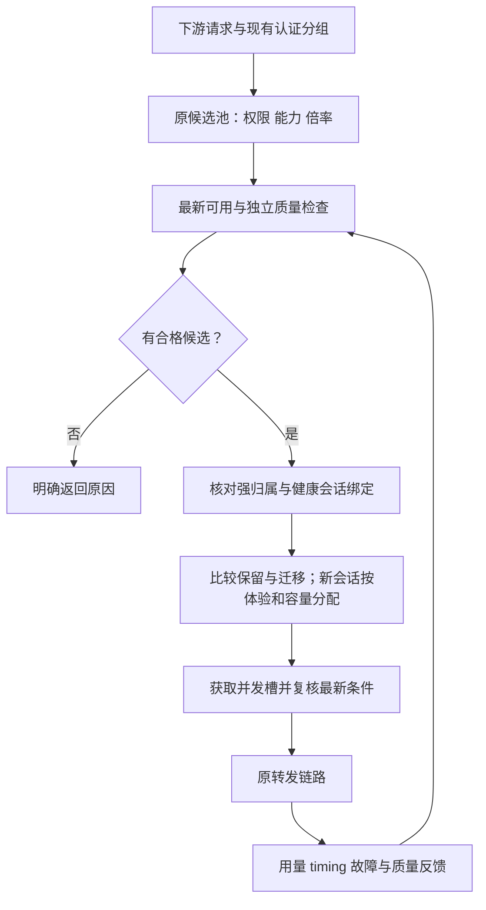

# 多供应商上游自动调度设计

| 属性 | 内容 |
| --- | --- |
| 状态 | 已授权推进本地实施；执行状态见 STATE.md |
| 更新日期 | 2026-11-05 |
| 项目 | sub2api |
| 源码基线 | `6de829fa2efa801dcf3071c4efe842198c7724be` |
| 状态入口 | [STATE.md](STATE.md) |
| 已确认决策 | [DECISIONS.md](DECISIONS.md) |

本文是本主题唯一设计与任务定义。当前进度和下一项工作只在 STATE.md 维护。
用户已授权推进本地实施、修复、本地验证及验收后本地提交；不运行 CI。本次不推送远程，未授权生产迁移或部署。
未确认参数先采用保守且可配置的局部默认值，避免扩大生产影响。

## 1. 目标与验收方向

在多个供应商、固定上游分组和 API Key 之间自动择优，让下游以固定售价规则获得质量合格、稳定、高效、缓存友好的服务。
后台替代人工频繁切换，保持已有会话连续性，并控制本地改动，便于跟进原 sub2api 仓库更新。

需要同时满足：

- 只选择当前下游产品允许倍率范围内的线路；没有合格线路时明确返回。
- 根据最新有效可用状态准入，质量状态独立判断和恢复。
- 同时评价首字、TTFT、持续输出、完成情况、负载与缓存，减少单指标误判。
- 已有健康会话保持稳定；必要切换计入冷缓存和重新预填充的损失。
- 复用原有调度、质量、计费、配置与快照机制，保留可核对的选路原因。

有限检测只能证明所测范围符合要求，不能证明模型身份或永久能力。

## 2. 范围与约束

### 2.1 已确认范围

| 主题 | 约束 |
| --- | --- |
| 下游产品 | 固定销售价格规则，档位数值可配置，讨论中的数字仅为示例 |
| 上游范围 | 使用实际绑定供应商分组的倍率和既有倍率控制，严格限制范围 |
| 无合格候选 | 明确暂不可用，不自动越倍率兜底或更改下游售价 |
| 最新监测 | 最近有效可用状态控制准入，历史可用率不替代该状态 |
| 质量 | 独立隔离与复测，低价和高缓存不能抵消质量失败 |
| 缓存 | 考虑同组账号切换损失，保护健康已有会话 |
| 上游更新 | 指跟进原 sub2api 仓库代码，优先配置和局部扩展 |

### 2.2 本期排除项

真实采购价格卡、实付对账、汇率税费、现金毛利保证及货币级缓存优化整体延期，不作为本期依赖。
本期使用 token、命中概率和时间评估缓存损失，不提前建设未来功能的空表或接口。
动态下游售价、外置转发网关和第二套长期并行调度器不进入本期设计。

## 3. 项目现状与复用边界

以下依据源码基线核对，不代表生产已开启全部能力。

| 现有能力 | 复用方式 | 需要补齐或核对 |
| --- | --- | --- |
| Account 多分组、模型范围、Group 优先账号 | 建立批准的静态候选范围 | 不因动态评分反复改分组关系 |
| 利润倍率门及抢槽后终检 | 复用倍率范围检查入口 | 手工使用 Account.RateMultiplier；自动同步还核对有效快照和实时高峰，不能混用 cost_multiplier |
| 上游倍率探测与同步 | 延续原协议、开关和快照 | 多分组及部分供应商不自动写回，需确认来源 |
| 质量隔离、复测和自动恢复 | 复用规则、历史与限制归属 | API Key 可用状态联动需补齐，OAuth 专用探针不能套用 |
| 原优先级、黏性、负载与并发 | 在原路径局部扩展 | 缓存迁移判断及共享配额需验证 |
| 请求 timing | 复用首字节、语义与可见文本事件 | 不等于已有逐线路完整聚合 |
| 原计费与 fast 行为 | 保持原计费链 | 核对账号附加倍率，避免换路改变客户单位售价 |
| 调度快照与 outbox | 复用状态传播 | 旧结果、失效快照及多实例一致性需回归 |

截图中的分组趋势和分组糖果检测只能辅助观察；分组检测由调度器选择账号，不能直接作为每个账号的隔离依据。
原倍率门存在分组读取失败后放行的缺口；D4.2 在既有门中表达配置不可用并拒绝准入，不新增平行调度器。
完整严格范围仍需核对配置新鲜度、线路倍率来源和固定售价，不能由局部修复代替。

### 3.1 D1 核对结论与本地实施基线

| 需求 | 已存在的配置/源码 | 本次确定的实施边界 |
| --- | --- | --- |
| 倍率范围 | Group 的 profit_control_enabled、profit_min_margin、profit_safety_buffer；GroupsView 已有表单 | 首期直接复用，不新增独立倍率上限；RateMultiplier 是现门输入 |
| 固定供应商组 | 现有 Account/Key、分组关联和模型范围 | 优先一个确定上游组对应一个 Account；不自动修改供应商 Key 全局分组 |
| 质量隔离恢复 | QualityPolicy 的 isolate_models/remove_models、auto_restore 和原复测上下文 | 复用，质量时间到期不放行；API Key 不采用 OAuth 状态探针 |
| 性能排序 | priority_scheduling_v1 支持分组、模型、样本、分位数、体验/负载/成本与延迟降权 | 复用原配置；首期延迟用降权而非短阈值硬停，不把历史评分当可用状态 |
| 黏性保护 | 高级调度的 sticky weighted 开关会将 response/session 绑定纳入打分 | 首期保持健康会话硬黏性，新的缓存软迁移策略后续在同入口补齐 |
| 共享并发 | AcquireAccountSlot 使用 accountID 作为并发键 | 同一 Account 多下游组已共享；重复 Key 建多个 Account 不共享，D2 必须明确该缺口 |
| 最新可用联动 | 分组监测不绑定账号；账号级 5xx 触发已覆盖 OAuth/API Key | D3 继续补账号/模型最新有效可用证据、版本、过期与独立恢复 |
| 倍率终检 | 有倍率门才进入 profitControlVetoLatest；缓存失败可回源数据库 | 缓存及数据库都失败不能使用旧选号对象放行；独立修复任务 D4.1 |
| 前端与更新兼容 | 已有分组、优先级、质量和监测页面；主链支持选择结果携带门 | 局部修改既有入口与表单，不重写核心计费、不新增平行调度器 |

配置例值只用于表达，不写入生产：下游倍率 D=0.15、margin=0.20、buffer=0，可表达 U<=0.12。
这不证明跨供应商真实成本等价；无法确定上游组或倍率来源的线路先留在检测/人工确认范围。
默认不新增采购价格、账单、共享密钥复制或全局供应商切组能力。

## 4. 对象与数据归属

| 对象 | 含义与约束 |
| --- | --- |
| 供应商 | 钱包、主体、服务故障域和共享限制 |
| 线路 | 本项目能确定选中的上游分组、端点、凭据与协议组合，首期尽量对应现有 Account |
| 凭据 | 复用现有 Key 安全存储；同 Key 多线路共享额度，不重复放大并发 |
| 下游产品 | 现有 Group，包含固定售价、模型/fast 能力、倍率边界与调度策略 |
| 缓存域 | 具有缓存共享证据的范围；未知共享关系按跨域处理 |
| 请求归属 | 复用 session hash、response ID 和工具任务拥有者 |

供应商没有可靠的固定组选择能力时，其内部多个组只能作为一个不透明线路观察。
优先独立 Key 或既有可靠请求级选择，避免修改 Key 全局默认分组影响在途请求。
现有 AccountOpsGroup 是站点/上游用户维度的运维归组，不是 Key 级共享额度或缓存域证据；
不能直接复用其 ID 作为限额键，也不能仅因两个 Account 同组就认为缓存共享。

### 4.1 New API 固定分组证据（D2.2）

库存掩码仅用于定位候选，不证明完整 Key 归属。唯一掩码候选和人工选择候选都须经原 Key 揭示接口完整比对；库存已返回精确完整 Key 时不额外揭示。空值、仍为掩码、接口失败或完整值不符均拒绝保存/有效探测；多个候选仍须人工选择，不自动猜选。
授权预览与持久快照共用固定分组倍率规则。归属核验和分组适用性独立：归属通过可保存绑定，不合格分组不显示有效倍率但保留已核验钱包；归属或请求失败清除倍率数据、成功时间、有效期及钱包有效状态，恢复成功后重建，不回显密钥。
绑定 Key 的声明分组必须非空、非 auto、长度不超过 128 字节，且其倍率为有限数、位于原展示值域 [0, 1000000]。
未提供 route_groups 的旧库存沿用声明分组；提供单个路由时必须与声明分组精确相同。
异组、空路由、多路由（包括重复项）或 cross_group_retry 均不足以证明固定分组，不取其他组倍率替代。
探测写回时以当前结果替换旧快照：不合格时状态为 unsupported/unsupported_group，不保留旧倍率与有效期；余额仍独立展示。
恢复同组且证据合法后恢复 OK。分组声明始终是 group 范围证据，不自动成为 token 同步依据，不改写 Account.RateMultiplier 或上游 Key 配置。
此项只核查 New API 库存返回的固定分组证据，不证明该供应商支持请求级强制选组或跨账号缓存共享。Sub2API 的显式请求选组见 4.6，共享 Key 限额见 4.4；D2 仍须完成其余验收。

### 4.2 协议线路身份与旧证据失效（D2.3）

探测身份除平台、账号类型、代理、Key、base_url 和请求头覆写外，也包括 api_base_urls、api_protocol、account_mode、protocol_rules；这些字段可改变协议或实际端点。protocol_rules 的替换、清空和显式空列表都按身份变化处理；单账号保存相同规则保留证据，批量显式提交沿用保守清除规则。
单账号身份比较、批量编辑的清除意图、CRS 合并和 New API 绑定指纹使用同一字段清单，防止一条编辑/同步路径保留另一线路的证据。
身份变化时清除受管探测快照，保留用户的探测/同步开关；自动同步账号没有新有效证据时由既有倍率门拒绝准入。
单账号保存相同身份值不主动清除；批量编辑无法逐行比较旧值，显式提交这些字段（包括 null）时沿用保守清除策略。
CRS 仍拒绝导入远端受管快照。数据库原全凭据 CAS、事务/outbox 和更保守的凭据变更清除保持，不以服务层身份判断缩小持久化边界。
已存在上述协议字段的 New API 账号，其旧指纹在代码升级后失效，需要通过现有配置入口重新核验绑定；没有这些字段的账号指纹保持。
此项不证明多个协议端点具有相同计价/分组/缓存域，也不实现请求级强制选组或共享 Key 限额。

### 4.3 自适应账号探测与授权目标（D2.4）

自适应多协议账号的账号级计费观察使用实际 Chat Completions 基址，与 GetOpenAIBaseURL 的协议地址优先级一致，包含按模型分流的供应商。
原生计费探测和 New API 管理站点解析共用 upstreamBillingProbeBaseURL；NewAPIAccountSite 保留原站点规范化规则和租户路径。
授权验证、同站点账号列表、绑定探测及数据库保存时的站点校验共用该解析，禁止原始 base_url 把授权或证据归到旧主机。
api_base_urls 单独提供地址时不再错误要求旧 base_url；非自适应账号、原官方域跳过策略和 OpenAI 默认探测语义保持。
旧绑定站点与实际生效站点不一致时需要重新核验；不迁移授权密文到另一主机，不自动修改上游 Key 或下游售价。
此项只纠正账号级观察目标，不将 Chat Completions 的证据扩展为所有协议/模型的计价证明；跨协议准入归属仍需后续验收。

### 4.4 共享 Key 并发规则与接线边界

用户已确认：同一上游 API Key 单独配置一个共享总上限，各 Account 原并发限制同时保留。
总上限不是账号并发的最小值、最大值或总和，不按下游产品分组重复计算。
共享策略应由 Key 维度的单一配置表达，不能复制到各账号的 extra 后由各请求自行决定上限。
账号引用同一策略时，跨账号、下游分组及实例合计占用该额度；本地 HTTP/SSE、HTTP→原生 Responses WS 及直接 Responses WS 的 ctx_pool/passthrough/HTTP 桥接使用以下统一配置，区域 HTTP/WS 共享额度已接通，Live 显式持久交接见 4.4.2；前端管理、混合版本与生产升级保持各自验收。

首期配置位于 `gateway.upstream_key_concurrency`，同一 Key 以最终出站凭据去空白后 SHA256 的小写摘要定位，`limits` 保存共享上限，`revision` 保存递增策略版本。
不保存第二份明文 Key，不把账号、下游分组、供应商倍率、端点或协议加入额度键；同一凭据通过多个账号/协议入口发送仍共用额度。摘要只用于限额，不证明跨协议计价或缓存共享。
复用现有 HTTPUpstream 的 Do/DoWithTLS，按实际请求的 Bearer/Token、X-Api-Key、Api-Key、X-Goog-Api-Key 与 key/api_key 查询凭据取槽，重复凭据只计一次。HTTP/原生WS共用的公共取槽入口也按首次出现的摘要去重，保持调用方握手证据切片不变；一个活跃请求对同一Key只持一个成员。后续凭据满额时回收本次先前取得的成员，保留其他请求，容量释放后允许恢复。
账号/用户原槽位保持；HTTP 共享 Key 维度在真正出站前抢槽，满额不发送网络请求，沿原有受限重选返回 503，不记录为供应商/代理健康故障。
HTTP/SSE 槽位持有至响应体 EOF/错误/Close；请求取消主动关闭响应体并回收本次成员，多凭据部分失败回收已取成员，重复 Close 不重复释放。
独立 Redis `concurrency:upstream_key:*` namespace 使用服务器时间、30 秒租约、5 秒续租；本地 19 秒所有权看门狗在租约被别人复用前取消请求，续租仅更新现存成员，禁止恢复已删除成员。
Lua 原子校验策略版本和完整 limits 摘要；同版本不同配置、旧版本、Redis 不可用明确拒绝。降低上限保留原槽位，已有流完成，新申请按新上限判断；同版本配置必须在所有服务实例一致。
首次启用、删除规则或关闭功能前须停止接流并排空旧流量，因为此前无限制请求未持共享租约；变更版本必须递增，回滚配置也使用新版本，不清空 Redis 规避版本栅栏。
当前配置由进程启动加载，不承诺在线热更新；revision=0 且空 limits 为旧行为，revision>0 且空 limits 可发布有版本的规则移除。
HTTP→原生 Responses WS 在原转发函数内调用 HTTPUpstream 的可选共享额度端口，复用同一共享策略、额度权威、续持及释放逻辑；非区域使用 Redis，区域使用下述 SQL 权威。池连接保存 HeadersFactory 完成后的实际握手凭据摘要，后续复用也据此取槽；不根据旧账号对象猜测已建连接的凭据。HTTP 与 WS 共用同一个凭据提取函数，不保存新的明文 Key。
原生 WS 在发送本轮 response.create（含本轮预热）前取槽，正常终态后释放；空闲连接不持槽，健康连接可复用。满额/策略冲突保持本地 503，不发送生成帧，不记为供应商健康故障。限额约束活跃生成请求，握手连接数不在该维度内：可能已完成握手后才被本地准入拒绝。已受限轮次取消或丢失租约时关闭该上游连接、等待关闭回调后释放精确成员；租约丢失保留原错误，不转 HTTP 重放。未命中限额的凭据保持原连接/取消行为。
本地额度/策略拒绝通过既有 UpstreamFailoverError 的独立 reason 标记来源，有界重选保持；公共调度反馈、API Key 健康熔断和物理请求错误率均排除该类错误，原错误及包装后的错误使用同一判定。既不增加失败样本，也不写成功/恢复样本或改变已有 TTFT；真正的供应商 503 和网络失败继续沿原归因处理。Grok 独立 web_search/x_search 在候选耗尽后保留本地 503 与准入错误体，不将其改成供应商 502。该分类只覆盖发送前的额度/策略拒绝，不把发送后的租约失效当作可安全重放的新拒绝。
直接 Responses WS ingress 保留账号选择的 ctx_pool/passthrough 原生协议；配置共享 Key 不再强制转 HTTP/SSE bridge。两种原生模式按实际握手凭据逐轮取槽，正常终态释放、空闲不占槽并保留健康连接；原显式 HTTP 桥接、平台规则及账号关闭 WS 规则保持。智能协议 disabled/ws/auto/shadow 的原生路径均执行共享限额，账号原每轮准入与完成回调保持。共享额度等待结束后，在物理发送前再次读取权威账号并检查握手绑定；期间 Key 变更时拒绝且不发送生成帧。
原生与桥接各轮的共享额度/策略失败保持本地 503 准入错误，不包装成供应商 502；发送后的租约失效保留原错误且不重放。透传模式配置共享额度时，relay、取消及退出共用上游立即关闭接口，避免普通关闭握手抢占关闭状态而延迟回收；relay 双向退出并关闭上游后先归还额度，再通知下游关闭，防止下游关闭握手占用已结束的生成容量。Live 的 SDP 创建使用显式持久额度交接，缺少交接端口的受限请求仍拒绝；区域 SQL 权威和受信任策略快照已接通。尚未覆盖自定义签名/非标准鉴权、绕过 HTTPUpstream 的出站及跨请求后台任务，D2 父验收保持未完成。

请求须同时满足账号额度与 Key 总额度；只占一维或结果不明确时，按本次精确成员清理，不能清空账号/Key 下其他请求。
等待重试、取消、抢槽终检、WebSocket 每轮和 Live 交接都必须保持同一共享归属，长请求须维持有效所有权。
共享额度使用独立上游凭据命名空间，不能复用表示下游用户 Key 的 concurrency:api_key，也不能把哈希塞入 accountID。
区域运行沿既有受信任后台控制通道与额度权威接线；缺少受控共享额度能力时明确拒绝，不回源主库或静默退化成账号额度。
额度身份与缓存域证据分开：同 Key、同站点或同 AccountOpsGroup 均不自动证明缓存共享。

本地并发入口已补齐账号/用户申请返回错误后的精确回收尝试，成功路径与错误路径共用释放逻辑；
清理保留区域路由上下文、脱离请求取消并受 5 秒超时约束，失败保留原申请错误和原租约过期兜底。
这减少已占槽而回包丢失造成的虚假满载；清理失败或迟到写入仍需依赖后续租约/交接设计，不能视为共享额度已完成。

### 4.4.1 区域共享 Key 的身份、策略与持有期

区域资源新增 `upstream_key`，独立于 account/user/api_key。主权威通过 `regional_upstream_keys` 为完整 SHA256 指纹分配永久数字 ID；授权同时携带 ID 和完整指纹，区域只安装来自已认证控制通道的绑定。同一 ID 配另一指纹、同指纹配另一 ID 均不覆盖既有身份，不截断哈希或借用账号 ID。原数字资源和旧 JSON 授权保持兼容。

`gateway.upstream_key_concurrency` 仍是唯一限额配置。主节点启动时在 SQL 事务内发布递增版本和完整策略摘要；同版本异内容或旧版本不能启动为权威。主请求和区域授权扣减同一预算行，授权到期不自动回收给主节点；先停止续期、区域排空并提交原 receipt，才能归还预算。缩减/删除规则保留注册身份和已占额度，已有请求正常收尾；完整快照携带主请求与所有区域预留的总预算超限证据，区域读取新策略后停止从超限旧授权分配新请求，不能只比较本地区域授权大小；首次启用、移除与重新启用前仍须排空此前未受控的请求。

区域后台沿现有 TLS 1.3/mTLS/证书 pin 通道每轮获取完整策略，主节点时间签发 15 秒有效期；接收、持久化及读取均不延长到期时间。缺失、过期、晚到旧版本、配置摘要不一致和 SQL 失败明确拒绝，未列入限额的凭据也不能把缺失策略当作无限制。递增版本的空策略才表示正式移除；区域不查询主库、不回退 Redis。主节点与区域时钟须满足原授权对齐要求。版本变更及总预算观察沿后台刷新和15秒有效期传播，不能宣称跨区域在同一瞬间切换；过期立即停止新准入。

`Scope.UpstreamKeyIDs` 是独立控制授权范围；原 AccountIDs/APIKeyIDs 中相同数字不授予上游额度。区域 Targets 的 Resource 包含 `kind: upstream_key`、注册 ID 和完整 fingerprint，Capacity 仍由原 broker 申请并受主权威上限约束。ID 可从主权威注册表读取；配置和 UI 的后续工作不能将其替换为下游 Key ID。

原 HTTP/SSE 响应体和 WS 活跃轮共用既有取槽入口、每 5 秒所有权检查和 19 秒本地看门狗；终态、取消和失败精确释放，空闲 WS 不持额度。SQL 不按 TTL 猜测进程已停止；释放确认失败或进程消失时保留占用，需要原区域排空/拥有者核对后归还，不能清空预算制造可用容量。Live 长通话使用同一预算内的持久成员，具体交接与确认释放规则见 4.4.2，不以 HTTP 响应体结束代替通话结束。

切换沿原部署 epoch、成员与旧 Redis 身份撤销证据执行。旧 Redis 上游 Key 槽位纳入原 namespace 排空检查，主区域取槽也执行原切换 guard；旧请求未排空时不分配新 SQL 额度。新提供器显式注入原区域 ConcurrencyCache；仅配置区域 scheduler 而未配置区域额度权威仍拒绝。

增量迁移 `327_regional_upstream_key_slots.sql` 添加注册表、主策略、区域策略缓存并扩展预算 kind 约束，不修改历史迁移或原资源主键。升级顺序为隔离验证、主节点及迁移、区域节点；混用未提供策略端点的旧主节点时新区域保持拒绝，不能把本地验证当作混合版本上线验收。回滚先停止新请求并排空区域及受限 Key，按新 revision 恢复原策略和运行模式，再降级二进制；保留新增表与占用/关闭记录，不执行破坏式 Down SQL。本轮只验证隔离 PostgreSQL，生产迁移和部署仍待 D8/D9。

### 4.4.2 Live 媒体会话的持久额度交接

SDP HTTP 响应和控制 WebSocket 都不承载媒体，二者结束不证明 WebRTC 通话结束。Live 创建在原 HTTPUpstream 端口按实际构造的认证指纹取得持久成员；最终发送再次核对完整凭据集合、端点、所有权及当前策略版本/有效期，不能用 Live 成员豁免普通 HTTP 生成。账号/用户/下游 Key 的原 Live 原子交接保持。

持久成员与 HTTP/WS 使用同一额度键及容量权威。Redis 在原 ZSET 内用正无穷分数区分持久成员，有持久成员时保留整个键，普通申请和续租不得给它重新设置 TTL；区域使用原 SQL 所有权记录，不引入第二套预算。持久成员只保存完整指纹、注册 ID、权威类型和精确成员 ID，通过原 LiveCallRecord 持久化，控制器/进程接管不重新申请或重建已释放成员。原自动过期的 HTTP/WS 租约保持。

受限 Live 的 Redis 申请和最终发送还须读取并确认 `appendonly=yes`、`appendfsync=always`、`no-appendfsync-on-rewrite=no` 与 `maxmemory-policy=noeviction`；配置不符、缺少读取权限或读取失败均在发送前拒绝。普通 HTTP/WS 不增加该存储条件。本地进程接管验收不代表 Redis 数据丢失/备份恢复/异步复制故障切换验收；这些操作必须停接流并核对远端会话与原成员，不能以空存储恢复新 Live 容量，完整故障演练保留 D8。

成功 SDP 之后，读取 EOF、关闭响应体或取消创建请求均不释放该成员。明确 4xx 创建拒绝和已确认的本地发送前拒绝可归还本次成员；网络错误、成功响应不完整、缺少 call ID 及 5xx 均可能已有远端通话，保留持久占用并停止该创建的跨账号重放。尚未发送的多凭据部分失败按精确成员回收，其他请求不受影响。

创建期间若账号/用户/下游 Key 联合租约丢失，外层合并保留原上游错误，并停止该创建的账号切换。即便已取得完整 SDP，也不以失去本地额度为理由重复创建；已取得的持久上游成员继续保留，待远端终结核对。

只有上游 session.closed/session.ended 明确确认通话终结时，才释放持久额度。控制 WebSocket 的 1000 正常关闭仅终结本地控制与原用量记录，不归还持久上游成员；显式会话结束事件使用独立标记，兼容原 ErrLiveCallNotFound 分类。本地 ExpiresAt、租约检查失败、控制连接断开或仅发出 session.close 都不替代远端终结证据；无法确认时保留额度，资源拥有者核对并终止远端会话后按精确成员归还。清理确认丢失可重试，原 first 语义仍保证用量只落一次。该规则不承诺自动发现失联通话或自动清除未知结果。

首次放行持久 Live 前必须排空旧流量并升级全部共享该 Redis 的实例；旧版本脚本会给整个 ZSET 设置 TTL，不能和持久成员混跑。回滚先停止新 Live、确认结束并归还持久成员，再降级；保留未确认成员，不以清库恢复容量。Live 仍仅使用原 OpenAI OAuth 能力，不扩展为 API Key/其他平台；混合版本、真实提供方结束契约和生产排空属于 D8/D9。

### 4.5 请求与静态凭据绑定

API Key 账号的静态 api_key 纳入既有线路指纹；替换、清空或移除后，旧选号对象和已建立 WS 连接的绑定失效。凭据只进入内存中的指纹计算，不写日志或另存明文。
OAuth 的 access_token/refresh_token 等轮换字段仍按原规则排除，不把正常刷新误判为购买线路变化；受管授权连接继续执行原连接绑定规则。
这保护的是本地静态凭据与账号行的一致性，不证明供应商内部固定分组、跨协议同价或缓存域，也不修改供应商 Key 的全局配置。

### 4.6 Sub2API 请求级固定分组与倍率确认

支持该协议的 Sub2API 实例使用 `X-Sub2API-Group-ID` 指定一个正整数分组 ID；不提供时保留既有自动选组行为。重复头、逗号列表、非规范数字或越界值返回 400；指定未绑定或无权使用的组不放行。业务请求仍执行原模型/能力、用户权限、订阅、余额与可用容量检查，指定组不可用时明确返回，不转选其他组，也不修改 Key 的全局默认组。

账号可通过既有请求头覆写配置该选择，倍率探测与业务出站共用它。`/v1/sub2api/billing` 对已验证的请求固定组返回 v1 token 声明并带数值 `selected_group_id`；未固定的多分组 Key 保留 v2 多组声明，不自动挑选一个倍率。探测仅在确认 ID 与生效配置精确相同后允许同步；旧上游忽略头、缺少确认或返回其他组时拒绝写回，记录 `group_selection_unconfirmed`，旧保存倍率不作为有效准入证据。快照将确认 ID 保存为十进制字符串，避免 JSON map 浮点转换丢失大整数精度；原未固定组的合法旧快照保持兼容。

利润门的在线判断与预演共用确认规则，最终 HTTP 出站还校验实际选择头与账号配置一致；请求内账号指纹继续保护配置变化。队列/WS 复核沿原 `PinAPIKeyGroup` 保留已选组，撤销该组时拒绝，不重新选组。强制安全路由优先，客户端选择不能将请求切离它。用量/异步图片任务读取不接受借选组改变资源归属；区域仍只接受本地单组身份相同的选择，多组区域路由继续拒绝且不回源主库。

这只建立支持该协议实例的请求级组归属与倍率确认，不为任意 New API 上游添加未知选组协议，也不证明不同端点、模型/fast 的价格或缓存共享。跨协议计价来源、区域调度传播和缓存域仍属 D2/D4 剩余验收；Live 持久交接见 4.4.2。

### 4.7 自动倍率的最终 HTTP 地址归属

启用利润门且使用自动同步倍率的 API Key，OpenAI 通用最终 HTTP 发送入口在权威账号刷新与倍率终检之后，还须与固定组一起验证实际请求地址属于倍率探测的 API 根。使用原探测基址与同一个 `/v1/sub2api/billing` URL 构造器得到探测目标，从其实际路径移除 `/sub2api/billing`，只接受该根下的 Chat Completions、Responses、Responses compact 和 Messages 业务端点；不以同账号、同 Key、同 Host 或字符串前缀替代归属证明。

scheme、Host/显式端口、转义路径和原始查询均参与比较，显式 HTTP Host 不得改到其他目标。版本、租户、完整端点基址、编码斜杠按真实探测构造结果处理，不使用其他协议构造器猜测共享根。目标无对应证据时返回本地 `profit_upstream_rate_unavailable`，在网络发送前拒绝；已通过的严格请求通过现有 HTTPUpstream 上下文禁用重定向，避免校验后跟随到另一价格来源。账号配置、保存倍率和原探测写回行为不变；手工倍率与未启用门保留原运输语义。

例如自适应账号从 `/cheap/v1/sub2api/billing` 获取倍率，而 Responses 的配置指向 `/premium/v1/responses`，即使二者共享服务器和 Key 也拒绝后者。不同协议地址需要各自的计价证据；本轮不自动探测所有协议、不新增来源配置，也不宣称同根下各模型/fast 的最终价格相同。跨协议来源、区域调度传播和模型/fast 来源仍保留 D2/D4 验收；账号级预演只验证已有倍率证据，不能代替某个已构建业务请求的地址终检。

### 4.8 原生 WS 的自动倍率握手归属

原生 WS 复用 4.7 的实际探测 API 根判定，将 `ws/wss` 精确对应到 `http/https` 后核对目标；HTTPS 探测不能授权降级 WS。连接池在最终 `HeadersFactory` 之后、直通入口在最终身份头刷新之后，校验实际地址与固定组头，不合格时在拨号前返回本地准入错误。默认 WS 拨号器消费现有禁重定向上下文，复制本次使用的 HTTP client 后拒绝跳转，保留未启用该上下文时的原行为及原代理/区域传输选择。

连接保存原目标、Host/固定组选择头和握手时是否禁重定向的摘要，不复制 Authorization 等凭据头；池与既有 turnBinding 引用同一摘要。借出连接与每轮权威账号检查后共同复核，保留原指纹、年龄和票据校验；缺失目标、错误固定组或曾允许跳转的连接不能因之后开启利润门而被当作已有计价证据。拒绝时沿原租约释放和损坏连接清理，不静默换到另一目标。

后台预热沿用原 lastAcquire 参数与请求内冻结的利润门快照，避免后台上下文丢失严格校验而创建随后又被拒绝的连接；最终拨号继续执行既有权威读取和本轮握手校验，借出与发送前仍重新确认最新状态。手工倍率、未启用门、OAuth 票据与原禁用范围保持。

现有原生 WS 的目标与选择头归属、直接原生 ingress 的逐轮共享额度已接通，详见 4.4；这些结果不证明协议、模型或 fast 同价。区域调度传播、跨协议计价来源与缓存域仍属 D2/D4 剩余验收；Live 持久额度沿 4.4.2 验证。

### 4.9 通用原生网关的最终发送准入

`GatewayService` 的 13 个实际 HTTP 发送点统一进入 `doGatewayUpstream`，覆盖原生 Messages、API Key 透传、协议转换、Bedrock、搜索、TypeSafe 和原有重试；计数接口在未携带 token 利润门时仍走原语义。保留每个调用点原来的 `Do` / `DoWithTLS` 契约与 TLS profile，不替换传输实现。

有门时，每次实际发送前以原 repository 的 `GetByID` 读取最新账号，读取受 3 秒上下文约束；缺少读取器、读取失败、账号缺失或错行均拒绝，不回退到已构建请求或调度缓存。账号平台、类型、路由/静态 Key 指纹、可调度状态和分组成员须一致，simple 模式保留原跨组选号语义；固定售价兼容和当前倍率继续使用既有利润判定。自动倍率再校验最终目标与固定组，HTTP、WS 共享唯一判定，并沿原上下文禁止跳转。

Messages 两个分流路径将槽位终检使用的选号门传到实际转发，而非恢复无门的原上下文。独立 Grok web/x search 标记 token 请求并传递本次选号门；保持请求内固定售价时刻。最终本地拒绝保留类型，handler 返回 `503 admission_unavailable`，不进入账号故障/网络故障归因，不自动重放已进入转发的请求；签名/预算修正与通用重试同样终检，拒绝后不恢复旧错误继续发送。

原生 Messages 的额外 `beta=true` 查询只有在现有计价来源可匹配时才可能通过；本轮不把已知参数、同 Host 或同 Key 作为同价证明。手工倍率仍使用原目标与跳转语义。本节不证明跨协议、不同模型/fast 的价格一致；区域调度传播与缓存域仍待 D2/D4 验收。

### 4.10 Gemini 独立网关的最终发送准入

Gemini 的 Messages、Chat Completions 与原生生成三个发送循环统一调用 `doGeminiUpstream`，每次重试重新进入与通用网关共用的 `guardGatewayUpstreamRequest`；原账号权威读取、绑定、分组、倍率和最终计价目标判定只有一份实现。保留 Gemini 原 `Do` 传输契约和同账号重试配置，不增加备用实现或跳过拒绝的重试。

Messages、Chat Completions、Responses 和 Gemini 原生 handler 将选号门传到实际 forward；本地准入拒绝保留错误类型并返回 503，不写供应商网络故障或处罚账号。Gemini 原生计数请求如果显式携带严格门，拒绝也必须保留，不能被本地 token 估算兜底吞掉；正常未装门的计数语义不变。模型列表和显式缓存管理请求继续保持原有非 token 范围。

Gemini 原生 `v1beta/models/...` 不等于现有 `/v1/sub2api/billing` 探测的 token API 根；自动倍率缺少对应计价证据时拒绝，不把同 Key、同站点或协议转换视为同价证据。手工倍率仍按原发送目标工作，无门请求不新增权威读取。TypeSafe/SystemOne 目前未列入原利润门支持平台，本节不改变该平台范围；Antigravity 独立网关的发送与智能重试终检见下节。

### 4.11 Antigravity 独立网关与重试的最终准入

Antigravity 的六个实际发送点统一调用 `doAntigravityUpstream`，覆盖上游透传、普通循环、智能重试、单账号原地重试、Credits 重试与 Gemini 模型兜底。该入口复用 `guardGatewayUpstreamRequest`，逐次读取原 repository 的最新账号并检查绑定、可调度状态、分组、倍率及适用的自动倍率目标；保留各调用点原来的 HTTPUpstream 实例与 Do 契约，不修改重试次数、等待策略或配额降级规则。

严格门下的拒绝原样穿过 Credits 结果、智能/单账号重试、Claude/Gemini 转换和 Chat/Responses 错误处理；签名、预算和模型修正也不再把拒绝记作网络失败、吞回旧错误或继续下次发送。关闭门时不新增权威读取，现有重试成功路径保持；有效手工倍率账号仍按原协议发送。Gemini 原生入口按现有 `/antigravity` 路由的强制平台契约验收，不扩大普通 Gemini 路由的平台许可范围。

历史 `type=upstream` 同样持有静态 api_key，路由指纹现将该 Key 纳入绑定，防止轮换后继续发送旧请求；OAuth access/refresh token 的正常刷新仍不纳入静态路由指纹。该变更不让历史 upstream 类型启用自动倍率探测，也不证明其与其他账号共用额度或缓存域。API Key 自动倍率继续按真实计价探测根检查最终目标并禁跳转，无法确认的跨协议来源仍拒绝；不把原生 v1internal、不同模型、fast 或 Credits 支付路径推定为同价证据。

## 5. 倍率准入与固定售价

当前利润门使用上游账号倍率 U、请求有效下游倍率 D 与既有 margin/buffer 配置：

```text
U <= D × (1 - margin - buffer)
```

该式是倍率准入规则，不代表已经核验的真实采购毛利。
优先用原配置表达边界；确有独立上限需求再补可选字段，并与现有边界取更严格值。

- 记录固定上游组、倍率来源、同步状态、更新时间及账号当前倍率。
- 不能使用多分组最小倍率代表当前请求；跨供应商、模型、fast 的倍率需确认可比性。
- 未知或失效倍率等待确认，不自动当作便宜路线；未开启原同步开关时不擅自开启。
- 倍率变化按下游产品分别重新求值，不因一个产品不符合就全账号停用。
- 换路线不回写下游售价、折扣、高峰或 fast 设置；核对 Account.GroupRateMultiplier 等影响项保持一致。
- 固定单位价格仍随实际用量产生不同总账单，缓存变化不得通过篡改 usage 隐藏。

### 5.1 自动同步倍率准入（D2.1）

在线候选、抢槽后终检和 profit-preview 共用 `profitControlAccountRateAt`，请求路径不发起探测，不写回账号倍率。
仅 API Key 且原 `upstream_billing_probe_enabled`、`upstream_billing_rate_sync_enabled` 两个开关同时开启时使用同步证据；
手工账号、OAuth、仅观察探测或同步未实际开启的账号沿用保存倍率，手工免费倍率 0 仍合法。

自动同步账号的本次 U 为：

```text
U(attemptAt) = max(accounts.rate_multiplier,
                   snapshot.resolved_rate_multiplier × upstream_peak(attemptAt))
```

保存倍率作为保守下限，声明值仍使用原同步写回的合法值域和四位精度检查；拒绝 0、舍入为 0、超出同步上限及非有限声明。
`upstreamBillingRateAt` 复用原时区与峰时段算法，只接收确定单组的 token 范围；不以 multi_group 的最低倍率或 New API 的 group 范围声明代替。
`effective_rate_multiplier` 是探测当时的值，不用它冻结高峰；U 使用当前尝试时刻，D 继续冻结于请求/WS turn 的 pricingAt。

快照须为 OK，received_at 与 last_attempt_at 必须存在、非零且不晚于本次尝试，fresh_until 必须严格晚于本次尝试。
缺失、失败、unsupported、过期、未来时间、非法倍率或高峰配置统一返回 `profit_upstream_rate_unavailable`，不退回旧基础倍率。
原探测仍按原调度独立复测；有效快照恢复后重新参与倍率检查，不附加永久停用或更改会话绑定。
沿用原仓库的身份 CAS、同步写回、outbox 和快照结构，不新增 schema；历史有效快照不强制要求 `synced_rate_multiplier` 字段。

预演保留 `account_rate` 的保存倍率含义，新增 `effective_upstream_rate` 表达本次 U；证据失效时省略有效倍率并返回
`rejected_upstream_rate_unavailable`。文本输出同时显示两种倍率并统计新拒绝分类；观测通过既有采样日志增加独立累计计数。
该子任务只补齐原自动同步的准入链路；固定线路协议、重复 Key 共享额度和缓存域证据继续由 D2 其余范围验收。

### 5.2 账号与分组配置终检

抢槽后账号终检的本地实现：已有倍率门时，缓存读取失败先回源数据库；最终读取报错或账号消失，返回
`profit_account_refresh_failed` 否决，由原 handler 释放槽位、排除该候选并受原重选预算约束。
不复用旧选号对象放行，不提前写响应或覆盖黏性绑定。未装门请求保持原行为。
D4.1 只处理已装门后的账号刷新；D4.2 则补齐装门前读取失败、空对象和错组结果：
门携带配置不可用状态，统一返回 `profit_group_config_unavailable`，而不是把阈值设为 0 或直接卸门。
免费账号同样拒绝，跨组不继承其他组的阈值，终检不以账号刷新覆盖配置失败原因。
HTTP 首次装门与 WS 每轮通过既有 Lite 接口读取实际调度组的策略：主节点读取主库，区域节点读取本地区域配置，不因认证分组 ID 相同而沿用旧认证策略。OpenAI/Grok 专用入口与五平台通用 token 网关均使用该顺序。收紧、放宽、关闭和重新开启在请求/轮次边界生效；读取报错、空对象或错组时安装拒绝门，即使旧认证快照显示关闭也不放行，恢复后在新请求/轮次重新装门。WS 每轮重新冻结 pricingAt，认证计费分组与售价快照保持；策略组的新售价字段不覆盖该快照。
HTTP 同一请求的 failover 复用已装门和已确认关闭的决定，重试中途不改变阈值或开关；关闭决定单独保留调度组 ID，不安装活跃门，不触发严格账号刷新。WS 新轮次不复用旧关闭决定，仍重新读策略；composite 成员组关闭再开启后也保持成员归属，不退回计费父组读取策略。
已知关闭/不适用的分组、显式非 token 范围保留原行为；OpenAI 未挂接调度快照且无有效上下文分组的内部调用保留原兼容边界，不作为生产严格范围保证。
这些修复不证明缓存一定实时；完整严格范围仍由 D4 验收。

启用利润门时，OpenAI、Grok 和 providerProfiles 登记的全部多协议供应商文本请求，在每轮准入和最终 HTTP 出站前共用线路绑定/倍率判定，通过既有主库或区域权威读取再次核对倍率、销售附加倍率和原同步证据，保留请求已冻结的销售阈值。严格准入跳过进程旧缓存；HTTP 最终入口同时复核当前分组归属，覆盖协议适配器构建请求期间的 Key、地址、协议和接入模式变化；本地拒绝不记录为供应商/代理健康故障。未启用门的其他供应商保留原读取行为；这不构成跨协议同价或共享缓存的证据。
严格请求不使用进程内账号准入缓存，避免旧的低倍率或旧 Key 继续授权；区域仍沿已有权威快照、有效期和栅栏，不回源主库。关闭利润门时保留原缓存与发送行为。此复核不是跨数据库和网络的原子事务，检查完成后的外部变化仍存在传播窗口。Grok Responses 原同账号可恢复重试也须重新复核，不能拿旧请求凭据配新账号倍率；关闭门时保持其既有直接调用边界，OAuth 正常刷新不改变线路身份。其他路径、区域传播窗口和模型/fast 来源仍属 D4 剩余验收；首次 Lite 读取不证明多实例传播零延迟，也不替代 D2 的完整线路与额度验收。

D4 固定售价准入复用上述公共判定：启用利润门时，Account.UserGroupRateMultiplier() 的有效值须精确为 1。
nil 及原有负值继续按计费的历史默认 1 处理；0、折扣、加价和非有限值会改变/破坏售价，返回 profit_account_sale_rate_mismatch。
不将售价附加倍率乘入 U/D 或阈值，也不改写账户配置、usage、下游售价和原计费函数；关闭门/显式范围外请求保持原行为。
候选、槽位终检、WS 后续轮次及预演共用该规则，恢复为 1 后重新准入；免费上游不绕过。
profit-preview 输入需导出 group_rate_multiplier，输出 rejected_account_sale_rate_mismatch 并从合格容量剔除；启用前须预演，原来依赖附加倍率的账号可能减少候选容量。
共享调度诊断分别统计分组配置不可用、同步证据不可用和附加售价不符，不将这些拒绝计入 eligible；公共汇总用于详细日志和错误摘要，避免重复格式漂移。
此项不替代 D2 线路/Key 归属、完整配置新鲜度或所有模型/fast 计价来源的验收。

## 6. 请求决策流程



普通选号、黏性复用、槽位等待后和 WS 每一新轮次使用一致检查，不能由备用路径绕过。
动态评分只作用于合格池；强归属、倍率、质量与能力不允许被总分抵消。
无候选区分倍率不符、状态过期、质量隔离、容量不足和归属不可迁移；未发响应头时返回相应 HTTP 错误，已建流时用协议错误结束。

## 7. 最新状态、隔离与恢复

### 7.1 状态规则

| 状态 | 解释 | 新请求处理 |
| --- | --- | --- |
| unknown | 尚未形成有效证据，或相关配置变化 | 等待检测确认 |
| pass | 最新有效结论通过且未过期 | 其他条件也满足时放行 |
| fail | 最新有效结论明确失败 | 停止对应范围，继续独立复测 |
| inconclusive | 本轮检测无明确结论 | 原隔离保持；原有效通过只用到有效期 |
| stale | 结论超过有效期 | 停止新准入并补测 |

可用、质量、倍率和人工限制分别管理拥有者与版本；恢复只解除本规则实际拥有的限制。
网络/上游超时可形成可用失败证据；判题器异常不伪造质量答错。
质量失败须由质量通过解除，连通通过不能代替；复测时间到期仅触发检测。

检测带开始序号、完成时间、配置/规则版本和 valid_until。旧轮次或旧配置结果晚到仅留历史，不覆盖新失败。
业务新故障可合并触发独立复测，旧的在途成功不解除较新的失败；内部检测仅绕过自身隔离，不绕过人工权限与配额。

现有上游 5xx 触发已接通 API Key：HTTP 实际 5xx 和 OpenAI SSE/WS 语义上游故障进入原跨实例合并队列，复用原规则与执行器；启用availability的规则独立复测，质量规则遵循自身触发开关。生产领取SQL接受OAuth/API Key，保留计划版本、租约、账号删除及同账号计划互斥条件，提前触发不改写未来cron。该领取与恢复链路已用隔离PostgreSQL验证，不以观察器或mock入队成功替代实际领取验收。本地共享额度/策略拒绝、客户端取消、请求参数/内容策略错误和检测自身的故障不触发递归检测。故障即时事务推进事件版本，防止旧检测成功覆盖新故障；检测无明确结论不恢复已有隔离。
API Key 的质量冷却和恢复继续按原模型拥有者执行，保留人工并发及无关配置，不写 OAuth 自动并发恢复状态。单次 5xx 仅触发复测和事件栅栏，不伪装成质量答错或已完成的最新可用性状态。独立可用性状态、有效期及配置版本已按下文实现；最终发送前会读取同一账号的权威状态，并按实际 HTTP body 校验模型、协议、stream、service tier 和 reasoning 作用域，缺失或过期证据在本地拒绝且不发送上游。

模型质量规则（remove_models/isolate_models）在领取事务中捕获账号线路配置指纹，结果写入在原计划版本/租约/事件栅栏之后再次核对；没有领取快照或线路配置已变时，结果只保留历史，不修改账号、隔离拥有者或调度事件。指纹复用转发端的AccountRouteFingerprint，包含静态Key、协议地址/分流、模型映射、路由方式、代理绑定与实际代理地址；子账号同时捕获母账号配置链。代理/母账号读取失败或父账号循环使领取事务回滚，不留下占用租约。指纹仅在执行内存中保存，不作为配置输入或持久日志。
此栅栏不以账号updated_at代替线路版本：人工并发、用量/运行数据及正常OAuth token刷新不应让有效检测失效。模型质量结果与独立可用状态分别核对自身版本；质量恢复不替代可用性通过，过期准入仍须在发送边界检查。

后台题目检测在判题前从既有 requesttiming 提取独立 `availability_result`，通过原 `pelican_config` 保存到每个样本的历史，不新增生产表或第二套传输。仅持久化版本、pass/fail/inconclusive、有界原因码、HTTP/已识别语义状态、逻辑尝试数及起止时间，不保存内部时序快照、地址、密钥或错误原文。最后一次实际尝试获得完整非空成功响应才记 pass；HTTP 200 头或部分输出不算通过。明确认证/限流/服务故障及有网络活动证据的传输失败可记 fail；本地拒绝、取消、捕获截断、无证据及参数/策略/模型拒绝保持不确定。Responses 流内已识别的结构化错误独立分类，其他协议未确认的语义错误不推断为成功。
答案错误、判题未知及判题器异常不覆盖已经取得的网络证据；门票状态探针不冒充连通性检测，规则输入中的结果元数据会清空。

后台规则可显式配置 `availability.valid_for_seconds`（30–86400 秒）；缺省不启用，不改变已有质量规则。迁移325增加按规则/模型保存的 `account_availability_states`，只保存最新观测、最后明确结论及其有效期，并绑定规则版本、领取租约和内部线路指纹。领取复用原账号/代理/母账号链指纹；写入事务再次检查规则/租约、线路、5xx事件版本，提交前再次检查实际数据库时钟，过期或晚到轮次不发布状态。逐模型全样本明确通过才记pass，任一明确失败记fail，其余不确定；不确定不得延长旧结论的期限。新规则版本/新线路的不确定结果不继承旧线路通过，同轮重复交付不得修改已提交结果，多模型写入整体提交或回滚，后续有效轮次清除已移出的模型状态。
可用性结果只更新自身派生状态，不修改账号人工开关/并发、质量拥有者或原生冷却；启用该策略的规则禁止混用旧连通性auto_recover，门票/BPS通道也不作为该连通状态来源。独立fail→pass表示可用性状态恢复，不是解除质量/人工限制或已接通调度放行。

权威读取使用主数据库的只读repeatable-read事务，同时核对规则、账号/实际代理/母账号链、状态及事件版本，所有读取结束后再按数据库实际时钟计算过期。管理入口 `GET /admin/scheduled-test-plans/:id/availability` 复用既有观察员账号范围守卫；返回配置是否存在、规则是否运行，以及逐模型当前状态和有界原因，不暴露线路指纹、故障版本、凭据或数据库错误。暂停规则保持configured=true，但当前结论为unknown/rule_paused；显式移除availability才表示退出此状态策略。旧规则、换线路、缺失/损坏证据和过期结论不回显为当前pass，人工并发/运行数据变化不使证据失效。
可用性另有迁移326新增的单调故障版本，领取、持久状态和权威读取均携带/核对。显式启用availability后，真实业务5xx沿既有观察入口递增该版本并提前数据库复测时间，不依赖质量动作、质量5xx开关或质量拥有者；原remove_models质量保护仍按自身条件执行。质量拥有者冲突、人工暂停账号或手工不可调度不抹去独立故障信号，也不授权修改这些人工状态。暂停规则、移除策略、已删除账号及不适用账号类型不参与新事件。当前观察入口只有账号粒度，保守使该账号启用规则的旧通过失效，不把一个故障伪造成所有模型的明确fail。质量拥有者清理不得重置独立版本，故障后的不确定复测不能继承故障前pass。旧版没有独立版本的状态返回unknown，须新检测确认。

事件复测复用原账号合并队列、单账号串行租约及后台执行器。availability规则保留原题目、模型列表、推理级别和样本数，不替换为门票探针或固定糖果题；不得仅用last_run_at晚于事件时间认定旧轮次已覆盖新故障。availability单独触发时即使规则同时配置了关闭5xx触发的质量动作，也只写availability证据，不执行该质量动作。Redis缺失时立即失效和数据库到期调度仍工作，不创建第二个工作器；触发中规则暂停/编辑、已有租约或抢锁失败沿原路径重读并保留未完成信号。这里已覆盖现有业务5xx入口的独立失效、原配置复测、数据库回退和 OpenAI 最终发送准入；模型/协议/fast 的范围仅在请求有对应已观测作用域时放行，其他协议与未观测能力继续拒绝。

当前发送准入范围为 OpenAI HTTP Responses/Chat 的已观测文本能力，必须匹配实际模型、stream、service tier 与 reasoning effort；未指定参数与显式参数不互相推断。探测只在响应关联的实际请求与原请求地址、方法及 body 一致且无跳转时发布作用域，多样本作用域不一致或缺失时不授权发送。账号全部规则在同一数据库快照读取，匹配模型的规则均须有效通过；等待限流/优先级后再次检查，读取失败、过期、线路变化或配置变化均在本地拒绝。旧状态缺失作用域须重新检测，不能直接继承放行。
原生 WS 尚无对应探测作用域；启用 availability 的账号在握手绑定、预热及逐轮实际发送前保守拒绝，不能用 HTTP pass 授权 WS。未配置该策略及显式移除策略保持原行为；已建立的 WS 在新增策略后也重新读取并拒绝。该范围不代表其他协议、工具/图片或全部 D3 验收完成。

业务侧明确的401认证拒绝、408上游超时和429限流也立即递增独立availability故障版本，并将原规则的数据库复测时间提前；不调用5xx专属质量保护、不发布伪造的upstream_5xx事件。复测由既有定时执行器领取，使用原配置题目/模型/推理/样本；恢复仍需新版本下的完整有效检测。与5xx共用原事务和锁顺序，保留在途租约、人工开关/并发和质量拥有者，暂停规则、移除策略及删除账号不新增故障。SIWC直接HTTP发送同样进入原故障观察入口。2xx响应体实际读取发生非EOF错误时，也在原观察入口通过响应体包装立即失效，一次包装只报告一次，不改变字节、错误或关闭行为；正常EOF、调用取消/已到期上下文、显式关闭、探测自身和本地Key容量/策略/逐轮准入错误均不作为上游故障。协议解析器明确识别缺少终态时，沿原错误分支独立失效availability，不伪造HTTP状态或调用5xx质量动作；覆盖Responses、直通、Chat/Messages、原生Anthropic Messages、Anthropic网关/直通/兼容转换和WS→HTTP桥接。原有客户端错误、usage及换路边界保留，取消、已断开客户端和探测不递归失效。流式Anthropic兼容转换尚未收到message_start的空流维持原未观察语义，不冒充已完成完整性判定。只有实际上游错误payload进入原流内语义状态分类，本地产生的502不当作观测到的上游5xx。

缓冲SSE转JSON同样要求协议终态：Anthropic的Chat/Responses共用原流式读取器与单一聚合实现，缺失响应/终态或实际读取失败时不发布部分成功；安全拒绝保留403与不重放边界，其他流内错误进入既有失败处理。OpenAI缓冲Chat/Messages的正常EOF、仅[DONE]和读间隔超时也独立失效。取消不触发可用性故障，保留已返回完整响应与计费用量收尾；Anthropic缓冲未完成读取按既有读间隔与断开排空上限结束。

HTTP→原生WS和直接ctx_pool在已发送轮次的上游读失败时失效；passthrough只在首个退出来源为read_upstream、轮次已发送且未完成时观察，在主动关闭下游前归因，避免关闭动作反过来污染判断。客户端断开/取消、控制面取消、共享额度租约故障、等待准入的轮次和已结束的轮次不按该路径失效。该观察不授权WS探测作用域或跨协议准入。

无响应的HTTP传输故障在实际发送边界独立失效availability，覆盖通用网关Do/DoWithTLS、Gemini与Antigravity共用发送入口、OpenAI原生代理尝试及SIWC/BPS发送。复用httptrace并组合既有timing/BPS回调，只有DNS、拨号、TLS、连接交付或写入/响应活动支持该结论；仅GetConn等待本地连接池不算已联网。必须有真实错误且没有HTTP响应；有响应的状态与响应体错误继续走各自原入口。不伪造5xx、不触发质量答错或新增队列。客户端取消/已到期上下文、本地共享额度/策略/逐轮准入拒绝及探测自身不触发。单次发送至多失效一次，保持原错误、字节、终态及重试契约；启用策略后，真实故障按原事件栅栏阻止后续尝试继承旧通过。

WS连接池与passthrough握手使用同一网络活动证据，传回原dial错误后由既有观察入口处理；握手HTTP状态仍按原分类。默认拨号器复制HTTP client并通过透明RoundTripper记录底层实际失败，复用原代理/区域传输与响应体语义，避免WS库把CheckRedirect本地拒绝包装成无响应错误后误停线路。WS库会覆盖nil CheckRedirect并移除HTTP默认限制，因此所有路线明确保留十次默认重定向上限；显式检查策略及禁跳转行为保持。只有底层失败且有网络活动的无状态握手错误才失效。该证据不授权WS探测或扩大协议能力；没有活动证据的自定义传输/插件保持不确定，插件“可能已发送”标志不当作确定联网。其他4xx、其他协议/能力及原生WS探测作用域仍待D3验收。

### 7.2 恢复与在途请求

建议通过后先受限恢复，再按后续通过放量；恢复限额与人工并发配置分开。
恢复线路优先接新会话，不抢回已稳定迁移的会话。
原线路出现新失败即重新隔离；其他限制仍有效时继续停调。
已经正常输出的流默认允许完成，后续新轮次重新检查；有副作用的工具任务保持归属。

### 7.3 状态迁移与回滚边界

迁移325随代码发布前只在隔离测试schema验证，未对生产执行。它是项目原迁移器支持的forward-only SQL，不修改既有迁移；同步原仓库时先检查编号/内容冲突，不重写已应用文件。回滚应用代码可保留此派生表；确需清除时，先停止新版本检测器、备份派生状态，再在单独批准的维护操作中执行 `DROP TABLE account_availability_states`，不把可执行Down SQL放进自动前向迁移目录。表删除不修改账号、质量拥有者或历史结果；重放迁移后从unknown重新检测，不能恢复为默认健康。该回滚/重放在隔离schema验证，不作为生产维护授权。
迁移326同样只在隔离schema验证；回滚应用优先保留availability_fault_version，禁止仅删除/归零计数却保留旧可用性决定。若经单独批准必须删除该列，先停止读写并备份，清空account_availability_states后再执行 `ALTER TABLE scheduled_test_plans DROP COLUMN availability_fault_version`；重放326后从unknown复测。回滚/重放测试保留账号、质量状态和历史，不以归零后的同值版本重新授权故障前证据。

## 8. 指标与动态评价

### 8.1 指标定义

| 指标 | 必须明确的口径 |
| --- | --- |
| TTFB | 首个 HTTP 响应字节，上游侧与客户端侧分开，不代表模型回答 |
| 响应头等待 | 请求上传完成到收到响应头 |
| TTFT/首语义输出 | 首个有效语义事件，区分推理、文本和工具事件，排除心跳 |
| 首字/首可见文本 | 首个非空可见文本；说明采集层级 |
| 首推理事件 | 首个可观察推理事件；未暴露不等于没有推理 |
| 队列、连接、上传 | 本地和网络阶段分开，避免归因给上游推理 |
| 输出 TPS | 输出阶段 token/秒，注明推理/文本及短输出影响 |
| 流中停顿 | 内容事件间隔及尾部指标，心跳不抵消停顿 |
| 业务完成与抖动 | 协议正确结束、分类失败、时延波动和频繁恢复 |
| 缓存 | 请求命中、token 占比、可复用前缀规模及切换后变化 |
| 质量与能力 | 模型、推理强度、fast、工具、协议和规则覆盖 |
| 容量 | 在途、排队、RPM/TPM、余额及共享 Key/供应商余量 |

每个特征附来源、范围、时间、窗口、样本数、覆盖和置信度。未采集保持 unknown，不能填为 0ms 或 100% 命中。
HTTP 200 不等于业务成功；最终一次尝试耗时不等于用户经历全部重试的总等待。

### 8.2 多窗口与防抖

最新明确故障直接影响准入，不等待历史平均。
短窗口约 1–5 分钟反映排队、负载、TTFT 和停顿；稳定窗口约 15–60 分钟用于分位数与缓存基线。
按模型、服务档、推理强度、协议、上下文和冷热请求分层；超时样本保留失败/删失信息，不能只看成功样本。
历史失败率用于合格池风险排序，历史可用率不决定放行。
相关启动指标避免重复赋权，具体权重和 SLO 依真实样本校准。
排名变化优先调整新会话，现有会话另行评估迁移。

## 9. 缓存保护与分配策略

### 9.1 缓存域与指标

同模型不同 Key、不同供应商分组或 standard/fast 之间不默认共享缓存。
沿用现有会话标识，绑定记录租户/产品、模型与服务档、线路、缓存域和最后成功时间。
绑定 TTL 不保证上游缓存存活，命中估计随空闲衰减；必要前缀摘要使用租户隔离的不可逆摘要，不记录原提示词。

Messages→Responses 桥接的 response ID、turn-state、续接禁用标记和摘要链绑定，统一校验现有账号线路指纹及有效期：同账号替换静态 Key、地址、协议/模型分流规则、代理或 OAuth 账号身份时旧状态失效，撤去基于旧 response ID 的增量裁剪，按既有 replay guard 重发历史，由新路线的成功响应重新建立续接。OAuth access/refresh token 正常刷新不改变线路身份。读写均拒绝继承过期或缺少有效期的状态，清理已加载的旧记录用条件删除，避免误删并发新观测；沿用原账号/下游 Key/会话键，不建立平行缓存或持久化凭据。既有 API Key 长会话仍受 12 条尾部消息及工具边界 guard 约束，本轮三消息转发夹具不证明长会话无截断。桥接续接同时匹配生效模型和策略处理后的 service_tier：模型或普通/priority 档改变时，不继承 response ID、turn-state、禁用标记或摘要链；被过滤的 fast 仍归入原普通档，missing→force_priority 按实际 priority 档处理。未知模型不建立续接证据，策略拒绝不读取/清除原缓存。fast 策略提前到读取前且只求值一次，构造后核对实际模型/档位未改变；原分组强制、全局过滤/强制/拦截仍使用同一策略函数，不另建规则。客户端回传 turn-state 的 HTTP、passthrough、共享 WS 握手及 SIWC 来源，按下述具体状态归属校验；既有 Codex 门票仍独立按账号/模型/有效期及传输约束注入，不将认证票等同于共享缓存证明。此项只证明 Messages→Responses 桥接托管续接缓存的出站契约与线路隔离，不证明跨账号缓存共享、供应商内部档位/缓存存活、其他协议缓存域、跨模型同价或全局内存容量已有上限；后者仍属 D2/D4/D5 对应验收。

托管 WebSocket turn-state 沿用原分组/会话或线程键、TTL 与容量回收，在既有绑定中保存不可变的账号 ID、线路指纹、生效模型和规范化 service_tier；没有完整归属或任一维度不一致就不读取。普通 OAuth 刷新不改变线路身份，静态 Key、端点、代理或协议配置变化会使旧状态失配；失配读取不删除仍健康的原绑定。HTTP→WS 池转发与原生 WS 接入使用相同的归属约束，HTTP 桥接继续与原生 WS 托管状态隔离。

连接上的握手状态只属于建连时的生效归属。兼容连接可以继续复用，但不得把旧握手重新标记成另一个模型/档位，或将该旧状态返回给下游；没有建连归属的预热连接也不据此生成托管绑定。原生 WS 每轮按映射及 fast 策略处理后的 payload 更新将来重连的头、准入和认证模型；换模型/档位先清除旧托管状态，再查询当前归属。模型别名落到同一实际模型、fast 被过滤为原档位时保留同域续接。客户端自带状态按具体状态归属规则处理，Codex 认证票继续遵循既有独立规则；托管状态本地绑定不替代客户端回传来源，也不证明供应商真实缓存命中或内部模型质量。

客户端回传来源以 SHA-256(下游 API Key ID、原始会话标识、具体 turn-state) 为索引，记录不可变账号/线路/生效模型/规范化服务档。并发响应各自归属，晚到响应不覆盖另一状态。普通 HTTP 与 passthrough 在构造时捕获归属；HTTP→WS 的上游握手状态仅在建连归属一致且实际写出 SSE/JSON 响应时向客户端返回并登记，首输出前废弃的握手不占来源；WS→HTTP 回传使用同一记录。原生 WS 的 ctx_pool、dedicated、passthrough 与预热握手共用既有 buildOpenAIWSHeaders，在独立门票注入前剥离已知异域客户端状态，不另建认证规则。SIWC 继续在发送边界重建白名单，客户端 Codex 状态仍不进入其上游；其响应来源使用当前选中账号和规范化后的模型/档位，清除上一 attempt 留下的归属。

透传 SSE 仅在当前 attempt 真正输出时提交状态并登记来源，首输出前失败不占用状态归属。若心跳已先提交响应头，本次不再追加或登记未发送给客户端的状态；JSON 与 SSE→JSON 也只在响应可提交后记录。

生产 GatewayCache 提供共享来源端口，通过原 Redis 发布带版本、作用域摘要和有界 TTL 的来源记录；不保存原始客户端会话、状态值、提示词或凭据。同一状态的有效首次归属由原子脚本保留：同域观测可以续期，异域冲突不重标来源且不将该响应状态交给客户端。生命周期以 Redis PX/PTTL 为唯一权威，读取值和有界 TTL 原子核查，不使用实例墙钟判断共享过期；无 TTL 的异常记录拒绝，旧时间字段不允许活记录重新归属。每次已知状态回传使用共享权威读取，不以进程热缓存覆盖；读取失败剥离客户端状态，写入失败不回传新增状态，业务请求按原协议继续。操作沿调用方上下文限制为250ms，生产 Redis 既有 ContextTimeoutEnabled 保持生效；恢复后同域状态可继续使用。未提供共享端口的独立嵌入者沿用原本地表，仅按具体状态索引并条件更新，不同时维护第二份共享权威。

无原始会话标识、未观测来源或来源过期仍保留原透传兼容；同路正常 OAuth 刷新不失效。该边界不为这些未知来源提供跨域证明，也不覆盖其他协议的独立缓存、跨实例托管连接内存、Redis 故障切换/数据丢失或新旧二进制混跑。上线须升级全部相关实例，旧版仍会按会话最近响应记录且缺少共享守卫；完整升级/回滚演练保留 D8/D9。本地真实 Redis、独立网关和 HTTP/WS 往返只验来源隔离，不证明提供方真实缓存存活、命中率或模型质量。

```text
请求命中比例 = 有缓存读取的业务请求数 / 可比较业务请求数
缓存token占比 = 读取token / (普通输入token + 缓存读取token + 缓存写入token)
额外冷输入估计 ≈ 可复用前缀token × max(原路预期命中 - 新路预期命中, 0)
```

先归一 usage 含义，避免重复计数。全站高命中率不能代替新迁入会话的命中预测。
迁移等待由排队、重新上传、冷预填充和首有效输出组成，各段边界要互斥，避免重复计时。
缺少证据时采用保守冷启动估计并显示不确定性，不依赖精确货币计算。

Gemini 显式缓存的原绑定已保存创建时完整 `UpstreamModel`。generateContent、streamGenerateContent、countTokens 在账号槽位取得和当前账号终检之后，将当前映射解析为完整模型资源，再与创建记录精确比较；Vertex 项目、区域和模型均包含在资源名内。缺少来源或不匹配时，在黏性绑定与转发之前归还本次槽位，返回既有缓存不存在 403，并按请求级错误记录；不发送、不自动迁到其他账号、不删除原缓存或改变其有效期。handler 的每次同账号重试继续执行相同比较，恢复原资源后原缓存可以继续使用。线路来源沿原缓存记录新增 `route_fingerprint`，创建请求发出前捕获；生成、流式生成和计数在上述终检同时比较账号 ID 与线路指纹。静态 Key、端点、代理、协议或映射配置变化使旧来源失配；Vertex 在共享线路指纹之外绑定 service account 的项目和 client_email，普通 token 更新及同一身份的私钥轮换保留来源。缺少来源的历史记录不按当前账号回填，须到期或重新创建。

显式缓存的创建、延长和删除沿原 HTTPUpstream 消费共享 Key 额度，统一复用 `IsUpstreamKeyAdmissionFailure` 区分发送前容量/策略拒绝与发送后的租约丢失。发送前拒绝保留原错误链并标记请求未发送：PATCH 清除本次修改意图，不改变原缓存和到期时间；创建按原上限重选其他账号，候选耗尽后返回本地容量 503；删除拒绝保留原记录。三条路径均不计费、不作为供应商网络故障，恢复后可直接重试。真实传输错误和租约丢失仍保留上游结果未知的修改意图，交由原恢复流程核对，不猜测操作未发生。本项不新增额度权威、重试实现或 token 利润门范围。

显式缓存绑定上下文保存创建线路的不可变副本，原生 Gemini 每次实际发送及内部同账号重试均复核；后置失配按既有本地准入拒绝返回，不作为供应商网络故障，countTokens 不用估算掩盖该拒绝。缓存 POST/PATCH/DELETE 在认证构造后、传输前复核同一来源；PATCH 的已知未发送拒绝沿原流程释放本次修改意图。管理 PATCH/DELETE 遇到线路失配返回本地 503，保留原记录、到期时间与尚需恢复的未知上游操作；不能把线路失配当成账号已删除而遗忘资源。恢复流程等待原线路重新匹配，达到既有确定过期界限后按原规则回收；新线路不会收到旧缓存的修改/删除请求。创建后的失败清理也携带原创建来源，防止在途配置变化后误删另一条线路的资源。

迁移 328 为既有表增加默认空值列，不改历史迁移或另建来源表。新建与读取、列表、修改意图接管均使用同一持久来源；真实 PostgreSQL 夹具验证迁移幂等、旧记录未知、新记录往返与接管保存，以及回滚应用后旧写入语句兼容。回滚应用时保留新增列；旧应用不执行新守卫，因此混合版本不提供线路隔离保证，完整滚动升级仍属 D8/D9。本项验证配置来源隔离与已构造请求的发送边界，不证明供应商内部缓存存活、真实命中率、跨协议/模型/fast 同价或外部配置与网络发送之间的原子事务。

### 9.2 保留与迁移

| 场景 | 处理 |
| --- | --- |
| 原路健康、合格且体验达标 | 保留，不因其他线路短暂更高分而切换 |
| 轻微波动 | 继续观察，新会话可以调整分配 |
| 持续明显变慢或拥塞 | 比较保留等待与冷启动损失，持续净收益充足才软迁移 |
| 可用失败、质量失败或倍率越界 | 停止新轮次，只选合格且协议允许迁移的路线 |
| response ID/工具任务强归属 | 不错误跨账号续接，不自动重放副作用 |
| 原路恢复 | 优先新会话，保留其他健康绑定 |

软迁移设置持续改善门槛、绝对时间收益、最短间隔与次数限制；硬故障不受软迁移冷却阻挡。
绑定更新遵循既有成功条件与终检，避免候选刚选中就破坏原绑定。

### 9.3 新会话与共享容量

新会话先在少量独立故障域的合格优选线路中加权分配，容量不足再扩大合格池。
会话内稳定、会话间分散，避免每轮均匀撒到所有路线，也避免集中第一名造成拥塞。
供应商、钱包、Key、线路的共享限额跨下游产品统一控制，产品公平份额需压测。
真实业务探索仅面向倍率与质量已通过的候选；未知路线留在检测池。

## 10. 检测、超时与建议参数

### 10.1 检测执行

逐线路检测必须能指向被测 Account，隔离后仍运行，复用现有构造与协议解析。
流式检查验证实际业务完成，不能仅检查响应头、心跳或空事件。
用户输入错误、客户端取消和本地检测排队问题分类处理，不污染上游质量。
同线路同类检测互斥，定时/手动/业务触发合并，全局与供应商配额分别限流。

下表全部为待校准建议，尚未确认实施：

| 参数 | 建议初值/方式 |
| --- | --- |
| 活跃线路可用证据 | 实际业务反馈，缺少新鲜证据时补测 |
| 备用可用检测 | 约 1–3 分钟一次，接流量前证据须有效 |
| 待测/冷门线路 | 约 5–15 分钟或按需排队，不接正式业务 |
| 故障复测 | 约 60/120/300 秒退避，尊重 429 重试时间 |
| 质量频率与样本 | 按主力模型/服务档配置，依据成本、耗时与质量有效期校准 |
| 恢复容量 | 配置并发约 20%，至少 1、首期最多 2，配合后续通过轮次 |
| 软迁移改善 | 同类净体验改善约 20%，连续 3 个评估周期，另设绝对收益门槛 |
| 新会话优选集 | 可从 2–3 个独立故障域开始，随容量扩大 |
| 自动切换重试 | 最多 1 次不同合格线路，受协议和总等待预算约束 |

有效期须覆盖正常周期、检测耗时和任务延迟。不能用单一质量结果证明所有模型/推理/fast 档位。
探测量按 `1440/间隔分钟 × 样本数 × 检测范围数` 估算，外部判题另算；先用次数、token 和并发限制控制。
监测器/判题器故障独立告警，不批量伪造上游失败。

### 10.2 业务超时与重试

区分排队、连接、响应头、语义输出、首文本、流空闲与总时长，按模型/推理/上下文设置。
现有预输出预算从转发阶段开始，不能直接当包含排队的端到端预算。
无输出也需判断上游可能已执行、计费和副作用；有文本/工具输出后不透明双发、拼接或重放。
所有重试继续受倍率、状态、能力与归属限制，记录全部尝试和等待。

OAuth 刷新在启动 provider、接受结果和持久化边界检查实际 Deadline，不仅依赖可能延迟到达的 Context.Err。父请求截止或取消不触发凭据写入、账号失败或后续重试；单次尝试超时保持原暂态策略。凭据已经在预算内持久化、仅后续清理跨过单次截止时，继续保留成功并使用独立清理上下文，不据此重复刷新。

## 11. 工程接入与原仓库更新兼容

### 11.1 最小改动

优先原生配置，差距在原调度入口内局部补齐；沿用认证、转发、计费、质量、timing、快照和 outbox。
动态状态与人工配置分离，不用反复改静态分组关联、账号优先级或并发实现评分。
共享判断仅为实际调度和预览等真实调用服务，不提前建设插件框架。
新增规则默认不启用，显式作用于选定分组；这用于发布控制，不保留重复调度实现。

### 11.2 数据与并发

记录必要的线路/缓存域信息、策略配置、最新结果和版本、限制拥有者及决策解释，优先扩展现有结构。
状态变更与 outbox 同事务，任务租约防重，条件写入防止旧结果覆盖。
槽位取得后复核最新状态、倍率和共享额度；严格组配置失败时用仍有效的已验证快照，没有则明确返回。
Redis 重建不将空状态当通过；多实例传播时延要实测，允许解释已经在途的请求。
导入导出、账号编辑、批量保存和快照重建必须验证新增字段保留，不能假定未知 extra 键天然安全。
确需新表时增量迁移，不修改已发布迁移或预占原仓库未来编号。

### 11.3 上游代码更新

1. 记录原仓库基线、本地补丁及定向回归入口，以 Git 管理实际差异。
2. 在集成分支审阅更新，重点检查调度、质量、配置、数据库和导入导出变更。
3. 原生新增同类功能时迁入其实现，删除被替代本地逻辑与配置。
4. 执行回归、迁移兼容、真实 CLI 长会话与故障注入，再按部署授权发布。
5. 保留前一可部署版本；代码同步不覆盖生产持久化配置，不自动回滚数据库。

目标是降低冲突和维护成本，不承诺任意更新零冲突。正式实施交付应确保必要文档纳入版本控制。

## 12. 前端与选路解释

| 既有入口 | 扩展内容 |
| --- | --- |
| 账号/供应商管理 | 固定上游分组、倍率来源/同步、Key 共享额度和能力 |
| 下游分组 | 原售价与倍率规则、模型/fast、策略范围、无候选行为 |
| 质量运维 | 检测、隔离、恢复、有效期及影响范围 |
| 优先级调度 | 活跃/备用、会话保护、软迁移和模拟选路 |
| 监测/用量 | 最新状态与趋势分开，指标口径、样本、缓存和切换记录 |

模拟选路解释每条候选的排除原因，以及保留/迁移的缓存和等待依据。
人工可以排除线路、立即复测、暂停软迁移；自动规则遵守已有权限、人工禁用和限制归属。
复用原组件、接口和国际化，不复制页面。保存前预览影响范围与合格容量。

## 13. 实施任务、验收与回滚

下表统一定义任务、依赖和验收条件，执行进度仅由 STATE.md 维护。

| ID | 工作 | 依赖 | 验收条件 |
| --- | --- | --- | --- |
| D1 | 原生配置覆盖、倍率口径、最小补丁评估 | 设计讨论结论 | 配置覆盖与源码缺口明确 |
| D2 | 线路固定绑定、原同步读取、共享 Key 与缓存域 | D1 | 可确定选路，原同步不被覆盖，额度不放大 |
| D2.1 | 原自动同步倍率的有效快照、实时高峰及预演一致性 | D1 | 失效证据拒绝准入，手工行为保留，候选/抢槽终检/预演同源；原同步写回及 D 固定时刻保持 |
| D2.2 | New API 固定分组证据与失效恢复 | D1 | 单路由必须与声明组一致；异组/多路由/跨组重试/非法倍率不保留有效倍率；旧库存兼容，余额/身份绑定/账号倍率保持，恢复与本地回归通过 |
| D2.3 | 协议线路身份字段与旧证据失效统一 | D1、D2.1 | 地址/协议/接入模式/模型分流规则变更或清空时，编辑/CRS/绑定指纹一致失效；开关保留、原值保存兼容、批量保守清除与倍率门回归通过 |
| D2.4 | 自适应账号的探测与 New API 授权目标统一 | D2.3 | 按入站/模型分流均使用生效地址；缺少旧 base_url 可用，旧站点排除；同站点列表、绑定探测与事务保存一致，原默认/官方域回归通过 |
| D3 | 最新可用反馈/复测及质量恢复复用 | D2 | API Key、过期、晚到结果与拥有者回归通过 |
| D4 | 倍率门/终检完整性与固定售价配置审计 | D1、D2、D4.1、D4.2 | 普通/黏性/WS 不越界，换路不改销售单价 |
| D4.1 | 倍率门已启用时，终检刷新失败拒绝旧对象准入 | D1 | 缓存故障可回源；双故障/账号消失拒绝；未启用门行为保持 |
| D4.2 | 分组配置读取失败时保留拒绝准入门 | D1、D4.1 | HTTP/WS/跨组 token 请求不静默卸门，免费账号不绕过；已知关闭与显式非 token 范围保持，失败原因可观测 |
| D5 | timing 与缓存分层、冷启动风险 | D2、D3 | 样本与边界正确，缺失诚实，估计可解释 |
| D6 | 健康会话保留、软迁移与新会话分配 | D3、D4、D5 | 防抖、强归属、故障避让和共享容量正确 |
| D7 | 既有前端配置与解释 | D1、D3、D4、D5、D6 | 默认兼容，权限/国际化/UI 检查通过 |
| D8 | 影子、故障注入、CLI 与升级兼容演练 | D2、D3、D4、D5、D6、D7 | 下列场景和字段保留通过，冲突范围可核对 |
| D9 | 小范围发布与回滚 | D8、对应部署授权 | 未启用组不变，版本与限制可恢复 |
| M1 | 清理调度、路由、额度测试的未引用辅助代码 | 实际 lint 与全仓引用核对 | unused 符号及死计数器删除，相关回归和本次差异检查通过 |
| M2 | 修复历史测试的错误处理、无效断言、过时静态写法与图片夹具泄漏 | M1 的实际 lint 报告与本地回归 | 范围内错误检查归零，原断言和取消/兼容边界保留，受影响测试与本地静态检查完成；图片测试隔离目录并关闭资源，不再新增源码产物 |
| M3 | 修复 Windows 原生连接错误的持久故障分类 | 本地真实拒绝连接复现 | 识别 WinSock 拒绝/不可达，超时/重置仍瞬时；发送后不重放，真实备用链只发送一次 POST，原绑定保持 |
| M4 | 修复区域状态、流量暂存与安全事件的跨平台私有文件持久化 | Windows 目录 Sync 与权限断言真实失败 | 共用私有原子写入；POSIX 保留文件/目录 fsync 与 0600，Windows 创建即保护 owner-only DACL 并 write-through 替换；失败仍可观测或拒绝准入，原失败范围和双平台回归通过，旧重复写入实现删除 |
| M5 | 澄清生产依赖规则与有意兼容测试的 lint 边界 | 14 项既有诊断逐项核查 | 生产 service/handler 依赖限制保留，根目录测试夹具允许真实 adapter；nil-context/历史密文测试保持，例外逐点说明；生产禁止依赖的负向检查及相关本地验证通过 |

关键验收：

- 倍率未知/越界与无合格候选不被备用路径绕过。
- 可用/质量独立恢复，隔离期间可复测，过期和晚到结果正确处理。
- 热缓存会话不因短暂排名迁移，持续拥塞迁移有证据，强归属不错误续接。
- 首字节快但文本慢、流中停顿、HTTP 200 流内失败均能区分。
- 同 Key 多线路/多产品共享额度，fast 和 WS 能力/计价保持一致。
- 原倍率同步、导入导出、快照重建及原仓库更新后配置与行为兼容。

验证使用项目现有后端 service/repository 单测、集成与 race，前端 test/typecheck/lint/build，另做实际多 CLI 长会话。
本地 lint 按实际执行的包范围验收，不用本次差异无告警替代完整包检查；具体范围、诊断数量和例外依据由 STATE.md 与 DECISIONS.md 记录。
生产依赖边界不约束直接验证真实 repository/Redis adapter 的根目录测试夹具；其他测试 lint 仍启用，刻意调用 nil-context 或历史密文接口的例外必须逐点说明。变更规则范围时以禁止生产依赖的负向检查验证限制仍然生效。
影子建议不等于未执行路线的实测收益；观测完成率、首字/语义分位数、停顿、切换、额外冷输入、恢复时间及探测量。
回滚仅关闭本次策略与触发器，保留人工、原质量和限流限制；数据库增量按兼容策略保留。

管理边界的真实 PostgreSQL/HTTP 组合测试统一放在 `backend/internal/integration/adminkey`，使用 `integration` 标签和 `SCOPED_ADMIN_TEST_DSN` 指向独立测试数据库；handler 包的 `unit` 标签只运行其单元夹具。迁移不得删减并发删除/轮换、事务提交/回滚或响应断言，也不通过放宽 handler 分层规则维持跨层依赖。

## 14. 待讨论与源码依据

### 14.1 待讨论

| 决策点 | 当前提议 |
| --- | --- |
| 跨供应商倍率可比性 | 明确固定组和来源，不可比时人工批准候选范围 |
| 状态过期与恢复放量 | 严格过期停接，受限恢复；具体有效期和轮次待定 |
| 质量检测覆盖与费用 | 先主力模型/推理/服务档，校准频率与样本 |
| 软迁移门槛 | 同时满足持续改善、绝对收益和缓存重建要求 |
| 冷缓存增量计费 | 解释实际 usage；是否承担增量属独立产品规则 |

### 14.2 源码依据

| 主题 | 文件 |
| --- | --- |
| 账号与分组 | [account.go](../../backend/internal/service/account.go)、[group.go](../../backend/internal/service/group.go) |
| 倍率门与估计字段 | [openai_profit_control.go](../../backend/internal/service/openai_profit_control.go)、[account_cost.go](../../backend/internal/service/account_cost.go) |
| 供应商探测 | [upstream_billing_probe.go](../../backend/internal/service/upstream_billing_probe.go)、[upstream_billing_groups.go](../../backend/internal/service/upstream_billing_groups.go)、[new_api_upstream.go](../../backend/internal/service/new_api_upstream.go) |
| 调度 | [openai_account_scheduler.go](../../backend/internal/service/openai_account_scheduler.go)、[priority_scheduling.go](../../backend/internal/service/priority_scheduling.go) |
| 质量 | [策略](../../backend/internal/service/account_quality.go)、[恢复](../../backend/internal/repository/account_quality.go)、[模型隔离](../../backend/internal/repository/account_quality_isolation.go) |
| 时延归因 | [content.go](../../backend/internal/pkg/requesttiming/content.go)、[latency.go](../../backend/internal/pkg/requesttiming/latency.go) |
| 固定售价审计 | [openai_gateway_usage.go](../../backend/internal/service/openai_gateway_usage.go) |
| 监测控制说明 | [channelMonitorV2.ts](../../frontend/src/i18n/locales/zh/channelMonitorV2.ts)、[qualityOps.ts](../../frontend/src/i18n/locales/zh/qualityOps.ts) |
| 快照 | [scheduler-snapshot-read-pipeline.md](../scheduler-snapshot-read-pipeline.md) |

源码依据用于区分已存在与拟补齐能力；实施前按实际部署版本重新核对。
