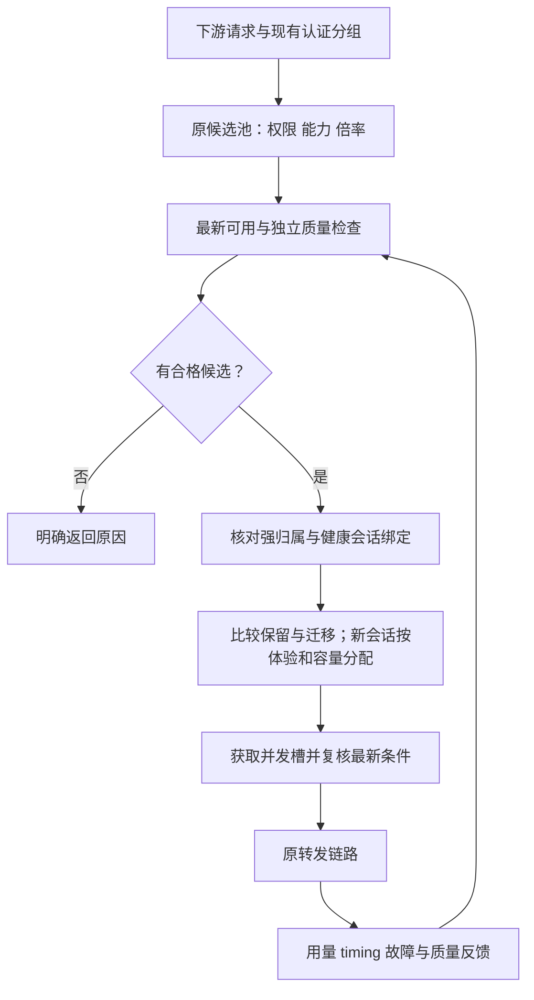

# 多供应商上游自动调度设计

| 属性 | 内容 |
| --- | --- |
| 状态 | 用户已授权规划后本地实施；本轮子任务见13.2，未完成部分仍是提案 |
| 更新日期 | 2026-11-13 |
| 项目 | sub2api |
| 本轮核对基线 | sub2api `8396a7d46`；avoding-newapi `3c85af256`；源码核对不等于生产能力 |
| 状态入口 | [STATE.md](STATE.md) |
| 已确认决策 | [DECISIONS.md](DECISIONS.md) |

本文是本主题唯一设计与任务定义。当前进度和下一项工作只在 STATE.md 维护。
既有实施和生产结果保留原验收边界。用户已追加授权规划任务后推进本地实施；本轮不改生产配置、不发布、不运行CI，整个功能保持单分支/单PR交付范围。
本轮扩展按一个完整 PR 设计；以下新参数与自动供应池行为均为提案，不代表现有程序已经支持或已获上线授权。

## 1. 目标与验收方向

在多个供应商、固定上游分组和 API Key 之间自动择优，让下游以固定售价规则获得质量合格、稳定、高效、缓存友好的服务。
后台替代人工频繁切换，保持已有会话连续性，并控制本地改动，便于跟进原 sub2api 仓库更新。

需要同时满足：

- 只选择当前下游产品允许倍率范围内的线路；没有合格线路时明确返回。
- 根据最新有效可用状态准入，质量状态独立判断和恢复。
- 同时评价首字、TTFT、持续输出、完成情况、负载与缓存，减少单指标误判。
- 已有健康会话保持稳定；必要切换计入冷缓存和重新预填充的损失。
- 复用原有调度、质量、计费、配置与快照机制，保留可核对的选路原因。

有限检测只能证明所测范围符合要求，不能证明模型身份或永久能力。

## 2. 范围与约束

### 2.1 已确认范围

| 主题 | 约束 |
| --- | --- |
| 下游产品 | 固定销售价格规则，档位数值可配置，讨论中的数字仅为示例 |
| 上游范围 | 使用实际绑定供应商分组的倍率和既有倍率控制，严格限制范围 |
| 无合格候选 | 明确暂不可用，不自动越倍率兜底或更改下游售价 |
| 最新监测 | 最近有效可用状态控制准入，历史可用率不替代该状态 |
| 质量 | 独立隔离与复测，低价和高缓存不能抵消质量失败 |
| 缓存 | 考虑同组账号切换损失，保护健康已有会话 |
| 上游更新 | 指跟进原 sub2api 仓库代码，优先配置和局部扩展 |

### 2.2 本期排除项

真实采购价格卡、实付对账、汇率税费、现金毛利保证及货币级缓存优化整体延期，不作为本期依赖。
本期使用 token、命中概率和时间评估缓存损失，不提前建设未来功能的空表或接口。
动态下游售价、外置转发网关和第二套长期并行调度器不进入本期设计。

### 2.3 本轮目标：程序管理供应池，产品价格保持固定

用户提供采购倍率区间、下游固定售价、主力模型/能力和场景目标，程序负责发现变化、取得证据、计算资格、隔离/恢复及解释。
“更高倍率”在本文解释为下游销售档位相对采购档位留有倍率空间，不表示优先采购更贵的线路，也不构成现金利润保证。
约 100 个上游分组/Key 是库存规模示例；不假定它们都是独立供应商、独立额度或独立缓存域。

- 采购分类使用可确定请求归属的**有效上游分组倍率**，并单列缓存能力、命中和可观测性；不恢复真实采购价计算。
- 下游产品是稳定合同；自动变化的是产品的合格候选和容量，不是客户价格、权限或已有会话身份。
- 新增完整闭环由一个 PR 交付，包含后端、迁移、前端、测试、文档和回滚；内部可分提交、影子运行和灰度步骤，不拆成功能残缺的多个 PR。
- 自动只在管理员批准的供应商、模型、采购范围和受管产品内操作。人工停用和已知归属限制不能被自动恢复覆盖。
- “全自动”指设置边界后的持续自治；供应商没有提供的事实保持未知，程序不得猜造价格、模型真实性或缓存共享关系。

## 3. 项目现状与复用边界

以下依据源码基线核对，不代表生产已开启全部能力。

| 现有能力 | 复用方式 | 需要补齐或核对 |
| --- | --- | --- |
| Account 多分组、模型范围、Group 优先账号 | 建立批准的静态候选范围 | 不因动态评分反复改分组关系 |
| 利润倍率门及抢槽后终检 | 复用倍率范围检查入口 | 手工使用 Account.RateMultiplier；自动同步还核对有效快照和实时高峰，不能混用 cost_multiplier |
| 上游倍率探测与同步 | 延续原协议、开关和快照 | 多分组及部分供应商不自动写回，需确认来源 |
| 质量隔离、复测和自动恢复 | 复用规则、历史与限制归属 | API Key 可用状态联动需补齐，OAuth 专用探针不能套用 |
| 原优先级、黏性、负载与并发 | 在原路径局部扩展 | 缓存迁移判断及共享配额需验证 |
| 请求 timing | 复用首字节、语义与可见文本事件 | 不等于已有逐线路完整聚合 |
| 原计费与 fast 行为 | 保持原计费链 | 核对账号附加倍率，避免换路改变客户单位售价 |
| 调度快照与 outbox | 复用状态传播 | 旧结果、失效快照及多实例一致性需回归 |

截图中的分组趋势和分组糖果检测只能辅助观察；分组检测由调度器选择账号，不能直接作为每个账号的隔离依据。
原倍率门存在分组读取失败后放行的缺口；D4.2 在既有门中表达配置不可用并拒绝准入，不新增平行调度器。
完整严格范围仍需核对配置新鲜度、线路倍率来源和固定售价，不能由局部修复代替。

### 3.1 原D1核对与当前实现边界

| 需求 | 已存在的配置/源码 | 当前边界（完整进度见STATE） |
| --- | --- | --- |
| 倍率范围 | Group 的 profit_control_enabled、profit_min_margin、profit_safety_buffer；GroupsView 已有表单 | 已实现部分复用原门；本轮拟增加受管采购区间与产品允许区间，并在同一门内取交集，不保留第二套倍率判断 |
| 固定供应商组 | 现有 Account/Key、分组关联和模型范围 | 优先一个确定上游组对应一个 Account；不自动修改供应商 Key 全局分组 |
| 质量隔离恢复 | QualityPolicy 的 isolate_models/remove_models、auto_restore 和原复测上下文 | 复用，质量时间到期不放行；API Key 不采用 OAuth 状态探针 |
| 性能排序 | priority_scheduling_v1 复用账号性能均值（TPS/首字）、质量与错误指标；保留分组、模型及线路证据边界 | 采用上游统一性能页面与公式，不保留第二套分位数评分；历史分位数仅诊断，不把评分当可用状态 |
| 黏性保护 | 高级调度的 sticky weighted 开关会将 response/session 绑定纳入打分 | 首期保持健康会话硬黏性，新的缓存软迁移策略后续在同入口补齐 |
| 共享并发 | 账号槽位与独立Key共享额度已分开，接线见4.4 | 多账号/协议/节点共享已有本地证据；供应商unknown提交关联等外部契约仍待，不把额度身份当缓存域 |
| 最新可用联动 | 分组监测不绑定账号；已有定向availability、版本/期限及文本发送准入 | D3保留未覆盖能力/生产场景，不从分组曲线推定每条线路健康 |
| 倍率终检 | 有倍率门才进入 profitControlVetoLatest；缓存失败可回源数据库 | 缓存及数据库都失败不能使用旧选号对象放行；独立修复任务 D4.1 |
| 前端与更新兼容 | 已有分组、优先级、质量和监测页面；主链支持选择结果携带门 | 局部修改既有入口与表单，不重写核心计费、不新增平行调度器 |

配置例值只用于表达，不写入生产：下游倍率 D=0.15、margin=0.20、buffer=0，可表达 U<=0.12。
这不证明跨供应商真实成本等价；无法确定上游组或倍率来源的线路先留在检测/人工确认范围。
默认不新增采购价格、账单、共享密钥复制或全局供应商切组能力。

### 3.2 avoding-newapi 源码对照与吸收清单

参考仓为 `H:/Root/jiaoben/zhongzhuang/avoding/avoding-newapi`，本轮只读；其本地功能不等于已在本项目或生产验收。
以下是算法、证据契约和交互方式的吸收，不整体搬迁其 Gin/GORM、React 页面、调度器或账务系统。

| 参考实现 | 拟吸收内容 | 落入本项目的入口 / 边界 |
| --- | --- | --- |
| `service/ops_probe_model_quality_analysis.go`、`model/ops_probe_model_quality.go` | 可用、协议、计费一致性、能力、事实、真实性、输出纯净、漂移、安全完整性分维度记录；结论、置信证据、原因和基线并存 | 扩展既有质量结果与规则；硬失败不被总分抵消。计费一致性本期只检验声明/usage结构，不核算实付 |
| `service/ops_probe_measurement_contract.go` | MeasurementHash、PolicyHash、ConfigRevision 分离 | 测量变更须重测；仅改阈值可复评仍有效的原始测量，但要刷新策略决定与终检版本 |
| `service/ops_probe_model_quality_baseline.go` | 可信参考、自身历史、群体参考区别；最低样本与独立轮次 | 复用 quality judge/样本链；自身历史只证明漂移，群体相似只作辅助，不让同源渠道互相自证 |
| `service/ops_probe_model_quality_number_fingerprint.go` | ModelTrace 数值指纹作为身份/漂移辅助信号 | 可选检测题型；不把指纹相似称为官方身份实证。实际移植前核查 MIT 与署名义务 |
| `service/upstream_observation.go`、`upstream_observation_record.go` | 请求/Token命中率、可观测覆盖率、原始usage来源、缺失与非法计数分开 | 扩展原 requesttiming/usage 及聚合；不搬官方价格卡、实付对账和真实采购倍率 |
| `service/upstream_observation_responses.go` | 逻辑请求与物理 attempt 分开；WS每轮独立关联 | 沿本项目 trace/attempt/WS turn 身份；可选可信peer观测，默认不向任意上游发送内部metadata |
| `service/ops_probe_model_quality_runner.go` | 全部目标公平轮转、全局/站点预算、参考线路独立 | 扩展原计划领取/租约/失败触发；不新增平行runner，避免仅检查列表前N个 |

不照搬参考仓“候选耗尽后试冷却线路”或跨组自动重试：本项目采购边界、最新状态、质量、共享额度和强归属必须始终生效。
参考仓 Redis/内存缓存、route affinity 与模型 prompt cache 是不同层次，不能互相证明命中。

## 4. 对象与数据归属

| 对象 | 含义与约束 |
| --- | --- |
| 供应商 | 钱包、主体、服务故障域和共享限制 |
| 线路 | 本项目能确定选中的上游分组、端点、凭据与协议组合，首期尽量对应现有 Account |
| 凭据 | 复用现有 Key 安全存储；同 Key 多线路共享额度，不重复放大并发 |
| 下游产品 | 现有 Group，包含固定售价、模型/fast 能力、倍率边界与调度策略 |
| 缓存域 | 具有缓存共享证据的范围；未知共享关系按跨域处理 |
| 请求归属 | 复用 session hash、response ID 和工具任务拥有者 |

供应商没有可靠的固定组选择能力时，其内部多个组只能作为一个不透明线路观察。
优先独立 Key 或既有可靠请求级选择，避免修改 Key 全局默认分组影响在途请求。
现有 AccountOpsGroup 是站点/上游用户维度的运维归组，不是 Key 级共享额度或缓存域证据；
不能直接复用其 ID 作为限额键，也不能仅因两个 Account 同组就认为缓存共享。

### 4.1 New API 固定分组证据（D2.2）

库存掩码仅用于定位候选，不证明完整 Key 归属。唯一掩码候选和人工选择候选都须经原 Key 揭示接口完整比对；库存已返回精确完整 Key 时不额外揭示。空值、仍为掩码、接口失败或完整值不符均拒绝保存/有效探测；多个候选仍须人工选择，不自动猜选。
授权预览与持久快照共用固定分组倍率规则。归属核验和分组适用性独立：归属通过可保存绑定，不合格分组不显示有效倍率但保留已核验钱包；归属或请求失败清除倍率数据、成功时间、有效期及钱包有效状态，恢复成功后重建，不回显密钥。
绑定 Key 的声明分组必须非空、非 auto、长度不超过 128 字节，且其倍率为有限数、位于原展示值域 [0, 1000000]。
未提供 route_groups 的旧库存沿用声明分组；提供单个路由时必须与声明分组精确相同。
异组、空路由、多路由（包括重复项）或 cross_group_retry 均不足以证明固定分组，不取其他组倍率替代。
探测写回时以当前结果替换旧快照：不合格时状态为 unsupported/unsupported_group，不保留旧倍率与有效期；余额仍独立展示。
恢复同组且证据合法后恢复 OK。分组声明始终是 group 范围证据，不自动成为 token 同步依据，不改写 Account.RateMultiplier 或上游 Key 配置。
此项只核查 New API 库存返回的固定分组证据，不证明该供应商支持请求级强制选组或跨账号缓存共享。Sub2API 的显式请求选组见 4.6，共享 Key 限额见 4.4；D2 仍须完成其余验收。

### 4.2 协议线路身份与旧证据失效（D2.3）

探测身份除平台、账号类型、代理、Key、base_url 和请求头覆写外，也包括 api_base_urls、api_protocol、account_mode、protocol_rules；这些字段可改变协议或实际端点。protocol_rules 的替换、清空和显式空列表都按身份变化处理；单账号保存相同规则保留证据，批量显式提交沿用保守清除规则。
单账号身份比较、批量编辑的清除意图、CRS 合并和 New API 绑定指纹使用同一字段清单，防止一条编辑/同步路径保留另一线路的证据。
身份变化时清除受管探测快照，保留用户的探测/同步开关；自动同步账号没有新有效证据时由既有倍率门拒绝准入。
单账号保存相同身份值不主动清除；批量编辑无法逐行比较旧值，显式提交这些字段（包括 null）时沿用保守清除策略。
CRS 仍拒绝导入远端受管快照。数据库原全凭据 CAS、事务/outbox 和更保守的凭据变更清除保持，不以服务层身份判断缩小持久化边界。
已存在上述协议字段的 New API 账号，其旧指纹在代码升级后失效，需要通过现有配置入口重新核验绑定；没有这些字段的账号指纹保持。
运行时 `AccountRouteFingerprint` 另纳入已启用的 Basispoints 托管代理池实际来源：默认/无效值归一为 Mihomo，显式 IP 池为另一线路；代理关闭时忽略池设置。升级后已启用托管代理的旧线路指纹和可用性证据须重新核验，不表示具体池内出口永不变化。
此项不证明多个协议端点具有相同计价/分组/缓存域，也不实现请求级强制选组或共享 Key 限额。

### 4.3 自适应账号探测与授权目标（D2.4）

自适应多协议账号的账号级计费观察使用实际 Chat Completions 基址，与 GetOpenAIBaseURL 的协议地址优先级一致，包含按模型分流的供应商。
原生计费探测和 New API 管理站点解析共用 upstreamBillingProbeBaseURL；NewAPIAccountSite 保留原站点规范化规则和租户路径。
授权验证、同站点账号列表、绑定探测及数据库保存时的站点校验共用该解析，禁止原始 base_url 把授权或证据归到旧主机。
api_base_urls 单独提供地址时不再错误要求旧 base_url；非自适应账号、原官方域跳过策略和 OpenAI 默认探测语义保持。
旧绑定站点与实际生效站点不一致时需要重新核验；不迁移授权密文到另一主机，不自动修改上游 Key 或下游售价。
此项只纠正账号级观察目标，不将 Chat Completions 的证据扩展为所有协议/模型的计价证明；跨协议准入归属仍需后续验收。

### 4.4 共享 Key 并发规则与接线边界

用户已确认：同一上游 API Key 单独配置一个共享总上限，各 Account 原并发限制同时保留。
总上限不是账号并发的最小值、最大值或总和，不按下游产品分组重复计算。
共享策略应由 Key 维度的单一配置表达，不能复制到各账号的 extra 后由各请求自行决定上限。
账号引用同一策略时，跨账号、下游分组及实例合计占用该额度；本地 HTTP/SSE、HTTP→原生 Responses WS 及直接 Responses WS 的 ctx_pool/passthrough/HTTP 桥接使用以下统一配置，区域 HTTP/WS 共享额度已接通，Live 显式持久交接见 4.4.2；前端管理、混合版本与生产升级保持各自验收。

首期配置位于 `gateway.upstream_key_concurrency`，普通 API Key 以最终出站凭据去空白后 SHA256 的小写摘要定位，`limits` 保存共享上限，`revision` 保存递增策略版本。AWS SigV4 请求按签名头中的实际 access-key ID 使用独立域：`SHA256(UTF-8("\x00aws4-access-key-id\x00" + trim(access_key_id)))`；例如 PowerShell 可用 `[Convert]::ToHexString([Security.Cryptography.SHA256]::HashData([Text.Encoding]::UTF8.GetBytes("`0aws4-access-key-id`0$($env:AWS_ACCESS_KEY_ID.Trim())"))).ToLowerInvariant()` 计算配置值，不读取或输出私钥。不同临时 access-key ID 不推定为同一角色或额度，改变 ID 须另配规则；签名/日期/区域/同 ID 的密钥和会话令牌变化不改变该身份。
标准 HTTP Basic 使用独立域 `SHA256("\x00http-basic\x00" + decoded_user + ":" + decoded_password)`：保留解码后凭据的原始字节、空格和密码中的冒号，用户名不能包含冒号；认证头首尾空格按 Go 的实际发送规则去除。仅当请求使用 UTF-8 编码凭据时，可从受保护的环境变量计算配置值：`[Convert]::ToHexString([Security.Cryptography.SHA256]::HashData([Text.Encoding]::UTF8.GetBytes("`0http-basic`0$($env:UPSTREAM_BASIC_USER):$($env:UPSTREAM_BASIC_PASSWORD)"))).ToLowerInvariant()`；其他编码须使用实际发出的字节。摘要并非加密，低强度密码仍可能被猜测，配置和 Redis 须限制读取权限。Basic 与 Bearer、不同用户名/密码不推定为同一真实上游身份；即使分别限额，也不证明它们合计受同一供应商总上限保护。识别不会自动创建规则，启用新规则前须升级所有相关实例、排空旧请求并按原协议递增 revision。
不保存第二份明文 Key，不把账号、下游分组、供应商倍率、端点或协议加入额度键；同一凭据通过多个账号/协议入口发送仍共用额度。摘要只用于限额，不证明跨协议计价或缓存共享。
复用现有 HTTPUpstream 的 Do/DoWithTLS，按实际请求的 Bearer/Token、Basic、X-Api-Key、Api-Key、X-Goog-Api-Key 与 key/api_key 查询凭据取槽；请求头逐个不区分大小写地扫描原始键，包括为保留 wire 大小写而直接写入的键，多种大小写和重复凭据只计一次，不修改出站头。HTTP/原生WS共用的公共取槽入口也按首次出现的摘要去重，保持调用方握手证据切片不变；一个活跃请求对同一Key只持一个成员。后续凭据满额时回收本次先前取得的成员，保留其他请求，容量释放后允许恢复。
启用共享或区域策略时，非空 `Authorization` 必须能按上述明确格式识别；未知方案、无法解码的 Basic、无法识别的 SigV4 Credential 范围、缺失令牌或含内部空白而存在歧义的 Bearer/Token，生成不可配置、不可持久化的未验证标记。即使同一请求还有已知 Key，HTTP、原生 WS、语音与巡检也在实际发送前拒绝该标记；WS、语音和巡检在委托额度权威前预检，HTTP共享权威在普通抢槽前拒绝，区域视频查询仍可先读取原有SQL归属。原有 Agent 断言未验证分支复用同一标记，不新增第二种额度身份；SigV4 仍仅识别 access-key ID，不验证签名。策略完全关闭时原始头与既有发送行为不变。无法从 `Authorization` 之外的任意自定义头、Cookie 或独立代理推断身份，仍是本任务的剩余边界，不把它们默认为已受限或声称全覆盖。

账号/用户原槽位保持；HTTP 共享 Key 维度在真正出站前抢槽，满额不发送网络请求，沿原有受限重选返回 503，不记录为供应商/代理健康故障。
HTTP/SSE 槽位持有至响应体 EOF/错误/Close；请求取消主动关闭响应体并回收本次成员，多凭据部分失败回收已取成员，重复 Close 不重复释放。
独立 Redis `concurrency:upstream_key:*` namespace 使用服务器时间、30 秒租约、5 秒续租；本地 19 秒所有权看门狗在租约被别人复用前取消请求，续租仅更新现存成员，禁止恢复已删除成员。
Lua 原子校验策略版本和完整 limits 摘要；同版本不同配置、旧版本、Redis 不可用明确拒绝。降低上限保留原槽位，已有流完成，新申请按新上限判断；同版本配置必须在所有服务实例一致。
首次启用、删除规则或关闭功能前须停止接流并排空旧流量，因为此前无限制请求未持共享租约；变更版本必须递增，回滚配置也使用新版本，不清空 Redis 规避版本栅栏。
当前配置由进程启动加载，不承诺在线热更新；revision=0 且空 limits 为旧行为，revision>0 且空 limits 可发布有版本的规则移除。
HTTP→原生 Responses WS 在原转发函数内调用 HTTPUpstream 的可选共享额度端口，复用同一共享策略、额度权威、续持及释放逻辑；非区域使用 Redis，区域使用下述 SQL 权威。池连接保存 HeadersFactory 完成后的实际握手凭据摘要，后续复用也据此取槽；不根据旧账号对象猜测已建连接的凭据。HTTP 与 WS 共用同一个凭据提取函数，不保存新的明文 Key。
原生 WS 在发送本轮 response.create（含本轮预热）前取槽，正常终态后释放；空闲连接不持槽，健康连接可复用。满额/策略冲突保持本地 503，不发送生成帧，不记为供应商健康故障。限额约束活跃生成请求，握手连接数不在该维度内：可能已完成握手后才被本地准入拒绝。已受限轮次取消或丢失租约时关闭该上游连接、等待关闭回调后释放精确成员；租约丢失保留原错误，不转 HTTP 重放。未命中限额的凭据保持原连接/取消行为。
本地额度/策略拒绝通过既有 UpstreamFailoverError 的独立 reason 标记来源，有界重选保持；公共调度反馈、API Key 健康熔断和物理请求错误率均排除该类错误，原错误及包装后的错误使用同一判定。既不增加失败样本，也不写成功/恢复样本或改变已有 TTFT；真正的供应商 503 和网络失败继续沿原归因处理。Grok 独立 web_search/x_search 在候选耗尽后保留本地 503 与准入错误体，不将其改成供应商 502。该分类只覆盖发送前的额度/策略拒绝，不把发送后的租约失效当作可安全重放的新拒绝。
直接 Responses WS ingress 保留账号选择的 ctx_pool/passthrough 原生协议；配置共享 Key 不再强制转 HTTP/SSE bridge。两种原生模式按实际握手凭据逐轮取槽，正常终态释放、空闲不占槽并保留健康连接；原显式 HTTP 桥接、平台规则及账号关闭 WS 规则保持。智能协议 disabled/ws/auto/shadow 的原生路径均执行共享限额，账号原每轮准入与完成回调保持。共享额度等待结束后，在物理发送前再次读取权威账号并检查握手绑定；期间 Key 变更时拒绝且不发送生成帧。
Astra 路由包装器透传同一 HTTP 底层的普通 Key 额度、持久额度和 HTTP 准入端口：WS、Live、批量和普通 HTTP 共用原权威，不重复抢槽；底层缺少相应能力时明确返回策略不可用。未启用共享策略的原请求与 Live 保持原行为。配置区域额度或区域调度时，即使进程内静态 Key 策略为空，原生 WS 也必须经过区域权威；策略缺失、版本不一致或权威不可用时不发送业务帧。

原生与桥接各轮的共享额度/策略失败保持本地 503 准入错误，不包装成供应商 502；发送后的租约失效保留原错误且不重放。透传模式配置共享额度时，relay、取消及退出共用上游立即关闭接口，避免普通关闭握手抢占关闭状态而延迟回收；relay 双向退出并关闭上游后先归还额度，再通知下游关闭，防止下游关闭握手占用已结束的生成容量。Live 的 SDP 创建使用显式持久额度交接，缺少交接端口的受限请求仍拒绝；区域 SQL 权威和受信任策略快照已接通。AWS SigV4 的 access-key ID 已进入同一权威（不校验签名或推断角色）；其他自定义签名/非标准鉴权、绕过 HTTPUpstream 的出站及跨请求后台任务仍未完整覆盖，D2 父验收保持未完成。

请求须同时满足账号额度与 Key 总额度；只占一维或结果不明确时，按本次精确成员清理，不能清空账号/Key 下其他请求。
等待重试、取消、抢槽终检、WebSocket 每轮和 Live 交接都必须保持同一共享归属，长请求须维持有效所有权。
共享额度使用独立上游凭据命名空间，不能复用表示下游用户 Key 的 concurrency:api_key，也不能把哈希塞入 accountID。
区域运行沿既有受信任后台控制通道与额度权威接线；缺少受控共享额度能力时明确拒绝，不回源主库或静默退化成账号额度。
后台控制通道的槽位签发/续期按同一 SQL 权威的 `clock_timestamp()` 检查剩余有效期上限，不与控制进程的墙钟混算；时钟读取失败拒绝，额度、区域、证书、原始签发及到期约束保持，长任务续期不按首次签发时间累计限长。
V1 渠道监控的主动模型探测保留原 SSRF 安全 HTTP 客户端，在最终请求头形成后、实际发送前通过同一个 HTTP Key 准入端口取槽，持有至响应体结束；业务请求与探测互相占用同一额度。自定义头按大小写无关规则稳定覆盖默认头，以实际最终认证提取凭据；共享或区域策略启用时不跟随重定向。缺少权威、满额、策略不可用或发送后租约丢失均标记为本地 `skipped`，不写供应商探测历史、不刷新无观测轮次的 last_checked_at，管理端明确显示跳过原因；同一轮其他模型的真实观测仍正常保存。恢复额度后正常探测。原配额查询与无凭据 HEAD 不占生成槽；未知自定义鉴权格式仍不构成可验证的共享Key身份，不因此宣称全覆盖。

内容审核 OpenAI 和 TypeSafe 的同步、异步及管理测试共用原审核客户端和代理；共享/区域策略启用时仅为本次调用复制客户端，在最终认证形成后的 Transport 层通过同一 Key 权威取槽，持有至响应体结束，并禁止重定向，原共享客户端与连接池不被改写。缺权威、满额或租约丢失不更新审核供应商 Key 健康和调用成功/失败样本；已发送请求的租约丢失不自动重放，发送前满额可沿原重试轮换其他 Key。管理测试返回本地 503；实际审核保留既有失败时放行和审核错误记录语义，不将本地满额伪装成供应商故障。关闭共享策略时保留原客户端和重定向行为；本项不改变审核策略本身，也不覆盖其他独立出站或混合版本。

Web Search 模拟的 Brave 和 Tavily 独立客户端在实际发送前将所选配置 Key 的精确值映射至同一个共享 Key 权威：Brave 请求头与 Tavily JSON 中的相同 Key 跨供应商、管理测试和普通 HTTP 共用上限，不以请求主体猜测任意 Key；有空白/控制字符的歧义凭据在受限模式下拒绝。额度持有至完整读取并关闭响应体，启用时使用客户端副本禁止重定向，不污染共享连接池；配置重新加载也重新接线。容量不足时不拨号、回滚预留的搜索配额，尝试其他搜索供应商，但不为了搜索全局 Key 切换大模型账号；缺少权威或额度时归类本地 503，不记供应商故障。请求取消与超限时的搜索配额回滚复用5秒上限的独立清理上下文，不因下游取消而滞留计数；Redis清理失败仍记录错误。发送后租约丢失立即取消，不自动重放其他搜索供应商，已预留搜索配额保留；供应商是否实际扣费不据本地取消推断。关闭共享策略保留原客户端行为；旧实例混用、其他未知自定义认证和其他独立出站仍不在此项证明范围内。

Grok 实时语音及流式 TTS 在构造最终握手凭据后、建立连接前取得同一共享 Key 额度，并持有至上游连接关闭；握手超时不提前结束已建立会话。受限连接禁止重定向，正常结束先立即关闭连接再释放额度，租约丢失时立即断连且不重放；管理员实时语音探测和原握手探测复用同一入口。发送前本地拒绝按原账号切换边界返回 503，不登记供应商故障，也不突破既有未知 403 的备用线路预算；随后出现的真实上游错误仍按真实错误分类。租约丢失后的已观察音频时长或已送达 TTS 字数沿原计费路径记录，未产生用量不计费；本地标准计费仓储夹具仅验证命令，不证明生产扣费。关闭连接不证明远端供应商已终结任务，异步视频等跨请求工作仍另行验收。

普通 OpenAI OAuth 的 Codex 用量快照主动模型探测也在最终认证头形成后复用同一准入端口，保留原代理、超时和响应头解析，响应体关闭、请求取消或出错时释放额度。共享/区域策略启用时缺少权威则不发出请求，也不跟随重定向；满额、策略失败及租约丢失不写快照或解除供应商冷却，按账号短暂等待 5 秒再尝试，即使手动强制刷新也遵守这段本地退避。条件替换保证旧失败不会覆盖并发的新探测预约；正常探测仍使用原 10 分钟节流，成功及携带用量头的 429 沿原语义处理。Bearer 凭据按最终摘要执行共享上限；Agent Identity 则在最终断言形成后用账号对应的 Ed25519 公钥验证 `runtime_id:task_id:timestamp` 签名，并以 `SHA256(UTF-8("\x00openai-agent-ed25519\x00" + public_key))` 进入同一 Key 权威，任务、运行时 ID 和签名时间变化不改变同一公钥的额度身份，公钥轮换形成新身份，不猜测不同运行时是否同一密钥。公钥只在请求 context 内使用，不写入请求头、Redis 或日志；断言缺失、篡改、重复字段或无法验证时使用不可配置的本地未验证标记，启用共享/区域策略即拒绝发送。插件拥有独立物理出站且无法回传最终签名证明时，在共享策略下失败关闭；未启用策略保持原插件行为。BPS/影子账号的 `/wham/usage` 与 reset provider-client 每次使用 req 客户端副本，在最终 Transport 层复用同一准入、响应体租约和禁重定向边界；本地额度拒绝沿既有 5 秒退避，不污染缓存客户端的其他调用；OAuth Codex models manifest 的直连客户端也复用该边界，其他非标准鉴权和跨请求后台出站仍按 D2 剩余范围验收。

OAuth Codex models manifest 的独立客户端属于未观测能力：当账号配置 availability 时，在 plugin/client 实际发送前复用同一权威读取；普通 HTTP 文本通过不能授权 GET manifest，因此规则存在且无对应 scope 时本地拒绝，不触达 ChatGPT backend、代理或插件。未配置规则保持 manifest 缓存、ETag、Agent Identity 任务恢复和 API Key 自定义上游行为；本边界不把模型列表管理请求当作业务质量探测。

Codex 780 harvest 的公网 Edge IP HTTP 和 WebSocket 探测即使使用独立 pinned client，也必须在拨号前复用同一共享 Key 准入。容量/策略拒绝不访问代理或 Edge，不包装成 harvest 网络故障；正常探测仍保留原 Host、SNI、CONNECT、TLS 和响应生命周期。没有可用权威时受限配置失败关闭，避免自定义 Edge 出站绕过额度。

Prism Browser 作为独立适配器出站，在共享/区域 Key 策略启用时因无法证明最终供应商凭据而在适配器发送前返回本地准入错误；关闭共享策略时保留原适配器流程。本地拒绝不预先写响应，允许现有调度器在安全边界内切线；线路耗尽才统一返回本地 503，已开始的 Responses 流仅输出一次 `response.failed`，不伪装成供应商 502。该门同时覆盖普通转发、流式已开始错误处理和管理员连接预览，且在调用本地 adapter 前执行；Prism 不占用共享 Key 槽位，也不把 adapter 的独立凭据猜测为账号 Key。

Grok 媒体生成、视频状态和视频内容下载属于独立能力，尚无与文本 availability 结果相匹配的 wire scope。配置 availability 规则时，三条物理发送路径均在 `HTTPUpstream.Do` 前复用同一权威读取并保守拒绝；生成请求可在未发送前切换其他账号，已绑定的视频查询不跨账号，耗尽后返回本地 503，且不记录为供应商故障。无规则仍保持原媒体流程；该终检不替代后续媒体专属探测或区域任务归属验收。

Seedance Ark 和 MiniMax-H3 也属于独立视频能力，配置 availability 时在各自最终 `HTTPUpstream.Do` 前保守拒绝；不得把 OpenAI 文本、Grok 媒体或其他模型的通过结果借作能力证明。无规则保持原任务创建、状态和内容查询流程；本终检只覆盖本地发送边界，不证明供应商任务完成或跨区域归属。

凭证守护 V1 探活把实际发送的账号 access token 及可识别自定义认证头摘要送入原共享 Key 权威，在响应关闭前持有额度；启用策略时禁止跳转。容量不足、权威缺失或租约失效记本地临时异常，不触发认证失败或自动重登。启用策略前须升级相关实例并排空旧探活；第三方探活服务内部如何转发及是否立即终止不在本地证明范围，重登接口不属于此探活额度交接。

额度身份与缓存域证据分开：同 Key、同站点或同 AccountOpsGroup 均不自动证明缓存共享。

批量生图的远端生成在提交响应之后继续运行，使用4.4.4的持久额度交接。Gemini与Vertex的原HTTP客户端在逐次物理发送处复用同一额度权威；配置了共享/区域策略却缺少完整交接能力或使用未知提供方时，仍在创建任务和冻结余额前返回 `BATCH_IMAGE_SHARED_KEY_UNAVAILABLE`/503。满额、策略/所有权故障也沿该本地503返回，不记为供应商5xx或结果解析失败；无共享策略时保留原行为。

Grok视频创建/编辑/扩展、Seedance与MiniMax-H3提交后可能继续在供应商排队或运行，普通HTTP响应体结束不代表任务结束。启用共享Key策略时，最终HTTP凭据准入为受限创建生成 `video:<uuid>`：先在额度的同一 Redis 或区域主/从节点 SQL 权威登记 provisional member，再以记录存在且未设栅栏为条件取得受限Key额度，最后发送 POST；未识别凭据、满额、策略读取失败或缺少同源任务记录能力均在发送前本地拒绝，不记供应商健康故障。收到合法 task ID 后原子绑定按用户、下游Key、组、供应商及任务ID计算的 v2 索引，并保存账号和线路指纹；同主体不同线路返回相同任务ID时拒绝覆盖。任务持有人可复用该持久成员查询，即使Key已满额；最终发送前仍核对账号、方法、URL和凭据。状态、内容或取消观察到实际终态后才释放，释放前校验成员和任务记录并设置栅栏，失败保留记录供重试；Grok内容和Seedance取消不凭请求类型猜测终态。管理员视频预览缺少持久归属时拒绝受限Key发送。

视频任务响应的身份和终态由同一解析器验证，创建确认、状态/取消及Grok内容下载前置状态读取仅接受完整JSON对象；未知业务字段原样保留。协议已识别的任务ID别名和顶层status禁止重复、转义后重复或大小写变体，ID只接受非空字符串，多别名同时出现必须一致。查询响应可以不回显任务ID，但明确回显的ID须与已认证请求目标一致；请求目标、凭据及持久成员仍受原最终发送校验保护。损坏JSON、类型错误、冲突别名或其他任务的结果在转发/内容抓取/计费和终态释放前报错，不设置释放栅栏、不重放创建；创建确认不可信则沿原unknown交接保留额度。Seedance空取消应答仍只表示受理，不证明终态；正常终态复测后沿原精确释放恢复。Grok计费和下载也复用该身份检查，不将未知字段或任意HTTP请求跟踪ID推断为任务ID。

Seedance成功终态按上游完成token计费，不伪造视频张数；但其已认领账单与Grok/MiniMax视频账单共用强制提交语义，worker队列满时同步执行，不因普通文本日志drop策略丢失。账单执行失败时使用独立限时上下文尝试释放一次性认领，避免worker期限已到导致清理立即失败；后续查询按同一任务ID重试，数据库现有幂等键阻止相同账单在提交确认丢失后重复扣费。清理失败、进程在持久暂存前退出、过期快照和重试时价格变化冲突仍须独立恢复或对账，不等同于区域视频资金账本已完成。

Redis 绑定和未知状态写入核对完整租约及主体，并以原子快照比较防止覆盖并发更新；快照变化时有限重试，持续冲突或栅栏拒绝保留原记录及额度。区域主节点使用行锁而非 Redis 快照。

供应商已返回任务 ID、但本地绑定应答异常时，对相同主体、成员和任务 ID 最多重试一次绑定，不重复提交供应商；策略拒绝和租约失效不重试。绑定使用两秒总上下文期限，其他请求及后续错误处理不由此期限约束。重试仍未确认时返回原未确认错误并保留额度；首次绑定实际成功但应答丢失时记录可能已经是 bound，不能推定为 unknown 或释放。

受限创建发生连接中断、5xx、408、响应体读取失败、超限、缺任务ID或重定向时进入未确认路径；通常标记为 `unknown`，标记失败可能仍为 `provisional`，均禁止自动重放或猜测释放。当前只提供给人工/外部 reconciler 的 member 绑定和释放入口：先按 member 对供应商做只读状态核对，再绑定 task ID，或确认不存在后释放，不创建第二个提交。未知提交的自动核实尚未接入；终态释放失败由后台重试。记录保存用户/下游Key/组/账号ID、供应商、线路指纹、lease authority、Key指纹摘要、资源ID、member/task/state/timestamps，不保存认证头或明文 Key；持久槽位和记录不设置自动TTL。明确的 401/402/403/405/422/429 供应商拒绝及本地共享Key准入仍按原有限切线预算处理，同步图片不受不重放规则影响。区域主/从节点 SQL 的任务记录、额度槽位和释放栅栏同源，抢槽与栅栏通过记录行锁串行化，确认终态后的多凭据释放与记录删除在同一事务内完成。从节点复用已通过认证后台通道安装的额度 grant 与有效策略，持久来源为 `regional:local:<region>`；创建、绑定、查询、释放和恢复只访问本地 SQL，不在业务请求中查询主库或调用控制服务。主节点保留该区域已拨出的总额度，因此主从竞争不会分别放大共享上限。缺少完整本地权威、有效策略或可用 grant 时发送前拒绝；管理预览仍须有真实主体，不凭 capability 信号跳过最终准入。

grant 或策略到期只禁止新创建，不删除在途持久成员；已绑定任务在原账号/线路/凭据终检后仍可用其现存成员查询或取消，直到确认终态。相同区域重启可以恢复，其他区域即使共用 SQL 也不得读作自己的任务或释放额度；恢复查询按 authority 过滤。gateway 运行模式仅为明确持有本地 SQL 权威的视频恢复器启动原有循环，Astra 装饰器透传该能力；普通 gateway 不因此启动主节点全局维护，也不回收未设终态栅栏的 unknown。

跨区域任务目录沿用既有区域并发运行时和SQL派生表，原5秒循环获取完整绑定任务快照，业务请求不调用控制服务或回源其他区域SQL。未配置媒体转发时，原mTLS 1.3控制listener继续只覆盖其固定主/从分配；显式配置`VideoForward.Peers`后，使用各peer独立固定pin的媒体客户端同步目录，支持主/区域及区域/区域，单节点1–8个peer。各源并发刷新、独立提交版本下限，失败保留原期限，不发布空证据；一源失败不阻止其他成功源更新。控制`Scope`和grant预算不因此扩大。未配置目录的嵌入夹具保留原本地持久行为；生产配置了通道后，目录启动未就绪、失效或错误不退回sticky猜线路。

目录 schema v1 仅同步租户/下游 Key/组/账号 ID、供应商、线路摘要、任务索引摘要、member 和释放栅栏；不传供应商 task ID、明文 Key、认证头、Key 指纹或可用于占槽的 lease。已有 `AsyncVideoKeyOwner` 沿原端口作为共享契约的类型别名，保留 JSON、校验及全部调用点，不保留第二份 owner 定义。服务端核对报告来源必须是证书分配的区域，每条报告的用户/下游 Key/账号须在该 peer 分配内；下发的主节点视图按相同分配过滤，其他租户不外泄。未知/provisional 无 task key，继续留在原权威保额，不假装其已完成绑定或借目录自动核实。

迁移332追加导出版本、接收快照及本地已完成归属三张派生表：导出在同一 repeatable-read SQL 事务内递增持久版本并捕获完整 bound 记录；接收以 `(consumer authority, source authority)` 隔离保存版本下限及整个快照，同源竞争用行锁串行化。低版本、同版本异内容、回退签发时刻、错来源、缺流、损坏记录、超限或取消均拒绝；完全相同的重试幂等，不刷新到期。完整空列表明确表示该源当前无绑定任务。当前每源最多128条，不静默截断或忽略下一页；超限导出回滚，256KiB控制报文上限仍生效。超出容量需要扩展协议后验收，不以不完整目录继续选路。

每份快照有效期最多30秒，以所属 SQL 时钟签发和读取判定；最多容忍签发时钟领先5秒，但不延长原到期。来源和接收方重启均保留版本下限，后台失败不改旧期限。查询在同一本地只读 repeatable-read 事务核对真实本地成员/已完成归属与对端活跃目录：本地任务且无对端冲突才返回其原账号；已知对端任务和新鲜目录未收录任务保留不同原因，只有显式启用下述转发通道才能询问固定peer。跨权威同主体/任务键冲突、目录过期/缺失始终本地拒绝，不换账号、不重新分配生成槽，不把该错误计成供应商故障。准备好的查询绑定task ID、原方法、URL、Host和最终凭据摘要，在既有最终HTTP准入再次读取归属、目录、栅栏和租约，不拿准备阶段的旧通过继续发送。目录属于有传播窗口的定位证据，不是全局线性一致的互斥锁，准入完成与网络发送仍非原子事务。确认终态的精确本地释放和栅栏恢复不依赖目录新鲜度，目录故障不应让已核实的本地任务占额滞留。

终态释放在同一事务归还原生成额度、写入本权威已完成归属并删除活跃任务记录；凭证写入失败则整笔回滚，保持原栅栏供恢复器重试。已完成凭证只保留member、账号/主体/线路、task key、供本地核对的task ID及期限，不保留Key摘要/slot资源/lease，不进入对端活跃快照。保留时间取原视频绑定的24小时与既有sticky期限的较大值；同主体/供应商task ID在凭证有效时不允许重新绑定到另一提交。原账号的终态状态/内容读取可以继续，不能用旧生成lease重新发送；这些读取仍遵守原普通HTTP Key额度及响应体生命周期，不重新创建生成任务或持久槽。无凭证、错主体、方法/目标被改写或已过期均不凭sticky猜测来源。原5秒循环仅按本authority每轮最多回收256条到期凭证，读取按SQL期限独立拒绝；不释放任何活跃或unknown成员。此凭证不证明已完成任务在其他区域的全局唯一性，也不授权跨区域接管或任意更换账号。

用户已确认采用原节点查询转发：异地节点转发查询，生成任务和额度继续由原节点管理，不迁移持久权威。可选`VideoForward`显式配置独立监听、双用途证书和CA，以及`Peers[]`各自的Authority、HTTPS根地址、对端叶证书SHA256 pin与用户/下游Key/账号范围；Authority、地址、pin各自唯一，禁止本节点身份，TLS1.3双向认证，不复用公开入口或把媒体传输混入额度控制RPC。原单peer顶层字段被替换，不保留并行配置；严格JSON解码拒绝旧字段，升级/回滚须按目标版本配置并统一切换。没有配置保持原本地拒绝。

查询在同一SQL快照核对本地记录及所有配置来源的新鲜目录；活跃任务携带其唯一来源与完整owner证据，只向该固定原节点执行locate并再次精确比较owner，然后执行一次query，既不广播业务查询也不按peer顺序选路。已完成凭证不在活跃目录中：新鲜目录均未收录时，只对已分配当前用户/Key的peer并发执行只读locate，最多8个、共用5秒期限；须全部明确不存在或仅有一个原节点，多个来源或任意超时/错误均拒绝，不将故障当不存在。原节点locate/query均只读本地SQL，不再向其他节点查询。任务来源冲突、fenced、目录缺失或过期始终503，不猜线路、不接管或重占额度。所有配置来源均须新鲜的保守约束意味着某peer离线超过30秒会影响其他任务查询；本项不宣称任意规模的高可用目录或全局线性一致唯一性。

转发只允许Grok状态/内容、Seedance状态/取消及MiniMax-H3状态/内容六项既有操作，原节点重新进入原完整router，验证实际下游Key、用户、选定组和安全客户端IP，再核对owner、账号、线路与最终发送准入。接收节点先执行分组策略，并传递模型、客户端标识及子代理分类供原节点按自身策略重验；策略证据采用明确版本，旧节点或未来版本不兼容时失败关闭，升级须统一切换。安全IP复用鉴权会话快照或项目既有解析器，不把代理地址替代原IP，也不转发原始代理头、Cookie或供应商凭据。下游Key仅在受限mTLS请求内供原认证使用，不持久化或记录。接收节点在用户/Key/账号槽位和计费前完成转发；原节点沿原持久成员查询、确认终态和结算，已转发请求带进程内证明且不再转发，owner变化拒绝，不产生环路或重复生成。请求取消沿上下文传到原节点；内容直接流式复制，保留Range及必要响应头，过滤Cookie和内部权威头。MiniMax内容经原接口验证的302下载地址返回客户端，节点客户端不跟随；其他节点跳转拒绝。连接/归属错误未写响应时返回本地503，已写流不追加第二份错误体，也不重试生成或切换账号。

区域网关同时配置本地鉴权快照与资金门时，全局预览门让已鉴权的六项注册视频查询和具备精确SQL价格合同的视频创建进入后续策略链；接收节点完成策略检查后，查询尝试原节点转发，远端已处理请求短路返回。本地及转发抵达的查询，只有原SQL永久资金记录核对用户、下游Key、组、供应商与任务归属后才进入原媒体handler；创建则在供应商 POST 前完成本地不可变价目核对和 Reserve→Start，收到任务ID后 Bind。无凭证、缺少账本或有效价格授权和其他未支持协议仍拒绝，不调用主节点鉴权或补造预留。接口分类和文本Pod路由均取已注册路由，不从实际任务ID判断元数据/文本入口。普通媒体入口与资金门共用原转发、归属解析及错误处理。任务已有预留时跳过旧余额缓存和新资金就绪检查，保留查询自身并发、账号选择及发送前永久线路终检；暂停新准入不能阻止在途结算或取消。主节点结算仍核对持久请求ID、区域、租约与事件版本，失败保额。普通模式MiniMax-H3继续沿原24小时Redis售价快照与旧库存兼容规则；资金模式统一使用下述永久SQL价目和终态账本，三处旧异步认领已排除。三家创建适配器已接通精确动态合同，SQL策略与价格授权不匹配仍 fail-closed；切换前仍须排空旧任务，这里不引入已延期的真实上游采购价。

Grok的生成/编辑/扩展、MiniMax-H3及Seedance创建适配器复用原请求账本：根据原始模型解析不可变价目，核对映射后的上游模型、分辨率和时长，以实际出站JSON摘要完成Reserve→Start后才发送。资金永久身份与共享Key生成槽位使用同一member；供应商确认任务ID后先绑定资金身份，再绑定共享槽位，相同ID的确认丢失仅重试绑定，不重发创建。明确的401/402/403/405/422/429拒绝及尚未发送的共享Key准入错误，只能退款尚未绑定任务的原预留；退款与并发绑定在原SQL事务串行化，已绑定任务拒绝进入退款路径。5xx、重定向、缺失或歧义任务ID、发送/绑定确认不明继续保留原资金与生成额度，不自动切线重放。资金模式的重复/大小写别名计费字段、批量生成、fast/非默认服务档、流式创建及无JSON成本证明均在预留前拒绝；未知提交仍须供应商核实契约，不能根据本地无任务ID推定未生成。三家创建路由已接通精确动态合同；未获授权的价格版本仍在发送前拒绝，D2父验收继续跟踪其余边界。

区域账本现可为明确全零的**文本**价格合同持久预留零金额：主/区域节点均在事务中读取已安装不可变价格，核对模型、内容版本和输入/输出/缓存各费率全部为零；任何非零、缺失或错模型合同不能伪装成零预留。请求仍经历原权限/预算维度、Reserve→Start→Complete、outbox和幂等验证；未完成请求及未确认outbox即使金额为零也阻止租约关闭。迁移333只放宽三个请求/分配表的金额下限；grant仍须正额，区域运行时仍要求可用grant，文本非单位有效倍率仍未支持。视频免费/非单位销售使用下述独立的不可变视频合同，本项不放行无合同视频，也不证明供应商采购成本为零；多节点须预先安装一致合同，主权威结算继续独立复验。

视频价格基础沿原`Price`增加可选`video`合同，与文本费率互斥；原文本JSON和内容版本不变。合同冻结供应商、计费模型/实际上游模型、分辨率、请求时长、计费方式、基础单价及最简有理数销售倍率；Seedance另要求明确的完成token上限。当前合同精确到一个请求规格，尚不是运行时可选的多档价目表。

| 视频来源 | 报价和预留依据 | 终态计量 |
| --- | --- | --- |
| MiniMax-H3 | 原请求1–15秒，按次或按秒；固定768p | 使用提交规格，不从状态响应或MP4重算时长 |
| Grok | 所选分辨率与原请求时长，按秒 | 与报价规格相同的一次成功任务 |
| Seedance | 输出token单价及显式完成token上限 | 成功终态的实际completion tokens，保留token账单，不伪造视频数量 |

基础价与实扣价用整数/有理数计算，销售倍率作用后才向上取整到原10 nano USD粒度，不先取整基础价再乘倍率。基础费率为零或销售倍率为零均可形成零金额视频预留，但必须安装内容一致的不可变价格；区域grant仍需正额。原`Reserve`核对完整上限；本地`Complete`和主权威按同一合同复算，拒绝变更规格、超上限、混入文本计量及缺失/未知终态。明确失败、取消或过期且无待结算token才记零额终态；没有终态证据继续保留预留。原预算、outbox、请求ID幂等、排空和事务回滚路径继续使用；用量保留基础价、实扣价、视频元数据或Seedance token模式，归属更新不再将所有记录覆写为token/倍率1。

账号预算与下游金额在原SQL账本内独立计量：余额、下游Key、订阅和用户平台额度使用销售实扣上限/实扣；账号总、日、周额度使用原`Price.video`基础价上限/终态基础费用。这是现有标准价目的账号预算口径，不是真实采购价格。两条金额各自按精确有理数向上取整；免费销售仍占账号预算，加价不放大账号预算。Seedance按最大完成token预留基础费用，终态只消耗实际基础费用；明确失败/取消/过期同时归零，未知提交继续保留两条预留。退款、原节点恢复、并发结算和重复确认沿原事务及幂等身份，不建立第二套账本。

区域授权增加独立`account_granted_nano_usd`，目标配置使用`account_amount`；省略/零值只表示沿用原正额grant的数值上限，不按销售倍率折算。下游与账号grant均受原mTLS `MaximumGrant`限制，主节点为账号grant预占基础预算，区域按基础费用原子扣减本地`account_reserved/account_spent`；后台对账再由主节点用已安装价目独立复算。任一额度耗尽停止新建，账号额度先耗尽也进入原drain流程；未完成请求/outbox仍阻止关闭，两种预算都不能靠到期自动归还。重启重放保留原grant的两条金额，改配置不重定价已排队授权。

迁移335在同一事务锁定原资金表并拒绝任何未关闭grant、未完成请求、held分配或未确认outbox，含零金额任务；先由原版本排空并统一停止写入后升级。关闭的历史记录只保留原数值，不追溯重算历史账号消耗，已存在的历史折扣账单须另行对账。新增账号列无隐式默认且非空，旧程序缺列写入明确失败，不能混跑旧账本；回退程序前同样排空并保留新列、永久身份、用量和幂等证据，旧版资金新建保持关闭直至兼容版本恢复。这项双口径修复与下述动态价格授权配合，账号基础预算不随售价变换。

动态售价以原配置模板乘当前有效策略：Grok为用户覆盖或分组默认，独立视频倍率启用时覆盖且不叠加高峰；MiniMax-H3仅取创建时分组倍率；Seedance按token取用户覆盖或分组默认并按订阅窗口叠加高峰。模板已有有理数销售因子继续保留，标准基础价模板设为`1/1`；派生合同新增`template_version`并禁止再次派生，文本JSON/版本不变。SQL十进制精确合并后形成内容寻址版本；本地SQL的`AdmittedAt`固定本次峰谷判断，Reserve与Start复验同一时刻和当前策略，已发送任务不重定价。

同一资金grant持久固定`group_id`及排序去重的`video_price_versions`，最多128项。区域先按自己的模板/SQL生成候选列表并持久排队，主节点在原授权事务按自身配置/SQL独立派生和安装，完整列表一致才发放；峰/谷可同时获准但发送时只允许实际生效版本。区域选grant、Reserve和主对账均核对价格与组，Key换组不会套用旧组资金。非单位视频grant不放宽文本有效倍率；用户/Key/订阅/平台销售预算与账号基础预算继续独立。新政策不在旧授权内时等待原grant到期、无在途/outbox并确认关闭后重新发放；unknown仍阻止释放，不另建报价RPC或账本。配置变更只影响新准入，不使用今日倍率重算旧事件。迁移336锁表拒绝六种未排空状态，新授权列无默认；历史关闭记录不补造组和视频权限。升级/回滚统一实例版本且保留336授权、334永久身份、335双预算和全部账单证据；生产执行另需授权。
视频预留现须携带创建时的`VideoOrigin`：原持久提交member、下游用户/Key/组、账号、供应商与线路指纹。迁移334在原主/区域SQL账本事务中保存永久身份索引，不新增资金账本；预留失败时身份和金额一起回滚，取消也不回收member。主请求与所有区域对账共用`primary`身份空间，区域执行保存自己的`local`副本；同一主体/供应商task的不同金融请求、member、账号或区域不得覆盖原归属。索引复用既有v2任务摘要，抽到共享契约后保留原Redis键及精确整数编码。当前区域创建入口只接受与本地SQL一致且包含在原grant授权内的精确价格，缺失/错组/未获授权的版本在准入和发送前拒绝。

创建的主/区域账本在`Reserve`和`Start`事务内共用本地SQL售价复验：检查真实用户/Key/分组/账号和成员关系，销售倍率须符合按供应商原规则派生的不可变合同，账号采购/销售附加倍率仍要求有效为1。不以鉴权缓存、旧账号对象或先前发放grant代替复验，区域业务不因此请求主库；预留拒绝时永久身份、资金和预算一起回滚。`Start`只在确认仍为reserved且复验拒绝、尚未发生状态转换时返回`ErrStartRejected`，适配器据此调用原`CancelBeforeStart`退款且零供应商出站；SQL提交确认丢失等其他Start错误保留原预留，不猜测取消、不自动重放。已绑定任务仍使用创建时不可变价格，不以此新准入校验重算旧任务；SQL复验不承诺跨节点配置零传播延迟。

原`Start`提交后收到明确task ID才调用`BindVideoTask`，收到未知结果仍保留未绑定预留。绑定为不可变的一次赋值，重复确认幂等，未启动/已取消请求不能绑定；不能让终态`Complete`自行认领任意task。`LoadVideoTask`只从原节点SQL返回原预留、状态和已完成事件，核对完整归属，不按当前路由补证据；可在进程重建后重放同一事件。`ResolveVideoTaskOwner`按已鉴权的用户/Key/组/供应商定位原账号与线路，只连接本地执行请求，不把主节点收到的区域对账事件当作本机任务。资金模式的六种视频查询选账号入口已接此SQL来源，来源缺失、错误或转发证明不一致时拒绝，不再退回槽位/短期sticky；只读定位不申请新额度，也不因新准入暂停而改认任务归属。发送前在原查询准备函数再次用`LoadVideoTask`核对当前账号的完整原线路：相同账号ID下更换静态Key、地址、代理或协议设置时拒绝，不能以新配置补造旧归属；缺少SQL/鉴权主体/持久额度端口、取消或转发证明冲突同样先拒绝。通过后仍沿既有最终目标/凭据和持久槽位检查，不据此申请新资金或重放生成。主权威对区域事件独立争用永久task索引，并核对归属分组与原资金分配快照，拒绝时身份、预算、用量一起回滚。数据库唯一约束及不可变触发器保护已绑定身份；完成、额度槽位释放、资金租约关闭或应用回滚均不删除这些凭证，没有24小时TTL。

资金查询即使已无活跃槽位，也显式禁止HTTP重定向；持久归属只准许原物理目标，MiniMax内容协议的302沿原专用结果处理，不由HTTP客户端跟随。`LoadVideoTask`同时读取创建时已安装的不可变售价，复核版本、模型、视频维度、完整预留金额及已完成事件金额，不按当前分组倍率重算旧任务。

三家视频服务的状态/内容/取消查询沿原SQL请求调用`Complete`：Grok按原请求时长与分辨率、MiniMax按原任务报价、Seedance按经过严格整数/重复字段检查的终态完成token计费。失败/取消/到期按已认证终态结算零费用，等待中或空取消应答保留预留。先提交终态账本再向下游发布结果；所有资金查询标记`RegionalMetered`并在三处原异步计费入口排除，避免第二次认领旧账单。并发轮询或提交确认丢失时，只重载并精确重放原持久事件，不重新生成时间、任务或金额；原资金暂不可用时返回独立503原因，不触发线路切换、供应商健康惩罚或释放生成额度。

上述终态服务接线已通过本地race、真实SQL与HTTP组合回归，覆盖三家供应商、主/区域两种账本、并发轮询、确认丢失及重启恢复；handler另外验证资金失败返回503且不进入旧账单。已有资金查询入口已接原永久SQL认证，精确动态倍率创建入口已接 Reserve→Start→provider POST→Bind 并沿原账本终态结算；unknown自动核实仍按D2父验收跟踪。多peer仅扩展元数据来源与单跳查询，不转移原结算权威。资金门对缺少价格授权的新建及缺少原财务凭证的查询继续503；已绑定的查询按原账本结算后返回，线路变化的本地准入失败同样503，不误报供应商502或切换账号。旧视频预留缺少原始`VideoOrigin`时不按当前账号补建归属；新旧实例须协调升级并排空。回滚应用仍须保留迁移334及永久索引，不删除金融幂等证据。

MiniMax-H3创建前从解码后的顶层字段统一读取报价、数量与路由信息，拒绝受控字段的重复身份及大小写别名；单个合法JSON转义字段仍可使用。显式`n`必须为整数`1`，空值、批量与浮点近似值均在报价和发送前返回400；原模型改写不产生第二个等价字段，未知未来字段继续保留。该入口校验只保证本地计费参数与转发字段一致，不替代任务级持久资金凭证。

转发独立总超时默认120秒，可配1–600秒，TLS握手5秒、首响应头15秒；目录各源后台刷新及未命中来源核对分别受5秒期限限制。这些是媒体查询边界，不替代文本首字/完整输出预算。配置和上线前提见[区域运行时说明](../regional-runtime-budget.md)。本地三节点验证不代表任意规模拓扑或生产已上线；无ID自动核实及其余来源仍属D2父验收，生产多区域与完整升级仍属D8/D9。

区域本地数据库须具备既有迁移331任务表及新增迁移332目录派生表，不改写历史迁移或另建任务执行器；同步原仓库前核对新增编号/内容冲突。回滚应用优先保留目录表；经单独批准移除目录表时，须先备份双方版本下限并在重建时恢复，实际任务/槽位记录保持完整，不以清零版本强行恢复同步。升级或回滚前须停止所有版本接收新视频任务，核对供应商终态并排空各主/从权威的相关持久槽位、成员、旧 `task:<id>`/新 v2 索引及 unknown 索引，再统一切换实例；关闭或修改共享策略也须先排空。旧版无 owner 的记录不会被新版本猜测认领或按 member 释放，新旧实例混跑不保证归属和栅栏；保留这些记录并由原版本或经核对的运维流程处理，不直接删除占槽证据。上述为上线前提，不表示已经完成生产排空或兼容演练。

已确认终态但释放操作失败的成员进入独立恢复队列，不与 unknown 提交混用。Redis claim 保留两分钟可见性期限，进程中断后可重新领取；失败按 Redis 服务器时钟退避，成功删除成员、任务索引、栅栏和队列项。SQL 主/从节点通过行锁和事务完成相同的栅栏恢复；后台恢复仅处理自身 authority 下已存在栅栏的记录，绝不凭 unknown 状态自动释放或猜测远端任务。full 角色运行原恢复循环；gateway 角色仅在传输端明确提供本地 SQL 恢复能力时运行，不启动其他全局后台任务。

首次启用共享策略前须在所有旧版本实例停止接收新批量任务，排空旧上传、提交及远端生成，或确认提供方已终结；仅等待提交响应结束不足以排空。无持久成员的历史任务不按当前账号猜测补占额度，来源规则见4.4.3。实际排空、生产迁移和部署仍属D8/D9。

本地并发入口已补齐账号/用户申请返回错误后的精确回收尝试，成功路径与错误路径共用释放逻辑；
清理保留区域路由上下文、脱离请求取消并受 5 秒超时约束，失败保留原申请错误和原租约过期兜底。
这减少已占槽而回包丢失造成的虚假满载；清理失败或迟到写入仍需依赖后续租约/交接设计，不能视为共享额度已完成。

原节点媒体转发的 `VideoForward.TimeoutSeconds` 同时约束 HTTP 写入和已认证请求的处理 context，覆盖目录导出、归属读取及原路由内的上游请求；接收节点配置更长的等待时间不延长原节点的处理期限。接收方提前取消仍沿原 context 传播。定位、响应头前等待及内容流超时不自动重放，后续请求仍可使用原节点；超时本身不证明生成终结，不迁移任务、释放持久生成额度或改由接收节点结算。

未知提交的关联查询契约必须来自实际接入线路与协议。当前 MiniMax-H3 使用中转站的 OpenAI Videos 协议，不使用 MiniMax 原生视频 API；原生 API 的任务列表、回调或查询字段不能直接充作该线路的恢复证明。原任务 ID 查询和相同提示词匹配不证明本地 member 与远端提交的唯一关联，D2 的 unknown 自动核实继续等待供应商/接入方提供可验证契约。

### 4.4.1 区域共享 Key 的身份、策略与持有期

区域资源新增 `upstream_key`，独立于 account/user/api_key。主权威通过 `regional_upstream_keys` 为完整 SHA256 指纹分配永久数字 ID；授权同时携带 ID 和完整指纹，区域只安装来自已认证控制通道的绑定。同一 ID 配另一指纹、同指纹配另一 ID 均不覆盖既有身份，不截断哈希或借用账号 ID。原数字资源和旧 JSON 授权保持兼容。

`gateway.upstream_key_concurrency` 仍是唯一限额配置。主节点启动时在 SQL 事务内发布递增版本和完整策略摘要；同版本异内容或旧版本不能启动为权威。主请求和区域授权扣减同一预算行，授权到期不自动回收给主节点；先停止续期、区域排空并提交原 receipt，才能归还预算。缩减/删除规则保留注册身份和已占额度，已有请求正常收尾；完整快照携带主请求与所有区域预留的总预算超限证据，区域读取新策略后停止从超限旧授权分配新请求，不能只比较本地区域授权大小；首次启用、移除与重新启用前仍须排空此前未受控的请求。

区域后台沿现有 TLS 1.3/mTLS/证书 pin 通道每轮获取完整策略，主节点时间签发 15 秒有效期；接收、持久化及读取均不延长到期时间。缺失、过期、晚到旧版本、配置摘要不一致和 SQL 失败明确拒绝，未列入限额的凭据也不能把缺失策略当作无限制。递增版本的空策略才表示正式移除；区域不查询主库、不回退 Redis。主节点与区域时钟须满足原授权对齐要求。版本变更及总预算观察沿后台刷新和15秒有效期传播，不能宣称跨区域在同一瞬间切换；过期立即停止新准入。

`Scope.UpstreamKeyIDs` 是独立控制授权范围；原 AccountIDs/APIKeyIDs 中相同数字不授予上游额度。区域 Targets 的 Resource 包含 `kind: upstream_key`、注册 ID 和完整 fingerprint，Capacity 仍由原 broker 申请并受主权威上限约束。ID 可从主权威注册表读取；配置和 UI 的后续工作不能将其替换为下游 Key ID。

原 HTTP/SSE 响应体和 WS 活跃轮共用既有取槽入口、每 5 秒所有权检查和 19 秒本地看门狗；终态、取消和失败精确释放，空闲 WS 不持额度。SQL 不按 TTL 猜测进程已停止；释放确认失败或进程消失时保留占用，需要原区域排空/拥有者核对后归还，不能清空预算制造可用容量。Live 长通话使用同一预算内的持久成员，具体交接与确认释放规则见 4.4.2，不以 HTTP 响应体结束代替通话结束。

切换沿原部署 epoch、成员与旧 Redis 身份撤销证据执行。旧 Redis 上游 Key 槽位纳入原 namespace 排空检查，主区域取槽也执行原切换 guard；旧请求未排空时不分配新 SQL 额度。新提供器显式注入原区域 ConcurrencyCache；仅配置区域 scheduler 而未配置区域额度权威仍拒绝。

增量迁移 `327_regional_upstream_key_slots.sql` 添加注册表、主策略、区域策略缓存并扩展预算 kind 约束，不修改历史迁移或原资源主键。升级顺序为隔离验证、主节点及迁移、区域节点；混用未提供策略端点的旧主节点时新区域保持拒绝，不能把本地验证当作混合版本上线验收。回滚先停止新请求并排空区域及受限 Key，按新 revision 恢复原策略和运行模式，再降级二进制；保留新增表与占用/关闭记录，不执行破坏式 Down SQL。本轮只验证隔离 PostgreSQL，生产迁移和部署仍待 D8/D9。

### 4.4.2 Live 媒体会话的持久额度交接

SDP HTTP 响应和控制 WebSocket 都不承载媒体，二者结束不证明 WebRTC 通话结束。Live 创建在原 HTTPUpstream 端口按实际构造的认证指纹取得持久成员；最终发送再次核对完整凭据集合、端点、所有权及当前策略版本/有效期，不能用 Live 成员豁免普通 HTTP 生成。账号/用户/下游 Key 的原 Live 原子交接保持。

持久成员与 HTTP/WS 使用同一额度键及容量权威。Redis 在原 ZSET 内用正无穷分数区分持久成员，有持久成员时保留整个键，普通申请和续租不得给它重新设置 TTL；区域使用原 SQL 所有权记录，不引入第二套预算。持久成员只保存完整指纹、注册 ID、权威类型和精确成员 ID，通过原 LiveCallRecord 持久化，控制器/进程接管不重新申请或重建已释放成员。原自动过期的 HTTP/WS 租约保持。

受限 Live 的 Redis 申请和最终发送还须读取并确认 `appendonly=yes`、`appendfsync=always`、`no-appendfsync-on-rewrite=no` 与 `maxmemory-policy=noeviction`；配置不符、缺少读取权限或读取失败均在发送前拒绝。普通 HTTP/WS 不增加该存储条件。本地进程接管验收不代表 Redis 数据丢失/备份恢复/异步复制故障切换验收；这些操作必须停接流并核对远端会话与原成员，不能以空存储恢复新 Live 容量，完整故障演练保留 D8。

成功 SDP 之后，读取 EOF、关闭响应体或取消创建请求均不释放该成员。明确 4xx 创建拒绝和已确认的本地发送前拒绝可归还本次成员；网络错误、成功响应不完整、缺少 call ID 及 5xx 均可能已有远端通话，保留持久占用并停止该创建的跨账号重放。尚未发送的多凭据部分失败按精确成员回收，其他请求不受影响。

创建期间若账号/用户/下游 Key 联合租约丢失，外层合并保留原上游错误，并停止该创建的账号切换。即便已取得完整 SDP，也不以失去本地额度为理由重复创建；已取得的持久上游成员继续保留，待远端终结核对。

只有上游 session.closed/session.ended 明确确认通话终结时，才释放持久额度。控制 WebSocket 的 1000 正常关闭仅终结本地控制与原用量记录，不归还持久上游成员；显式会话结束事件使用独立标记，兼容原 ErrLiveCallNotFound 分类。本地 ExpiresAt、租约检查失败、控制连接断开或仅发出 session.close 都不替代远端终结证据；无法确认时保留额度，资源拥有者核对并终止远端会话后按精确成员归还。清理确认丢失可重试，原 first 语义仍保证用量只落一次。该规则不承诺自动发现失联通话或自动清除未知结果。

首次放行持久 Live 前必须排空旧流量并升级全部共享该 Redis 的实例；旧版本脚本会给整个 ZSET 设置 TTL，不能和持久成员混跑。回滚先停止新 Live、确认结束并归还持久成员，再降级；保留未确认成员，不以清库恢复容量。Live 仍仅使用原 OpenAI OAuth 能力，不扩展为 API Key/其他平台；混合版本、真实提供方结束契约和生产排空属于 D8/D9。

### 4.4.3 批量生图未知提交与旧任务恢复

批量提交在任何上传/创建前将既有任务持久化为 `uploading`。两种提供方在原 `Submit` 路径区分创建前失败、明确创建拒绝和未知创建结果：上传/校验失败及已识别的参数、认证、权限、限流等明确4xx拒绝可以沿原账务释放冻结；创建阶段的网络/超时、408、409、5xx、损坏成功响应或缺少任务名均不证明远端未运行。未知结果保持 `uploading` 和冻结，记录 `submit_unconfirmed`；对下游返回409、`BATCH_IMAGE_SUBMIT_UNCONFIRMED`及本地 `batch_id`，不公开远端任务名、文件路径或凭据。

原幂等键查询返回同一任务，不再次上传或生成。服务器自动生成的任务显示时间不参与新请求的幂等哈希；旧哈希仅以已保存的任务名兼容核验，不猜测来源或覆盖原哈希。显式名称或请求内容改变仍冲突。未传幂等键时也可用错误中的本地ID查询，未知结果核对完成前不以新任务替代原请求。

旧任务回收只自动处理仍为 `created`、无提供方任务名且满足原截止条件的行，SQL最终更新再次核对；过期 `uploading` 不因心跳消失自动退款。无提供方任务名的本地取消也只允许SQL条件仍为 `created`，与提交推进竞争时仅一方生效；生产仓库的取消状态与审计事件在同一原SQL事务提交，事件写入失败回滚状态，提交结果不明确时保留冻结。已有提供方任务名的取消继续等待原轮询确认，不因取消请求被接收就释放冻结。

远端创建成功但本地推进失败时，以独立有界上下文请求取消；仅查询得到明确 `Done` 且为成功、失败、取消或过期终态后清理输入。原事件保存任务/输入/输出引用和终态确认标记供内部核对，未知结果保留资源；不把“请求取消”记为“已中止”。无任务名的未知创建须由资源拥有者在原提供方按本地任务显示名核对，确认远端结果后走原账务核对，不能按本地超时猜测结束。

新任务在创建原SQL记录时写入不可变 `route_fingerprint`。指纹使用既有账号线路/静态凭据与Google身份规则，再纳入实际批量客户端和对象存储的地址；Vertex同时绑定生效项目、区域、托管桶、前缀和环境。同一服务身份正常换私钥仍可管理原资源，换Key/身份/地址不把原任务重新归属。只保存摘要，不公开原始凭据、指纹、提供方引用或配置。

轮询、取消、结果索引、单图/ZIP下载和输入/输出清理在原服务入口核对来源。既有HTTP客户端每次物理发送前，通过原账号读取器在3秒上下文内再次核对；覆盖上传后创建、下载元数据后取文件、GCS分页及逐个对象读取/删除。带来源守卫的请求复制客户端并禁止重定向，不修改共享客户端。来源缺失、账号读取失败/缺失/错行或指纹不符在响应未提交时返回本地JSON/503 `BATCH_IMAGE_ROUTE_UNAVAILABLE`，不发送旧引用到新线路；保留任务、结果、冻结和清理标记，恢复原来源后重试。延迟读取期间的该拒绝不作解析失败、终态或退款依据；已证明创建未发送的拒绝仍沿原失败释放流程。ZIP首次输出前被拒绝时不写空包尾部，HTTP错误清除ZIP类型/附件头；已开始的ZIP中止且不写完整归档尾部，不追加JSON或标记下载成功，恢复后重新下载。

迁移329只为原表增加默认空值列，不按当前账号回填历史来源。未知历史任务仍可本地查询与幂等读取，但不自动出站管理；上线前需完成旧任务生成、下载保留期与资源核对。混合版本的旧写入者仍不生成来源，旧恢复器仍可能退款未知任务，升级须暂停旧提交/恢复器并完成排空。回滚保留新增列、未知任务、冻结及事件；旧列SQL兼容不等于旧二进制具有新守卫，不能恢复旧恢复器清空占用。

本地下载时限从入口开始，传到元数据、GCS列表和逐对象读取；返回的单图流保留同一截止，取消后以独立有界上下文释放下载槽位。HTTP入口在响应写入器支持时设置并最终清除socket写入截止，防止慢下游长期占用处理器。中断ZIP不写完成尾部、不标记下载成功。

用户级下载并发沿原Redis键改为每请求独立到期的ZSET成员，单图和ZIP共享上限；精确释放幂等，失败可重试，不让旧请求扣减新请求。旧字符串计数保持且拒绝新申请，不按当前计数猜测成员；升级及回滚须在全部旧实例排空下载并等待旧键自然到期，不清库制造容量。下载槽位只描述本地传输，不证明远端生成终结，也不替代批量持久Key额度。

来源守卫与4.4.4的持久Key成员共同约束原批量路径；缺少旧来源或旧持久成员时不按当前配置补造历史。其他缓存域与生产排空仍属D2/D8/D9。来源守卫只证明请求归属，供应商内部缓存存活与价格一致性仍须相应证据。

### 4.4.4 批量生图持久额度与释放恢复

沿原Live持久额度端口统一为 `PersistentUpstreamKeyConcurrency`，保留原JSON字段、Redis ZSET、SQL区域权威和普通请求生命周期。上传、结果获取与清理按实际出站认证抢普通请求槽位；真正创建生成任务时取得持久成员。每次申请使用 `batch:<本地批次ID>:<申请UUID>`，持久成员写入原任务后才允许创建请求发送。数据库按批次、不可变线路、uploading状态及空成员执行原子绑定；竞争失败者只归还自己的申请UUID，不释放获胜者或重建已释放成员。

迁移330只扩展 `batch_image_jobs` 的 `upstream_key_lease`、`upstream_key_terminal_at`、`upstream_key_released_at` 及待释放索引，绑定/终态/释放标记各与其审计事件在原SQL事务内提交。保存完整指纹、资源ID、权威与精确成员，不保存认证头或另建额度表；旧行默认空，不回填。未列入限额的凭据按已确认有效策略处理；有版本空策略不等于缺失策略。

创建成功关闭响应体、下游取消、本地超时及进程退出均不归还远端生成占用。明确创建拒绝和已证明的发送前失败可以确认结束；408、409、5xx、网络失败、损坏成功响应或缺少远端任务名仍保留原成员与冻结，并禁止自动重发。取消响应只表示请求已接收，须后续轮询得到 `Done` 且为成功、失败、取消或过期终态才可归还。

轮询及取消在原来源守卫下携带已保存成员，满额时仍可管理自己的远端任务，无须额外空槽。每次发送核对实际完整凭据与持久成员；创建发送另核对当前策略，已有远端任务不因策略修订重新申请或遗忘原占用。终态先持久确认，再精确释放，最后保存释放回执；任一步失败保留可重试证据。既有恢复循环扫描SQL已确认但缺回执的任务，不依赖原进程、账号当前可用状态或原Redis队列成员；无终态证据的未知任务不自动回收。

受限批量与Live共用Redis耐久条件：AOF开启、每次fsync、重写期间仍fsync、noeviction，配置或读取权限不符即拒绝新生成。区域沿原主/区域SQL预算，不回退另一权威。正常HTTP/WS仍共用同Key容量；账号原并发与下游计费规则保持。

升级前排空旧版本与无成员远端任务，再执行兼容增量迁移并升级所有相关实例。回滚保留新增列、原成员、未确认任务与冻结；先停止新批量并核对远端终结，禁止直接清Key或重新启用会退款未知任务的旧恢复器。Redis丢数据/备份恢复、混合版本、提供方真实终态及生产排空验收继续归D8/D9；本地夹具不替代这些验收。

### 4.5 请求与静态凭据绑定

API Key 账号的静态 api_key 纳入既有线路指纹；替换、清空或移除后，旧选号对象和已建立 WS 连接的绑定失效。凭据只进入内存中的指纹计算，不写日志或另存明文。
OAuth 的 access_token/refresh_token 等轮换字段仍按原规则排除，不把正常刷新误判为购买线路变化；受管授权连接继续执行原连接绑定规则。
这保护的是本地静态凭据与账号行的一致性，不证明供应商内部固定分组、跨协议同价或缓存域，也不修改供应商 Key 的全局配置。

### 4.6 Sub2API 请求级固定分组与倍率确认

支持该协议的 Sub2API 实例使用 `X-Sub2API-Group-ID` 指定一个正整数分组 ID；不提供时保留既有自动选组行为。重复头、逗号列表、非规范数字或越界值返回 400；指定未绑定或无权使用的组不放行。业务请求仍执行原模型/能力、用户权限、订阅、余额与可用容量检查，指定组不可用时明确返回，不转选其他组，也不修改 Key 的全局默认组。

账号可通过既有请求头覆写配置该选择，倍率探测与业务出站共用它。`/v1/sub2api/billing` 对已验证的请求固定组返回 v1 token 声明并带数值 `selected_group_id`；未固定的多分组 Key 保留 v2 多组声明，不自动挑选一个倍率。探测仅在确认 ID 与生效配置精确相同后允许同步；旧上游忽略头、缺少确认或返回其他组时拒绝写回，记录 `group_selection_unconfirmed`，旧保存倍率不作为有效准入证据。快照将确认 ID 保存为十进制字符串，避免 JSON map 浮点转换丢失大整数精度；原未固定组的合法旧快照保持兼容。

利润门的在线判断与预演共用确认规则，最终 HTTP 出站还校验实际选择头与账号配置一致；请求内账号指纹继续保护配置变化。队列/WS 复核沿原 `PinAPIKeyGroup` 保留已选组，撤销该组时拒绝，不重新选组。强制安全路由优先，客户端选择不能将请求切离它。用量/异步图片任务读取不接受借选组改变资源归属；区域仍只接受本地单组身份相同的选择，多组区域路由继续拒绝且不回源主库。

这只建立支持该协议实例的请求级组归属与倍率确认，不为任意 New API 上游添加未知选组协议，也不证明不同端点、模型/fast 的价格或缓存共享。跨协议计价来源、区域调度传播和缓存域仍属 D2/D4 剩余验收；Live 持久交接见 4.4.2。

### 4.7 自动倍率的最终 HTTP 地址归属

启用利润门且使用自动同步倍率的 API Key，OpenAI 通用最终 HTTP 发送入口在权威账号刷新与倍率终检之后，还须与固定组一起验证实际请求地址属于倍率探测的 API 根。使用原探测基址与同一个 `/v1/sub2api/billing` URL 构造器得到探测目标，从其实际路径移除 `/sub2api/billing`，只接受该根下的 Chat Completions、Responses、Responses compact 和 Messages 业务端点；不以同账号、同 Key、同 Host 或字符串前缀替代归属证明。

scheme、Host/显式端口、转义路径和原始查询均参与比较，显式 HTTP Host 不得改到其他目标。版本、租户、完整端点基址、编码斜杠按真实探测构造结果处理，不使用其他协议构造器猜测共享根。目标无对应证据时返回本地 `profit_upstream_rate_unavailable`，在网络发送前拒绝；已通过的严格请求通过现有 HTTPUpstream 上下文禁用重定向，避免校验后跟随到另一价格来源。账号配置、保存倍率和原探测写回行为不变；手工倍率与未启用门保留原运输语义。

例如自适应账号从 `/cheap/v1/sub2api/billing` 获取倍率，而 Responses 的配置指向 `/premium/v1/responses`，即使二者共享服务器和 Key 也拒绝后者。不同协议地址需要各自的计价证据；本轮不自动探测所有协议、不新增来源配置，也不宣称同根下各模型/fast 的最终价格相同。跨协议来源、区域调度传播和模型/fast 来源仍保留 D2/D4 验收；账号级预演只验证已有倍率证据，不能代替某个已构建业务请求的地址终检。

### 4.8 原生 WS 的自动倍率握手归属

原生 WS 复用 4.7 的实际探测 API 根判定，将 `ws/wss` 精确对应到 `http/https` 后核对目标；HTTPS 探测不能授权降级 WS。连接池在最终 `HeadersFactory` 之后、直通入口在最终身份头刷新之后，校验实际地址与固定组头，不合格时在拨号前返回本地准入错误。默认 WS 拨号器消费现有禁重定向上下文，复制本次使用的 HTTP client 后拒绝跳转，保留未启用该上下文时的原行为及原代理/区域传输选择。

连接保存原目标、Host/固定组选择头和握手时是否禁重定向的摘要，不复制 Authorization 等凭据头；池与既有 turnBinding 引用同一摘要。借出连接与每轮权威账号检查后共同复核，保留原指纹、年龄和票据校验；缺失目标、错误固定组或曾允许跳转的连接不能因之后开启利润门而被当作已有计价证据。拒绝时沿原租约释放和损坏连接清理，不静默换到另一目标。

后台预热沿用原 lastAcquire 参数与请求内冻结的利润门快照，避免后台上下文丢失严格校验而创建随后又被拒绝的连接；最终拨号继续执行既有权威读取和本轮握手校验，借出与发送前仍重新确认最新状态。手工倍率、未启用门、OAuth 票据与原禁用范围保持。

现有原生 WS 的目标与选择头归属、直接原生 ingress 的逐轮共享额度已接通，详见 4.4；这些结果不证明协议、模型或 fast 同价。区域调度传播、跨协议计价来源与缓存域仍属 D2/D4 剩余验收；Live 持久额度沿 4.4.2 验证。

### 4.9 通用原生网关的最终发送准入

`GatewayService` 的 13 个实际 HTTP 发送点统一进入 `doGatewayUpstream`，覆盖原生 Messages、API Key 透传、协议转换、Bedrock、搜索、TypeSafe 和原有重试；计数接口在未携带 token 利润门时仍走原语义。保留每个调用点原来的 `Do` / `DoWithTLS` 契约与 TLS profile，不替换传输实现。

有门时，每次实际发送前以原 repository 的 `GetByID` 读取最新账号，读取受 3 秒上下文约束；缺少读取器、读取失败、账号缺失或错行均拒绝，不回退到已构建请求或调度缓存。账号平台、类型、路由/静态 Key 指纹、可调度状态和分组成员须一致，simple 模式保留原跨组选号语义；固定售价兼容和当前倍率继续使用既有利润判定。自动倍率再校验最终目标与固定组，HTTP、WS 共享唯一判定，并沿原上下文禁止跳转。

Messages 两个分流路径将槽位终检使用的选号门传到实际转发，而非恢复无门的原上下文。独立 Grok web/x search 标记 token 请求并传递本次选号门；保持请求内固定售价时刻。最终本地拒绝保留类型，handler 返回 `503 admission_unavailable`，不进入账号故障/网络故障归因，不自动重放已进入转发的请求；签名/预算修正与通用重试同样终检，拒绝后不恢复旧错误继续发送。

原生 Messages 的额外 `beta=true` 查询只有在现有计价来源可匹配时才可能通过；本轮不把已知参数、同 Host 或同 Key 作为同价证明。手工倍率仍使用原目标与跳转语义。本节不证明跨协议、不同模型/fast 的价格一致；区域调度传播与缓存域仍待 D2/D4 验收。

### 4.10 Gemini 独立网关的最终发送准入

Gemini 的 Messages、Chat Completions 与原生生成三个发送循环统一调用 `doGeminiUpstream`，每次重试重新进入与通用网关共用的 `guardGatewayUpstreamRequest`；原账号权威读取、绑定、分组、倍率和最终计价目标判定只有一份实现。保留 Gemini 原 `Do` 传输契约和同账号重试配置，不增加备用实现或跳过拒绝的重试。

Messages、Chat Completions、Responses 和 Gemini 原生 handler 将选号门传到实际 forward；本地准入拒绝保留错误类型并返回 503，不写供应商网络故障或处罚账号。Gemini 原生计数请求如果显式携带严格门，拒绝也必须保留，不能被本地 token 估算兜底吞掉；正常未装门的计数语义不变。模型列表和显式缓存管理请求继续保持原有非 token 范围。

Grok 后台模型观测与管理端模型同步继续遵守共享 Key 额度：容量、策略或租约故障不覆盖已有上游观测；已保存账号和预览两个管理入口均返回本地 503。读取响应体期间租约丢失时保留实际租约原因；真实上游 HTTP 或读取故障仍按原故障记录，恢复后可重新同步。

Gemini 原生 `v1beta/models/...` 不等于现有 `/v1/sub2api/billing` 探测的 token API 根；自动倍率缺少对应计价证据时拒绝，不把同 Key、同站点或协议转换视为同价证据。手工倍率仍按原发送目标工作，无门请求不新增权威读取。TypeSafe/SystemOne 目前未列入原利润门支持平台，本节不改变该平台范围；Antigravity 独立网关的发送与智能重试终检见下节。

### 4.11 Antigravity 独立网关与重试的最终准入

Antigravity 的六个实际发送点统一调用 `doAntigravityUpstream`，覆盖上游透传、普通循环、智能重试、单账号原地重试、Credits 重试与 Gemini 模型兜底。该入口复用 `guardGatewayUpstreamRequest`，逐次读取原 repository 的最新账号并检查绑定、可调度状态、分组、倍率及适用的自动倍率目标；保留各调用点原来的 HTTPUpstream 实例与 Do 契约，不修改重试次数、等待策略或配额降级规则。

严格门下的拒绝原样穿过 Credits 结果、智能/单账号重试、Claude/Gemini 转换和 Chat/Responses 错误处理；签名、预算和模型修正也不再把拒绝记作网络失败、吞回旧错误或继续下次发送。关闭门时不新增权威读取，现有重试成功路径保持；有效手工倍率账号仍按原协议发送。Gemini 原生入口按现有 `/antigravity` 路由的强制平台契约验收，不扩大普通 Gemini 路由的平台许可范围。

历史 `type=upstream` 同样持有静态 api_key，路由指纹现将该 Key 纳入绑定，防止轮换后继续发送旧请求；OAuth access/refresh token 的正常刷新仍不纳入静态路由指纹。该变更不让历史 upstream 类型启用自动倍率探测，也不证明其与其他账号共用额度或缓存域。API Key 自动倍率继续按真实计价探测根检查最终目标并禁跳转，无法确认的跨协议来源仍拒绝；不把原生 v1internal、不同模型、fast 或 Credits 支付路径推定为同价证据。

### 4.12 BPS 独立发送终检

BPS 正文、图片生成、附件、压缩和修复重试在各自实际发送前复用 OpenAI 权威账号与利润门判断。已选线路、分组、可调度状态和倍率变更或读取失败时，本地拒绝且不继续发送；认证连接与未绑定旧凭据的托管策略也在发送边界核对。托管 BPS 在连接投影时捕获父账号对应的线路摘要，最终读取与其比较，避免连接仍有效时父代理、代理池或模型映射改变后继续使用旧请求；恢复原线路后可重新发送。无利润门时不新增该门的账号读取。受控实验仅在上述检查通过后登记提交，本地拒绝释放代理租约但不计为代理或上游故障。

普通 Responses HTTP 的探测结果不证明 BPS 协议、附件或图片能力。账号线路检测实际通过 BPS 发送时，按转换后的真实请求捕获独立 `bps_responses` 纯文本作用域，绑定生效模型、流式形式、请求服务档和实际上游推理强度；只有同作用域的有效通过允许发送。继承工具目录、工具历史、图片、附件、未知字段、未经确认的托管连接和不同服务档均不借用文本结果；BPS 会丢弃服务档字段，普通档检测不因此授权显式 priority/fast。未配置规则保留既有行为。拒绝发生在任何输出前时返回本地 503；此前已有压缩或工具调用用量仍沿原流程保留，不把已发送请求自动换线重放。该终检不证明供应商真实缓存、模型或 fast 的跨线路一致性，也不关闭 D3/D4 其余验收。

BPS 正文、无效密文恢复及工具修复/纠错共用实际 HTTP 发送函数：本地准入完成后、物理发送时建立 availability 传输观察，状态和响应体故障只在这一边界记录一次。真实网络活动后的无响应失败按原账号级规则失效，明确状态与响应体失败按4.12的来源证据处理；本地准入拒绝、含协议终态的正常 EOF 与检测自身不触发，原发送前代理切换、租约和已发送后不重放的边界保持。

BPS 正文转换后若没有协议终态，独立失效 availability；本地返回的 `basispoints_stream_incomplete` 不构造上游 HTTP 5xx，也不触发 5xx 专属质量动作。响应体读取错误已在物理发送观察器中登记时，转换层不重复登记；每次实际发送持有自己的读取标记和已确认响应来源，迟到的旧响应读取错误不会掩盖或改变本次来源。已确认的空响应或缺终态响应只隔离该托管连接，响应请求被改写、缺失或其他来源不明时仍按账号级保护。上游实际返回的结构化错误仍按原状态分类；调用取消及探测自身不作为故障。

自动图片历史压缩同样区分没有终态与明确失败终态：前者按该次实际发送的来源独立失效 availability，响应体读取错误已登记时不重复；后者保留原失败处理，格式校验失败不伪造传输故障。保留压缩阶段的 usage 和原有不启动生成的返回行为。

托管 Codex、BPS、SIWC 与历史 API Key 连接的账号测试先选择实际授权连接并复核版本，availability 纯文本证据绑定该连接 ID 与版本的不可逆摘要；请求的最终认证头必须对应所选连接，轮换、换连接、父线路变更或旧证据缺来源均不借用之前的通过。原规则/模型状态行内按摘要保存独立观察、明确结论与有效期，一条连接的新检测不会覆盖其他连接；旧版带摘要的单连接状态按原归属读取并在后续写入时转换，旧版无摘要的通过仍不授权。每行最多保留256个连接版本，淘汰最早到期或无期限的状态后该版本回到 unknown，当前写入版本保留。摘要只保存在既有内部 JSON，不进入管理状态/历史 API 或插件元数据；不带具体连接的规则级管理报告返回 unknown，避免将某一连接状态展示为整个账号健康。

只有全部配置样本都证明同一实际作用域，失败或不确定才归属该连接；同样作用域的明确失败只停止该连接，不确定不延长旧结论。无法判明连接的明确失败即时推进原账号规则故障版本，使所有可能受影响的旧证据失效，并安排最多30秒内或更早的既有计划复测，避免持续失败紧密重试；无法归属的不确定结果不修改其他连接决定。重复交付与租约过期不得重写结果或发布故障。托管连接探测的 401 不停用父账号，compact/配额观测不写成父账号专属状态；429 保留原账号级额度策略。

后台使用既有计划、单账号租约和模型/样本配置，每轮从已启用、未冷却、认证空闲且支持 Responses 的托管连接中按稳定摘要轮转选一个；游标仅存于原状态 JSON，跨进程继续，不保存连接 ID 或凭据，不改变首选连接或黏性会话。所选目标只进入被测请求的内部 context，账号不符、连接取消/禁用、策略改变或版本变化时不能退回首选凭据；结果仍必须以实际发送的认证头和版本建立作用域。游标与结果/故障事务提交，领取失败、异常或过期回滚不前进；来源不明的明确失败也记录本次选择，避免反复停在单条故障线路。独立质量判题器不继承被测连接，质量动作仍按既有账号级规则。

默认预算为零，保持原有每次计划一条连接的轮转。管理员可在账号定时测试或质量运维规则中设置 `availability.max_extra_samples`（0–64）：一次计划最多覆盖 8 条不同连接，基础与额外样本合计最多 100 个，也不超过计划的最大结果数，以免额外样本立即挤掉本次基础结果。每条连接需要的样本数为模型数乘以 `parallel_count`；预算不足一个完整连接的样本数时不执行该额外轮次。该值是额外样本预算，不是金额或物理请求次数上限；每个样本的上游重试仍可能增加调用和费用。

执行器以合格连接数量、相邻 cron 计划周期和有效期的 80% 估计本次需要覆盖的连接数，并以预算、结果保留数和上述硬上限截断；这不是有效期内全部覆盖的保证，慢请求、冷却、预算、历史保留、计划不规则周期或故障都可能让部分连接变为 stale。额外轮次复用原工作槽及逐次数据库租约，按匿名游标选择并排除本轮已选连接；每次领取时复核规则版本、下一执行时间和故障版本，并按数据库时钟拒绝已到期的额外领取，让正常计划优先。竞争失败、取消、未知或不确定来源、任一原始样本 429、故障版本变化或非观察型质量动作等情况终止余下批次。仅释放本轮租约，不覆盖原计划 cron 和 `last_run_at`。

额外轮次只发布可用性证据，不调用质量判题或执行质量动作，其结果快照不含质量配置、判题、轮次或动作，避免进入质量历史及统计；基础轮次仍按原质量规则执行。额外记录与基础结果共用既有历史保留上限，可能缩短更早记录的保留时间。预设、复制和批量编辑保留显式配置；关闭额外样本预算即可恢复单连接轮转，不撤销已产生的普通历史记录或其他人工限制。

业务 HTTP 状态和 2xx 响应体读取故障仅在最终请求认证头与托管连接凭据一致、实际返回的请求方法/地址/Host/认证一致且无重定向时，才归属该连接版本；请求来源缺失、构造的响应请求、传输无响应、未确认语义/WS 路径仍按账号级保守失效。429 可能涉及多连接共享权益，保留账号级失效。已确认故障在原计划事务中递增账号事件栅栏，拒绝故障前所有在途检测；仅为当前规则/父线路/旧事件版本均匹配的其他连接保留原有效证据，故障连接恢复为 unknown 等待新检测，旧版本或损坏状态不复活。父线路已变的迟到结果不污染当前线路；事务失败时回退账号级失效。5xx 仍按原配置执行账号级质量保护和原队列，不把连接级可用性等同于质量或配额隔离。此项不证明所有独立传输均具备归属证据。

无新增迁移。升级后旧版无连接摘要的通过不授权托管连接，需重新检测；回滚到旧二进制前须停止相关入口并排空/清理旧 availability 派生证据，避免旧程序忽略连接来源继续放行。新旧实例混跑不满足此隔离，生产升级、排空和回滚仍属 D8/D9。

### 4.13 自动供应池对象与证据契约（提案）

```text
供应商站点 → 复用原凭据 → 可确定的固定分组绑定 → 模型/协议/服务档scope
                                                     ↓
                     来源与测量 → 分维度决定 → 采购桶 → 产品合格候选
                                                     ↓
                               原会话归属 + 原统一评分 + 最终发送门
```

新增的概念优先投影到原对象，不为每个概念创建新表或服务：

| 概念 | 权威与生命周期 |
| --- | --- |
| 站点/故障域 | 复用现有站点/运维归组，可人工声明共同供应商、钱包和出口故障域；未知关系标未知，不把不同域名当独立供给 |
| Key共享身份 | 沿现有安全摘要与独立总并发策略；同Key多Account不放大额度，不保存第二份明文Key |
| 线路与配置版本 | 沿AccountRouteFingerprint及绑定修订；它证明本地配置身份，不证明供应商内部节点未换 |
| 模型能力scope | 实际公开/映射模型、协议、effort、服务档、stream及适用上下文档；未覆盖组合不继承通过 |
| 受管产品策略 | 复用Group、原调度设置和权限，扩展允许采购桶/来源、质量模板、缓存要求、自动/人工模式及revision |
| 产品资格投影 | 从原授权关系与最新证据编译，不是价格/质量第二份权威；缓存附revision和最早到期时间，最终发送重验 |
| 缓存域 | 独立证据对象；与Key身份、故障域、站点和采购桶分开，不因同Key或同组就合并 |

证据最小契约：`source`、`scope`、`route_revision`、`measurement_hash`、`policy_hash`、`observed_at/received_at`、`valid_until`、`sample_count`、`coverage`、`verdict`、`reason_codes`、`evidence_ref`。
哈希字段标识配置，不包含密钥明文；可选数值使用null与状态区分缺失、非法和真实零。置信评分只有经校准才能称概率。
倍率、可用、质量、缓存和能力各自有有效期及拥有者；综合资格只是这些决定的交集，不能给它们统一续期。

探测raw结果与策略决定分离：阈值变化重新评估仍新鲜且同测量契约的数据；换题、模型、线路或采样设置后只重测依赖的证据。
后台写入通过原租约、故障栅栏与条件更新；乱序/重复结果幂等，旧revision只留历史不改当前资格。证据到期按读取时钟拒绝，不依赖清理任务及时执行。
事件经原outbox/快照传播；传播失败不伪造已生效，跨节点暴露版本与延迟。未具备一致契约的节点不得加入启用该策略的流量范围。

## 5. 倍率准入与固定售价

当前利润门使用上游账号倍率 U、请求有效下游倍率 D 与既有 margin/buffer 配置：

```text
U <= D × (1 - margin - buffer)
```

该式是倍率准入规则，不代表已经核验的真实采购毛利。
已实现部分优先用原配置表达边界；本轮自动供应池提案增加明确的采购分类和产品允许区间，与原倍率门取交集，见 5.3–5.4。

- 记录固定上游组、倍率来源、同步状态、更新时间及账号当前倍率。
- 不能使用多分组最小倍率代表当前请求；跨供应商、模型、fast 的倍率需确认可比性。
- 未知或失效倍率等待确认，不自动当作便宜路线；未开启原同步开关时不擅自开启。
- 倍率变化按下游产品分别重新求值，不因一个产品不符合就全账号停用。
- 换路线不回写下游售价、折扣、高峰或 fast 设置；核对 Account.GroupRateMultiplier 等影响项保持一致。
- 固定单位价格仍随实际用量产生不同总账单，缓存变化不得通过篡改 usage 隐藏。

### 5.1 自动同步倍率准入（D2.1）

在线候选、抢槽后终检和 profit-preview 共用 `profitControlAccountRateAt`，请求路径不发起探测，不写回账号倍率。
仅 API Key 且原 `upstream_billing_probe_enabled`、`upstream_billing_rate_sync_enabled` 两个开关同时开启时使用同步证据；
手工账号、OAuth、仅观察探测或同步未实际开启的账号沿用保存倍率，手工免费倍率 0 仍合法。

自动同步账号的本次 U 为：

```text
U(attemptAt) = max(accounts.rate_multiplier,
                   snapshot.resolved_rate_multiplier × upstream_peak(attemptAt))
```

保存倍率作为保守下限，声明值仍使用原同步写回的合法值域和四位精度检查；拒绝 0、舍入为 0、超出同步上限及非有限声明。
`upstreamBillingRateAt` 复用原时区与峰时段算法，只接收确定单组的 token 范围；不以 multi_group 的最低倍率或 New API 的 group 范围声明代替。
`effective_rate_multiplier` 是探测当时的值，不用它冻结高峰；U 使用当前尝试时刻，D 继续冻结于请求/WS turn 的 pricingAt。

快照须为 OK，received_at 与 last_attempt_at 必须存在、非零且不晚于本次尝试，fresh_until 必须严格晚于本次尝试。
缺失、失败、unsupported、过期、未来时间、非法倍率或高峰配置统一返回 `profit_upstream_rate_unavailable`，不退回旧基础倍率。
原探测仍按原调度独立复测；有效快照恢复后重新参与倍率检查，不附加永久停用或更改会话绑定。
沿用原仓库的身份 CAS、同步写回、outbox 和快照结构，不新增 schema；历史有效快照不强制要求 `synced_rate_multiplier` 字段。

预演保留 `account_rate` 的保存倍率含义，新增 `effective_upstream_rate` 表达本次 U；证据失效时省略有效倍率并返回
`rejected_upstream_rate_unavailable`。文本输出同时显示两种倍率并统计新拒绝分类；观测通过既有采样日志增加独立累计计数。
该子任务只补齐原自动同步的准入链路；固定线路协议、重复 Key 共享额度和缓存域证据继续由 D2 其余范围验收。

### 5.2 账号与分组配置终检

抢槽后账号终检的本地实现：已有倍率门时，缓存读取失败先回源数据库；最终读取报错或账号消失，返回
`profit_account_refresh_failed` 否决，由原 handler 释放槽位、排除该候选并受原重选预算约束。
不复用旧选号对象放行，不提前写响应或覆盖黏性绑定。未装门请求保持原行为。
D4.1 只处理已装门后的账号刷新；D4.2 则补齐装门前读取失败、空对象和错组结果：
门携带配置不可用状态，统一返回 `profit_group_config_unavailable`，而不是把阈值设为 0 或直接卸门。
免费账号同样拒绝，跨组不继承其他组的阈值，终检不以账号刷新覆盖配置失败原因。
HTTP 首次装门与 WS 每轮通过既有 Lite 接口读取实际调度组的策略：主节点读取主库，区域节点读取本地区域配置，不因认证分组 ID 相同而沿用旧认证策略。OpenAI/Grok 专用入口与五平台通用 token 网关均使用该顺序。收紧、放宽、关闭和重新开启在请求/轮次边界生效；读取报错、空对象或错组时安装拒绝门，即使旧认证快照显示关闭也不放行，恢复后在新请求/轮次重新装门。WS 每轮重新冻结 pricingAt，认证计费分组与售价快照保持；策略组的新售价字段不覆盖该快照。
HTTP 同一请求的 failover 复用已装门和已确认关闭的决定，重试中途不改变阈值或开关；关闭决定单独保留调度组 ID，不安装活跃门，不触发严格账号刷新。WS 新轮次不复用旧关闭决定，仍重新读策略；composite 成员组关闭再开启后也保持成员归属，不退回计费父组读取策略。
已知关闭/不适用的分组、显式非 token 范围保留原行为；OpenAI 未挂接调度快照且无有效上下文分组的内部调用保留原兼容边界，不作为生产严格范围保证。
这些修复不证明缓存一定实时；完整严格范围仍由 D4 验收。

启用利润门时，OpenAI、Grok 和 providerProfiles 登记的全部多协议供应商文本请求，在每轮准入和最终 HTTP 出站前共用线路绑定/倍率判定，通过既有主库或区域权威读取再次核对倍率、销售附加倍率和原同步证据，保留请求已冻结的销售阈值。严格准入跳过进程旧缓存；HTTP 最终入口同时复核当前分组归属，覆盖协议适配器构建请求期间的 Key、地址、协议和接入模式变化；本地拒绝不记录为供应商/代理健康故障。未启用门的其他供应商保留原读取行为；这不构成跨协议同价或共享缓存的证据。
严格请求不使用进程内账号准入缓存，避免旧的低倍率或旧 Key 继续授权；区域仍沿已有权威快照、有效期和栅栏，不回源主库。关闭利润门时保留原缓存与发送行为。此复核不是跨数据库和网络的原子事务，检查完成后的外部变化仍存在传播窗口。Grok Responses 原同账号可恢复重试也须重新复核，不能拿旧请求凭据配新账号倍率；关闭门时保持其既有直接调用边界，OAuth 正常刷新不改变线路身份。其他路径、区域传播窗口和模型/fast 来源仍属 D4 剩余验收；首次 Lite 读取不证明多实例传播零延迟，也不替代 D2 的完整线路与额度验收。

D4 固定售价准入复用上述公共判定：启用利润门时，Account.UserGroupRateMultiplier() 的有效值须精确为 1。
nil 及原有负值继续按计费的历史默认 1 处理；0、折扣、加价和非有限值会改变/破坏售价，返回 profit_account_sale_rate_mismatch。
不将售价附加倍率乘入 U/D 或阈值，也不改写账户配置、usage、下游售价和原计费函数；关闭门/显式范围外请求保持原行为。
候选、槽位终检、WS 后续轮次及预演共用该规则，恢复为 1 后重新准入；免费上游不绕过。
profit-preview 输入需导出 group_rate_multiplier，输出 rejected_account_sale_rate_mismatch 并从合格容量剔除；启用前须预演，原来依赖附加倍率的账号可能减少候选容量。
共享调度诊断分别统计分组配置不可用、同步证据不可用和附加售价不符，不将这些拒绝计入 eligible；公共汇总用于详细日志和错误摘要，避免重复格式漂移。
此项不替代 D2 线路/Key 归属、完整配置新鲜度或所有模型/fast 计价来源的验收。

### 5.3 统一倍率字典与适用契约（提案）

| 名称 | 含义 | 使用限制 |
| --- | --- | --- |
| `U_group` | 上游所声明固定组的基础倍率 | 组名不是路由证明；全站group_ratio不必然等于此Key的生效倍率 |
| `U_resolved` | 该Key实际绑定组、用户特例和已知高峰规则解析后的分组倍率 | 作为采购分类输入，记录来源、时区/时间范围、模型与服务档适用性；不能取库存最低值 |
| `U_gate` | 现有倍率门的保守有效输入 | 自动同步沿原 `max(已保存倍率, 当前有效快照倍率)`；降价尚未同步时不提前放宽；手工路径沿原语义 |
| `D_request` | 此请求实际采用的固定销售规则 | 与原计费时刻、用户覆盖、高峰、组合组、fast策略同源；换线路不改单位售价 |
| `account.GroupRateMultiplier` | 账号附加的下游销售倍率 | 不是采购倍率；固定售价池沿现门要求兼容，不能靠换账号让客户单位价格变化 |
| `cost_multiplier` | 现有估计/展示字段 | 不是本轮分组倍率的替代权威，不将其重命名为真实采购倍率 |
| 缓存读/写相对计费规则 | 上游声明的缓存优惠/创建规则 | 若可获取则展示来源和适用性；单独记录，绝不混成“实付倍率” |

本期的“倍率真实”表示：**当前请求能确定命中的组、此Key生效声明、适用范围和新鲜度相符**。
它不能证明供应商实际扣费诚实，也不能证明不同供应商采用相同模型底价。相同U只有在管理员批准的可比契约中才可自动比较。
适配器识别 sub2api/newapi 的版本与能力，分别解析固定组、用户特例、高峰和模型例外；不支持/冲突/缺失时标 unknown，不从相似UI、组名或域名猜规则。

- 契约范围至少为：供应商/凭据绑定/固定组/公开及映射模型/协议/effort/standard或fast/已知上下文价格档。
- 一个组通常通用同倍率，不等于所有模型、图片、视频和fast都适用；模型有独立加价或无法确定时，仅该scope退出受管池。
- 本期先接通已具有文本准入的scope；其他能力在独立检测、成功条件和倍率契约齐备后纳入，不能由文本通过推定。
- 手工录入也是有来源、有理由、有效期和scope的声明。自动读取失败不无限延长手工或历史通过，不偷偷切成无期限默认值。
- 比率为非负、有限、明确精度的十进制。区间新增比较在原倍率门公共解析/比较入口内实现定点规则；不在前端、预演和最终发送各写一套浮点判定。现有已发布比较边界必须回归，超精度输入拒绝或明确预览量化，禁止静默截断。

### 5.4 采购分桶、产品组合与自动重归类（提案）

**采购桶是库存分类，产品是销售合同。** 一个scope在某一采购桶内唯一归类；同一合格scope可被多个产品允许，但额度仍只算一次。
默认推荐产品按采购上限和质量模板选择可用桶，允许使用更便宜的合格桶；需要独占成本区间的场景可显式设下限。产品允许的桶/来源均在保存时展示。

以100个绑定为例，30个声明 `0.02≤U<0.03`，20个声明 `0.03≤U<0.05`，其余50个在更高区间：

| 层次 | 示例配置（非生产参数） | 程序行为 |
| --- | --- | --- |
| B1采购桶 | `[0.02,0.03)` | 30个仅是待核实库存，不表示30个都合格 |
| B2采购桶 | `[0.03,0.05)` | 20个同样需逐Key/模型证据；0.03只进入B2 |
| 后续采购桶 | 如`[0.05,0.08)`及管理员定义范围 | 未覆盖的倍率进入“未归类”，不创建新销售产品 |
| P1产品 | 固定销售倍率示例0.04；允许B1；标准模板 | 实际候选为允许来源、区间、原利润门和质量等所有硬门交集 |
| P2产品 | 固定销售倍率示例0.07；允许B1+B2；缓存优先模板 | 可以使用B1合格供给；并不因为更贵就强制选B2 |
| 严格区间产品 | 固定售价；显式仅允许B2 | 不因B2耗尽而回落B1或越界调用更贵线路 |

自动分类取最新契约；最终候选还须通过 `U_gate ≤ D_request × (1-margin-buffer)`。
区间下闭上开，允许未覆盖空档但需预览告警；重叠拒绝保存。最后一个开放上界须显式配置，不能自动吞入未知高价。
按模型/服务档算资格，不能仅把整个账号移动到一个新组而失去其他模型的有效资格。

变化顺序：

1. 新声明经身份与来源校验后，原子保存revision与受影响范围；先撤销不再合格的旧资格，再计算新候选。
2. 例如U从0.025涨到0.042：B1资格立即撤销；B2分类成立，但新产品准入仍须适用契约、质量和状态有效，不能无条件放行。
3. 降价可在两次独立读取一致后晋级（建议初值）；涨价或明确失效不等防抖。读取失败不是涨价、降价或默认健康。
4. 仅价格变更且线路/模型/缓存域确定未变时，可保留未受影响质量与缓存证据；Key组、端点、模型映射或能力改变则按依赖失效相关证据。不得为减少重测而保留错误身份。
5. 按最新revision在候选、黏性、等待后和最终物理发送前复核；并发保存、晚到探测和旧快照不得复活旧资格。
6. 已正常输出的当前请求沿原计价/归属完成；下一轮重验。response/file/视频任务等强归属不能为了价格迁移而错误续接或重放；无合法续接路线时明确返回。

组/模型清单、倍率与资格使用同一绑定修订；站点请求无法原子取得时，适配器校验前后身份/版本，冲突保持待确认。
外部供应商与本地发送没有分布式原子事务；“立即”是获知有效变化后的本地撤销，发现前仍存在轮询窗口，必须展示证据年龄与最大观察延迟。

## 6. 请求决策流程



普通选号、黏性复用、槽位等待后和 WS 每一新轮次使用一致检查，不能由备用路径绕过。
动态评分只作用于合格池；强归属、倍率、质量与能力不允许被总分抵消。
无候选区分倍率不符、状态过期、质量隔离、容量不足和归属不可迁移；未发响应头时返回相应 HTTP 错误，已建流时用协议错误结束。

## 7. 最新状态、隔离与恢复

### 7.1 状态规则

| 状态 | 解释 | 新请求处理 |
| --- | --- | --- |
| unknown | 尚未形成有效证据，或相关配置变化 | 等待检测确认 |
| pass | 最新有效结论通过且未过期 | 其他条件也满足时放行 |
| fail | 最新有效结论明确失败 | 停止对应范围，继续独立复测 |
| inconclusive | 本轮检测无明确结论 | 原隔离保持；原有效通过只用到有效期 |
| stale | 结论超过有效期 | 停止新准入并补测 |

可用、质量、倍率和人工限制分别管理拥有者与版本；恢复只解除本规则实际拥有的限制。
网络/上游超时可形成可用失败证据；判题器异常不伪造质量答错。
质量失败须由质量通过解除，连通通过不能代替；复测时间到期仅触发检测。

检测带开始序号、完成时间、配置/规则版本和 valid_until。旧轮次或旧配置结果晚到仅留历史，不覆盖新失败。
业务新故障可合并触发独立复测，旧的在途成功不解除较新的失败；内部检测仅绕过自身隔离，不绕过人工权限与配额。

现有上游 5xx 触发已接通 API Key：HTTP 实际 5xx 和 OpenAI SSE/WS 语义上游故障进入原跨实例合并队列，复用原规则与执行器；启用availability的规则独立复测，质量规则遵循自身触发开关。生产领取SQL接受OAuth/API Key，保留计划版本、租约、账号删除及同账号计划互斥条件，提前触发不改写未来cron。该领取与恢复链路已用隔离PostgreSQL验证，不以观察器或mock入队成功替代实际领取验收。本地共享额度/策略拒绝、客户端取消、请求参数/内容策略错误和检测自身的故障不触发递归检测。故障即时事务推进事件版本，防止旧检测成功覆盖新故障；检测无明确结论不恢复已有隔离。
API Key 的质量冷却和恢复继续按原模型拥有者执行，保留人工并发及无关配置，不写 OAuth 自动并发恢复状态。单次 5xx 仅触发复测和事件栅栏，不伪装成质量答错或已完成的最新可用性状态。独立可用性状态、有效期及配置版本已按下文实现；已接入守卫的 HTTP 发送路径在最终发送前读取同一账号的权威状态，并按实际 HTTP body 校验模型、协议、stream、service tier 和 reasoning 作用域，缺失或过期证据在本地拒绝且不发送上游。BPS 纯文本按 4.12 使用专属作用域，其余未观测能力仍属 D3 未完成范围。

模型质量规则（remove_models/isolate_models）在领取事务中捕获账号线路配置指纹，结果写入在原计划版本/租约/事件栅栏之后再次核对；没有领取快照或线路配置已变时，结果只保留历史，不修改账号、隔离拥有者或调度事件。指纹复用转发端的AccountRouteFingerprint，包含静态Key、协议地址/分流、模型映射、路由方式、代理绑定与实际代理地址；子账号同时捕获母账号配置链。代理/母账号读取失败或父账号循环使领取事务回滚，不留下占用租约。指纹仅在执行内存中保存，不作为配置输入或持久日志。
此栅栏不以账号updated_at代替线路版本：人工并发、用量/运行数据及正常OAuth token刷新不应让有效检测失效。模型质量结果与独立可用状态分别核对自身版本；质量恢复不替代可用性通过，过期准入仍须在发送边界检查。

后台题目检测在判题前从既有 requesttiming 提取独立 `availability_result`，通过原 `pelican_config` 保存到每个样本的历史，不新增生产表或第二套传输。仅持久化版本、pass/fail/inconclusive、有界原因码、HTTP/已识别语义状态、逻辑尝试数及起止时间，不保存内部时序快照、地址、密钥或错误原文。最后一次实际尝试获得完整非空成功响应才记 pass；HTTP 200 头或部分输出不算通过。明确认证/限流/服务故障及有网络活动证据的传输失败可记 fail；本地拒绝、取消、捕获截断、无证据及参数/策略/模型拒绝保持不确定。Responses 流内已识别的结构化错误独立分类，其他协议未确认的语义错误不推断为成功。
答案错误、判题未知及判题器异常不覆盖已经取得的网络证据；门票状态探针不冒充连通性检测，规则输入中的结果元数据会清空。

后台规则可显式配置 `availability.valid_for_seconds`（30–86400 秒）；缺省不启用，不改变已有质量规则。迁移325增加按规则/模型保存的 `account_availability_states`，只保存最新观测、最后明确结论及其有效期，并绑定规则版本、领取租约和内部线路指纹。领取复用原账号/代理/母账号链指纹；写入事务再次检查规则/租约、线路、5xx事件版本，提交前再次检查实际数据库时钟，过期或晚到轮次不发布状态。逐模型全样本明确通过才记pass，任一明确失败记fail，其余不确定；不确定不得延长旧结论的期限。新规则版本/新线路的不确定结果不继承旧线路通过，同轮重复交付不得修改已提交结果，多模型写入整体提交或回滚，后续有效轮次清除已移出的模型状态。
可用性结果只更新自身派生状态，不修改账号人工开关/并发、质量拥有者或原生冷却；启用该策略的规则禁止混用旧连通性auto_recover，门票/BPS通道也不作为该连通状态来源。独立fail→pass表示可用性状态恢复，不是解除质量/人工限制或已接通调度放行。

权威读取使用主数据库的只读repeatable-read事务，同时核对规则、账号/实际代理/母账号链、状态及事件版本，所有读取结束后再按数据库实际时钟计算过期。管理入口 `GET /admin/scheduled-test-plans/:id/availability` 复用既有观察员账号范围守卫；返回配置是否存在、规则是否运行，以及逐模型当前状态和有界原因，不暴露线路指纹、故障版本、凭据或数据库错误。暂停规则保持configured=true，但当前结论为unknown/rule_paused；显式移除availability才表示退出此状态策略。旧规则、换线路、缺失/损坏证据和过期结论不回显为当前pass，人工并发/运行数据变化不使证据失效。

区域发布复用原调度流，文档v2将每个已导出账号的可用性报告与账号、分组放在同一repeatable-read事务及加密全量包中，不另建状态服务。相同账号跨桶仅导出一份报告；空报告数组明确表示没有规则，缺项、空指针、重复或错账号/规则/模型拒绝发布。SQL读取失败不消费版本或延长旧包。区域HTTP与原生WS逐轮终检只读同一持久快照，旧v1、候选专用存储或缺少本地策略不回源主库；即使未注入主库读取器也执行终检。报告保持原有效期，读取时计入传输和保存时间，再校验实际线路、模型、协议、stream、服务档及推理强度；新鲜快照不能复活已过期的监测通过。未观测托管连接保持unknown，不复制私有连接摘要或猜测整账号健康。

故障、暂停、删除和恢复经原后台同步传播，区域时钟仍须满足既有时钟同步约束。新策略的可见时间受发布/拉取间隔和快照有效期约束，监测结论另受自身有效期约束；不宣称跨区即时一致或新增区域故障回传协议。接收端须先支持v2，再启用新发布端；旧接收端会拒绝v2，新接收端读取旧v1候选不代表能够发送。回退须停接流、排空并恢复匹配的发布/接收版本；保留密文版本下限、规则、账单和证据，不清状态制造健康。该本地传播子项不代替D3其余协议能力、D4模型/fast计价来源或D8/D9生产演练。
可用性另有迁移326新增的单调故障版本，领取、持久状态和权威读取均携带/核对。显式启用availability后，真实业务5xx沿既有观察入口递增该版本并提前数据库复测时间，不依赖质量动作、质量5xx开关或质量拥有者；原remove_models质量保护仍按自身条件执行。质量拥有者冲突、人工暂停账号或手工不可调度不抹去独立故障信号，也不授权修改这些人工状态。暂停规则、移除策略、已删除账号及不适用账号类型不参与新事件。除4.12中已确认的托管 HTTP 连接作用域外，来源不明故障仍按账号粒度使旧通过失效，不把一个故障伪造成所有模型的明确fail。质量拥有者清理不得重置独立版本，故障后的不确定复测不能继承故障前pass。旧版没有独立版本的状态返回unknown，须新检测确认。

事件复测复用原账号合并队列、单账号串行租约及后台执行器。availability规则保留原题目、模型列表、推理级别和样本数，不替换为门票探针或固定糖果题；不得仅用last_run_at晚于事件时间认定旧轮次已覆盖新故障。availability单独触发时即使规则同时配置了关闭5xx触发的质量动作，也只写availability证据，不执行该质量动作。Redis缺失时立即失效和数据库到期调度仍工作，不创建第二个工作器；触发中规则暂停/编辑、已有租约或抢锁失败沿原路径重读并保留未完成信号。这里已覆盖现有业务5xx入口的独立失效、原配置复测、数据库回退和 OpenAI 最终发送准入；模型/协议/fast 的范围仅在请求有对应已观测作用域时放行，其他协议与未观测能力继续拒绝。

当前发送准入范围为 OpenAI HTTP Responses/Chat、原生 WSv2、原生 Messages 以及 Gemini 原生/Code Assist/Antigravity 包装协议的已观测文本能力，必须匹配实际模型、stream、service tier 与 reasoning effort；Messages 和 Gemini 另匹配各自的 thinking 模式/预算及协议选项摘要，未指定参数与显式参数不互相推断。HTTP探测只在响应关联的实际请求与原请求地址、方法及 body 一致且无跳转时发布作用域，多样本作用域不一致或缺失时不授权发送。账号全部规则在同一数据库快照读取，匹配模型的规则均须有效通过；等待限流/优先级后再次检查，读取失败、过期、线路变化或配置变化均在本地拒绝。旧状态缺失作用域须重新检测，不能直接继承放行。
Gemini 原生作用域从实际 `/models/{model}:generateContent` / `:streamGenerateContent` 地址取模型，Code Assist/Antigravity 从实际 `v1internal` 包装取模型，两种协议不互相授权；路径版本、严格的 `alt=sse` 查询、项目/客户端/请求类型、受支持的 Google 路由头和文本/思考选项只保存摘要，不保存题目、项目标识或凭据。思考 level、整数 budget（含 -1 自适应）、includeThoughts 的缺省/显式配置分别匹配；提示词、请求ID和会话ID变化不构造新的能力，工具、文件/签名历史、显式缓存对象、媒体、JSON/多候选及未知选项继续拒绝。实际请求归属遵循下述统一身份校验。
Gemini 与 Antigravity 共享完整答案解析器，完整答案检测只有正常 `STOP` 且有可见正文或图片返回才成功；后台文本可用性还要求非空正文和已观测文本请求范围。手工连接测试保留极小预算，有正文的 `MAX_TOKENS` 可证明连通性，但进入后台答案/可用性检测后同一终态始终是未完成，不能授权调度。`[DONE]`、EOF、截断、MAX_TOKENS、阻断、仅思考、格式错误及空终态不形成通过；流内 Google error 的明确状态码独立于 HTTP 200 和质量评分保留，错误先于同事件的正文/终态处理。图片响应不发布文本作用域。两条检测链都逐事件读取，完整终止后不等待连接关闭。
后台 Gemini 检测继续使用配置题目，并复用现有按模型映射的 level/budget 转换；Antigravity 的 Gemini 与 Claude 检测也使用配置题目和推理参数，后者复用既有完整 Claude 题目预算与协议转换，只记录实际生成的 thinking budget；既有转换器不映射 `output_config.effort`，不把界面的 high 等标签冒充供应商实际档位。手工空连接测试的最小请求保持；后台不再以单字符、单token代替题目。模型名称按实际别名/通配符及 Antigravity 变体解析匹配，不将界面请求的档位标签当作供应商实际参数。现有后台探测发送流式请求，不能据此授权未观测的非流式请求、Credits 变化或其他能力；这些边界仍属于 D3/D4 剩余验收。
本轮复用既有作用域字段与区域 v2，不新增策略配置、SQL 迁移或第二个网关。旧程序无法识别新协议范围时仍拒绝发送；先升级处理节点，再启用相应观测。回退沿既有停接流、排空和匹配版本流程，保留规则、任务、额度及账单。

Gemini 原生、Messages 与 Chat Completions 兼容生成，以及 Code Assist 流转非流的 HTTP 2xx 带内故障共用原响应信号入口。JSON 在 OAuth 解包前判定，SSE 在既有解析点观察，三入口不维护重复故障分类。明确的整数错误码401/408/429与已识别Google状态使原可用证据失效、提前数据库复测；明确5xx同时复用原质量保护和合并队列。流式错误在收到完整错误行时处理，不等待连接关闭；同一响应重复错误不重复处罚，先可用性故障后5xx仍执行质量保护。空体、只有空对象/空candidates事件或心跳的完整流只失效可用性，不伪造5xx；中途空事件后仍有正常内容不算空响应，取消后的空体不处罚。内容策略、请求/权限拒绝、正文中引用错误、未知状态、非法或冲突重复错误字段只保留原运维语义，不据兜底502停线路。OAuth信封须在解包前判定，数组聚合不让前一条非故障信号遮蔽后续明确故障；原生响应体及兼容入口各自的转换输出保持，用量与原计费不变，不对已开始响应重放。复测成功才能恢复，沿原故障版本、租约与线路归属栅栏执行；该接线限于本节三入口的已观测范围；没有匹配的 thinking/includeThoughts、协议或能力证据仍拒绝，不据兼容转换推断放行，也不代替其他能力及生产验收。

探测作用域版本2要求实际响应关联的请求与原请求保持上游身份一致：HTTP统一比对Authorization、X-Api-Key、X-Goog-Api-Key及Chatgpt-Account-Id、X-Openai-Account-Id、OpenAI-Organization、OpenAI-Project，WS握手摘要也包含这些认证和账号/组织/项目头。身份头增删、值改写、空值或重复（包括不同大小写的重复键）均不发布作用域；只改变头名称大小写或无关请求头不使合法证据失效。比较只在当前请求/连接内进行，原值不进入作用域、协议选项摘要、历史或日志。未配置availability的账号保留原行为。
旧作用域版本1及未知版本不能授权版本2发送，须按原规则重新得到完整有效通过；BPS、托管连接和区域快照同样执行此边界，不自动给旧证据补版本。此处仅升级作用域版本，可用性结果版本1和区域文档版本2不变，不新增字段或迁移。升级按转发/区域接收节点、探测/发布节点、原规则复测顺序执行；混合版本不保证持续放行。回退须停接流、排空并恢复匹配版本和对应复测，保留全部规则、证据与账单。
Antigravity 的 Gemini、Messages、Chat 和 Responses 业务入口在原 SSE 解析点、解包和聚合前复用同一 Gemini 带内故障观察器，包括流式及流转非流。账号和托管归属来自现有响应读取故障包装中的不可变发送身份，不从响应头或客户端参数猜测；探测自身保持独立。明确401/408/429、已识别Google故障状态及5xx沿上一段规则立即失效旧证据，重复错误不重复处罚，先可用性故障后5xx仍追加质量保护。正常EOF的空体、仅心跳/DONE、空对象/候选及仅用量/身份元数据复用同一EOF分类撤销availability，不伪造5xx质量动作；先空事件后正常答案不失效。非SSE fallback沿原有界分类，策略/请求/未知错误不据兜底状态停线路；取消及下游已断开不在EOF补造故障。原转换输出、已收用量、当前响应不重放及非故障分类保持；此项不授权工具/媒体等未观测能力。
Gemini三入口及Antigravity的SSE/流转非流在已识别主候选缺少终态时独立撤销availability；已有部分内容、[DONE]和次候选终态均不补成主候选完成，Gemini运维区分INCOMPLETE_STREAM与空流。STOP、MAX_TOKENS等实际字符串终态保留原生成结果，不把模型预算截断伪造成供应商5xx；空、数字及FINISH_REASON_UNSPECIFIED不作为终态。Antigravity原读间隔超时同样反馈，已完成、取消/截止、下游断开、探测及非故障信号保持原边界；重复终结不重复处罚。当前响应字节/转换/错误和用量保持，不据此重放请求或授权未观测能力。
Antigravity 连接检测沿实际发送入口采集作用域和计时，不再叠加检测专用传输包装器；每次物理请求只记录一次逻辑尝试，流式模式由实际检测路径明确标记，原重试和完整答案判断保持。

原生WS后台检测复用原Responses网关与完整答案解析，不再以单独HTTP检测代替所选传输。仅实际默认WS客户端、标准HTTP Transport、未跳转且地址/Host/唯一鉴权一致的握手，配合实际写出的`response.create`及完整非空答案，发布`responses_ws_v2`文本作用域；单独101握手、代理插件/自定义不透明Transport、合成连接和未完成答案均不授权。WS未传stream按物理流式处理，显式值保持匹配；模型只在网关映射一次，按最终fast策略档位校验。新attempt清除旧语义错误及作用域，重试或HTTP回退的成功只证明最后实际传输，不能借用前次证据。
握手绑定保存目标及不可逆的托管授权版本摘要，不持久化凭据；托管ID/版本变化或父账号未选连接均不继承证据，此绑定约束不改变托管账号现有禁用WS的产品边界。HTTP→WS、ctx_pool/dedicated及passthrough在握手前、等待后和逐轮实际发送前复用同一权威准入；已建立连接也重新读取。HTTP pass不授权WS，WS文本pass也不授权工具、附件、加密历史、response ID续接、`session.update`、`conversation.item.*`或`generate=false`预热。未配置该策略及显式移除策略保持原行为；未知能力继续本地拒绝。该范围不代表其他协议或全部D3验收完成。

WS 预热、原生 WS 各轮、直接 ingress 与 OpenAI proxy fallback 的发送顺序固定为：先做本地 availability/线路准入，再取得 OAuth RPM；RPM 预约或代理 fallback 等待后再次读取权威状态，失败不消耗 RPM、不拨号、不写生成帧。无 RPM 且无 fallback 的普通 API Key 请求不重复读取一次性请求体；普通 HTTP 与 WS 的已有重试和连接归属边界保持。

Grok Realtime 与流式 TTS 的独立 WebSocket 同样没有已观测的语音作用域：取得共享 Key 槽位后、实际握手前读取该账号的最新 availability，规则存在或读取失败时保守拒绝；无规则及主动质量探测保持原流程。Grok HTTP `/tts`、`/stt` 和 custom-voices 在最终认证头形成后、物理 HTTP 发送前复用同一终检；规则存在或状态读取失败时同样本地拒绝。拒绝时释放槽位并按本地准入处理，允许原预算内切线，不报告为供应商故障；管理员独立连通性探测仍可执行。已建立的语音连接不因之后新增规则被强制中断，新连接会重新终检；语音专属探测、其他能力和整体 D3 仍待验收。

业务侧明确的401认证拒绝、408上游超时和429限流也立即递增独立availability故障版本，并将原规则的数据库复测时间提前；不调用5xx专属质量保护、不发布伪造的upstream_5xx事件。复测由既有定时执行器领取，使用原配置题目/模型/推理/样本；恢复仍需新版本下的完整有效检测。与5xx共用原事务和锁顺序，保留在途租约、人工开关/并发和质量拥有者，暂停规则、移除策略及删除账号不新增故障。SIWC直接HTTP发送同样进入原故障观察入口。2xx响应体实际读取发生非EOF错误时，也在原观察入口通过响应体包装立即失效，一次包装只报告一次，不改变字节、错误或关闭行为；正常EOF、调用取消/已到期上下文、显式关闭、探测自身和本地Key容量/策略/逐轮准入错误均不作为上游故障。协议解析器明确识别缺少终态时，沿原错误分支独立失效availability，不伪造HTTP状态或调用5xx质量动作；覆盖Responses、直通、Chat/Messages、原生Anthropic Messages、Anthropic网关/直通/兼容转换和WS→HTTP桥接。Anthropic兼容转换必须先收到 `message_start` 再接受 `message_stop` 或带终态的 `message_delta`；正常EOF前缺少起始事件、仅ping、孤立终态及起始后的无终态均作为不完整流失效availability，输出协议内失败帧而不伪造HTTP 5xx。孤立终态不得先转换成下游成功完成帧。原有客户端错误、usage及换路边界保留，取消、已断开客户端和探测不递归失效。只有实际上游错误payload进入原流内语义状态分类，本地产生的502不当作观测到的上游5xx。

缓冲SSE转JSON同样要求协议终态：Anthropic的Chat/Responses共用原流式读取器与单一聚合实现，缺失响应/终态或实际读取失败时不发布部分成功；安全拒绝保留403与不重放边界，其他流内错误进入既有失败处理。OpenAI缓冲Chat/Messages的正常EOF、仅[DONE]和读间隔超时也独立失效。取消不触发可用性故障，保留已返回完整响应与计费用量收尾；Anthropic缓冲未完成读取按既有读间隔与断开排空上限结束。

HTTP→原生WS和直接ctx_pool在已发送轮次的上游读失败时失效；passthrough只在首个退出来源为read_upstream、轮次已发送且未完成时观察，在主动关闭下游前归因，避免关闭动作反过来污染判断。客户端断开/取消、控制面取消、共享额度租约故障、等待准入的轮次和已结束的轮次不按该路径失效。该观察不授权WS探测作用域或跨协议准入。

无响应的HTTP传输故障在实际发送边界独立失效availability，覆盖通用网关Do/DoWithTLS、Gemini与Antigravity共用发送入口、OpenAI原生代理尝试及SIWC/BPS发送。复用httptrace并组合既有timing/BPS回调，只有DNS、拨号、TLS、连接交付或写入/响应活动支持该结论；仅GetConn等待本地连接池不算已联网。必须有真实错误且没有HTTP响应；有响应的状态与响应体错误继续走各自原入口。不伪造5xx、不触发质量答错或新增队列。客户端取消/已到期上下文、本地共享额度/策略/逐轮准入拒绝及探测自身不触发。单次发送至多失效一次，保持原错误、字节、终态及重试契约；启用策略后，真实故障按原事件栅栏阻止后续尝试继承旧通过。

WS连接池与passthrough握手使用同一网络活动证据，传回原dial错误后由既有观察入口处理；握手HTTP状态仍按原分类。默认拨号器复制HTTP client并通过透明RoundTripper记录底层实际失败，复用原代理/区域传输与响应体语义，避免WS库把CheckRedirect本地拒绝包装成无响应错误后误停线路。WS库会覆盖nil CheckRedirect并移除HTTP默认限制，因此所有路线明确保留十次默认重定向上限；显式检查策略及禁跳转行为保持。只有底层失败且有网络活动的无状态握手错误才失效。此故障观察本身不扩大协议能力，WS文本通过仍须满足上述独立完整证据；没有活动证据的自定义传输/插件保持不确定，插件“可能已发送”标志不当作确定联网。其他4xx及未观测协议/能力仍待D3验收。

原生Gateway、Gemini和Antigravity的独立发送及重试入口复用同一个availability准入函数；生产通过原RateLimitService依赖注入权威规则读取器，区域有本地快照时只读本地。Do与DoWithTLS都在最终利润/线路终检后、网络发送前执行，缺失策略、读取失败、暂停、过期或作用域不符均本地拒绝，不记供应商故障。无规则保持原行为，后台恢复探测独立放行；最终准入错误保留原类型，未开始下游响应时返回503，已开始流则沿既有流内错误格式结束，不据此重放已经可能发送的业务。

原生Messages纯文本作用域包括实际模型、stream、service_tier、output_config.effort、thinking模式和整数预算，以及query beta=true和Anthropic版本/beta头的摘要；普通文本和未指定TTL的ephemeral文本缓存可被观测。工具、媒体、1h等显式缓存TTL、未知配置及其他原生协议不借用文本通过。原生与自适应Anthropic探测共用原processClaudeStream，必须有message_start与message_stop；孤立终态、部分内容后[DONE]、重复start及缺少终态均不成为可用通过。同为v2的旧区域接收端也会因严格解码拒绝新作用域字段，需先升级接收端再发布Messages观测；回退先停接流并排空，恢复匹配版本且保留原证据。该Messages子项不扩大其他协议/能力范围，Gemini文本作用域另按本节前述边界核验，亦不替代D4模型/fast计价来源。

### 7.2 恢复与在途请求

建议通过后先受限恢复，再按后续通过放量；恢复限额与人工并发配置分开。
恢复线路优先接新会话，不抢回已稳定迁移的会话。
原线路出现新失败即重新隔离；其他限制仍有效时继续停调。
已经正常输出的流默认允许完成，后续新轮次重新检查；有副作用的工具任务保持归属。

### 7.3 状态迁移与回滚边界

迁移325随代码发布前只在隔离测试schema验证，未对生产执行。它是项目原迁移器支持的forward-only SQL，不修改既有迁移；同步原仓库时先检查编号/内容冲突，不重写已应用文件。回滚应用代码可保留此派生表；确需清除时，先停止新版本检测器、备份派生状态，再在单独批准的维护操作中执行 `DROP TABLE account_availability_states`，不把可执行Down SQL放进自动前向迁移目录。表删除不修改账号、质量拥有者或历史结果；重放迁移后从unknown重新检测，不能恢复为默认健康。该回滚/重放在隔离schema验证，不作为生产维护授权。
迁移326同样只在隔离schema验证；回滚应用优先保留availability_fault_version，禁止仅删除/归零计数却保留旧可用性决定。若经单独批准必须删除该列，先停止读写并备份，清空account_availability_states后再执行 `ALTER TABLE scheduled_test_plans DROP COLUMN availability_fault_version`；重放326后从unknown复测。回滚/重放测试保留账号、质量状态和历史，不以归零后的同值版本重新授权故障前证据。

### 7.4 自治闭环与人工控制（提案）

对每个scope维护独立决定向量：`人工许可 / 绑定 / 倍率 / 能力 / 最新可用 / 质量 / 缓存 / 容量`。
前六项以及产品明确要求的缓存证据为硬门；容量通过原共享额度控制，不把一次本地满额当供应商质量失败。
页面可汇总为“待核验、合格备用、接流中、受限恢复、隔离、过期、人工停用”，但摘要状态不能覆盖分维度原因。

自动流转：发现/变更 → 依赖证据失效 → 有预算的定向检测 → 分维度决定 → 采购分类 → 产品准入 → 监控反馈 → 隔离/复测/受限恢复。
静态能力撤销、明确越价、人工停用立即撤销受影响新准入；最新确认故障沿原可用策略与已启用熔断处理，不等待历史成功率下降。
质量题失败不能当作网络失败；监控器/参考端/判题器出错产生inconclusive与系统告警，不批量标上游降智。旧通过只保留至原期限。
冷却到期只是重新检测/受限尝试的时间，不能直接变绿。恢复只解除本规则拥有的限制，不改其他规则、人工并发和停用状态。

三种管理模式：

1. 自动：在批准来源范围内维护产品资格、复检与恢复；不远程修改供应商Key默认组。
2. 审核：程序提出分类/变更，管理员批准后生效；发现越界仍立即撤销不安全的旧资格。
3. 手动：人工选择允许来源/采购桶/偏好与暂停状态；仍受产品硬门和最终终检约束。

人工排除、固定候选、修改声明和临时接纳新证据均记录操作者、原因、作用域及可选到期时间；手工可信声明须明确有效期。
固定候选是偏好，不是越价/失败时的强制发送。系统恢复不能撤销人工停用；模式切换预览新增/撤销资格，不自动清会话。
程序受管关系具有拥有者：只调整自己维护的候选关系；管理员原有关联和权限不能被重算覆盖。动态失效由准入门立即执行，不等待关系清理完成。

## 8. 指标与动态评价

### 8.1 指标定义

| 指标 | 必须明确的口径 |
| --- | --- |
| TTFB | 首个 HTTP 响应字节，上游侧与客户端侧分开，不代表模型回答 |
| 响应头等待 | 请求上传完成到收到响应头 |
| TTFS/首语义输出 | 本设计用TTFS标记首个有效语义事件，区分推理、文本和工具事件，排除心跳和仅生命周期事件 |
| TTFT/首字/首可见文本 | 首个非空可见文本；说明起点与采集层级。旧avg_ttft_ms/firstTokenMs沿原口径并带标签，不静默改含义或混入新口径 |
| 首推理事件 | 首个可观察推理事件；未暴露不等于没有推理 |
| 队列、连接、上传 | 本地和网络阶段分开，避免归因给上游推理 |
| 输出 TPS | 输出阶段 token/秒，注明推理/文本及短输出影响 |
| 流中停顿 | 内容事件间隔及尾部指标，心跳不抵消停顿 |
| 业务完成与抖动 | 协议正确结束、分类失败、时延波动和频繁恢复 |
| 缓存 | 请求命中、token 占比、可复用前缀规模及切换后变化 |
| 质量与能力 | 模型、推理强度、fast、工具、协议和规则覆盖 |
| 容量 | 在途、排队、RPM/TPM、余额及共享 Key/供应商余量 |

每个特征附来源、范围、时间、窗口、样本数、覆盖和置信度。未采集保持 unknown，不能填为 0ms 或 100% 命中。
HTTP 200 不等于业务成功；最终一次尝试耗时不等于用户经历全部重试的总等待。

D5 的 Responses 文本间隔子项沿既有 `requesttiming.Content`、物理 attempt JSON 和
`content_timing` 用量诊断传递，不新增表、采样队列或另一套计时器。
`text_stream` 保存非空 `response.output_text.delta` 的分片数、间隔样本数、首末分片跨度、
最大分片间隔，以及末分片到协议终态的等待；这些是应用解析层时间，不是客户端收到时间、
网络分包、供应商纯计算时间或 token TPS。心跳、推理、工具和累计 done/完整响应不刷新文本间隔。
只有单个分片时仍可记录终态等待，但间隔/跨度保持 null；两个同刻分片则可为真实 0ms。
普通原生流以 scanner 为唯一 typed 采集点，删除消费端的重复调用；普通 passthrough 保留其消费端采集点。
开启客户端工具转换时，若转换层已为同一请求采集器观察原始 SSE，原生/passthrough 消费端不重复采集转换副本；
没有采集器或属于其他请求的转换层不抑制当前解析层。原转换前后阶段诊断、首语义和工具恢复逻辑保持。
`response.completed/done` 仅含最终文本时补首可见文本，但不伪造流分片样本；已见终态后的事件忽略。
每个物理 HTTP attempt 只保留常数大小聚合，不存文本；计数上限一百万，超限仅保留前缀并标 partial，
此时末分片终态等待未知。失败、EOF、取消/断连、缺业务终态或未成功状态也只形成 partial，
部分最大间隔是已见样本下界，不能作为健康样本；坏时钟/矛盾边界标 invalid_boundary，旧JSON与未测协议为 not_collected。
诊断事件超过原16MiB缓冲上限时，沿既有物理attempt事件标记不完整采集，不调整业务扫描/流量上限。
此类有缺口的数据不能计算真实相邻间隔或确定首次内容，`text_stream`标incomplete_capture且数值为null；
用量诊断和既有分层SQL同时排除该attempt的首推理/首文本样本，独立HTTP首字节证据仍可保留。
用量只投影最终物理 attempt，重试和先前账号不借样本，已有首语义/首可见口径、计费及调度权重不变。
Responses HTTP 文本间隔与原生 WS 逐轮分开，不进行混合分位数排序。Messages 与 Gemini HTTP 的接线和边界见下文，其余协议仍待验收。

Messages HTTP 普通与 Anthropic API Key 透传复用同一物理 attempt 聚合：原计时中间件扩展到
POST `/messages` 入口，最终发送边界记录账号、实际代理和不可变线路摘要，解析器从真实响应恢复物理 attempt。
原 Responses scanner 的有界 SSE 诊断提取为唯一共享观察器，消费端观察原始上游行，业务转发、计费用量和原 `firstTokenMs` 不改写。
Messages 的 `Forward` 入口记录最终成功、失败与客户端断连，透传继续收集上游用量时也保留真实下游结果，不能由上游终态冒充成功。
非空 `text_delta` 计入文本分片，非空初始 text block 仅补首文本而不伪造 delta；thinking block/非空 thinking delta
记录首个可观察推理事件。心跳、空文本、签名、工具参数和 message_start 元数据不冒充文本，推理与心跳不重置文本间隔。
Messages 使用独立 `typed_messages_sse` 来源与 Messages parser 作用域，旧记录没有协议字段仍保持原 Responses 解释，
混合协议的同一物理聚合标记无效；不因观察到一次推理就宣称该模型具备稳定推理流式能力。

只有实际 `message_stop` 且整个请求成功、采集完整、下游无写错/断连时，文本间隔才可为 observed；
`error`、缺终态、仅兼容 `[DONE]`、取消及业务失败保留 partial，单分片不伪造间隔，终态后事件不覆盖首次终态。
未完成或超过16MiB的诊断事件使 typed 采集不完整，首推理、首文本与间隔数值保持未知，独立 HTTP 首字节仍可保留；
首个有效事件前即发生采集缺口时，按最终物理 HTTP 的实际 Messages 端点保留来源标注，不冒用 Responses 来源或前次重试。
不改变业务扫描上限或截断转发。无采集器的请求不计算额外线路摘要，父 attempt 不重复存储物理分片，重试不借前次数据。
该路径仍沿原 request timing JSON、30天保留、异步队列及用量投影，不增加表或第二套计时器。
Messages 仅报告 output_tokens 时不推断推理量为零；输出阶段 TPS 还须符合下述明确推理计数和完整文本边界；
规范缓存按下述独立累计桶采集，不从原计费兼容值反推。Gemini HTTP 与原生 WS 的接线见下文，D5不因单协议交付关闭。

Gemini HTTP 原生、Messages 兼容、Chat Completions 兼容与 Code Assist 流转非流，沿同一物理 attempt
记录首推理、首可见文本、文本 chunk 间隔和终态等待。HTTP 采集中间件与传输诊断共用实际端点分类，增加
POST `/chat/completions` 及 Gemini 的 `generateContent`/`streamGenerateContent`；模型列表、`countTokens`、
缓存管理和 GET 继续不进入生成请求采集。分类只保留固定端点码，不保存模型路径、查询或凭据。
Gemini 共用最终发送入口记录账号、实际代理和不可变线路摘要，普通网关与 Gemini 复用相同初始化函数；
解析器从真实响应恢复物理 attempt，父 attempt 不复制物理 chunk 数。三个公开 Forward 入口记录最终业务结果。

观测只消费原始 Gemini wire；Code Assist 只解包一层 `response`，外层错误不会被内层 STOP 隐藏。
只以 index 缺省或为0的首个主候选为准，其他候选不能替主候选完成或提前首文本。非空且 `thought=true` 的文本
标记首个可观察推理，非空且非 thought 的文本标记首可见文本；每个含可见文本的原始流式 chunk 记一次，
不是 token 数、网络包数或转换后下游 delta 数，也不假定各供应商的 chunk 是等粒度或逐 token 输出。
空文本、签名、心跳、模型元数据与用量不抵消文本停顿，工具和媒体只标记非文本输出，不冒充可见文本。
聚合路径观察原始行且不再观察聚合结果；普通 JSON 响应只补解析时首内容和终态，不伪造流式 chunk 或间隔。
来源独立为 `typed_gemini_content`，作用域明确为最终物理 HTTP 的 Gemini 主候选在解析层的文本 chunk。

只有主候选正常 STOP、完整采集、请求成功且无取消/断连/下游写错时，文本流样本才可为 observed。
MAX_TOKENS、内容策略、未知停止原因、错误信封、EOF 或仅 `[DONE]` 都不等价于正常完整回答；
保留原 ops 对请求级内容策略与账号故障的区分，不为计时改写计费、字节转发或错误策略。
STOP 后纯用量元数据可保留，继续出现内容或失败信号则使原聚合无效，不能以早先 STOP 掩盖后续异常。
损坏事件、错误字段类型、混入其他协议或超过16MiB诊断上限使 typed 采集标为 incomplete_capture，
首推理/首文本/间隔数值保持未知；独立 HTTP 首字节仍可保留，不截断业务转发。
即使已收到 STOP，后续客户端断连也保留断连结果和原已采集计费用量，不形成健康样本。

该子项复用原 request timing JSON、异步记录、保留期限和 SQL 投影，无数据库迁移或第二套计时器；
旧 JSON 继续按原协议解释。Gemini 的计费兼容量不套用 Responses 的规范缓存和推理扣除公式，
规范缓存直接读取原始 usageMetadata，输出阶段 TPS 仅按下述独立 candidates/thoughts 计数与完整文本边界估算。新观测尚不改变自动排名或线上策略，也不证明真实供应商的缓存、质量或完整能力。
回退应用保留原 JSON 和账单；旧读取者不识别 Gemini 的来源与异常边界，不作为完整观测的验收结果，混合版本及生产升级仍按D8/D9核验。
Antigravity 独立网关在既有最终发送入口复用相同账号/代理/线路初始化，覆盖普通循环、智能重试、
Credits 重试及模型兜底；物理 HTTP attempt 与外层发送分别记录，旧尝试不贡献最终尝试的文本样本。
五个公开 Forward 记录实际返回结果；Messages 上游透传即使沿原契约返回空 error，HTTP 错误状态
仍记为失败。原生 Gemini、Messages 转换、Chat/Responses 转换及流转非流只在六个原始读取点观察，
不重复观察解包后的内容、聚合结果或转换器补出的结束事件。来源按实际 wire 区分 Gemini 与 Messages，
不按下游接口名称冒充协议；无入站 Request 的独立组件可从真实响应恢复 attempt，缺少计时上下文则保持原行为。

Antigravity 的 scanner 超限、读取错误与间隔超时显式标记 incomplete_capture，包括上游已 STOP
但后续读取异常的情况；未收到真实终态、损坏事件、下游写错或取消均不形成健康文本流样本。
保留原扫描限制、keepalive、取消和断连后 drain 计费规则；Messages JSON 直接透传保持文本间隔未知，
不把完整 JSON 当作文本 delta。Gemini/Messages 的规范缓存与输出计数使用各自原始协议，文本 TPS 复用下述边界与速度公式，不从缓存或计费兼容桶反推。
流转非流的 Claude 聚合器另外保留最新原始 usageMetadata：即使尾帧只有用量、无正文，原转换器也能
保留实际输入/缓存/思考/输出计数；明确零值覆盖旧值，无新用量则保留最近值。该修复不改变计费公式、
空响应/错误处理或调度权重；相同聚合器服务 Messages、Chat 与 Responses，不新增平行路径。
原生 WS 的逐轮内容、规范缓存与输出阶段速度按下述独立边界交付；无规范计数的其他 wire 保持未知，跨协议速度与跨请求会话迁移风险仍属 D5 剩余验收。

原生 Responses WS 复用 `requesttiming.Content`、固定大小文本聚合和原 `request_timing_details`，
按每次实际 generation 的发送边界建立 `kind=ws_turn`、`ttft_mode=ws_turn` 的独立 trace，
不将 socket session、握手或客户端思考/排队时间当成一轮生成。普通非 smart 的 `ctx_pool`、
`passthrough` 与 HTTP→WS 共用同一采集方式；每轮只保存当前账号、代理和不可变线路摘要。
原始文本帧在改写前解析，首推理、首可见文本、非空文本分片间隔和终态尾等复用既有算法；
不重复观察下游 SSE/JSON 转换结果，不保存内容、response ID、原始 Key 或完整帧。

WS 来源为 `typed_responses_ws`，偏移范围为 `physical_websocket_turn_offsets_from_generation_start`，
文本范围为 `physical_websocket_turn_text_deltas_at_parser`。HTTP 状态保持未观测的 0，
网络首字节、DNS、TCP/TLS和上传不从 WS 内容反推，WS 逐轮指标不进入原 HTTP 分位数或速度排名。
每轮 usage 仅选择其物理 turn collector；HTTP 请求诊断仍独立保留，不为同一 usage 再写入整段连接数据，
也不借用前后轮的文本样本。落库仍在原用量关联队列中完成，沿用队列上限、重试及30天保留，
无数据库迁移或第二条诊断写入链；未产生原用量行的失败、区域独立资金结算的跨节点观测仍不冒充已落库。

透传的上游终态用量回调可以先绑定诊断，但完整计时等待该帧的下游写入完成才发布。
写入/flush失败、取消、断连 drain、无终态、failed/incomplete、终态后矛盾输出、损坏或超过16MiB
诊断上限均不形成健康文本流样本；采集失败不截断原业务转发或改变原用量结算。
二进制帧维持原不透明契约，不解析为文本；回退旧读取者可保留新 JSON，但不会识别 WS turn，
不得将旧读取者的未采集结果用作本子项或全局验收证据。

D5 的 Responses HTTP 与原生 WS 缓存观测沿相同终态采集点保存原始 `input_tokens` 与明确上报的
`input_tokens_details.cached_tokens`，可选记录 `cache_write_tokens`；普通、passthrough 与工具转换路径共用原采集器。
终态诊断只属于最终物理 attempt，线路指纹在原出站 attempt 建立时捕获并传到 transport，实际代理 ID 独立分层。
WS 计数只属于本轮物理 generation，不借整段连接或前后轮用量；其缓存范围为 `physical_websocket_turn_responses_terminal_usage`。
只保存计数和摘要，不保存提示词、原始 Key 或缓存内容，不新增表或另一套缓存。
负数、字符串、分数、重复字段、读取/写入超出总输入、诊断超限及旧协议保持明确未知或异常；未上报的读取不补为零。
已取消、断连、失败终态、下游写错或漏采不作为成功缓存证据；终态后的重复数据不重标首次终态。

既有 HTTP 延迟 SQL 将普通输入、缓存读取和写入作为互斥桶，修正遗漏写入导致的高命中误判；不将 WS 缓存观测混入 HTTP 分布。
只有唯一 trace、最终账号匹配、成功且完整的原始终态与计费用量守恒时才归入规范证据；
SQL 同时排除明确失败的请求结果/终态、伪装 HTTP 状态的 WS 模式，以及无效或截断的文本聚合，与请求详情的证据准入一致。
原始明确零读取才分入 `0%`，历史正读取保留 `billed_usage_positive_read` 来源，历史零读取保持 unknown。
已知原始用量异常不退回历史正读取“修复”。未计费用量的 Ops trace 保持未知，多个 trace 不各自冒充一份最终用量。
公开/实际模型、服务档、上游端点、线路指纹、实际代理、流式状态、请求体桶、推理强度与证据来源均独立分层。
账单中的 `upstream_endpoint` 与实际 HTTP 的 `transport_endpoint` 分开保留：后者只读取唯一诊断中、
与最终账号一致的最后物理 HTTP attempt 的 `route.endpoint` 固定分类，区分 Responses、compact、Chat、
Messages 及 Gemini generate/streamGenerate；不记录主机、原始路径、模型资源或查询参数。
即使账单路径、模型、线路和原始用量来源完全相同，物理端点不同也不混组或配对冷热分布。
缺失、未知版本/分类、WS、账号失配及多 trace 均保持端点未知，不借父 attempt、先前重试或账单路径补证；
未计费 Ops trace 保留原未知口径。原始缓存观测与其他延迟组件仍可显示，但端点未知不生成冷热关联。
沿既有 JSON/SQL 聚合和页面原位升级，无新表、迁移或第二套采集器；旧 JSON 不回填，旧读取者忽略新字段，
混合版本不提供新的分层保证。该分层不证明跨协议 TPS 可比或真实缓存收益，也不改变调度权重。

冷启动观测仅对完整同域的流式成功样本比较 `0%` 与 `95%+` 的上传后首文本等待 p90。
统计窗口为查询结束与数据库当前时刻较早者之前15分钟，且仍受原查询范围限制；两组各至少5个有效样本。
近期计数、分位数和时间戳全部使用这个窗口，单个近期请求不能让历史样本变新。
模型/服务档/协议/代理/线路/推理强度或请求体桶不同不配对；缺失、旧样本、坏边界或作用域歧义不给差值。
结果标记 `historical_association`，保留负差值、样本数、方法、时效和不确定状态；
独立历史分布差值不证明同提示词收益、供应商缓存寿命、下次命中或迁移节省，不自动修改调度权重。
现有延迟面板同步展示来源、作用域、冷热样本数、准入条件与非因果差值，旧响应字段缺失仍显示未采集。
Responses 的缓存子项边界如上；Messages/Gemini 按下述原始口径扩展，不将 D5 的会话风险验收一并关闭。

Messages HTTP 的规范缓存保存显式独立桶：`input_tokens` 为未缓存输入，
`cache_read_input_tokens` 为读取，`cache_creation_input_tokens` 为写入，总输入为三者之和。
message_start 初始化、message_delta 按明确出现的字段更新累计桶，不相加多次；明确零覆盖旧值，
只更新 output_tokens 的事件不清除输入证据。三个桶未齐全不补零，cached_tokens 等兼容别名不补规范读取，
出现可重定义 input_tokens 的 prompt 兼容字段标 ambiguous_counters。坏计数在本次物理生成内保持异常，后续正常事件不掩盖。
范围为 `final_physical_http_messages_cumulative_usage`，来源为 `canonical_messages_cumulative_usage`。

Gemini HTTP 从同一原始事件或一层 Code Assist 信封内的 usageMetadata 读取
`promptTokenCount` 和 `cachedContentTokenCount`；读取包含在总输入内，不重复相加，不伪造写入。
每份最新元数据独立有效：尾帧在主候选 STOP 后仍可更新用量，明确零覆盖旧读取；
最新元数据缺读取就保持 not_reported，不拼接不同 chunk 的计数。来源为 `canonical_gemini_usage_metadata`，
范围为 `final_physical_http_gemini_usage_metadata`。仅元数据不重写内容终态时间，也不伪造文本分片。

普通/透传/国产供应商原生 Messages 的 SSE 与非流式 JSON、Antigravity 的原始 Messages/Gemini、
Gemini 原生与兼容转换均在改写计费、强制缓存计费或下游转换前采集。JSON 的有效 stop_reason 为
end_turn、stop_sequence、tool_use；流式已报告 max_tokens、pause_turn、refusal、未知终止等时不由后续
message_stop 抹成完整回答。只缺 stop_reason 的旧 SSE 保留原 message_stop 兼容；无终态、异常计数、
漏采、混合协议、失败/取消/下游写错和终态后矛盾内容不形成健康缓存样本。原计费与转发契约不变。

CacheUsage.protocol 显式区分来源，缺字段的旧 JSON 仍只按 Responses 解释。HTTP SQL 同时复核协议、
唯一 trace、账号、完整成功边界、规范桶与原账单守恒；原账单兼容规则造成差异时分组保持 unknown，
不回退成历史正读取修复。用量详情展示的是原始计数观测，不声称账单已核对；分层表的规范来源才表示通过守恒。
冷热历史 p90 关联也按协议来源分层，即使模型/端点/线路相同也不配对；缺少完整模型/档位/推理范围仍不给估计。
既有前端分开标注三种规范来源，未知来源保持未采集；不新增表、计费公式、后台队列或自动调度权重。
旧应用回退保留 JSON 与账单，但旧读取者不认识协议标签，不用于跨协议观测验收；混合版本按 D8/D9 核验。
Messages/Gemini/Chat 的文本 TPS 仅使用下述明确计数与完整边界；单次 HTTP 请求内换线后的未读缓存输入按下述范围观测。未覆盖 wire、跨协议可比性、跨请求会话迁移及下一轮保守估计继续待验，不以历史 p90 差冒充迁移收益。

国产供应商原生 Messages→Chat Completions/Responses 桥接，以及 Anthropic 平台的
Chat Completions/Responses 兼容适配器，复用同一 SSE 观察器及物理 attempt：
Anthropic 平台通过原共享读取器接线，不另建采集器；上游恒流式，客户端可以流式或缓冲 JSON，
只在原始 event/data 读取处采集，不观察转换器补出的 Responses/Chat 事件或最终 JSON。
首字、文本 chunk 与规范缓存均按实际 Messages wire 标注；原 firstTokenMs、计费和转换契约不改写。
四个原 Forward 边界记录实际返回结果及断连；缓冲路径存在下游写错时也不形成健康样本。
缺 message_stop、明确截断停止、坏帧、晚到错误、事件行后 EOF、读取错误、间隔超时及下游写错，
均不借转换器 finalize 补出的完成事件形成健康缓存或文本样本；终态后的读取超时同样失效。
EOF 截断后留下只有已知 Messages event 字段、没有有效 data 的残帧也标记漏采，
不因缓冲解析器忽略残帧而形成健康缓存；已由空行分隔的空事件按 SSE 规则忽略，
完整 data 后缺少最后空行仍按原 EOF 规则处理。
Chat 流最后的 [DONE] 及两个适配器 finalize 写入失败按原断连结果保留用量，不再忽略该错误；
已结束的上游不重放、生成与结算不迁移。两处恒 false 回调与不可达退出分支原位删除。
此项覆盖上述原生桥接与 Anthropic 平台适配器；原始 Chat wire 见下文独立边界，
跨协议 TPS 可比性和实际会话迁移收益仍独立验收；原数据结构、保留期限及回滚边界不变。

原始 Chat Completions wire 的直接转发、Responses→Chat 回退、Messages→Chat 回退，
各自流式与非流式读取沿同一物理 HTTP attempt 采集；共用原 SSE 有界观察器，
不观察协议转换器补出的 Responses/Messages 完成事件。只取 index=0 的主候选；
单候选缺省 index 保持兼容，多候选缺省/重复主候选、重复关键字段、异协议或错误形状标记漏采。
非空 content delta 记文本分片，非空 reasoning_content/reasoning 记可观察推理；
角色、心跳、工具、媒体、空文本及 usage-only chunk 不贡献文本间隔。
非流式 JSON 只补首次内容及终态，不伪造文本分片或输出速度。
主候选 finish_reason=stop/tool_calls/function_call 才提供正常结束证据，
length/content_filter/未知结束为不完整，[DONE] 或 usage 单独出现不证明完整回答。
完成之后允许原始 usage-only 更新，但额外文本、错误、异协议、残帧或读取失败不形成健康样本。
三个原转发边界记录业务结果，直接转发保留下游写错/断连和计费用量，不改原 firstTokenMs/重试/结算契约。

Chat 规范缓存直接读取 prompt_tokens 与 prompt_tokens_details.cached_tokens，
显式零才是未命中；可选的同桶 cache_write_tokens 不得与读取量重叠。
缺失、非整数、负数、重复字段、别名口径混杂或超出安全整数范围不推断缓存命中，
不从原兼容计费桶或其他 attempt 补证据。来源 canonical_chat_completions_usage，
作用域 final_physical_http_chat_completions_usage，保留独立协议标签；原 SQL 继续要求
规范总输入与最终账单输入/缓存桶守恒，历史/失败/多 trace/协议矛盾维持 unknown。
原分层页面中英文明确来源；冷热历史比较按相同来源单独分群，不混 Responses/Messages/Gemini。
本项不证明供应商缓存保留、跨线路共享或迁移收益，Chat 输出阶段 TPS 使用下述独立用量证据；
沿用既有 JSON、队列、保留及应用回滚边界，不增加表或平行观测实现。

Responses HTTP 与原生 WS 的输出阶段速度复用上述物理 attempt 与原始终态 JSON；`output_usage` 仅保存计数及输出类型结论，
`output_rate` 由同一函数投影到请求详情和用量诊断。不新增表、采样器或计费口径。
必须明确报告整数 `output_tokens` 和 `output_tokens_details.reasoning_tokens`，缺失不推断为零；
负数、重复字段、非整数、推理量超出总量及未分离的其他输出用量类型均不估算。
终态只接受文本及可明确扣除的推理；工具、媒体、未知输出或已观测的非文本 delta 不混入文本窗口。
最终成功尝试、完整采集且下游未失败/断连时，以非推理输出 token 除以首文本至完成事件的秒数。
首文本必须与首个文本 delta 一致；至少两个文本分片、32 个非推理 token 和250ms文本跨度，
单分片、终态一次性给出完整文本、短输出、缓冲至同刻或矛盾边界不给速度值。
这是应用解析层的 `estimated`，包含首个分片的 token 和终态尾等，不是供应商逐token时钟、
隐藏推理速度、客户端接收速率或调度SLO；上述下限只是诊断样本准入边界。
请求详情保留原“输出token/总耗时”的平均TPS，并分开展示本估算、扣除量、窗口和缺失原因。
每条trace独立展示，切换trace不借用另一条或用量行的值；旧JSON缺字段与未覆盖协议保持未采集。
新字段随原详情30天保留及队列上限回收，混合旧写入不回填；回退旧应用可保留JSON并忽略新增字段。
HTTP、WS 复用同一成功判定及计数/速度推导，不维护两套公式。WS 必须是 `kind=ws_turn`、`ttft_mode=ws_turn`、
两个未观测 HTTP 状态为0且本轮明确成功和 completed；握手101、伪造200、未知结果不作为本轮成功。
下游写入/flush失败、取消、断连、采集缺口、分片上限和终态后矛盾输出均不给有效缓存比例或速度；
透传在终态写入返回后同时复核原单一入站读取者的离线信号，缓冲写返回成功不能覆盖已经确认的断连；原用量 drain 与结算回调不改写。
终态信封和输出项状态矛盾时，缓存计数也标 `invalid_terminal`，不由事件名覆盖失败状态。
WS 的输出阶段范围为 `physical_websocket_turn_responses_text_at_parser`，只对本轮完整文本和明确推理扣除估算，
既有 HTTP→WS 的流式/非流式渲染也按真实物理 WS 观测；不是非流式客户端接收速率。
请求详情按实际 scope 区分 HTTP 最终尝试和 WS 单轮，未知/不匹配范围隐藏估算，不将未采集显示为0。
本指标尚未接入自动排名，跨协议可比性、分位数及会话迁移风险仍按D5–D8验收。

Chat Completions、Messages 与 Gemini HTTP 沿同一 `output_usage` 和 `output_rate` 增补原始计数，
共用上述成功判定、推理扣除、250ms/两分片/32token 下限和同一速度公式，不新增表、采样器或计费模型。
Chat 仅接受明确的 `completion_tokens` 与 `completion_tokens_details.reasoning_tokens`；
Messages 仅接受 `output_tokens` 与 `output_tokens_details.thinking_tokens`；
Gemini 仅接受明确的 `candidatesTokenCount` 与 `thoughtsTokenCount`，规范总输出为两者之和，
扣除思考后只剩 candidates 计数，不把 Gemini 的 candidates 计数再次扣除 thoughts。
缺少推理明细保持未报告，未观察到推理片段不等于推理量为零；不从计费归一化值或另一轮补齐。
可选音频/预测明细仅在 Chat 明确为零时兼容；非零、未知明细、跨协议别名、非法/重复/不安全整数不估算。
Gemini 若报告 candidates 模态明细，须全部为 TEXT 且计数守恒；工具、媒体、多候选和采集缺口也不估算。

只有同帧业务终态、Messages 带 stop_reason 的最终累计用量，或已完成 Chat/Gemini 的独立尾帧用量才能封存最终计数。
仅有中途累计值不作为最终证据；后续缺失字段不借前帧补齐，累计计数倒退或异常证据保持失效。
尾帧不移动文本终态时刻，结束后的正文/错误/协议矛盾仍拒绝健康样本；Messages 的结束后用量也视为边界矛盾。
原始计数带独立协议和最终边界标识，协议必须与物理文本流一致，WS 仍只支持原 Responses 逐轮口径。
来源为 `canonical_<protocol>_usage_and_text_events`，范围为 `final_physical_http_<protocol>_text_at_parser`，
其中 protocol 分别为 chat_completions/messages/gemini；页面同时核对来源、范围和传输，再展示对应中英文标签。
范围只匹配明确列出的自有属性，缺来源的历史数据和对象继承属性均保持未采集，不显示速度估算。
三种新协议使用独立 `content_status`，使忽略新 JSON 字段的旧 Responses 读取器也保留未知，不生成误标估算。
旧 JSON、原 Responses HTTP/WS 和既有账单保持兼容；完整混版/升级及真实供应商表现仍由 D8/D9 分别验收。

单次 HTTP 请求内的换线冷输入观测复用原 `latency.cache_migration` JSON、物理 attempt 和持久化队列，
不新增表、计费桶或调度器。只取最终成功尝试的规范原始总输入与缓存读取：未读缓存输入为两者之差，
包含缓存创建量，不再扣写入。Responses、Chat Completions、Messages、Gemini 分别沿各自规范来源解释；
不以账单兼容值补原始用量，也不将 WS 单轮套入 HTTP 范围。

完整顺序的物理发送按账号 ID、规范非零线路指纹及代理 ID 比较，区别账号切换、同账号配置/代理变化与同路重试。
仅在本请求内已确认换线且最终用量可信时，给出 `0 … 最终未读缓存输入` 的保守归因范围；
它只约束最终成功尝试，不覆盖此前失败尝试的输入或费用，亦不证明该范围内任何 token 确由换线造成。
缺少线路、顺序/计时异常、未观测发送、截断、失败、取消、断连、下游写错及无可信缓存计数均不给归因数值。
同路或单次发送表示“本请求未观测到换线”，不表示整个会话未迁移，不以零损失替代未知。
用量详情按 trace 独立展示中英文状态、原始计数与范围；旧记录、未知版本/来源/方法和 WS 保持未采集，
持久化时沿既有投影重算，调用方传入的派生范围不作为权威。

该观测没有同前缀的反事实样本，不是下一轮命中预测、迁移收益、成本或自动调度信号。
跨请求会话估计仍需可复用前缀、实际模型/fast 与候选缓存域的独立证据；当前数据没有这些证明，
不从 session ID、全站命中率或历史冷热 p90 差补出数值，D5 父项与 D6 软迁移验收继续保留。
应用回退保留新增 JSON 和原账单；旧读者忽略该字段，混合版本不能据此宣称完整观测。

### 8.2 多窗口与防抖

延迟诊断保留原测量的未知语义，缺失证据不压成数值零或借其他分位数补值。优先调度已改用统一账号性能均值；原 P50/P90/P99 及请求计时只作诊断，不形成第二套评分或并列热图。兼容诊断接口不改变 usage、计费或线路归属；旧前端和混版仍按 D8/D9 验收。

最新明确故障直接影响准入，不等待历史平均。
短窗口约 1–5 分钟反映排队、负载、TTFT 和停顿；稳定窗口约 15–60 分钟用于分位数与缓存基线。
原优先级调度的历史缓存、后台 SQL、延迟趋势和选号后等待复核使用同一规范入站端点；Responses、Chat、compact、Messages 等不互借历史。
SQL 对业务用量和上游错误均按已记录的入站端点精确过滤，缺失端点不以 `request_path`、账单路径或其他端点补证；显式未指定端点的仓储聚合保持原兼容行为，实际调度总是传入解析后的端点。
等待上下文保留 reasoning effort 的值及是否已观测标记，避免选号后退回混合人群，或因作用域键变化误拒绝；快照及黏性读取复用相同缓存，不增加工作器或存储。
普通 Responses、Chat 和 Messages 转发在延迟准入前从当前请求体捕获 effort；原生 WS 的 ctx_pool/shared/dedicated/passthrough 和 HTTP 桥接按每轮当前帧捕获，后续轮不继承连接首轮的 effort。明确未指定 effort 属于独立空值人群，不等同于未采集或混合人群。
选号或首次准入后、物理发送前 effort 改变时，丢弃旧人群的冻结候选集合并按当前人群重新核对。已开始物理发送的当前轮保留原准入标记，正常完成及原有同轮重试不因新惩罚中断或重放；下一逻辑轮再独立判断。临时拒绝不删除既有 response 归属或将其作为切线重放授权。
HTTP 桥接各轮在准备或额度等待后被本地逐轮准入拒绝时，保留原错误交由既有入口处理，不写供应商 502 或记作上游健康失败；真正的上游网络/状态错误保持原有分类和重试边界。
普通代理 HTTP、SIWC 和 BPS 的服务层预检不冻结首次发送标记。原 HTTPUpstream 通过请求上下文携带同轮守卫，在共享 Key 额度取得和客户端准备完成后复核：普通/TLS 路径在首次 Client.Do 前、区域路径在当前出口客户端准备后且底层 RoundTrip 前执行；Astra 包装继续委托同一传输，不重复抢槽。插件在本地 RPC 流准备完成后、首次发送请求元数据前复核。原生 WS 仍在共享 Key、RPM 和逐轮发送守卫完成后建立标记，不增加平行调度器或重放入口。
上述最终拒绝保留本地准入原因，关闭本次请求体并回收其精确 Key 成员、客户端或插件在途计数；即使被 net/http 包装也不计供应商物理失败，更不制造成功/恢复样本。已尝试发送的同轮保留原重试边界，不因新惩罚中断或重放；后续轮独立复核。此边界不证明客户端内部连接池排队、DNS/TLS、HTTP/2 流队列或插件进程内部等待之后仍有原子终检，也不将发送后租约失效视为未发送。
趋势用量分桶继承已捕获快照的入站、可选 effort 及各候选的不可变线路指纹，与评分摘要使用相同人群。
进程内物理 attempt 在发送前捕获既有 `AccountRouteFingerprint`，错误/时延反馈、默认排序、精确 effort 的高级负载排序和黏性逃逸均读取当前候选线路；同账号换地址、静态 Key、映射、协议或代理后不继承旧线路反馈，迟到响应不按完成时配置重标。正常 OAuth token 刷新保持同源，托管 grant 与父账号及兄弟 grant 独立。
原历史缓存保留逐账号线路摘要；变更只清除该账号证据，保留未变同伴，迟到 SQL 结果只写回仍匹配的候选。旧快照或等待池中的旧同伴不把实时缓存回退到旧线路，失配显示未知。只读黏性查询不启动工作器；原 32 作用域、2000 账号及两工作器/全局启动预算保持。快照和等待池只保存摘要，不保存凭据；等待后用当前选中账号复核，不从脱敏投影重建指纹。
实际调度的 SQL 聚合和趋势查询要求唯一 trace 中最后一个物理 HTTP attempt 同时证明账单账号及当前规范非零线路指纹；legacy 和 attributed 两种时延口径都遵守该身份门。旧线路、缺失/坏指纹、未来版本、父 attempt、先前重试、错账号和多 trace 不补作本线路样本；无可归属记录仍为冷启动未知，不表示 0ms 或健康。显式 nil 线路范围的仓储调用保持原聚合兼容，空范围不退回无范围。
Ops 错误日志仍保存在原运维入口；它们缺少不可变线路归属，故不进入有线路范围的历史错误聚合，也不补推 effort；返回的零条可归属错误不证明线路零故障，精确运行时失败反馈仍沿独立 attempt 计数。托管连接的历史 HTTP JSON 尚不能证明 grant 身份，其线路范围保持未知，不能把父指纹借给某个 grant。
质量轮次仍沿原路由模型独立聚合，不因入站或线路摘要相同而授予质量/能力证明；同一线路内的实际模型、fast、物理出站协议及可复用缓存域仍须独立证据。本项不新增表、缓存或调度器，不改变固定售价及原倍率门。
原账号级运行时 TTFT EWMA 采用独立的 10 分钟样本时效，不沿用错误率的最后报告时间。
没有有效 TTFT 的成功或失败报告不续期；迟到报告保留自己的观察时间，不覆盖更新的 TTFT。
样本过期、时间在未来或缺失时间时返回未知，不以 0ms 参与排序或触发慢线路黏性逃逸；
过期后首个有效样本重新建立均值，未过期样本保留原 EWMA 权重。近期真实错误仍按原错误率规则避让。
该时效只修复原统计的陈旧样本，不是响应超时、可用性授权或会话迁移收益；
它也不证明账号级混合指标已具有模型、fast、协议或缓存域的可比性。
按模型、服务档、推理强度、协议、上下文和冷热请求分层；超时样本保留失败/删失信息，不能只看成功样本。
历史失败率用于合格池风险排序，历史可用率不决定放行。
相关启动指标避免重复赋权，具体权重和 SLO 依真实样本校准。
排名变化优先调整新会话，现有会话另行评估迁移。

### 8.3 指标目录：分类、来源、周期与用途（提案）

本表与5.3构成完整指标合同。`实时/短/稳/长`对应10.3的建议周期，均非已生效生产配置。
每个scope只建立已配置模型和场景的必要聚合；不做100个Key×全部模型×全部能力的笛卡尔积，也不把大scope均值填补小scope未知值。

| 类别 | 指标/单位与分母 | 来源 / scope / 周期 | 用途与未知处理 |
| --- | --- | --- | --- |
| 价格声明 | U_group、U_resolved、U_gate、适用高峰/用户特例/缓存计费声明 | 绑定凭据的适配API或有期限手工声明；模型/服务档；短+变更 | 原倍率门与分桶；来源冲突/过期不准入，不宣称实付价格 |
| 产品价格 | D_request、销售覆盖/高峰/fast规则、账号销售附加倍率 | 原Group/用户覆盖/计费配置；请求定价时刻 | 固定售价兼容硬门；不因自动分桶改客户价格 |
| 价格变化 | 变更前后值、revision、变化次数、当前证据年龄 | 同源声明历史；短/日趋势 | 调整采购桶、缩短波动线路复核周期；不以旧平均覆盖新值 |
| 绑定与能力 | Key固定组、支持模型/协议/上下文/工具/effort/fast、模型映射变化 | 适配目录+定向探测；短/中周期 | 目录声明只是发现；实测能力另有证据，未覆盖不推定 |
| 最新可用 | pass/fail/inconclusive/stale、末次明确结论、期限、归因 | 原availability，定向真实完成或满足相同契约的业务观测；实时 | 当前准入；历史成功率不替代，心跳/200头不等于成功 |
| 业务成功 | 首次尝试成功率；最终完整完成数/同类已终结逻辑请求数 | 原trace/终态；请求类、模型、协议；短+稳 | 供应商口径排除用户取消/本地拒绝并列出数量；端到端体验另保留断连等终局，未结束请求不计失败 |
| 物理尝试 | 成功/失败attempt数、每逻辑请求尝试数、切换后成功率 | 所有真实出站attempt与WS每轮；短+稳 | 供给可靠性与重试放大；不能只统计最后成功attempt掩盖故障 |
| 失败分类 | 认证、429、5xx、响应头超时、流断、空流、协议错误、用户参数、本地拒绝分别计数 | 原结构化错误；实时+短 | 各自触发对应机制；只将可归属的上游错误送熔断 |
| 响应阶段 | 排队、连接/TLS、上传、响应头等待、TTFB，ms | 原requesttiming，逻辑请求和物理attempt分开；实时+短 | 区分本地拥塞与上游；不可观测阶段为null |
| 首输出 | TTFS、首推理、首文本TTFT，ms | 实际解析事件；起点标请求入站或attempt开始；实时+短/稳 | 文本/思考/工具分开；按effort和上下文比较，不把心跳视为输出 |
| 输出连续性 | 文本输出TPS、最大语义/文本间隔、终态尾等、超时分段 | 同attempt的原始用量+事件；短+稳 | TPS保持已有最小样本/推理扣除规则；片段或终态缺失不算健康 |
| 波动与尾延迟 | 均值、样本数、诊断P50/P90/P99、连续慢轮次、隔离/恢复次数 | 同源同scope样本；短+稳+日 | 原统一性能均值评分；分位数仅诊断/SLO告警，不另造评分 |
| 身份可信 | 声明模型、独立基线匹配、候选替代模型、混用迹象、覆盖和证据等级 | 定向多题多轮；模型/采样设置/线路；长+变更 | 模型真实性准入；模型自报和models列表不作身份证明 |
| 能力质量 | 指令遵循、代码/数学/事实/结构化/工具任务通过、相对基线退化 | 原quality suite/judge；按工作负载；长+变更 | 独立质量门；题目范围外能力未知，不用单一“智商分”概括全部 |
| 安全/纯净 | 模板注入、输出污染、工具协议偏差、越权工具意图 | 仅检测题与sandbox工具；长+变更 | 单独隔离所测能力；不采集真实用户提示词送外部判题 |
| 缓存报告 | 原始总输入/缓存读/缓存写tokens、来源、合法性 | 同attempt规范usage；实时 | 显式0是miss，缺失是unknown；计数守恒按协议归一 |
| 缓存请求命中 | 可比较请求中read>0的个数/可比较请求数 | 最终成功attempt、同输入档/协议/模型/服务档；稳 | 展示n与覆盖率，不能给短单轮与长会话统一门槛 |
| 缓存Token命中 | Σcache_read / Σnormalized_total_input | 与上行相同且计数有效的人群；稳 | 加权聚合而非平均各请求百分比；缺失不补0 |
| 缓存可观测 | 有合法缓存字段请求数/应观测且已完整成功的请求数 | 同工作负载；稳 | 防“少量命中撑高平均”；低覆盖不能标高缓存达标 |
| 缓存机会 | 已有可信可复用前缀的命中/机会、前缀长度档 | 租户隔离的前缀证据；稳 | 没有可信机会分母则不计算，不能由session ID猜测 |
| 缓存能力/存活 | 同路warm-pair、复用间隔、跨域对照、证据期限 | 合成探测，版本化固定前缀；中/长+变化 | 证明所测scope的复用能力，不承诺每个业务请求命中 |
| 缓存迁移 | 同域/跨域、最后成功、已见冷输入范围、迁移后实测 | 原归属与cache_migration；请求/会话 | 观察与预测分开；无反事实/前缀/候选域证据不声称净收益 |
| 容量与额度 | Account与共享Key在途、排队、RPM/TPM、冷却/Retry-After、钱包剩余/配额 | 原额度权威+声明；实时/短 | 容量硬限制和排序；钱包量纲/真假未知不得估算可用次数 |
| 供给集中度 | 合格/活跃/备用数量、独立故障域数、最大域占比、同源Key占比 | 产品候选与故障域证据；短 | 冗余与集中风险告警；100Key不展示成100份独立备援 |
| 监控系统 | 最老待测年龄、轮转覆盖、队列延迟、预算耗尽、判题/参考端故障 | 原检测计划/租约/预算；实时+短 | 监测失灵告警；不能用“上次通过”掩盖长期未测 |
| 决策与变更 | 候选排除原因、产品成员增减、版本、人工覆盖及回退 | 原审计/快照；事件 | 可解释与恢复；只留必要摘要，不记录Key、正文或内部凭据 |

成功率同时展示统计范围和被排除的取消/本地拒绝计数；本地容量不足不降低供应商成功率，但仍体现在端到端用户体验指标中。
请求级汇总用于用户体验，attempt级汇总用于供应商；故障检测/健康探针、合成缓存探测与真实业务各自标记，禁止混样抬高成功率或命中率。
聚合带样本量与新鲜度；小样本用未知/不足，不把2次成功显示成稳定100%。趋势与阈值的最低样本由模板提供，仍可人工调整。

### 8.4 模型验真、降智与漂移的证据链（提案）

验真是连续推断，不是永久认证。返回model、问“你是谁”、价格高低、单题正确或响应更慢都不足以证明模型身份/推理档。

1. 声明层：解析模型和能力清单、固定组与适用契约；校验协议/结构，只用于发现和建立检测目标。
2. 行为层：采用轮换的私有测试集、多题型、多轮独立run，冻结温度/采样/effort/服务档；区分代码、数学、工具、结构化和长上下文能力。
3. 对照层：指定可信且独立的参考线路，匹配同模型/参数的基线；自身历史只检测漂移；同群中位数只辅助，不能让多个同源上游互证官方身份。
4. 交叉层：可选数值指纹/输出分布/协议与用量一致性；信号相互矛盾时降为未知并复测，不把启发式分数宣传为精确“真模型概率”。
5. 持续层：按scope观察退化和混用迹象；采购组、模型映射、服务档或供应商配置变化触发定向复核。疑似降智先撤销对应严格质量资格，独立复测恢复。

严格产品要求其配置的可信参考与质量证据均满足；无独立基线时只可标“功能检测通过/身份待确认”，不能自动进入要求已验真的产品。
首批正式支持的模型/effort/fast组合及可信参考须在配置中明确；这属于启用数据，不允许系统凭模型名自动承诺。
题目与基线版本受控，限制保留，业务提示词不进入验真样本；供应商签名观测只证明来源和完整性，不证明其声明诚实。
异常监测可发现随时间换模的迹象，有限抽样不能保证每次请求都使用真实模型；界面必须展示“最近检测范围/结论/年龄”，不能用永久真/假徽标。

## 9. 缓存保护与分配策略

### 9.1 缓存域与指标

同模型不同 Key、不同供应商分组或 standard/fast 之间不默认共享缓存。
沿用现有会话标识，绑定记录租户/产品、模型与服务档、线路、缓存域和最后成功时间。
绑定 TTL 不保证上游缓存存活，命中估计随空闲衰减；必要前缀摘要使用租户隔离的不可逆摘要，不记录原提示词。

Responses 的 response ID→账号绑定在已配置 GatewayCache 时只使用共享记录，不再发布或优先读取本地热绑定；其他实例的替换、删除及 Redis 到期对暖节点和冷节点一致生效。共享写入失败不安装仅本节点可见的绑定；读取缺失返回未命中，传输失败保留错误供调用方判断，沿用原 3 秒上下文上限。未配置共享缓存的独立实例仍使用原分组隔离、本地 TTL 和容量清理，该路由索引的原 Redis 键和整数值格式不变。

已认证 HTTP 与原生 WS Responses 的拥有者记录同时绑定下游用户、原下游 Key、创建时账号/线路指纹、实际模型及规范化 service_tier。普通与 passthrough 在实际映射及 fast 策略处理后的构造边界捕获不可变来源，响应完成后先发布来源再发布账号路由索引；在途配置改变不重标响应。请求构造及最终发送前重新读取原拥有者记录，模型/档位或线路不匹配时本地拒绝，不删除原绑定、不剥离旧 response ID 重放；恢复原归属后可继续使用。最终发送复用原权威账号读取并跳过进程准入缓存，区域继续沿原快照权威/TTL，不回源主库。HTTP handler 保留原请求的 previous_response_id，原生 WS 逐帧保留该 ID；后续协议处理移除/替换该 ID 时拒绝，冲突的重复字段、大小写变体和字符串或 null 以外类型的关键 JSON 字段不作为归属证据。原有 WS 允许的同名、同类型、同值 model 字段保持兼容；重复 service_tier 或 previous_response_id 继续拒绝。

HTTP 请求采用 WSv2 加速时复用相同创建来源与租户记录：按实际映射及 fast 策略处理后的字段绑定，握手等待后、真实业务帧写入前再查共享来源和当前账号；成功路径不再只发布账号索引。范围校验只编码最终模型、服务档与 response ID，不复制完整会话。SIWC 在既有无状态归一化后执行同一校验，原请求携带的 response ID 被删除时在发送前拒绝，不能退化为无续接重放。原生 WS 的 ctx_pool、dedicated 与 passthrough 复用该唯一拥有者接口：每轮按最终模型和 fast 策略结果建立证明，物理业务帧发送前复核共享来源与当前账号；发布不可变来源后再发布账号索引。透传沿原串行 turn 生命周期，以发送前捕获的作用域关联终态，避免响应期间配置变化重标归属。每个新帧重新建立证明，连接首轮为续接时，后续无 previous_response_id 的新请求不继承原续接证明。HTTP 与原生 WS 可以沿同一有效来源互相续接；未知来源、异用户、异组、异线路及撤销均在本地拒绝，不静默重放或处罚上游。

共享拥有者沿原 Redis 记录键升级为 v2，原子发布带作用域摘要的记录及旧读者使用的两个整数键；有效首次租户/作用域不可被冲突响应重新标记，拒绝不延长 TTL，同一用户的其他下游 Key 保持可用。用户/Key ID 以十进制字符串参与脚本比较，避免大整数舍入。旧 v1/整数对只表明历史租户，不按当前账号补填来源，不能授权新 HTTP 或原生 WS 续接；未到期旧记录不被新来源覆盖。共享缓存缺少完整拥有者能力时拒绝该功能，不再通过两个独立整数写入退化为单节点来源；无共享缓存的嵌入实例保留同一来源规则和原本地容量/TTL。无需数据库迁移；回滚应用可保留 Redis 记录和原整数键，但旧程序不执行新守卫，混合版本仍不提供完整隔离，须纳入 D8/D9。此项覆盖已认证 HTTP 与原生 WS Responses 的 response ID 来源；原生 WS 的 node/boot/连接约束继续独立执行，其他协议/工具拥有者及整体错误处理仍按 D2 余项验收，不证明供应商真实缓存存活或内部不降级。

Messages→Responses 桥接的 response ID、turn-state、续接禁用标记和摘要链绑定，统一校验现有账号线路指纹及有效期：同账号替换静态 Key、地址、协议/模型分流规则、代理或 OAuth 账号身份时旧状态失效，撤去基于旧 response ID 的增量裁剪，按既有 replay guard 重发历史，由新路线的成功响应重新建立续接。OAuth access/refresh token 正常刷新不改变线路身份。读写均拒绝继承过期或缺少有效期的状态，清理已加载的旧记录用条件删除，避免误删并发新观测；沿用原账号/下游 Key/会话键，不建立平行缓存或持久化凭据。既有 API Key 长会话仍受 12 条尾部消息及工具边界 guard 约束，本轮三消息转发夹具不证明长会话无截断。桥接续接同时匹配生效模型和策略处理后的 service_tier：模型或普通/priority 档改变时，不继承 response ID、turn-state、禁用标记或摘要链；被过滤的 fast 仍归入原普通档，missing→force_priority 按实际 priority 档处理。未知模型不建立续接证据，策略拒绝不读取/清除原缓存。fast 策略提前到读取前且只求值一次，构造后核对实际模型/档位未改变；原分组强制、全局过滤/强制/拦截仍使用同一策略函数，不另建规则。客户端回传 turn-state 的 HTTP、passthrough、共享 WS 握手及 SIWC 来源，按下述具体状态归属校验；既有 Codex 门票仍独立按账号/模型/有效期及传输约束注入，不将认证票等同于共享缓存证明。此项只证明 Messages→Responses 桥接托管续接缓存的出站契约与线路隔离，不证明跨账号缓存共享、供应商内部档位/缓存存活、其他协议缓存域、跨模型同价或全局内存容量已有上限；后者仍属 D2/D4/D5 对应验收。

托管 WebSocket turn-state 沿用原分组/会话或线程键、TTL 与容量回收，在既有绑定中保存不可变的账号 ID、线路指纹、生效模型和规范化 service_tier；没有完整归属或任一维度不一致就不读取。普通 OAuth 刷新不改变线路身份，静态 Key、端点、代理或协议配置变化会使旧状态失配；失配读取不删除仍健康的原绑定。HTTP→WS 池转发与原生 WS 接入使用相同的归属约束，HTTP 桥接继续与原生 WS 托管状态隔离。

连接上的握手状态只属于建连时的生效归属。兼容连接可以继续复用，但不得把旧握手重新标记成另一个模型/档位，或将该旧状态返回给下游；没有建连归属的预热连接也不据此生成托管绑定。原生 WS 每轮按映射及 fast 策略处理后的 payload 更新将来重连的头、准入和认证模型；换模型/档位先清除旧托管状态，再查询当前归属。模型别名落到同一实际模型、fast 被过滤为原档位时保留同域续接。客户端自带状态按具体状态归属规则处理，Codex 认证票继续遵循既有独立规则；托管状态本地绑定不替代客户端回传来源，也不证明供应商真实缓存命中或内部模型质量。

客户端回传来源以 SHA-256(下游 API Key ID、原始会话标识、具体 turn-state) 为索引，记录不可变账号/线路/生效模型/规范化服务档。并发响应各自归属，晚到响应不覆盖另一状态。普通 HTTP 与 passthrough 在构造时捕获归属；HTTP→WS 的上游握手状态仅在建连归属一致且实际写出 SSE/JSON 响应时向客户端返回并登记，首输出前废弃的握手不占来源；WS→HTTP 回传使用同一记录。原生 WS 的 ctx_pool、dedicated、passthrough 与预热握手共用既有 buildOpenAIWSHeaders，在独立门票注入前剥离已知异域客户端状态，不另建认证规则。SIWC 继续在发送边界重建白名单，客户端 Codex 状态仍不进入其上游；其响应来源使用当前选中账号和规范化后的模型/档位，清除上一 attempt 留下的归属。

透传 SSE 仅在当前 attempt 真正输出时提交状态并登记来源，首输出前失败不占用状态归属。若心跳已先提交响应头，本次不再追加或登记未发送给客户端的状态；JSON 与 SSE→JSON 也只在响应可提交后记录。

生产 GatewayCache 提供共享来源端口，通过原 Redis 发布带版本、作用域摘要和有界 TTL 的来源记录；不保存原始客户端会话、状态值、提示词或凭据。同一状态的有效首次归属由原子脚本保留：同域观测可以续期，异域冲突不重标来源且不将该响应状态交给客户端。生命周期以 Redis PX/PTTL 为唯一权威，读取值和有界 TTL 原子核查，不使用实例墙钟判断共享过期；无 TTL 的异常记录拒绝，旧时间字段不允许活记录重新归属。每次已知状态回传使用共享权威读取，不以进程热缓存覆盖；读取失败剥离客户端状态，写入失败不回传新增状态，业务请求按原协议继续。操作沿调用方上下文限制为250ms，生产 Redis 既有 ContextTimeoutEnabled 保持生效；恢复后同域状态可继续使用。未提供共享端口的独立嵌入者沿用原本地表，仅按具体状态索引并条件更新，不同时维护第二份共享权威。

无原始会话标识、未观测来源或来源过期仍保留原透传兼容；同路正常 OAuth 刷新不失效。该边界不为这些未知来源提供跨域证明，也不覆盖其他协议的独立缓存、跨实例托管连接内存、Redis 故障切换/数据丢失或新旧二进制混跑。上线须升级全部相关实例，旧版仍会按会话最近响应记录且缺少共享守卫；完整升级/回滚演练保留 D8/D9。本地真实 Redis、独立网关和 HTTP/WS 往返只验来源隔离，不证明提供方真实缓存存活、命中率或模型质量。

Basispoints 的工具回放、工具目录、图片策略及上游 prompt cache 使用同一版本化作用域摘要，绑定原账号线路及生效代理池、实际生效模型、下游用户/Key/售价组、可信会话、授权连接以及实际上游账号和 OAuth 主体；代理出口选择仍使用原会话黏性键，避免因模型变化额外切换代理。JWT 主体、实际受众和客户端相同的正常令牌刷新保留作用域；`aud` 的字符串和数组形式按同一受众集合规范化，缺少主体字段时按完整令牌摘要保守隔离，不猜测两个不透明令牌属于同一主体。声明只用于隔离，不替代签名验证或既有客户端受众检查。所有摘要不记录令牌或原始会话；别名和空白规范化后映射到相同生效模型时继续复用。当前 Basispoints 协议转换丢弃 `service_tier`，因此被过滤的 fast 请求与普通请求按同一实际上游档位处理；若将来开始透传档位，须同步调整作用域和测试。

换模型、售价组、静态线路、上游账号或 OAuth 主体时，不继承原工具目录和原生工具项；仅有工具结果而缺原始工具调用时在本地明确拒绝，不发送到新来源。原线路恢复后仍可使用原记录。启用原共享状态时继续使用既有 Redis 原子写入、TTL 和容量；不可读时按原错误在出站前拒绝，不转成本地独有缓存。作用域计算依赖实际凭据，因此取凭据早于工具目录解析；无效请求仍须经原协议校验后才上传附件或发起生成。新作用域不回填旧记录，旧会话可能需要完整工具历史或重新开始；混合旧版仍可能使用旧作用域。

BPS 原生图片上传成功后，在既有有界目录缓存中以文件 ID 摘要登记创建线路、上游工作区及可确认主体摘要；启用共享状态时使用原 Redis CAS 和 TTL，不保存文件 ID、令牌或图片明文。已知不同线路或明确不同主体的 `input_image.file_id` 在上传其他附件前及实际生成发送前拒绝，重复引用去重；上传期间或代理等待后账号线路变化也会触发权威复查。未知/过期来源按用户决定继续透传，不冒充已验证同源；读取失败与未知区分，前者本地拒绝。原生附件缓存与来源记录分别有有效期，来源记录过期后仍按未知兼容。文件再次成功上传时才可补齐此前缺少的主体证据，普通未知透传不登记来源。动态出口、存储故障恢复、混合旧版、外部配置与网络发送之间的原子窗口不因此消失。

BPS `reasoning` 与 `compaction` 的 `encrypted_content` 同样按真实线路、工作区及可确认主体保护；复用文件来源的有界缓存、原 Redis CAS 和 TTL，以密文摘要索引，不保存密文、提示词或凭据。仅检查实际协议项，不搜索文本和工具参数。流式事件与非流式终态在向客户端写出密文前登记来源；自动图片压缩产生的状态在继续请求前登记。非流式未返回的中间项不占归属，普通透传的未知历史不补造来源。首次有效来源不可被不同线路覆盖：输出来源冲突或共享存储故障时不交付该密文，已开始的流返回 `response.failed`，未开始的非流返回本地 503。

已知异域历史在其他附件上传前及每次实际发送前拒绝；等待代理期间新出现的归属或账号线路变化会触发复查，恢复原线路后可继续。来源缺失、过期或容量淘汰仍按用户决定透传，不冒充已确认同源；存储读取失败不是未知。登记在写出之前，客户端在途断开时可能保守留下短期来源，直至既有 TTL 或容量淘汰；检查与外部网络发送之间仍非原子事务。本项只证明已观察的线路归属，不证明跨模型/服务档同域、供应商缓存存活、动态出口身份或真实质量；新旧版本混跑、生产升级与回滚仍属 D8/D9。

```text
请求命中比例 = 同scope可比较成功请求中cache_read>0的数量 / 同scope可比较成功请求数
缓存token占比 = Σcache_read / Σnormalized_total_input（同一组有效原始usage样本）
缓存可观测覆盖率 = 有合法缓存计数的完整成功请求数 / 同scope应观测完整成功请求数
额外冷输入估计 ≈ 可复用前缀token × max(原路预期命中 - 新路预期命中, 0)
```

先按协议归一usage含义：总输入已包含缓存时不能再加读/写；分桶互斥协议才可相加，防止重复计数。分母为零时不显示0%或100%。
缺失计数不当miss，也不静默排除后只宣传高命中；命中率必须和可观测覆盖率、样本和年龄一同展示。全站高命中率不能代替新迁入会话的命中预测。
迁移等待由排队、重新上传、冷预填充和首有效输出组成，各段边界要互斥，避免重复计时。
缺少证据时采用保守冷启动估计并显示不确定性，不依赖精确货币计算。

Gemini 显式缓存的原绑定已保存创建时完整 `UpstreamModel`。generateContent、streamGenerateContent、countTokens 在账号槽位取得和当前账号终检之后，将当前映射解析为完整模型资源，再与创建记录精确比较；Vertex 项目、区域和模型均包含在资源名内。缺少来源或不匹配时，在黏性绑定与转发之前归还本次槽位，返回既有缓存不存在 403，并按请求级错误记录；不发送、不自动迁到其他账号、不删除原缓存或改变其有效期。handler 的每次同账号重试继续执行相同比较，恢复原资源后原缓存可以继续使用。线路来源沿原缓存记录新增 `route_fingerprint`，创建请求发出前捕获；生成、流式生成和计数在上述终检同时比较账号 ID 与线路指纹。静态 Key、端点、代理、协议或映射配置变化使旧来源失配；Vertex 在共享线路指纹之外绑定 service account 的项目和 client_email，普通 token 更新及同一身份的私钥轮换保留来源。缺少来源的历史记录不按当前账号回填，须到期或重新创建。

显式缓存的创建、延长和删除沿原 HTTPUpstream 消费共享 Key 额度，统一复用 `IsUpstreamKeyAdmissionFailure` 区分发送前容量/策略拒绝与发送后的租约丢失。发送前拒绝保留原错误链并标记请求未发送：PATCH 清除本次修改意图，不改变原缓存和到期时间；创建按原上限重选其他账号，候选耗尽后返回本地容量 503；删除拒绝保留原记录。三条路径均不计费、不作为供应商网络故障，恢复后可直接重试。真实传输错误和租约丢失仍保留上游结果未知的修改意图，交由原恢复流程核对，不猜测操作未发生。本项不新增额度权威、重试实现或 token 利润门范围。

显式缓存绑定上下文保存创建线路的不可变副本，原生 Gemini 每次实际发送及内部同账号重试均复核；后置失配按既有本地准入拒绝返回，不作为供应商网络故障，countTokens 不用估算掩盖该拒绝。缓存 POST/PATCH/DELETE 在认证构造后、传输前复核同一来源；PATCH 的已知未发送拒绝沿原流程释放本次修改意图。管理 PATCH/DELETE 遇到线路失配返回本地 503，保留原记录、到期时间与尚需恢复的未知上游操作；不能把线路失配当成账号已删除而遗忘资源。恢复流程等待原线路重新匹配，达到既有确定过期界限后按原规则回收；新线路不会收到旧缓存的修改/删除请求。创建后的失败清理也携带原创建来源，防止在途配置变化后误删另一条线路的资源。

迁移 328 为既有表增加默认空值列，不改历史迁移或另建来源表。新建与读取、列表、修改意图接管均使用同一持久来源；真实 PostgreSQL 夹具验证迁移幂等、旧记录未知、新记录往返与接管保存，以及回滚应用后旧写入语句兼容。回滚应用时保留新增列；旧应用不执行新守卫，因此混合版本不提供线路隔离保证，完整滚动升级仍属 D8/D9。本项验证配置来源隔离与已构造请求的发送边界，不证明供应商内部缓存存活、真实命中率、跨协议/模型/fast 同价或外部配置与网络发送之间的原子事务。

### 9.2 保留与迁移

| 场景 | 处理 |
| --- | --- |
| 原路健康、合格且体验达标 | 保留，不因其他线路短暂更高分而切换 |
| 轻微波动 | 继续观察，新会话可以调整分配 |
| 持续明显变慢或拥塞 | 比较保留等待与冷启动损失，持续净收益充足才软迁移 |
| 可用失败、质量失败或倍率越界 | 停止新轮次，只选合格且协议允许迁移的路线 |
| response ID/工具任务强归属 | 不错误跨账号续接，不自动重放副作用 |
| 原路恢复 | 优先新会话，保留其他健康绑定 |

软迁移设置持续改善门槛、绝对时间收益、最短间隔与次数限制；硬故障不受软迁移冷却阻挡。
绑定更新遵循既有成功条件与终检，避免候选刚选中就破坏原绑定。

现有优先级调度配置增加可选 `preserve_session_affinity`，在「智能运维 → 优先调度」原表单启用，默认关闭以保持旧配置行为。
只作用于该策略已启用的 OpenAI 文本分组和模型；已有普通 session 先按原绑定选号，不进入粘性加权竞赛，也不因软延迟、历史错误率或一次容量差临时逃逸。
门票账号的优先级偏好同属软换线：原账号仍合格时，不因另一个账号优先级更高而清除已有绑定；新会话仍沿原分配。原有效FailClosed设置下的缺票/过期票、排除及其他硬资格限制继续生效，静态Key、明确skip_harvest和fail-open账号不额外套用门票资格。关闭策略/开关或请求在范围外时保留原门票优先级行为。
并发槽暂满时返回原线路的有界等待计划，等待预算及耗尽后的原处理保持，不新增无限等待、租约或状态存储。
排除/禁用、组与模型资格、倍率门、硬延迟停调、最新可用性/质量与最终发送守卫继续执行；response ID及任务强归属仍走原规则，不把此开关作为跨线路续接授权。
没有绑定的新会话仍进入原评分和容量分配，未启用/范围外请求保留旧行为；不改售价、usage、共享Key额度或原绑定格式。
配置复用原设置JSON和五秒缓存；旧客户端省略该字段时保留条件写入时的最新值，显式false可关闭，非法类型拒绝。跨实例保存的重合并、冲突及失败行为见11.2；旧应用忽略此字段，混版不提供完整保护，升级/回退仍按D8/D9排空并统一版本。
此项是缓存重建证据尚缺时的会话保留边界，不证明上游缓存存活，不代替持续净收益、冷启动损失、迁移防抖及独立故障域优选的其余D5/D6验收。

### 9.3 新会话与共享容量

新会话先在少量独立故障域的合格优选线路中加权分配，容量不足再扩大合格池。
会话内稳定、会话间分散，避免每轮均匀撒到所有路线，也避免集中第一名造成拥塞。
供应商、钱包、Key、线路的共享限额跨下游产品统一控制，产品公平份额需压测。
真实业务探索仅面向倍率与质量已通过的候选；未知路线留在检测池。

### 9.4 高缓存产品与会话调度（提案）

高缓存必须同时看“有无复用能力、是否能观察、相同工作负载的真实表现、会话是否仍在原缓存域”。
默认模板要求经验证的缓存能力、计数覆盖和漂移监控，不承诺所有短请求命中。若产品额外设置业务命中率硬下限，必须指定工作负载与最低样本；不足时保持待验证，不放宽成100%通过。

- 合成探测用版本化、非业务内容的固定长前缀，比较冷请求与多次warm请求，并测试多个复用间隔；总输入和缓存读写必须来自同次真实attempt。
- 报告cached_tokens高只是供应商报告；结合结构守恒、前缀复用对照和时延趋势发现矛盾，不能把自报usage当缓存真实存在的绝对证明。
- 验证跨Key/组共享须专门交叉对照；未证明时按跨缓存域处理。API网关的Redis命中和会话绑定命中不等于模型prompt cache命中。
- 新会话在合格的少量独立故障域候选中沿原统一评分、负载和共享Key容量分配；不每轮追逐第一名。缓存只在同工作负载的可比证据内作偏好/保留判断，不新增综合评分引擎。
- 已有健康会话默认硬黏性；只有持续净体验收益、可复用前缀/候选域证据和协议迁移安全均成立时，才允许同入口的软迁移。证据不足时不启用预测迁移。
- 缓存下降先分辨上下文变短、流量结构变化、组/模型变化和观测缺失；机会充分且持续退化才撤销高缓存资格。普通产品是否仍可用由自己的要求独立决定。
- 缓存域/能力变化只失效相关范围，不清空全站绑定；原线路恢复后优先新会话，不抢回已稳定迁移的会话。

不同租户之间不因前缀相似合并归属；前缀证据采用租户隔离HMAC/长度档，密钥轮换后旧证据失效，原文不落日志。
无法得到可靠前缀时，保留现有会话保护和原冷输入观测，不新增虚假的命中预测。
OpenAI官方说明精确前缀匹配、请求路由及保留策略会影响缓存；Anthropic按其usage字段分列未缓存输入、缓存创建和读取。两者都不能据以推定第三方网关跨Key共享，见14.2官方资料。

场景模板只封装已有目标和新资格门，底层仍是一条调度链：

| 模板 | 主要目标 | 调度行为 |
| --- | --- | --- |
| 均衡交互 | 首文本、完整完成、稳定容量 | 同模型/effort和输入档比较；合格池内体验优先 |
| 长会话/编码缓存优先 | 前缀复用、会话连续与完整输出 | 更强保留；新会话集中到少量可用缓存域，容量不足再扩池 |
| 深度推理质量优先 | 对应effort/模型的能力基线与稳定性 | 使用独立合理等待目标，不为首字快自动降effort、换廉价模型或截短输出 |
| 批处理/吞吐 | 完整完成、持续TPS、配额与成本边界 | 允许更宽队列；仍不放松真实模型、倍率和归属门 |

图片/视频/实时语音需要自己的质量题、成功终态、倍率和任务归属契约；在这些验收齐备前仅展示库存，不自动加入本轮文本产品。

## 10. 检测、超时与建议参数

### 10.1 检测执行

逐线路检测必须能指向被测 Account，隔离后仍运行，复用现有构造与协议解析。
流式检查验证实际业务完成，不能仅检查响应头、心跳或空事件。
用户输入错误、客户端取消和本地检测排队问题分类处理，不污染上游质量。
同线路同类检测互斥，定时/手动/业务触发合并，全局与供应商配额分别限流。

下表全部为待校准建议，尚未确认实施：

| 参数 | 建议初值/方式 |
| --- | --- |
| 活跃线路可用证据 | 实际业务反馈，缺少新鲜证据时补测 |
| 备用可用检测 | 约 1–3 分钟一次，接流量前证据须有效 |
| 待测/冷门线路 | 约 5–15 分钟或按需排队，不接正式业务 |
| 故障复测 | 约 60/120/300 秒退避，尊重 429 重试时间 |
| 质量频率与样本 | 按主力模型/服务档配置，依据成本、耗时与质量有效期校准 |
| 恢复容量 | 配置并发约 20%，至少 1、首期最多 2，配合后续通过轮次 |
| 软迁移改善 | 同类净体验改善约 20%，连续 3 个评估周期，另设绝对收益门槛 |
| 新会话优选集 | 可从 2–3 个独立故障域开始，随容量扩大 |
| 自动切换重试 | 最多 1 次不同合格线路，受协议和总等待预算约束 |

有效期须覆盖正常周期、检测耗时和任务延迟。不能用单一质量结果证明所有模型/推理/fast 档位。
探测量按 `1440/间隔分钟 × 样本数 × 检测范围数` 估算，外部判题另算；先用次数、token 和并发限制控制。
监测器/判题器故障独立告警，不批量伪造上游失败。

### 10.2 业务超时与重试

区分排队、连接、响应头、语义输出、首文本、流空闲与总时长，按模型/推理/上下文设置。
现有预输出预算从转发阶段开始，不能直接当包含排队的端到端预算。
无输出也需判断上游可能已执行、计费和副作用；有文本/工具输出后不透明双发、拼接或重放。
所有重试继续受倍率、状态、能力与归属限制，记录全部尝试和等待。

跨请求健康熔断复用 `openai_apikey_health_breaker_settings`、Redis 原子滚动窗口和原临时不可调度状态，不依赖“池模式”的同账号重试开关。代码默认关闭；生产当前为 `v2.21.0-ransub.3`，沿用自 `.2` 起按用户确认经真实前端保存并独立回读的 **5 分钟内 3 次失败、暂停 1 分钟**。响应头超时仍保持 60 秒，不通过缩短时限或并发双发改善表面延迟。仅 OpenAI API Key 的可归属上游 429/5xx，以及带 `HeaderTimeoutSubmitted` 标记的已提交响应头超时参与计数；请求取消/总预算、请求级容量、本地 Key 准入和独立恢复策略保持排除。成功不清除滚动窗口内失败，高并发下累计阈值仍可能触发。

流内明确失败（`response.failed` 或终态 `error`）同样按结构化错误归因参与上述窗口；一条物理请求即使先后携带两种错误帧也只计一次。已向下游输出语义内容的失败保留终态，不暴露可重试标记、不自动重放。容量、无效输入/加密历史、策略限制和凭据专用处理等仍沿原分类排除，错误归因只保留错误字段，不保存生成内容或历史。HTTP 初始发送前，若权威终检明确账号已停用、冷却、父账号失效、移出分组或绑定变化，释放旧槽位并在原预算/组别/成本/会话边界内重选；权威读取故障、模型/所有权拒绝或已发送后的拒绝不借此重放。

管理入口为系统设置 → 网关 → OpenAI API Key 健康熔断，独立 GET/PUT `/api/v1/admin/settings/openai-apikey-health-breaker`；同节点保存立即生效，其他实例按原 30 秒缓存刷新。保存与刷新串行发布，写入失败不修改生效缓存。冷却到期仅恢复原准入检查，不伪造最新监测通过，也不改手动停用、分组、模型、额度、倍率或缓存归属。关闭开关不撤销已触发的临时冷却；这不是 D3 最新可用/质量监测或全能力验收的替代。

OAuth 刷新在启动 provider、接受结果和持久化边界检查实际 Deadline，不仅依赖可能延迟到达的 Context.Err。父请求截止或取消不触发凭据写入、账号失败或后续重试；单次尝试超时保持原暂态策略。凭据已经在预算内持久化、仅后续清理跨过单次截止时，继续保留成功并使用独立清理上下文，不据此重复刷新。

### 10.3 分周期监控与预算编译（提案）

当前倍率runner源码默认30分钟、最小5分钟、每分钟领取且每轮最多20个Account；以下更短周期/更大覆盖是本PR拟补齐的能力，不能只修改TTL就宣称已支持。
复用原计划执行器、倍率runner、租约与出站额度；扩展其公平调度和能力参数，不再加一套后台轮询服务。

| 观察 | 活跃/备用建议初值 | 失效/触发原则 |
| --- | --- | --- |
| 并发、排队、业务错误/终态 | 每次真实请求 | 当前容量与可归属故障按原机制即时反馈；不因旧窗口成功抹掉新故障 |
| 分组归属、采购倍率/高峰 | 活跃5分钟、备用10–15分钟；波动源可缩短 | 有效期至少覆盖调度/执行预算且限定最大年龄；已知高峰边界提前预约，事件触发提早读；不支持短周期则界面明确 |
| 模型目录/能力声明 | 10–30分钟，变更/相关错误提前 | 目录变化只撤销受影响scope，新增模型待验真；HTTP失败不等于所有模型删除 |
| 定向可用性 | 活跃优先复用符合完整契约的业务观测；无观测时1–3分钟；冷备用5–15分钟 | 每条证据有明确TTL；探测故障不延长旧通过，备用接流前必须新鲜 |
| 真实缓存/性能聚合 | 1分钟刷新；5分钟短窗、30–60分钟稳窗 | 按scope/输入档与最低样本评估；指标龄期与样本不足单独展示 |
| 合成缓存warm-pair | 主力scope约30–60分钟；变化/漂移即定向补测 | 与真实业务分开；主动探测读写token也消耗同一上游额度 |
| 质量/身份 | 主力scope约6–24小时轮转，多轮题目；风险升高立即复核 | 有效期由预算/轮次设定，参数或测量契约变更失效；不能以连通成功续期 |
| 隔离恢复 | 沿60/120/300秒退避和Retry-After | 到点只安排检测；通过后低并发观察，不抢回健康旧会话 |

上述均为待校准模板，不把所有指标设成相同周期。严格产品展示“在这些观测窗口内最近验证合格”，不承诺在供应商隐藏变更发生的同一瞬间识别。
为避免同站点惊群，使用有上限抖动、同任务合并、站点目录去重、独立Key核验和公平轮转；去重不能跨不同绑定/模型证据借用通过。
真实失败触发的补测、被隔离线路恢复、即将过期scope和新库存都要有有界等待，不能让高流量线路永久挤掉备用。

预算同时控制物理HTTP调用数、探测token、判题次数、全局并发、每站并发及共享Key额度；一次倍率探测可能有分页和多个API，不能按一次任务冒充一次调用。
优先复用同scope的新鲜业务事实，独立参考基线可在其合法范围共享；未知身份不能仅因同站点而免测。
预算不足优先停止扩张/探索并告警，保留恢复预算与必要复核；不延长证据、隐瞒过期或把未测项标通过。

保存配置前估算并拒绝不可实现的覆盖承诺：

```text
每日探测请求数 = Σ(scope数 × 每天轮次数 × 每轮请求数) + 恢复/失败补测 + 参考/判题
所需任务吞吐 ≥ Σ(待维持scope数 / 目标周期)；另预留失败、分页和执行延迟余量
```

例如100Key×3模型每1分钟单次主动可用检测即432000次/天；每5分钟也为86400次/天，尚不含质量、缓存与判题。
100个倍率绑定每5分钟全覆盖恰好占满现有20任务/分钟的理论上限，没有任何失败或执行余量；本PR必须支持预算内扩容/分层，或在配置预览降低承诺覆盖，不能沿旧上限伪称实时全覆盖。
若100Key×2模型×6题×3轮每天一次质量复核，原始样本就有3600次/天；预算必须与实际目标相容，不随意给低预算产品标“已全面验真”。
默认以请求/token预算控制，本期不引入真实采购价格来估算花费；UI同时显示保守调用数与预计检测完成时间。

## 11. 工程接入与原仓库更新兼容

### 11.1 最小改动

优先原生配置，差距在原调度入口内局部补齐；沿用认证、转发、计费、质量、timing、快照和 outbox。
动态状态与人工配置分离，不用反复改静态分组关联、账号优先级或并发实现评分。
共享判断仅为实际调度和预览等真实调用服务，不提前建设插件框架。
新增规则默认不启用，显式作用于选定分组；这用于发布控制，不保留重复调度实现。

### 11.2 数据与并发

记录必要的线路/缓存域信息、策略配置、最新结果和版本、限制拥有者及决策解释，优先扩展现有结构。
状态变更与 outbox 同事务，任务租约防重，条件写入防止旧结果覆盖。
槽位取得后复核最新状态、倍率和共享额度；严格组配置失败时用仍有效的已验证快照，没有则明确返回。
Redis 重建不将空状态当通过；多实例传播时延要实测，允许解释已经在途的请求。
导入导出、账号编辑、批量保存和快照重建必须验证新增字段保留，不能假定未知 extra 键天然安全。

优先调度仍使用原 `priority_scheduling_v1` 设置及保存接口。旧客户端省略的12类兼容字段（错误率参数、OAuth配额策略、协议偏好、会话保护、延迟惩罚/分位/测量与恢复探索）由原服务保存入口读取最新SQL值后合并，以原始值为条件写入；首次创建只插入，不用upsert覆盖并发创建的配置。发生竞争时重新读取并合并，最多三次条件写入后仍冲突返回409及 `PRIORITY_SCHEDULING_CONFIG_CONFLICT`，不提交旧快照。读取、解析、校验或存储失败返回503；已有空值/非法配置不冒充缺失行，缺少条件写入能力不退回无条件保存。请求自身的非法字段仍返回400。

只有持久化成功才更新原本机缓存及其revision，成功响应返回实际提交的合并结果；失败不发布请求配置，也不延长旧缓存有效期，其他实例继续遵守既有五秒刷新边界。所有字段均显式提供时保持原完整替换语义，可修复旧非法配置，不宣称提供通用编辑版本锁。无新增表、迁移、设置键或第二套保存接口。此项保护旧客户端访问升级后的服务；仍执行旧版读合并/无条件写回代码的实例不受此保证，不能据两实例SQL测试宣称新旧二进制混跑安全。

原账号备份格式以可选 `load_factor` 保留显式调度负载系数，导入沿原 `CreateAccountInput` 校验与持久化；未提供或 null 保留原默认规则，不设定 override，零沿原创建语义使用默认系数，超过10000仍由原服务拒绝。老备份无需改版本；旧应用会忽略该新增字段，因此不得用旧程序导入含该配置的备份来声称完整还原。前端同一备份类型与单/多文件合并保留该字段和已有 `group_rate_multiplier`，不另建备份格式或调度算法。

本地组合验收覆盖手工采购倍率、自动同步开/关、旧库存缺开关及显式零成本，原导出/导入HTTP handler、真实服务及隔离PostgreSQL持久化，再经普通编辑、批量编辑与真实Redis启动全量快照重建；候选投影保留评分所需字段，完整账号恢复保留原凭据/配置。导入仍清除旧探测结论和系统管理的自动探测/倍率写回开关，不按备份伪造新账号的新鲜通过；非法成本、错误类型同步开关及越界负载系数不落新账号。原下游分组售价保持。此处验证原凭据型账号备份的已覆盖字段，不把动态监测、独立质量规则/分组策略或所有数据库数据算入账号JSON；完整备份、混版和生产排空仍按对应验收执行。

确需新表时增量迁移，不修改已发布迁移或预占原仓库未来编号。

### 11.3 上游代码更新

1. 记录原仓库基线、本地补丁及定向回归入口，以 Git 管理实际差异。
2. 在集成分支审阅更新，重点检查调度、质量、配置、数据库和导入导出变更。
3. 原生新增同类功能时迁入其实现，删除被替代本地逻辑与配置。
4. 执行回归、迁移兼容、真实 CLI 长会话与故障注入，再按部署授权发布。
5. 保留前一可部署版本；代码同步不覆盖生产持久化配置，不自动回滚数据库。

目标是降低冲突和维护成本，不承诺任意更新零冲突。正式实施交付应确保必要文档纳入版本控制。

#### 自研分支的同步与在线更新渠道

线上“立即更新”会替换完整可执行程序，不在服务器上合并源码。保留自研的发布链为：固定上游仓库及目标版本 → 在自有fork的集成分支合并 → 自研与上游回归、迁移及回滚验证 → 自有稳定分支发布完整安装包 → 线上仅订阅该fork的Release。原仓库更新通知与可安装的自研版本分开，不把上游新版本号当作自研安装包已就绪。

自动同步可定时或手动触发，必须保留Git合并历史；不强制镜像覆盖自研分支。有冲突、契约变化或测试失败时保留待处理集成结果，停止发布，线上继续使用上个验证版本。成功发布须将全部架构安装包、嵌入前端、资源和checksums绑定到同一源码commit；后端检查/下载/回退渠道及前端手动回退命令使用同一自有仓库，更新缓存按渠道隔离。客户端只执行下载、校验、替换与重启，不现场自动合并或运行测试。

建议采用上游版本与自研修订号，并在版本信息明确保留上游基线及自研commit；不能用一个更大的虚构上游版本号掩盖未合入的上游更改。Docker部署还须发布并固定自有镜像，避免容器重建恢复到原公共镜像；迁移保留新增数据及旧程序兼容边界，禁用未经演练的自动数据库降级。

用户已指定并授权使用公开仓库 `a5116107/ransub2api`。`a5116107/bps2api` 实为 `liulixin-lex/bps2api` 的分叉，与本工作区来源不同，保持不变。唯一工作树的 origin 改为自有仓库；ranxi2001/sub2api 设为只拉取的 upstream，禁用推送。

`production` 保存合并自研后的稳定源码；`upstream/stable` 仅跟踪 ranxi2001/sub2api 的最新稳定 Release 标签，每6小时及手动触发同步。同步流程不运行上游代码、不强推、不自动合并、不构建/部署，只提出或更新指向 production 的合并请求；无冲突也须本地验证后集成。人工解冲突使用唯一 `integration/upstream-stable` 分支；复用该分支的同步逻辑已合入 production，新上游不在候选中时标记 `requires_integration`，不覆盖自研。原构建/测试 CI 禁用，继承工作流只手动触发；定时同步与经授权的手动镜像封装独立运行。

稳定自研版本使用 `X.Y.Z-ransub.N`，X.Y.Z保留已集成的上游基线，N区分同一基线的自研修订。后端比较自研修订号，Release明确标为stable/latest；前端回退脚本、GHCR镜像及后端检查/下载/指定版本回退统一到自有渠道，旧仓库的缓存不能作为新渠道更新证据。未完成自有发布的source构建仍禁止在线替换。

复用 `.github/release-tools/release_matrix.py local-build/local-publish` 在干净已提交源码上本地构建，绑定源码commit、内嵌前端、归档和SHA256；先上传draft，逐个核对GitHub计算的资产digest再公开为latest。首版仅提供生产对应的Linux amd64归档，其他架构没有验证前不宣称可用。现有Release工作流增加prebuilt_only入口，只将同一标签下已验证的归档封装为GHCR运行镜像，不重复编译、不运行CI。Docker将可更新程序单独持久化到/app/bin；同一镜像重启/重建保留在线更新，明确更换镜像时原子切换为新镜像程序并保留上一程序。每实例使用独立程序卷，避免多个进程共同替换。安装/镜像发布不等于生产切换；D9仍要求迁移及回滚演练、加载身份和真实用户流证据。

最近一次已记录生产验收为 `v2.21.0-ransub.3`，发行源码 `5ce1d18923584731fdad37b97c80b5f7bce3945e`，完整证据见 [STATE.md](STATE.md) 和 [DECISIONS.md](DECISIONS.md)。该版沿原432条迁移、统一性能评分和5/3/1熔断，补齐流内错误计数与首次发送前重选；生产副本四阶段升级/回退、正式排空/重建、实际加载哈希、公网SSE完整终态及唯一账单已记录通过。未在生产注入故障证明全部恢复场景；优先调度当时仍关闭，完整混版、非文本与供应商缓存仍保留原验收。上游v2.21.1来源11f250894已在本功能分支整合，本地归属、双版本共享配置及正常在线认证失效已验；漏收通知恢复需独立验证；[PR #3](https://github.com/a5116107/ransub2api/pull/3)保留为来源跟踪入口，不代表生产已升级。本轮未重新连接生产核验，自动供应池提案不属于上述发行。

### 11.4 本PR工程范围与兼容设计（提案）

| 既有落点 | 本PR改动 | 保持的边界 |
| --- | --- | --- |
| `upstream_billing_probe.go`、`new_api_upstream.go`、`upstream_billing_groups.go` | 适配能力声明、绑定/价格修订、可观测范围和预算轮转；复用原CAS写回 | 不抓管理页密码、不远程切Key全局分组、不把公开价格表当本Key生效证明 |
| `account.go`、`group.go`与原设置/DTO | 受管来源、采购桶、产品模板、模式、TTL/覆盖和版本；旧客户端省略字段不抹新配置 | 复用已有权威；手工静态组/售价不被动态重算覆盖，旧字段不改名换义 |
| 原质量计划、judge、availability/repository | 版本化测量、独立基线、分维度结果、依赖失效与受限恢复 | 复用租约/故障版本/拥有者，不保留重复隔离链 |
| 原requesttiming、usage、account_performance | 有界scope聚合、缓存覆盖与同层计时；原attempt唯一身份 | 不存业务正文；不改usage或结算；统一性能均值评分继续唯一 |
| `openai_profit_control.go`及既有最终出站准入 | 原门内增加受管区间/产品资格，预演和发送共用原因码/版本 | 普通/黏性/重试/WS新轮次不绕过；服务端预选不代替最终终检 |
| 原snapshot/outbox与审计 | 原子发布资格修订、幂等传播、变更影响和前后版本 | 原始事实只有一份权威；读失败/过期不自动放开，事件最终一致性不冒充零传播延迟 |
| 既有管理页与组件 | 按12.1扩展配置、监控、预览和解释 | 不复制调度页/仪表盘、评分器、计费引擎或后台服务 |

数据迁移只新增确有持久需求的策略/测量版本和证据索引；先核查现有JSON与表能否承载，编号在实际实施基线分配，不提前占号或建未来价格空表。
派生聚合按原异步流水线增量更新，避免每次选号对100Key扫描usage表；限制scope总数、队列、保留期与索引规模，超过预算须显式拒绝扩张。
原始用量/测量与派生资格分别保留；沿现有30天诊断保留边界，新增聚合不得无期限累积。指标查询分页、有界时间范围，不为仪表盘生成无限基数时序。
自动管理开关只控制新策略适用范围，不保留另一套调度实现；未启用产品沿原行为。已启用严格产品缺必要配置/节点能力时拒绝，不回退到无新门的普通池。

API仅增加有实际调用方的字段/操作，复用原读写入口。保存携带expected revision，冲突返回409并保留前端草稿；权限、敏感信息脱敏、批量预览和操作审计必须覆盖。
供应商适配访问沿原受控base URL/代理/超时/重定向策略，不能自动扫描任意站点或跟随跳转泄露Key。
维护自研与原仓更新时，不修改已应用迁移，不改官方计费/统一性能公式；本功能变更聚焦上述边界，附上游升级回归用例。移植参考仓代码前核对整体和子文件许可证及归属，不只看单个指纹方法许可。

## 12. 前端与选路解释

| 既有入口 | 扩展内容 |
| --- | --- |
| 账号/供应商管理 | 固定上游分组、倍率来源/同步、Key 共享额度和能力 |
| 下游分组 | 原售价与倍率规则、模型/fast、策略范围、无候选行为 |
| 质量运维 | 检测、隔离、恢复、有效期及影响范围 |
| 优先级调度 | 活跃/备用、会话保护、软迁移和模拟选路 |
| 监测/用量 | 最新状态与趋势分开，指标口径、样本、缓存和切换记录 |

优先调度采用上游 v2.21.0 统一账号性能组件和均值公式，不保留旧分位数评分或并列热图。平均 TPS、平均首字、质量轮次及 HTTP 错误率的采集覆盖与未知状态见 [优先调度说明](../priority-scheduling.md)。共享聚合不等于放宽归属：实际请求保留线路、公开模型、分组、入站协议及推理档隔离；账号换线后不把原线路记录混入新线路。未能证明当前线路归属的进程级 HTTP 计数和质量轮次，在该范围评分保持未知，原监测准入与人工暂停照常生效。

重算对比沿同一快照/历史刷新入口比较 `old_avg_ttft_ms` / `new_avg_ttft_ms`，非正、非有限值及缺失保持未知，新增/移除账号只展示存在侧的值并持有自己的指针副本。P90 兼容诊断值不参与分数或变更判定；独立延迟观测仍仅作诊断。重算不修改账号、不迁移会话、不自动清粘性；会话保护开关保留在新版同一配置表单，保存失败保留草稿。人工清粘性仍需确认且可能造成缓存冷启动。旧字段保留读取兼容、旧客户端省略字段继续条件写入，但不据此宣称新旧二进制混跑完整安全。

候选表复用 `AccountPerformanceCell`，展示性能采集范围、窗口及样本。缺失/null/非有限值不显示为 0 或健康；不借独立 P90 填补未知均值。只读分析和刷新不写配置、不重算、不清理会话。中英文与移动端分别验收；支付 SDK 仍按需分包，非支付页面不因公共 vendor 触发支付外站加载。

模拟选路解释每条候选的排除原因，以及保留/迁移的缓存和等待依据。
延迟分析只在已观测快照存在候选时查询；无快照或空候选保持空状态并禁用刷新，不把尚未发生的选择当成服务故障。首个候选池出现后沿原快照刷新加载，池消失时丢弃在途旧结果；不为显示数据而自动启用调度或生成候选。
人工可以排除线路、立即复测、暂停软迁移；自动规则遵守已有权限、人工禁用和限制归属。
复用原组件、接口和国际化，不复制页面。保存前预览影响范围与合格容量。

### 12.1 低心智配置与上游监控面板（提案）

复用实际管理路由 `/admin/channel-operations` 的 `UpstreamChannelOperationsView.vue` 作为供应商/线路总览入口；质量页、监控页和优先调度页显示同一证据详情，不新增平行总览。
已有 `UpstreamBillingRateCell`、`AccountPerformanceCell` 和原Group表单继续使用；涉及手动操作和原服务开关的文案需明确“已配置/已生效/待复核”。

默认三步，不要求管理员逐个维护几十项指标：

1. 批量接入站点/Key：识别适配器、声明模型和固定组，去重Key共享身份；自动发现不支持项，敏感值仅掩码展示。
2. 建立产品：填固定销售倍率、允许采购桶/来源、主力模型/服务档，选均衡/缓存/质量/吞吐模板；高级项才展开TTL、最低样本与阈值。
3. 预览并选择自动/审核/手动：展示可比契约、合格/待验/排除数量、独立故障域、共享容量、预测探测量和启用后变更；预算不够直接指出影响范围。

管理员只需持续处理“未知且缺资料、预算不够、可信参考缺失、人工例外冲突”等例外，不手工反复移动账号分组。
模板有版本，升级模板先预览影响再生效，不随程序更新偷偷改已启用产品阈值；允许显式复制模板参数到产品覆盖，不复制实现。

总览每行以供应商→绑定组/Key→模型scope下钻，默认展示：

- 当前U/所属采购桶、来源、年龄、变化标识；下游允许产品单列，避免把U和D混在一个“倍率”列。
- 最新可用状态及期限、模型可信结论/基线/覆盖、质量与能力例外；“未知/过期”不显示绿灯。
- 首文本与首语义、完整完成率和样本、持续TPS/停顿；起点/协议可点击查看。
- 缓存请求命中、Token命中、可观测覆盖、warm-pair、工作负载和样本；“计数报告”与“复用检测”分开。
- 账号/共享Key余量、故障域、活跃/备用/隔离、最老待测任务与预算压力。
- 当前主要排除原因与影响产品；最近自动重归类、恢复及人工覆盖的时间线。

产品详情显示“合格数/库存数/独立故障域数/共享容量约束”，同Key容量不能相加；对未知供应商容量只展示已知限制，不宣传精确可用QPS。
模拟请求输入模型、effort、服务档、上下文档和会话归属后，解释每条候选为何入选/排除及预计冷启动不确定性；只读模拟不发业务请求、不改会话。
操作只保留立即复检、临时排除、恢复自动、编辑有期限声明和查看证据；恢复自动不是强制放行。手机、中英、读写权限和空/错误状态一并验收。

## 13. 实施任务、验收与回滚

下表统一定义任务、依赖和验收条件，执行进度仅由 STATE.md 维护。

| ID | 工作 | 依赖 | 验收条件 |
| --- | --- | --- | --- |
| D1 | 原生配置覆盖、倍率口径、最小补丁评估 | 设计讨论结论 | 配置覆盖与源码缺口明确 |
| D2 | 线路固定绑定、原同步读取、共享 Key 与缓存域 | D1 | 可确定选路，原同步不被覆盖，额度不放大 |
| D2.1 | 原自动同步倍率的有效快照、实时高峰及预演一致性 | D1 | 失效证据拒绝准入，手工行为保留，候选/抢槽终检/预演同源；原同步写回及 D 固定时刻保持 |
| D2.2 | New API 固定分组证据与失效恢复 | D1 | 单路由必须与声明组一致；异组/多路由/跨组重试/非法倍率不保留有效倍率；旧库存兼容，余额/身份绑定/账号倍率保持，恢复与本地回归通过 |
| D2.3 | 协议线路身份字段与旧证据失效统一 | D1、D2.1 | 地址/协议/接入模式/模型分流规则变更或清空时，编辑/CRS/绑定指纹一致失效；开关保留、原值保存兼容、批量保守清除与倍率门回归通过 |
| D2.4 | 自适应账号的探测与 New API 授权目标统一 | D2.3 | 按入站/模型分流均使用生效地址；缺少旧 base_url 可用，旧站点排除；同站点列表、绑定探测与事务保存一致，原默认/官方域回归通过 |
| D2.5 | 原物理attempt的最终凭据归属与权限投影 | D2 | HTTP发送交接及WS每轮已建立握手身份保留独立摘要；缺失/多凭据/不可验证/同attempt变化保持未知，重试隔离、快照与观察员脱敏通过；不据此认证实际组/缓存域 |
| D3 | 最新可用反馈/复测及质量恢复复用 | D2 | API Key、过期、晚到结果与拥有者回归通过 |
| D4 | 倍率门/终检完整性与固定售价配置审计 | D1、D2、D4.1、D4.2 | 普通/黏性/WS 不越界，换路不改销售单价 |
| D4.1 | 倍率门已启用时，终检刷新失败拒绝旧对象准入 | D1 | 缓存故障可回源；双故障/账号消失拒绝；未启用门行为保持 |
| D4.2 | 分组配置读取失败时保留拒绝准入门 | D1、D4.1 | HTTP/WS/跨组 token 请求不静默卸门，免费账号不绕过；已知关闭与显式非 token 范围保持，失败原因可观测 |
| D5 | timing 与缓存分层、冷启动风险 | D2、D3 | 样本与边界正确，缺失诚实，估计可解释 |
| D6 | 健康会话保留、软迁移与新会话分配 | D3、D4、D5 | 防抖、强归属、故障避让和共享容量正确 |
| D7 | 既有前端配置与解释 | D1、D3、D4、D5、D6 | 默认兼容，权限/国际化/UI 检查通过 |
| D8 | 影子、故障注入、CLI 与升级兼容演练 | D2、D3、D4、D5、D6、D7 | 下列场景和字段保留通过，冲突范围可核对 |
| D9 | 小范围发布与回滚 | D8、对应部署授权 | 未启用组不变，版本与限制可恢复 |
| M1 | 清理调度、路由、额度测试的未引用辅助代码 | 实际 lint 与全仓引用核对 | unused 符号及死计数器删除，相关回归和本次差异检查通过 |
| M2 | 修复历史测试的错误处理、无效断言、过时静态写法与图片夹具泄漏 | M1 的实际 lint 报告与本地回归 | 范围内错误检查归零，原断言和取消/兼容边界保留，受影响测试与本地静态检查完成；图片测试隔离目录并关闭资源，不再新增源码产物 |
| M3 | 修复 Windows 原生连接错误的持久故障分类 | 本地真实拒绝连接复现 | 识别 WinSock 拒绝/不可达，超时/重置仍瞬时；发送后不重放，真实备用链只发送一次 POST，原绑定保持 |
| M4 | 修复区域状态、流量暂存与安全事件的跨平台私有文件持久化 | Windows 目录 Sync 与权限断言真实失败 | 共用私有原子写入；POSIX 保留文件/目录 fsync 与 0600，Windows 创建即保护 owner-only DACL 并 write-through 替换；失败仍可观测或拒绝准入，原失败范围和双平台回归通过，旧重复写入实现删除 |
| M5 | 澄清生产依赖规则与有意兼容测试的 lint 边界 | 14 项既有诊断逐项核查 | 生产 service/handler 依赖限制保留，根目录测试夹具允许真实 adapter；nil-context/历史密文测试保持，例外逐点说明；生产禁止依赖的负向检查及相关本地验证通过 |
| M6 | 删除代理连接的无调用假成功入口 | 全仓引用与行为核对 | `ProxyService.TestConnection`实现及调用为零，service编译与vet通过 |
| M7 | 删除账号凭据的无调用假成功入口 | 全仓引用与行为核对 | `AccountService.TestCredentials`实现及调用为零，service编译与vet通过 |
| M8 | 分组统计接入真实Key和用量数据 | 原统计API及dashboard数据契约 | Key总数/活跃数分页准确，历史请求与标准成本复用真实聚合，handler回归通过 |
| M9 | 兑换码统计接入真实分页数据 | 原兑换码API契约 | 状态、类型和已使用面值准确，移除mock值，admin回归及service编译/vet通过 |
| M10 | 删除管理员凭据刷新的无调用假成功入口 | 全仓接口/实现/stub引用核对 | `AdminService.RefreshAccountCredentials`接口、实现和stub为零，admin回归及service编译/vet通过 |
| M11 | 用户用量接入既有Repository聚合 | 原用户API与UsageLogRepository契约 | 周期校验及缺依赖失败关闭，移除mock零值，service/admin回归及server编译/vet通过 |
| M12 | 代理与realtime统计移除固定零值/假成功 | 原兼容路由与实际数据能力核对 | 不返回虚假100%健康，未支持兼容入口明确501，admin回归与vet通过 |
| M13 | 删除无调用的重复分组统计入口 | 分组统计调用链核对 | `GroupService.GetStats`第二入口及调用为零，group handler回归与service编译/vet通过 |

关键验收：

- 倍率未知/越界与无合格候选不被备用路径绕过。
- 可用/质量独立恢复，隔离期间可复测，过期和晚到结果正确处理。
- 热缓存会话不因短暂排名迁移，持续拥塞迁移有证据，强归属不错误续接。
- 首字节快但文本慢、流中停顿、HTTP 200 流内失败均能区分。
- 同 Key 多线路/多产品共享额度，fast 和 WS 能力/计价保持一致。
- 原倍率同步、导入导出、快照重建及原仓库更新后配置与行为兼容。

会话保留的本地多节点组合使用两个独立网关对象、独立 Redis 连接池和真实 PostgreSQL，覆盖暖快照、原绑定满槽时的有界等待计划、新会话使用空闲容量、手工停调后的换线与恢复不抢回，以及同 Key 多账号的实际 HTTP 上限和释放恢复。此夹具在同一测试进程内运行，不替代跨进程多 CLI 长会话、完整混版升级或生产验收。

跨进程 CLI 子验收显式使用 `codexcli` 测试标签及 `SUB2API_TEST_CODEX_BIN` 指定已安装的原生 CLI，不下载客户端或连接真实供应商。复用同一仓储夹具的隔离 PostgreSQL、Redis 命名空间与暖快照，启动两个独立网关进程，并核对 PID/Redis 连接身份；真实 CLI 的新建与 resume 请求经过原生产路由、选号、最终倍率及共享 Key 准入。检查跨节点长会话历史与缓存键保持、节点正常重启后的续聊、满 Key 时零物理发送与释放恢复、人工停调后迁移及恢复不抢回。CLI 使用隔离 HOME/CODEX_HOME 和仅本地夹具凭据，不继承用户配置、代理或 MCP。

本地命令为 `SUB2API_TEST_CODEX_BIN=<原生CLI绝对路径> go test -json -race -p 1 -tags 'unit,integration,codexcli' ./internal/repository -run '^TestPrioritySessionAffinityCLIProcesses$' -count=1 -timeout=8m`（在backend目录；Windows先设置同名环境变量）。固定两会话各12轮续聊，中间重启一个节点，共30次成功物理请求；满额请求先遇共享Key的503，回退到已占满账号后按既有handler契约公开返回429，二者都不出站。Windows以独立未命名job拥有每次CLI及其后代，挂起启动、安装kill-on-close后才运行，主命令退出后回收自己的后代再结束输出采集，避免继承输出句柄泄漏；只读文本夹具关闭shell/工具host，不终止用户的其他CLI。

该夹具注入隔离 SQL 中的下游身份，使用 standard 模式保留分组作用域，接入真实使用记录及扣费仓储；检查成功记录一次性落库、额度拒绝不记假成功，以及余额与已记录费用守恒。该结果不证明生产登录、供应商实际采购价/对账、缓存存活或不同版本混跑。普通组合与跨进程组合共用账号/设置清理和 Redis 命名空间规则；对外共享的构造器仅存在于 `_test.go`，不扩展生产 API。其他能力/协议及生产验收继续保留。

v2.21 候选的串行升级子验收复用现有发行 CLI 的 `local-rehearse`，详见 [发行工具](../../.github/release-tools/README.md)。用已存 `.2` 归档（源码 bbe3274f7）与应用源码 5b5050e97 的 Linux amd64 候选，在本机内部网络、隔离 PostgreSQL 17/Redis 7、tmpfs 数据中启动四阶段真实程序：基线、候选、旧程序回退、再次升级。前一应用完全停止后才启动后一应用；逐次读取实际 `/proc/1/exe` SHA256，并经真实健康、登录和管理 API。新建基线 406 条迁移增至 428，旧 checksum 不变；测试账号凭据/倍率、暂停的性能监控配置、会话保护与未启用开关保留。候选先保存 TPS=47，再以旧客户端字段保存仍保留 47；旧程序回退后普通账号编辑可用，再升级幂等且配置保留。七个容器/网络资源按捕获 ID 与归属清理，不接触生产数据库、发行包或共享缓存。此合成数据子项不包含生产历史数据库或真实供应商。补充的生产副本演练使用同一发行源和原PostgreSQL 18/Redis 8镜像，完成410→432迁移、旧程序回退和重升，旧checksum与业务配置保持；副本仅暂停外部倍率探测runner，原账号开关与证据保留。正式上线先维护并排空请求，等待旧程序完全退出及后台结算完成后再建立一致性快照和备份；不能把Redis槽位为零当作账务写入已结束。切换与同镜像重建均核对实际加载哈希及原DB/Redis身份。公网SSE和真实用量已验证。本轮原local-rehearse已补齐新旧真实程序同时连接同一PostgreSQL/Redis的配置与认证兼容子验收：三轮并发发起旧版Key名称和新版上下文策略保存，普通账号编辑保留凭据、倍率、人工状态及暂停监控；已分组Key经只读用量接口交替读取Redis快照，33/34版本不兼容时各自重载，候选策略和Key并发上限保持，迁移历史不变且无生成/计费记录。第一阶段仅夹具关闭L1以观察L2；随后两个程序重启并启用L1，独立淘汰夹具L2后仍可认证且不重填Redis，证明真实内存命中。旧节点停用Key后双节点401、新节点恢复后双节点200，在600秒TTL前完成；保留策略且无计费。不证明旧转发器执行新版硬门、全部缓存故障或严格产品混版准入；完整供应商能力、缓存迁移净收益与后续生产仍保留原D8/D9验收。

认证缓存故障子观察：隔离 Redis 禁止 SUBSCRIBE 并断开 pubsub，确认监听数为零后保存 Key 撤销，恢复权限后检查重订阅及双节点拒绝/恢复。原消息通道隐藏运行期协议错误，现原位改为可观察接收与空闲心跳，错误进入原服务重试，订阅确认推进已有 L1 epoch。旧二进制不含该修复，不能以两个候选节点通过证明旧新版兼容；完整混版、严格产品和生产仍按 D8/D9 保留。 修复06b1305e5的双候选真实程序演练55.02秒退出0，两方向均在零订阅者时撤销、恢复后双节点401、启用后200；同候选与保留的.3旧程序对照56.44秒退出1，权限恢复后仅1/2订阅恢复。两次各10资源已回收；沿排空统一版本路径交付，不将候选双节点结果算作严格产品混版通过。

本轮运行证据来自 Windows 原生 CLI；Linux 目标执行 `GOOS=linux CGO_ENABLED=0 go vet -tags 'unit,integration,codexcli' -p 1 ./internal/repository` 检查同一测试包及 Unix 适配器，不将交叉目标静态检查记作 Linux CLI 运行验收。专项和扩大回归分别保留，不重复累加同一场景的通过数。

验证使用项目现有后端 service/repository 单测、集成与 race，前端 test/typecheck/lint/build，另做实际多 CLI 长会话。
本地 lint 按实际执行的包范围验收，不用本次差异无告警替代完整包检查；具体范围、诊断数量和例外依据由 STATE.md 与 DECISIONS.md 记录。
生产依赖边界不约束直接验证真实 repository/Redis adapter 的根目录测试夹具；其他测试 lint 仍启用，刻意调用 nil-context 或历史密文接口的例外必须逐点说明。变更规则范围时以禁止生产依赖的负向检查验证限制仍然生效。
影子建议不等于未执行路线的实测收益；观测完成率、首字/语义分位数、停顿、切换、额外冷输入、恢复时间及探测量。
回滚仅关闭本次策略与触发器，保留人工、原质量和限流限制；数据库增量按兼容策略保留。

管理边界的真实 PostgreSQL/HTTP 组合测试统一放在 `backend/internal/integration/adminkey`，使用 `integration` 标签和 `SCOPED_ADMIN_TEST_DSN` 指向独立测试数据库；handler 包的 `unit` 标签只运行其单元夹具。迁移不得删减并发删除/轮换、事务提交/回滚或响应断言，也不通过放宽 handler 分层规则维持跨层依赖。

### 13.1 单个完整PR：范围、依赖、验收与回退（提案）

本扩展只有一个功能PR；绑定/证据、探测、自动分类、调度、UI、迁移与测试可按依赖分提交，合并时共同满足验收。
不将“后端已写、UI下个PR”“只分组不验真”“只放量不回退”作为交付。单PR提高变更一致性，但不保证今后永远没有修复或回退。
用户已追加授权本地实施，按13.2推进并在STATE记录验收；整个功能完成前不拆建多个PR。原上游v2.21.1来源冲突已在本功能分支解决并提交同步，定向回归与本地SQL升级通过；五组嵌套身份测试按29个独立进程覆盖280个不同叶场景，每场景双轮通过，未改断言或产品源码。此结果不证明同进程长跑或全仓测试；混版、供应商和生产验收仍开放，不混称整个功能已完成或生产已升级。

| 原任务 | 本提案补齐范围 | 关键依赖 |
| --- | --- | --- |
| D2 | 可证明绑定、倍率/模型适用契约、测量身份、共享Key/缓存域分离 | 适配器能力与供应商可提供事实；不删去原unknown任务关联验收 |
| D3 | 分维度质量/可用决定、基线、失效与独立恢复、预算轮转 | D2及明确检测scope；非文本仍须独立契约 |
| D4 | 采购桶/产品资格、保守倍率、固定售价与最终发送一致 | D2/D3；原margin/buffer规则不被绕过 |
| D5 | 指标目录、原始usage归一、缓存覆盖/能力和同层计时 | D2/D3；前缀和共享关系未知则保留未知 |
| D6 | 产品内统一评分、健康黏性、有限合格探索、可证迁移 | D3/D4/D5；软迁移缺净收益证据保持关闭 |
| D7 | 原页面配置/监控、预算预览、影响解释、人工覆盖 | 同一版本的数据/API契约，不复制总览 |
| D8 | 以下回归矩阵、真实SQL/Redis交互、100绑定轮转/并发、升级回退 | D2–D7；源码/运行加载/业务验收分开 |
| D9 | 影子到受控产品启用、来源一致的自有发布与回退 | D8及独立发布/部署授权，不由本轮规划触发 |

映射仅收敛现有验收，不重置原28项分母、不因写完设计关闭D2–D9；本轮规划结果与实施状态分开记录。

同一PR必须具备的回归矩阵：

| 场景 | 预期行为 / 观察证据 |
| --- | --- |
| 100绑定、公平轮转、站点失败及预算耗尽 | 全部目标在配置可实现的周期内有界覆盖；最老任务可见，无前N饥饿；分页/判题按真实调用预算 |
| U在0.03边界、超精度、零/非法值、用户特例/高峰切换 | 预演、编译、终检同源；原自动同步零值等既有保护保留，未知不入池 |
| 0.025→0.042涨价、随后降价/乱序返回 | 旧档先撤销、新档须全部资格；迟到旧结果不能恢复，降价待保守门与证据一致才放行 |
| Key组/模型/端点改变及价格独立变化 | 仅依赖范围失效；身份变更不继承旧通过，单纯已证价格变化不无故清缓存 |
| 模型名称相同但能力/指纹漂移、混用、基线不足 | 分维度未知/失败及原因可见；参考端故障不批量判降智，网络通过不解除质量隔离 |
| HTTP200空流/心跳/流内失败、断连、晚到成功 | 按完整终态判业务成功；真实attempt只计一次，取消/本地拒绝分类不污染供应商 |
| 缓存缺失、显式0、非法/重叠计数、短单轮与长上下文混流 | 未知/未命中有区别；同scope比例守恒，覆盖率与样本同显；不靠去掉未知制造高命中 |
| warm-pair通过但业务命中不足、供应商报告与行为矛盾 | 能力/业务/可信度独立；严格业务门不放宽，普通产品按自身要求判断 |
| 同Key多账号/多个产品、同源不同域名 | 全局共享总额不放大；故障域风险与缓存域未知独立显示 |
| 健康长会话、硬故障、持续慢但缺前缀/候选域证据 | 健康不软抖动；合法重选只在全部硬门内；缺迁移证据不猜净收益或重放强归属 |
| response/file/加密历史/视频任务续接 | 保留原已知归属；未知历史继续执行既有兼容决定，不借新策略擅自改成全拒绝；已知异路仍拒绝 |
| 等待槽位后涨价/停用、WS下一轮、多个节点传播迟到 | 最终发送重验revision和scope；不以旧候选放行，不宣称跨外部系统原子一致 |
| 自动/审核/手动切换，旧客户端保存与并发409 | 程序只写受管关系；人工停用不被恢复；旧客户端不覆盖新字段，失败保留草稿与原生效值 |
| 单产品全部候选失效 | 明确返回倍率/质量/状态/容量/归属原因；不跨采购边界兜底、不更改售价、不调用冷却线路 |
| 桌面/手机、中英与只读角色 | U/D分栏、未知/过期真实可见、筛选下钻/预览一致，无Key或正文泄露 |
| 数据迁移、应用回退、重复升级与重启 | 已有数据/迁移校验和/价格/权限/人工限制保留；新旧节点能力不一致不能启用严格产品 |

实施顺序为：锁定契约与原失败用例 → 扩展既有采集/状态 → 分类及同门终检 → 原页面 → 组合/故障/升级回归 → 影子对照。
本地验证包含聚焦Go回归/race/vet、适用lint、前端类型/测试及真实SQL/Redis组合；共享状态和迁移需失败/恢复证据。无CI并不省略这些本地检查。
正式验收另需明确的真实供应商/模型/服务档及参考基线；本地夹具不能证明供应商缓存、模型身份或全部生产场景。

发布设计：一个已验收提交对应自有Release与嵌入前端；先影子计算不改变调度，核对排除原因和容量，再对一个受管产品启用，观察真实业务后扩大。
新策略启用前校验相关节点能力/版本；不能只升级一个节点便声称全流量具有新硬门。影子结果仅证明计算对照，不关闭真实接流验收。

回退设计：保存策略revision/受管关系快照与数据库备份；先停止受管产品新准入、排空在途和结算，再回退程序。
新增表/列通常保留，不自动执行破坏性Down SQL；恢复应用后重新核验来源/版本再检测，不用旧绿灯补发。
旧程序若不识别新采购/质量合同，受影响严格产品保持停接或明确503，不静默转成旧普通调度。未受管产品沿既有路径；回退不能删除人工限制或强归属。
全局供应商事实不能随本地回退倒退：恢复配置时仍须按当前有效U与新证据判断，禁止用历史快照重新接受已涨价线路。

### 13.2 本轮任务清单：缓存归属、粘性与可读结论

本表定义子验收，进度由STATE维护，不改变原28项分母。实施在统一工作区的单功能分支推进，不将未完成的整个功能拆成多个PR。

| ID | 工作与依赖 | 完成观察 |
| --- | --- | --- |
| D5.1 | 明确上游/下游/计费三类缓存合同与两种模板的Key接口；无依赖 | 本节事实表与受众矩阵可追到源码；不将计费补偿/改桶当供应商缓存事实 |
| D5.2 | 登录用户原始缓存体验统计与现有用量页；依赖D5.1/D2.5 | 最终响应摘要重算持久化；本人Key/所购组/请求模型/窗口筛选；逻辑请求唯一归属、加权Token比例、未知覆盖及权限/真实SQL/中英手机UI通过；不关闭供应商scope与Key直查父验收 |
| D6.1 | 原探测使用稳定会话、独立运行隔离；依赖D5.1 | 同run同会话、不同run不同；质量/倍率/监测硬门继续有效，已有粘性回归通过 |
| D7.1 | 原分组缓存测试增加结构化结论、覆盖率、复用轮次与账号一致性；依赖D5.1/D6.1 | 完整/缺失/失败/部分/换账号均有徽标与数值；结论不冒充上游缓存域或模型身份认证 |
| D7.2 | 管理/用户用量明确计费口径并保留可见性开关；依赖D5.1 | 用户只看自己Key/所购组/请求模型，供应商原始观测不混用；中英/导出/提示一致 |
| D3.1 | 上游最新监测与健康粘性联动的原链验收；依赖D2/D3原范围 | 当前绑定通过则保留；最新质量/可用失败后仅在合格池合法迁移；恢复不抢回 |
| D7.3 | 质量/模型指纹等统一结论呈现；依赖真实分维度证据合同 | 结论、证据等级/覆盖、数值与新鲜度可见，未知不伪造通过；无数据不制作假指纹 |

D3.1本地链验收：最终监测拒绝发生在首次生成发送之前时，沿既有HTTP初始准入重选预算排除该账号，再对同池候选执行原硬门和最终监测；不得直接将局部失效变成无备用的503。复用原转发attempt作用域证明尚未开始发送，不依赖性能评分开关或“下游没收到字节”。权威读取失败、实际请求scope无法确认、已开始的生成、续接拥有者和客户端输出仍按原保护关闭，不把后续拒绝当作可重放依据。监测失败/过期/未知/暂停/模型未覆盖、恢复后原会话保留替代绑定、新会话使用恢复账号，以及读取故障/切换预算/全部失效均由真实本地HTTP和生产Redis适配器的隔离夹具验证；这不证明供应商缓存、模型身份或生产效果，D3/D5/D8/D9的原外部验收保持。

D7.3的历史展示不依赖尚缺的验真基线：三处既有运维页面共用`QualityRoundAssessment`，将原API的持久化轮次结论、配置样本保存覆盖、模型样本计数、记录时间与读取时年龄分开显示。部分/矛盾计数不呈现通过，不用通过比例推导新结论；覆盖仅指本轮配置样本，不代表全能力覆盖。此API没有当前Key/线路、测量版本、有效期、分维度向量和独立基线，故始终标明历史功能结果、当前准入未知及模型身份待验证；不造指纹、不将旧结果当最新放行。原分维度采集/独立参考和真实验真仍保留D3/D7.3验收，不因历史UI完成而关闭。

三处历史查询也共用同一轮次SQL分类，不再从另一条完整查询按字符串位置截取分类器。同模型的每条冻结记录必须声明一致且有效的`parallel_count`（数值1–8）；缺失、非法或矛盾时，该模型的目标样本数为null。跨模型还须冻结模型集合及并发数一致，才能给出轮次目标样本数；缺少同伴模型或样本不足仍可显示已知目标，但结论保持证据不足。禁止用最大并发数拼出完整轮次，也不把未知目标显示为零或百分比。真实SQL/race覆盖三个入口、完整/部分/缺失/矛盾/降级及跨模型场景；没有新增表、迁移、调度或放行规则。回退恢复原程序即可，历史JSON和测试结果不改写。

用户最新确认的归属合同：

| 受众/场景 | 统计归属 | 指标来源与边界 |
| --- | --- | --- |
| 管理端上游监控 | 上游Key身份摘要 × 实际绑定组 × 模型/协议/服务档 × 线路版本/窗口 | 原物理attempt的规范上游usage；重复Key账号按共享身份处理，价格组与缓存域不混同 |
| 下游用户缓存体验 | 当前用户自己的Key × 所购下游组 × 请求模型/窗口 | 汇总此Key逻辑请求所关联的实际接口usage，按Token累加而非平均线路百分比；同请求的失败重试不重复当成下游成功请求；不混入其他用户，不暴露上游Key、采购倍率和内部映射 |
| 管理端下游产品测试 | 当前管理员自己的下游Key × 下游组 × 测试模型/run | 合成重复前缀，验证产品出口所报告表现；它不是定向上游Key测试，账号切换要显示 |
| 计费/账单缓存占比 | 原账单input/read/write桶 | 可含网关计费规则调整；仅解释收费，不给原始上游缓存准入背书 |

上下游两侧都分别显示请求命中率、Token命中占比、可观测覆盖、样本和窗口；同一笔响应可按权限归属两侧，但失败attempt和最终逻辑结果的分母分开。
现有使用记录是计费桶，D7.2纠正其标签/可见性与导出；下游原始缓存体验由D5.2按以下独立合同实施，定向上游Key监控仍保留D5/D7父验收。

**D5.2 下游原始缓存体验合同。** 沿现有`request_timing_details.detail`保存`raw_cache`：写入时从冻结终态重新派生最终响应的规范计数，不信任预填摘要、不读改写后的计费桶；没有新增表、迁移或另一套采集器。登录用户在原`GET /api/v1/usage/stats`显式请求`include_raw_cache=true`，沿原鉴权/本人Key校验、所购产品组、请求模型、请求类型/计费模式与半开时间窗口过滤；账号、凭据摘要和上游模型不进入此返回对象。默认调用不读取诊断，原计费/管理统计兼容。

一次已记录的逻辑用量最多计一次：只接受唯一trace的有效最终观测；多trace、缺失、旧版无摘要、取消/部分输出、非法或不支持的规范计数都归入未知，不能挑选其中成功的一条。原始输入含缓存读取/写入；Token占比为有效观测的`Σread/Σinput`，请求命中占比为`read>0请求数/有效观测请求数`，覆盖率为`有效观测请求数/所选已记录逻辑用量数`。全未知时命中比例为null；空范围覆盖率也为null；明确上报的零命中保留0。只读取既有30天保留期内的用量及诊断，避免清掉较老trace后将后来的重试误恢复为唯一归属；异步诊断尚未落库时保持未知，刷新后可恢复。它不覆盖未记入用量的失败请求，不等于请求成功率、供应商缓存真值或未来命中承诺。

用户原用量页展示结构化覆盖状态、Token占比、请求命中占比、有效/总数/未知数和覆盖进度；部分覆盖不四舍五入成100%。沿既有缓存展示及用户可见性开关，计费CSV仍保持计费口径，后台开关文案同步说明二者。查询切换只接受最新结果，刷新隐藏旧百分比、失败显式告知；公开设置晚于路由到达时自动补取。该下游投影不依赖尚缺的供应商真实组/模型scope，但不关闭上游定向原始聚合、独立验真、缓存共享和迁移净收益的父验收。回退只需恢复原程序：旧程序忽略新增JSON字段，无破坏性Down迁移。

D2.5在原timing JSON的物理`http`/`ws_turn` attempt中增加`upstream_credential`，复用共享Key限流的最终凭据提取规则，不从当前账号配置反推历史Key。HTTP在原`RoundTrip`交接前记录；WS每轮使用已建立连接的握手凭据摘要，空闲连接不成为生成样本。摘要只说明可识别的传输凭据，不证明网络发送成功、供应商实际分组、模型身份、缓存共享或保留。OAuth凭据轮换可以产生不同摘要，不能将其宣称为不变的供应商账号身份；已验证Agent签名Key也不等同于其下每个实际授权/缓存域。

| 凭据观测状态 | 含义与聚合边界 |
| --- | --- |
| 字段缺失 | 历史数据或路径未采集，不从账号现值补齐 |
| `observed` | 提取到唯一规范摘要；仍须结合实际组/模型/协议/服务档、终态和原始usage才能进入完整上游scope聚合 |
| `no_credential` | 未提取到受支持的凭据，不推断无鉴权或真实Key |
| `unverified` / `ambiguous` | 存在不可验证、非法/超界输入或多个不同凭据；不保留任选摘要 |
| `changed_credentials` | 同一`Client.Do`内重定向/兼容回退的交接身份变化；整个attempt不具备唯一Key归属，后续相同结果不将其洗回有效 |

原有HTTP attempt仍是一次`Client.Do`，不将其中的多次跳转伪装成独立生成或额外下游成功。安全TLS重试各有独立attempt，失败不继承后续成功的usage或身份；终态后不重标归属。原存储/管理诊断保留该观测，观察员响应删除完整`upstream_credential`字段并保持其余兼容字段；下游接口不因此获得采购或上游Key信息。回调快照分别复制，互不修改。该子项不关闭D2实际组合同或D5/D7原始聚合与可视化验收，无新增表、迁移、调度器或准入规则。

两种模板接口核对事实（本地源码版本，不保证所有站点开放）：

- sub2api：Key鉴权的 `GET /v1/usage` 经gateway.Usage/buildUsageData返回此Key的今日/累计缓存Token、模型统计等；账户JWT的 `/api/v1/usage` 按用户授权查询记录。汇总计费缓存占比可以计算，单靠Key统计没有逐请求原始缓存可观测状态，不能据此算“有命中请求数/可比较请求数”。
- avoding-newapi：`GET /api/log/token` 经TokenAuthReadOnly/GetLogByKey读取该Key最近有上限的日志；`/api/log/self` 使用用户权限。若日志保留cache_tokens等字段，可按该日志schema计算样本比例；最近日志不是全量、字段缺失不是零。`channel_affinity_usage_cache`是管理员路由亲和缓存，不能当模型prompt cache命中率。
- 原始单请求仍依赖上游实际响应usage；命中比例是从计数推导。管理/日志接口可补充历史，但缓存状态、是否计费调整与scope必须单列，不能自动升级为物理缓存真值。
- 后续供应商适配器须声明 `raw_usage / key_billing_summary / recent_billing_logs / trusted_observation` 能力、窗口/覆盖与权限。只有Key且站点没有日志权限时，仍采集本地实际经过的请求；不存在“只给Key就能读全站缓存率”的默认承诺。

粘性合同为“同一下游租户/Key/产品/会话，在当前模型/能力/倍率/最新可用/质量等硬门合格的条件下保持绑定”；绑定到可确定的上游组/线路，不能只保留下游组名。
监测优先提前隔离和补足合格备用，降低业务请求触发失败的概率；监测通过不授权跨线路续接强归属，恢复优先接新会话。
结构化检测结果使用明确状态、数字/分子分母、覆盖/样本、范围、新鲜度和原因。成功、失败、证据不足、运行中和已停止分别呈现；不得只写一段描述，也不得把自报模型或一次命中渲染成“已验真/高缓存”。

## 14. 待讨论与源码依据

### 14.1 待讨论

| 决策点 | 当前提议 |
| --- | --- |
| 跨供应商倍率可比性 | 采用5.3的有效分组倍率合同；来源不完整时有期限人工声明或待验证，不恢复真实采购价任务 |
| 产品是否允许更便宜的桶 | 建议按上限+质量准入，允许更便宜合格桶；需要独占区间时显式下限，保存前预览 |
| 高缓存承诺 | 建议“验证复用能力+覆盖率+真实趋势”；严格业务命中硬下限需明确工作负载和样本，不对全部短请求承诺 |
| 首批模型/可信参考与探测预算 | 启用时选定真实scope、独立参考和请求/token预算；这是运行配置，不能用方案中的示例代替 |
| 状态过期与恢复放量 | 按10.3多周期方案校准，严格到期停新准入；通过后受限恢复，不抢回原健康会话 |
| 软迁移门槛 | 同时满足持续改善、绝对收益和缓存重建要求 |
| 冷缓存增量计费 | 解释实际 usage；是否承担增量属独立产品规则 |

### 14.2 源码依据

| 主题 | 文件 |
| --- | --- |
| 账号与分组 | [account.go](../../backend/internal/service/account.go)、[group.go](../../backend/internal/service/group.go) |
| 倍率门与估计字段 | [openai_profit_control.go](../../backend/internal/service/openai_profit_control.go)、[account_cost.go](../../backend/internal/service/account_cost.go) |
| 供应商探测 | [upstream_billing_probe.go](../../backend/internal/service/upstream_billing_probe.go)、[upstream_billing_groups.go](../../backend/internal/service/upstream_billing_groups.go)、[new_api_upstream.go](../../backend/internal/service/new_api_upstream.go) |
| 调度 | [openai_account_scheduler.go](../../backend/internal/service/openai_account_scheduler.go)、[priority_scheduling.go](../../backend/internal/service/priority_scheduling.go) |
| 质量 | [策略](../../backend/internal/service/account_quality.go)、[恢复](../../backend/internal/repository/account_quality.go)、[模型隔离](../../backend/internal/repository/account_quality_isolation.go) |
| 时延归因 | [content.go](../../backend/internal/pkg/requesttiming/content.go)、[latency.go](../../backend/internal/pkg/requesttiming/latency.go) |
| 固定售价审计 | [openai_gateway_usage.go](../../backend/internal/service/openai_gateway_usage.go) |
| 监测控制说明 | [channelMonitorV2.ts](../../frontend/src/i18n/locales/zh/channelMonitorV2.ts)、[qualityOps.ts](../../frontend/src/i18n/locales/zh/qualityOps.ts) |
| 快照 | [scheduler-snapshot-read-pipeline.md](../scheduler-snapshot-read-pipeline.md) |
| 最新状态与统一性能 | [availability_policy.go](../../backend/internal/service/availability_policy.go)、[account_performance.go](../../backend/internal/service/account_performance.go) |
| 供应商运维UI | [UpstreamChannelOperationsView.vue](../../frontend/src/views/admin/UpstreamChannelOperationsView.vue)、[路由](../../frontend/src/router/index.ts) |

参考仓依据（固定于`3c85af256`，不是本仓已接入能力）：`service/ops_probe_measurement_contract.go`、`ops_probe_model_quality_analysis.go`、`ops_probe_model_quality_baseline.go`、`ops_probe_model_quality_number_fingerprint.go`、`ops_probe_model_quality_runner.go`、`upstream_observation.go`、`upstream_observation_record.go`、`upstream_observation_responses.go`；架构说明为`docs/architecture/upstream-monitoring-and-failover-topology.md`。

官方协议语义核对于2026-11-13：[OpenAI Prompt Caching](https://developers.openai.com/api/docs/guides/prompt-caching)、[Anthropic Prompt Caching](https://platform.claude.com/docs/en/build-with-claude/prompt-caching)。仅用于解释原始usage、前缀复用与缓存范围；不替第三方供应商作共享/保留/真实性保证。

源码依据用于区分已存在与拟补齐能力；实施前按实际部署版本重新核对。
