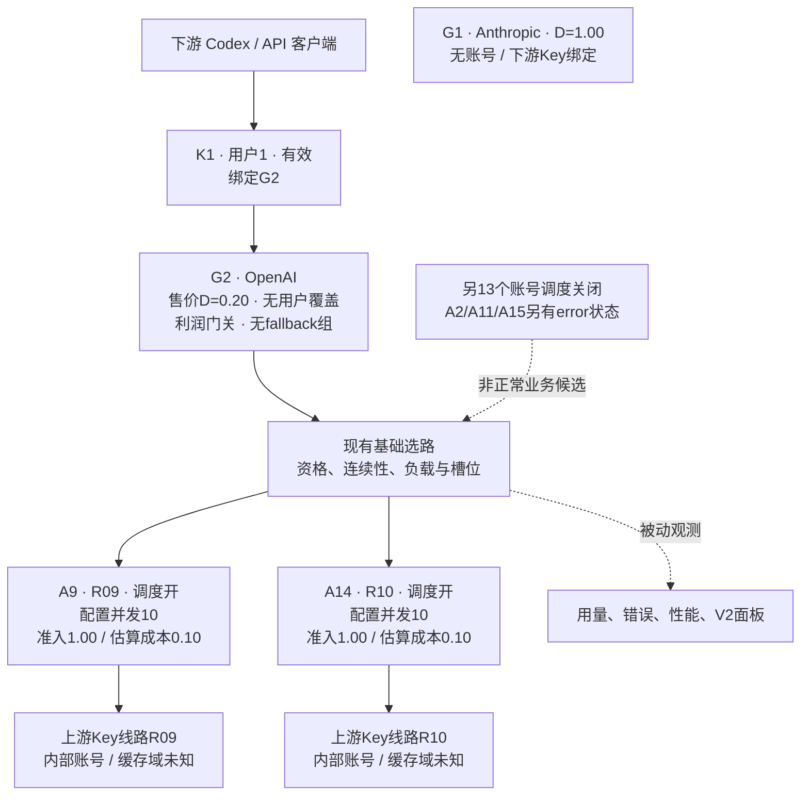
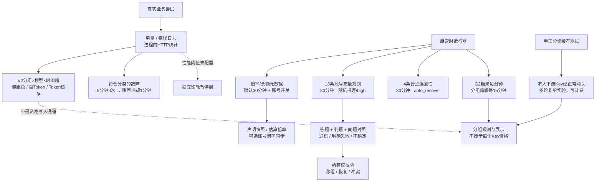
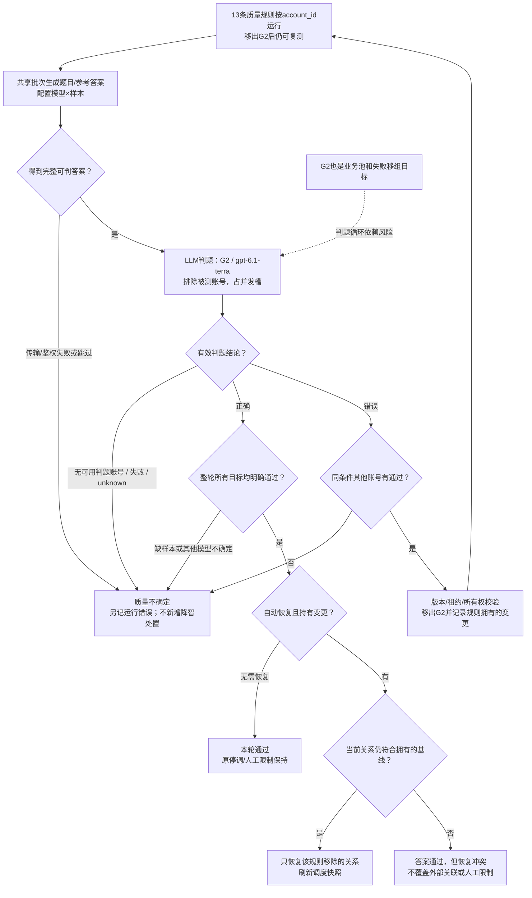
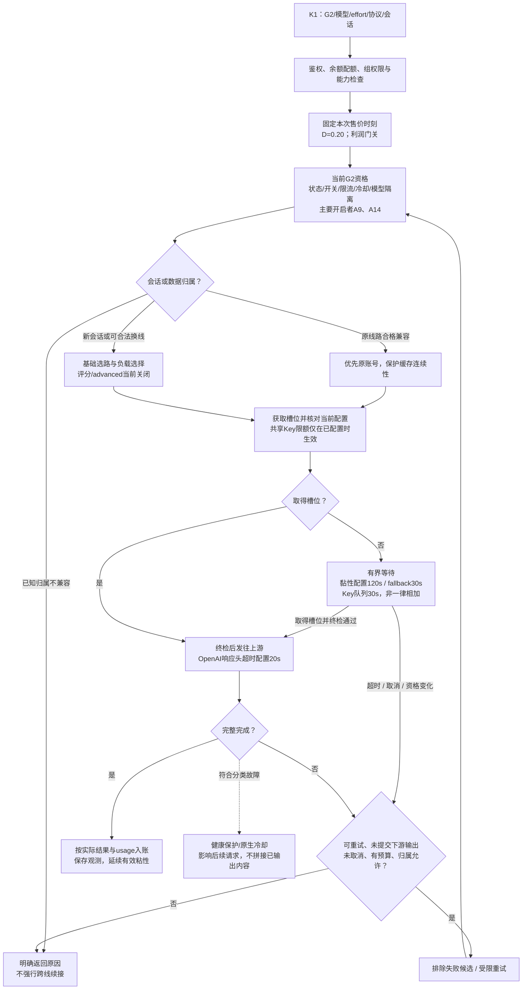
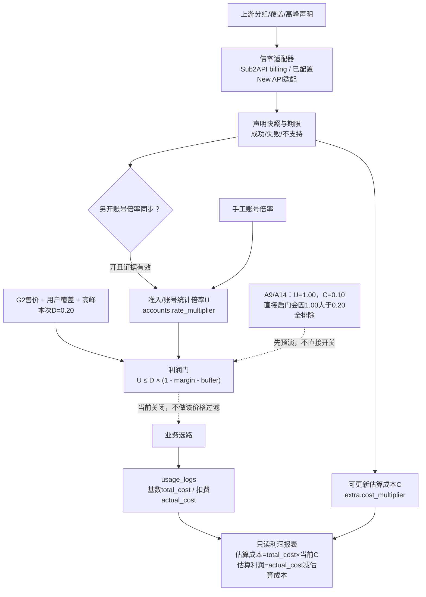
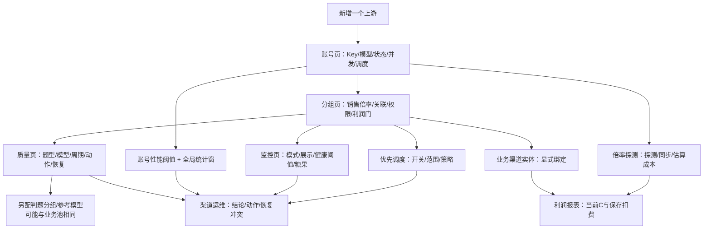

# 生产监测、验真与调度流程图册

> 核查：2026-11-20，配置快照11:28–11:32（UTC+8）。运行版 `v2.21.0-ransub.8`，发行源码 `1171780c7fc5e38def77dba160ac570a827a45bf`，镜像摘要 `291c5bf6dccd`。这是时间点快照，不是实时面板。
>
> 本文负责**生产事实与流程解释**；唯一方案和任务仍在[主设计§12.1、§13.3](monitor-driven-scheduling-design.md#121-低心智配置与上游监控面板提案)。开发功能不视作生产能力。本轮只读，不触发付费检测、不改配置、不部署、不运行CI。

[打开离线图文版（9张已渲染流程图）](production-observation-flow.html)。HTML由本文和主设计§12.1生成，不是另一份方案。

## 1. 核心判断

目标是“管理员定义产品边界，程序持续证明并维护合格供应”，不是增加分数后继续手工搬账号。生产尚未完整闭环：

1. V2面板的健康色、缓存和首Token等指标，**不直接决定选路资格**。质量规则、原生故障保护、人工开关分别生效。
2. 15个账号只有9、14号开启调度，每个配置并发10。配置上限不等于实时可用容量，也不代表每个模型都有两个合格备选。
3. 主力账号的**报表估算倍率0.10、利润准入倍率1.00、下游售价倍率0.20**。利润门当前关闭，直接开启会排除两个主力账号。
4. **单题通过、整轮通过、处置完成、当前可调度是不同结论**。不能用一个红绿灯代替。
5. 随机推理题、糖果题、返回模型名及Codex/TLS客户端指纹，不单独认证真实模型。当前没有模型身份认证闭环的生产证据。

## 2. 线上上下游与配置

### 2.1 具体拓扑

`A`是账号ID，`G`是分组ID，`K`是本系统下游Key ID。`R`是配置base URL的脱敏地址桶，不是已核实的独立供应商、实际出口或缓存域；凭据和原始站点地址不进入文档。

所有账号均为OpenAI API Key、优先级1、账号附加销售倍率1、配置并发10。12个地址桶、15个不同Key值，未发现同值Key重复建号；不同地址仍可能共用供应商故障域。

| 账号 | 地址桶 | 状态 / 调度 | 当前关联 | 准入账号倍率U | 报表估算倍率C | 倍率探测 / 账号倍率同步 |
| --- | --- | --- | --- | ---: | ---: | --- |
| A1 | R01 | active / 关 | G2 | 0.20 | 0.20 | 开 / 开；快照有效 |
| A2 | R03 | error / 关 | G2 | 0.08 | 0.08 | 开 / 开；保存的成功快照过期 |
| A3 | R02 | active / 关 | G2 | 1.00 | 0.10 | 开 / 未开启；404不支持；pool_mode=true |
| A4 | R05 | active / 关 | G2 | 1.00 | 0.10 | 开 / 关；404不支持 |
| A5 | R10 | active / 关 | G2 | 1.00 | 0.10 | 开 / 关；404不支持 |
| A6 | R10 | active / 关 | G2 | 1.00 | 0.10 | 开 / 未开启；404不支持 |
| A7 | R12 | active / 关 | G2 | 1.00 | 0.029 | 开 / 关；声明0.029 |
| A8 | R11 | active / 关 | G2 | 1.00 | 0.04 | 开 / 关；声明0.04 |
| A9 | R09 | active / **开** | G2 | **1.00** | **0.10** | 开 / 关；404不支持 |
| A10 | R04 | active / 关 | 无 | 1.00 | 0.03 | 开 / 未开启；声明0.03 |
| A11 | R07 | error / 关 | G2 | 1.00 | 0.10 | 开 / 关；404不支持 |
| A12 | R08 | active / 关 | G2 | 1.00 | 0 | 开 / 未开启；声明0，非已验证免费 |
| A13 | R08 | active / 关 | G2 | 1.00 | 0 | 关 / 关；无快照 |
| A14 | R10 | active / **开** | G2 | **1.00** | **0.10** | 关 / 关；无快照 |
| A15 | R06 | error / 关 | G2 | 1.00 | 0.10 | 开 / 关；无快照 |

“关”只说明保存值，不反推操作者或原因。A5/A6/A14共地址，A12/A13共地址，但Key不同，缓存关系仍未知。A9/A14的sol、terra、6.2-sol均同名映射，映射不是身份认证。

### 2.2 什么真正生效

| 机制 | 快照配置 | 当前影响 |
| --- | --- | --- |
| V2监控 | 开，G2，每60秒刷新 | 展示聚合健康，不自动移组/隔离 |
| V2阈值 | 错误权重0.6、TTFT/缓存各0.2；最小样本10 | TTFT警告8s/严重20s；缓存警告85%/严重60%；不是选路门 |
| V2糖果题 | G2 / gpt-6.1-sol / medium，每分钟 | 分组抽样，不是每个上游Key各测一次 |
| 分组鹈鹕 | G2 / gpt-6.1-sol，每15分钟 | 分组回答/展示，非全组账号验真 |
| 账号质量 | 13条启用，每30分钟，随机推理/high | 动作移出G2、自动恢复开、5xx即时触发关 |
| 普通连通性 | A3/A4/A6/A7共4条，每30分钟 | 原生auto_recover，与质量计划独立 |
| 最新可用性准入 | 未配置；状态表为空 | 尚未启用“最近检测可用且未过期才放行” |
| 性能阈值暂停 | 无账号配置 | 性能可观测不等于自动停调；统计窗源码默认60分钟 |
| 优先评分 | 设置缺省，源码默认关 | advanced scheduler亦显式关；并非统一评分分流 |
| 跨请求健康保护 | **开：5分钟累计3次、暂停1分钟** | 符合分类的失败按账号累计，成功不清零，不是失败率阈值 |
| 倍率元数据探测 | 全局缺省开/30分钟，13个账号开 | 单组有效声明可更新估算C；账号倍率同步另有开关 |
| 利润门 | G1/G2均关 | 报表盈利不等于会拦超倍率线路 |
| V1 / V3空闲探测 | V1无配置，当前V2；V3 idle_probe关 | 不是另外正在运行的主动检测池 |
| 自动采购桶、受管产品、完整多维资格与预算 | 开发或提案 | 不属于本次生产稳定版已验能力 |

## 3. 监测与检测的控制边界

过去窗口的高可用率不能覆盖新故障，上次通过也不能覆盖换Key、过期或模型不一致。V2忽略错误含authentication、client_cancelled、content_policy、context_limit、group_access、model_unsupported、not_found、quota_or_balance；面板成功率不是所有请求未经筛选的成功率。

## 4. 质量检测、处置与恢复

图中为逻辑归约；处置在原整轮/共享批次收集完成或到达其收集期限、且版本与所有权校验通过后执行，不是单个答案返回就立即改组。

### 4.1 生产实例

| 时间 / 证据 | 实际情况 | 结论 |
| --- | --- | --- |
| 11:00 P12/A9，9184/9185 | terra答错，peer_passed=0/no_passing_peer；sol通过 | 答案一错一对；处置整轮inconclusive，非两个模型都通过 |
| 11:00 P16/A14，9182/9183 | 同样是terra无通过对照、sol通过 | 不新增确认降智，也不恢复整个规则 |
| 10:30 P16/A14，9159/9160 | 两模型正确，动作restore_conflict | 答题通过，恢复未完成，不代表全部恢复 |
| 11:00 P14/A12、P15/A13 | 单模型本轮passed | 调度开关仍false；检测不替管理员打开停调 |
| P13/A10 | 保存移出G2的所有权，当前无关联 | 按ID的复测仍继续 |

当前有质量所有权的规则为P12/P13/P16；A9/A14又在G2中，历史所有权与外部关联需对账，不能由当前关系倒推全部历史原因。

**风险不等于宣称当前没有判题账号。** A9/A14开调度且声明支持terra，通常互为候选，但仍受容量和隔离等约束；若两者都被移组/停调，判题失去来源。应使用不在本产品移组目标中的独立参考池，本轮没有创建它。随机题本地生成参考答案后，仍调用配置LLM比较答案，不是纯本地判分。

## 5. 用户请求如何放行、等待与切换

这是OpenAI文本主链逻辑视图，不承诺HTTP/WS/媒体内部步骤相同。归属未知按已选兼容策略透传，只拦截有证据的跨线数据；未知透传不保证换线成功。HTTP200不等于SSE完整完成，已输出后的断流不透明拼接重试。

20秒是响应头限制，不是首文本SLA或请求总上限。黏性满槽可先等120秒，重试继续耗时。诊断应合并展示“已等多久、在等什么、剩余预算、为何不切换”，而非让管理员分别猜超时。

近24小时留存日志中，无账号归属的一类503在一次查询中有503条，后一次为504条；另有A9/A14归属的502及HTTP200内错误。查询时点不同，且日志不是完整冻结请求全集，不直接相加计算失败率，也不凭状态码认定都是队列问题；需请求ID与尝试链关联后定责。

## 6. 倍率、利润门与报表

- **采购声明倍率**：特定Key/固定组的声明，带来源、期限、模型/服务档；不是已核对的实际结算价。
- **准入U**：利润门使用的账号倍率；开启同步时需新鲜有效单组快照并保守取值。手工值不是供应商价格证据。
- **估算C**：报表使用，缺失默认0.10；默认不能包装成已确认价格。当前报表按当前C计算，不是历史逐请求采购价快照。
- **销售D**：本次固定的销售规则，不随换账号改变；actual_cost为保存的扣费，订阅扣费也不自动等于现金收入。

实时文本利润门公式为 `U ≤ D × (1 - profit_min_margin - profit_safety_buffer)`。上游声明0须核对语义，404只说明元数据接口不支持；不等于模型不能用。真实采购价重构继续延期，高缓存不用于绕过既定倍率上限。

独立图片/视频、Grok媒体、count_tokens、live不直接套用此文本门；混合Responses的token计费部分仍受保护。报表查询的5分钟预算不是上游响应超时。

## 7. 缓存究竟面向谁

### 7.1 实际用量示例

11:30左右读取近24小时usage_logs；跨effort/协议混合，仅解释现状，不作为严格线路比较。

| 本系统账号 / 模型 | 账单记录数 | 归一化Token读取率 | 保存的平均首Token |
| --- | ---: | ---: | ---: |
| A14 / gpt-6.1-sol | 3835 | 96.34% | 15.52s |
| A9 / gpt-6.1-sol | 2664 | 96.51% | 17.48s |
| A9 / gpt-6.2-sol | 79 | 92.05% | 15.77s |
| A14 / gpt-6.2-sol | 4 | 49.67% | 18.09s，低样本 |

共6582条，Token加权读取率约96.37%。这不是供应商全站统计，也不是每个新会话的热缓存保证；百分比不算术平均。高缓存与慢首字可同时存在。

| 面向谁 | 正确范围 | 当前边界 |
| --- | --- | --- |
| 管理员比较采购 | 上游Key/绑定组×模型×协议/服务档×时间窗 | 可看账号用量；内部账号/缓存域未知，G2平均不能贴给每个上游 |
| 下游用户核对服务 | 本人下游Key×销售组×模型×时间窗 | usage有api_key_id；**V2用户聚合按user_id，不是逐Key**。现在只有K1，增加Key后不再等价 |
| 分组状态页 | 获授权的分组/模型统计 | 是分组输出，不证明全部上游；并列忽略错误与覆盖窗口 |
| 主动复用实验 | 同上游Key、scope、前缀的cold→warm | 现手工分组缓存页走本人下游Key和正常调度，属于端到端实验，不是逐上游直测 |

V2归一化公式：`Σcache_read / Σ(input + cache_creation + cache_read)`。Responses/Chat原始input常已含缓存，必须先归一化，不能重复加入。请求命中率另定义为“read>0请求 / 缓存字段可观测请求”，并列覆盖率，缺字段不当0。账单改写后的桶、原始usage与复用实验证据分开。

普通API Key没有统一的“查询全Key缓存命中率”协议。现有Sub2API billing/New API适配主要取倍率、组和余额；请求回传usage时按范围计算。个别站点有授权用量接口，可显式适配并标覆盖，不能假设全支持，也不为统计自动索取站点管理员凭据。模型名与缓存数都可能是自报，属于证据而非独立认证。

## 8. 现有后台为什么复杂

| 入口 | 职责 / 易混点 |
| --- | --- |
| `/admin/accounts`、`/admin/groups` | 接入、关联、倍率；库存、销售和判题来源混用分组 |
| `/admin/account-quality` | 单题、整轮、动作和当前资格容易混淆 |
| `/admin/channels/monitor`、`/monitor` | 展示健康阈值不等于隔离阈值 |
| `/admin/priority-scheduling` | 页面存在不等于启用；评分不授予资格 |
| `/admin/channel-operations` | 原运维总览；地址桶不是业务渠道或故障域 |
| `/admin/upstream-channels`、`/admin/profit-operations` | 当前1个实体、仅A1绑定；其余按地址只读归类；并非模型价卡渠道 |
| `/admin/group-cache-tests`、`/admin/pelican-tests` | 端到端抽样/展示，可计费，不是逐Key全覆盖认证 |

根因是**业务对象、证据范围与写入所有权交叉**；把原表单折叠到同一页仍需记住同样多的依赖。

## 9. 优化方向与交付边界

统一方案见[主设计§12.1](monitor-driven-scheduling-design.md#121-低心智配置与上游监控面板提案)：一条供应记录、一个产品策略、一份可解释准入结果；各检测器只产证据，一个拥有者维护受管关系；三步配置，日常只处理异常。

本轮是事实核查与设计，不是已上线的新后台。原28项仍20done/8部分，D3/D4/D5/D6/D7/D8的生产及外部验收不因画图关闭。

## 10. 证据与源码

本地最小证据：`H:/Root/DevCache/evidence/sub2api-production-flow-review/snapshot.json`，只有白名单状态、ID、模型及聚合数，无Key/地址/登录响应/原始正文。只读事务限时8秒，保留SSH主机校验；一次Paramiko EOF切到原生SSH，一次本地解码错误未算成功采集。

源码固定到上述发行提交，不能用开发HEAD替代：

| 对象 | 源码 |
| --- | --- |
| 整轮归约 | [account_quality.go](https://github.com/a5116107/ransub2api/blob/1171780c7fc5e38def77dba160ac570a827a45bf/backend/internal/service/account_quality.go#L234) |
| 判题来源/超时 | [quality_judge.go](https://github.com/a5116107/ransub2api/blob/1171780c7fc5e38def77dba160ac570a827a45bf/backend/internal/service/quality_judge.go#L56) |
| 同题对照 | [quality_shared_batch.go](https://github.com/a5116107/ransub2api/blob/1171780c7fc5e38def77dba160ac570a827a45bf/backend/internal/service/quality_shared_batch.go#L150) |
| 答题到判题 | [pelican_scheduled.go](https://github.com/a5116107/ransub2api/blob/1171780c7fc5e38def77dba160ac570a827a45bf/backend/internal/service/pelican_scheduled.go#L490) |
| 可用期限 | [availability_policy.go](https://github.com/a5116107/ransub2api/blob/1171780c7fc5e38def77dba160ac570a827a45bf/backend/internal/service/availability_policy.go#L31) |
| 基础选路 | [openai_gateway_scheduling.go](https://github.com/a5116107/ransub2api/blob/1171780c7fc5e38def77dba160ac570a827a45bf/backend/internal/service/openai_gateway_scheduling.go#L1206) |
| 累计保护分类 | [openai_apikey_health_breaker.go](https://github.com/a5116107/ransub2api/blob/1171780c7fc5e38def77dba160ac570a827a45bf/backend/internal/service/openai_apikey_health_breaker.go#L22) |
| 利润准入 | [openai_profit_control.go](https://github.com/a5116107/ransub2api/blob/1171780c7fc5e38def77dba160ac570a827a45bf/backend/internal/service/openai_profit_control.go#L8) |
| 报表成本/默认 | [account_cost.go](https://github.com/a5116107/ransub2api/blob/1171780c7fc5e38def77dba160ac570a827a45bf/backend/internal/service/account_cost.go#L10)、[profit_operations.go](https://github.com/a5116107/ransub2api/blob/1171780c7fc5e38def77dba160ac570a827a45bf/backend/internal/service/profit_operations.go) |
| 倍率探测 | [upstream_billing_probe.go](https://github.com/a5116107/ransub2api/blob/1171780c7fc5e38def77dba160ac570a827a45bf/backend/internal/service/upstream_billing_probe.go#L35) |
| 缓存归一化公式 | [channel_monitor_v2_repo.go](https://github.com/a5116107/ransub2api/blob/1171780c7fc5e38def77dba160ac570a827a45bf/backend/internal/repository/channel_monitor_v2_repo.go#L1440) |
| 性能暂停 | [account_performance.go](https://github.com/a5116107/ransub2api/blob/1171780c7fc5e38def77dba160ac570a827a45bf/backend/internal/service/account_performance.go#L38) |
| 默认评分关闭 | [priority_scheduling.go](https://github.com/a5116107/ransub2api/blob/1171780c7fc5e38def77dba160ac570a827a45bf/backend/internal/service/priority_scheduling.go#L57) |
| 后台路由 | [router/index.ts](https://github.com/a5116107/ransub2api/blob/1171780c7fc5e38def77dba160ac570a827a45bf/frontend/src/router/index.ts) |

源码证明机制存在，不单独证明已启用、模型真实或供应商兑现价格/缓存承诺。留存数据和本次只读查询也不替代故障会话的完整生产验收。
