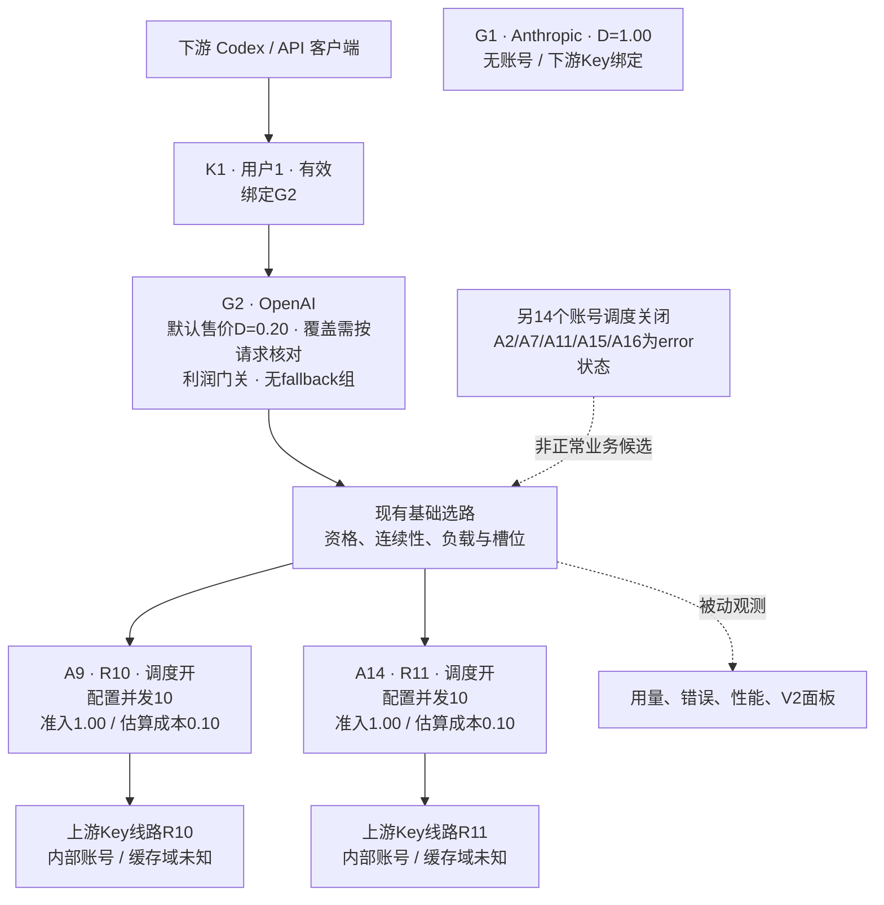
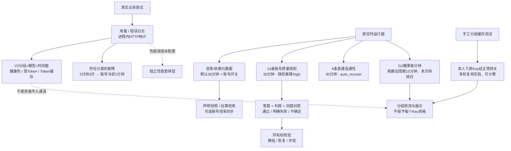
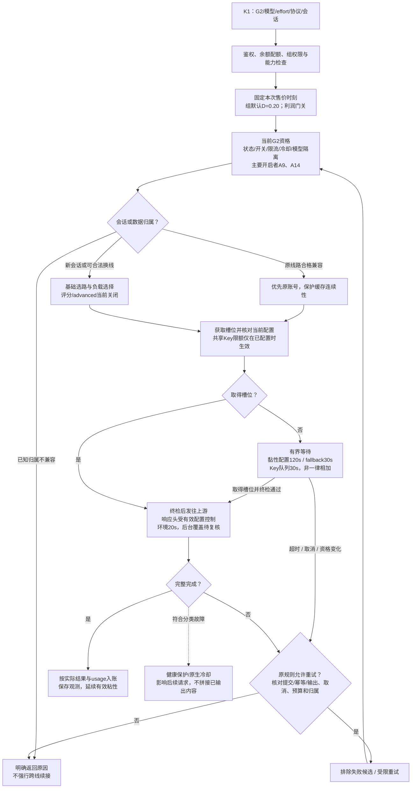
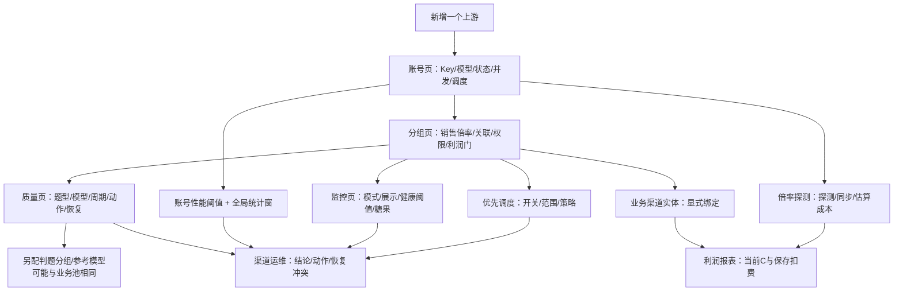

# 生产监测、验真与供给经营流程图册

> 核查：2026-11-25 16:47–16:48（UTC+8）。运行版 `v2.21.0-ransub.9`，发行源码 `de8b86ed8916c012f5421cc00c4fdd97eec8d6f3`，实际程序 `c8cec584a181`，镜像摘要 `bfea56342282`。这是已读取的时间点快照，不是实时面板。
>
> 本文负责生产事实与流程；唯一方案和任务仍在[主设计§12.1、§13.3](monitor-driven-scheduling-design.md#121-低心智配置与上游监控面板提案)。先阅读其中的[产品化体验合同](monitor-driven-scheduling-design.md#1219-产品化体验合同2026-11-25)。开发能力不视作生产已启用。本轮只读生产，不触发付费检测、不改配置、不部署、不运行CI。

[打开离线图文版与可点击产品草图](production-observation-flow.html)。默认以横向上游线路卡片展示价格来源、质量/身份、缓存与等待，卡内可预演手工倍率填写；具体合同见[主设计§12.1.10](monitor-driven-scheduling-design.md#upstream-line-panel)。现状图、目标业务图和体验草图区分；HTML由本文、主设计与脱敏快照生成，不是另一份方案，也不是已上线的新后台。

## 1. 核心判断

目标是“管理员定义产品边界，程序持续证明并维护合格供应”，不是增加分数后继续手工搬账号。生产尚未完整闭环：

1. V2面板的健康色、缓存和首Token等指标，**不直接决定选路资格**。质量规则、原生故障保护、人工开关分别生效。
2. 16个账号只有9、14号开启调度，每个配置并发10。配置上限不等于实时可用容量，也不代表每个模型都有两个合格备选。
3. 主力账号的**报表估算倍率0.10、利润准入倍率1.00、下游分组默认售价倍率0.20**。利润门当前关闭；在默认售价0.20且无用户覆盖的预演条件下，开启会排除两个主力账号，不能直接推荐开启。
4. 本次近24小时主力线路的Token读取率约95%–98%，保存的平均首Token仍约14–19秒；高缓存与慢等待可以同时存在。
5. **单题通过、整轮通过、处置完成、当前可调度是不同结论**。不能用一个红绿灯代替。
6. 随机推理题、糖果题、返回模型名及Codex/TLS客户端指纹，不单独认证真实模型。当前没有模型身份认证闭环的生产证据。

## 2. 线上上下游与配置

### 2.1 具体拓扑

`A`是账号ID，`G`是分组ID，`K`是本系统下游Key ID。`R`是配置base URL的脱敏地址桶，不是已核实的独立供应商、实际出口或缓存域；凭据和原始站点地址不进入文档。

所有账号均为OpenAI API Key、优先级1、配置并发10。13个地址桶、16个不同Key值，未发现同值Key重复建号；不同地址仍可能共用供应商故障域。

| 账号 | 本次地址桶 | 状态 / 调度 | 当前关联 | 准入U | 估算C | 元数据观测 / 时效 |
| --- | --- | --- | --- | ---: | ---: | --- |
| A1 | R01 | active / 关 | G2 | 0.200 | 0.200 | 成功声明 0.2；新鲜 |
| A2 | R03 | error / 关 | G2 | 0.080 | 0.080 | 成功声明 0.08；过期 |
| A3 | R02 | active / 关 | G2 | 1.000 | 0.100 | 接口不支持 |
| A4 | R06 | active / 关 | G2 | 1.000 | 0.100 | 接口不支持 |
| A5 | R11 | active / 关 | G2 | 1.000 | 0.100 | 接口不支持 |
| A6 | R11 | active / 关 | G2 | 1.000 | 0.100 | 接口不支持 |
| A7 | R13 | error / 关 | G2 | 1.000 | 0.050 | 成功声明 0.05；过期 |
| A8 | R12 | active / 关 | G2 | 1.000 | 0.050 | 成功声明 0.05；新鲜 |
| A9 | R10 | active / **开** | G2 | 1.000 | 0.100 | 接口不支持 |
| A10 | R04 | active / 关 | 无 | 1.000 | 0.030 | 成功声明 0.03；新鲜 |
| A11 | R05 | error / 关 | G2 | 1.000 | 0.100 | 接口不支持 |
| A12 | R08 | active / 关 | G2 | 1.000 | 0.001 | 成功声明 0.001；新鲜 |
| A13 | R08 | active / 关 | G2 | 1.000 | 0.000 | 无快照；探测关 |
| A14 | R11 | active / **开** | G2 | 1.000 | 0.100 | 无快照；探测关 |
| A15 | R07 | error / 关 | G2 | 1.000 | 0.100 | 无快照 |
| A16 | R09 | error / 关 | G2 | 1.000 | 0.080 | 成功声明 0.08；过期 |

“关”只说明保存值，不反推操作者或原因。地址桶只在本次快照内有效，不跨快照比较；A5/A6/A14同地址、A12/A13同地址但Key不同，缓存关系未核实。A7/A8估算已变为0.05，A12为0.001，新增A16估算0.08；不再沿用11/20的0.029/0.04/0或15账号库存。价格同步开关本次未完成准确重读，不把null或错误字段当成“关”。

### 2.2 什么真正生效

| 机制 | 快照配置 | 当前影响 |
| --- | --- | --- |
| V2监控 | 开，G2，每60秒刷新 | 展示聚合健康，不自动移组/隔离 |
| V2阈值 | 错误权重0.6、TTFT/缓存各0.2；最小样本10 | TTFT警告8s/严重20s；缓存警告85%/严重60%；不是选路门 |
| V2糖果题 | G2 / gpt-6.1-sol / medium，每分钟 | 分组抽样，不是每个上游Key各测一次 |
| 分组鹈鹕 | **18:31补读**：G2 / gpt-6.1-sol / low / 每15分钟 | 分组抽样；最近执行失败，历史有成功作品；非全组账号验真 |
| 账号质量 | 14条启用，每30分钟，随机推理/high | 动作移出G2、自动恢复开、5xx即时触发关 |
| 普通连通性 | A3/A4/A6/A7共4条，每30分钟 | 原生auto_recover，与质量计划独立 |
| 最新可用性准入 | 未配置；状态表为空 | 尚未启用“最近检测可用且未过期才放行” |
| 性能阈值暂停 | 无账号配置 | 性能可观测不等于自动停调；统计窗源码默认60分钟 |
| 优先评分 | 设置缺省，源码默认关 | advanced scheduler亦显式关；并非统一评分分流 |
| 跨请求健康保护 | **开：5分钟累计3次、暂停1分钟** | 符合分类的失败按账号累计，成功不清零，不是失败率阈值 |
| 倍率元数据探测 | 全局缺省开/30分钟，14个账号开 | 单组有效声明可更新估算C；账号倍率同步另有开关 |
| 利润门 | G1/G2均关 | 报表盈利不等于会拦超倍率线路 |
| V1 / V3空闲探测 | V1无配置，当前V2；V3 idle_probe关 | 不是另外正在运行的主动检测池 |
| 自动采购桶、受管产品、完整多维资格与预算 | 开发或提案 | 不属于本次生产稳定版已验能力 |

## 3. 监测与检测的控制边界

过去窗口的高可用率不能覆盖新故障，上次通过也不能覆盖换Key、过期或模型不一致。V2忽略错误含authentication、client_cancelled、content_policy、context_limit、group_access、model_unsupported、not_found、quota_or_balance；面板成功率不是所有请求未经筛选的成功率。

## 4. 质量检测、处置与恢复

图中为逻辑归约；处置在原整轮/共享批次收集完成或到达其收集期限、且版本与所有权校验通过后执行，不是单个答案返回就立即改组。

### 4.1 本次结果与历史例子分开看

本次16:30样本中P12/A9结果15435、P13/A10结果15437、P15/A13结果15443等动作均为`inconclusive`，部分无判题verdict，不能据`failed`反推所有模型答错。移出G2的A10仍有按ID计划，复测不因移组消失。

11/20的P12/P16“一个模型通过、另一个无通过对照”及P16“答题通过但restore_conflict”保留为历史诊断例，不是11/25实时冲突计数。当前仍有P12/P13/P16质量状态记录，但本次未完整重读它们拥有的关系差量，不宣称恢复完成。

G2仍是规则保存的判题来源和移组目标，存在循环依赖风险；这不等于断言此刻没有判题账号。A9/A14能否互为参考还受模型、资格和容量影响；同地址或另建一组也不证明参考独立。随机题本地生成参考后仍调用配置LLM判分，答对不认证模型身份。

### 4.2 鹈鹕补读：模型、实际作答账号和历史作品分开（18:31）

2026-11-25 18:31（UTC+8）既有SSH通道已恢复本次定向只读查询，运行版仍为`.9/de8b86ed8916`。只读计划、结果与已发布作品，没有启动新测试；16:47账号库存/质量统计与本节不是同一时刻快照，其他未复核配置仍保留原未知。

- 当前分组计划：**G2 · gpt-6.1-sol · low · 每15分钟 · 已开启**。计划模型只描述后续要测什么；实际已测模型来自每条结果冻结的`pelican_config.model_id`。
- 最新样本15519：18:15开始、18:17结束，模型`gpt-6.1-sol/low`；先尝试A9，最终A14，无输出、执行失败。前一条15518在18:00开始，先尝试A14、最终A9，也无输出。这里只证明该次执行结果，不证明答错或模型假。
- 17:45样本15494（最终A9）、17:30样本15492（A9）、17:15样本15469（A14）等有成功输出，并有对应发布记录。**不是全部历史都失败；也不能用旧作品把最新失败显示为通过。** 查询只取最近8条，不能据此给全量成功率。
- 新卡片应在缩略图旁直接写实际测试模型/effort/生成时间，另标最新执行状态；详情列分组、实际作答账号和前序尝试。分组一次成功不授予所有上游账号通过，成功生成作品也不等于已有正式质量判分或独立身份认证。

对应产品合同在[主设计§12.1.10](monitor-driven-scheduling-design.md#upstream-line-panel)。本节补读仅解除鹈鹕当前计划/结果的事实缺口，不把其他同步开关/有效超时/实体绑定的旧读超时改成已验证。

## 5. 用户请求如何放行、等待与切换

这是OpenAI文本主链逻辑视图，不承诺HTTP/WS/媒体内部步骤相同。归属未知按已选兼容策略透传，只拦截有证据的跨线数据；未知透传不保证换线成功。HTTP200不等于SSE完整完成，已输出后的断流不透明拼接重试。

**多个配置层是当前心智负担的一部分。** 本次环境值是响应头20s、粘性120s、fallback30s、Key队列30s。11/22发布后验另确认后台响应头覆盖60s，普通/高推理首输出120/300s；本次补充重读遇SSH超时，20s只称环境值，不称最终生效值。产品应统一显示有效值、来源、当前等待阶段及剩余预算，而不是让管理员分别猜；响应头限制不是首文本SLA，也不是所有阶段一律相加。

已提交请求的重放还受提交状态、幂等与重复计费保护，不能只看“还没输出”就承诺可换账号。原11/20错误数量不沿用为当前失败率；需请求ID与尝试链关联后定责，200也不等于流完整完成。

## 6. 倍率、利润门与报表

- **采购声明倍率**：特定Key/固定组的声明，带来源、期限、模型/服务档；不是已核对的实际结算价。
- **准入U**：利润门使用的账号倍率；开启同步时需新鲜有效单组快照并保守取值。手工值不是供应商价格证据。
- **估算C**：报表使用，缺失默认0.10；默认不能包装成已确认价格。当前报表按当前C计算，不是历史逐请求采购价快照。
- **销售D**：本次固定的销售规则，不随换账号改变；actual_cost为保存的扣费，订阅扣费也不自动等于现金收入。

实时文本利润门公式为 `U ≤ D × (1 - profit_min_margin - profit_safety_buffer)`。显式0须核对语义，404只说明元数据接口不支持；不等于模型不能用。真实采购价重构继续延期，高缓存不用于绕过既定倍率上限。

独立图片/视频、Grok媒体、count_tokens、live不直接套用此文本门；混合Responses的token计费部分仍受保护。报表查询的5分钟预算不是上游响应超时。

## 7. 缓存究竟面向谁

### 7.1 实际用量示例

本次16:47–16:48读取近24小时留存usage，混合effort/协议，仅解释现状，不作为严格线路比较。首Token均值不是首非空文本或P95。

| 本系统账号 / 模型 | 用量行数 | 归一化Token读取率 | 保存的平均首Token |
| --- | ---: | ---: | ---: |
| A14 / gpt-6.2-sol | 1434 | 98.32% | 14.25s |
| A9 / gpt-6.1-sol | 453 | 95.12% | 17.66s |
| A14 / gpt-6.1-sol | 323 | 97.71% | 19.29s |
| A9 / gpt-6.2-sol | 225 | 97.08% | 15.67s |

共2435条用量记录；下游K1/G2分别有1659条6.2-sol、776条6.1-sol。不是供应商全站统计，也不是每个新会话热缓存保证；高缓存与慢首字可以并存，不能平均各线路百分比。

| 面向谁 | 正确范围 | 当前边界 |
| --- | --- | --- |
| 管理员比较采购 | 上游Key/绑定组×模型×协议/服务档×时间窗 | 可看账号用量；内部账号/缓存域未知，G2平均不能贴给每个上游 |
| 下游用户核对服务 | 本人下游Key×销售组×模型×时间窗 | usage有api_key_id；**V2用户聚合按user_id，不是逐Key**。现在只有K1，增加Key后不再等价 |
| 分组状态页 | 获授权的分组/模型统计 | 是分组输出，不证明全部上游；并列忽略错误与覆盖窗口 |
| 主动复用实验 | 同上游Key、scope、前缀的cold→warm | 现手工分组缓存页走本人下游Key和正常调度，属于端到端实验，不是逐上游直测 |

V2归一化公式：`Σcache_read / Σ(input + cache_creation + cache_read)`。Responses/Chat原始input常已含缓存，必须先归一化，不能重复加入。请求命中率另定义为“read>0请求 / 缓存字段可观测请求”，并列覆盖率，缺字段不当0。账单改写后的桶、原始usage与复用实验证据分开。

普通API Key没有统一的“查询全Key缓存命中率”协议。现有Sub2API billing/New API适配主要取倍率、组和余额；请求回传usage时按范围计算。个别站点有授权用量接口，可显式适配并标覆盖，不能假设全支持，也不为统计自动索取站点管理员凭据。模型名与缓存数都可能是自报，属于证据而非独立认证。

## 8. 现有后台为什么复杂

| 入口 | 职责 / 易混点 |
| --- | --- |
| `/admin/accounts`、`/admin/groups` | 接入、关联、倍率；库存、销售和判题来源混用分组 |
| `/admin/account-quality` | 单题、整轮、动作和当前资格容易混淆 |
| `/admin/channels/monitor`、`/monitor` | 展示健康阈值不等于隔离阈值 |
| `/admin/priority-scheduling` | 页面存在不等于启用；评分不授予资格 |
| `/admin/channel-operations` | 原运维总览；地址桶不是业务渠道或故障域 |
| `/admin/upstream-channels`、`/admin/profit-operations` | 11/20为1个实体且仅A1绑定；本次待重读；其余按地址只读归类；并非模型价卡渠道 |
| `/admin/group-cache-tests`、`/admin/pelican-tests` | 端到端抽样/展示，可计费，不是逐Key全覆盖认证 |

根因是**业务对象、证据范围与写入所有权交叉**；把原表单折叠到同一页仍需记住同样多的依赖。

## 9. 产品化方向与交付边界

统一方案见[主设计§12.1.9产品化体验合同](monitor-driven-scheduling-design.md#1219-产品化体验合同2026-11-25)：**一个经营台，四个业务视图；定义产品→选供应→确认供给方案，日常只处理例外。**

| 用户办什么事 | 生产.9已有 | 开发分支已有切片 | 仍待完成的产品结果 |
| --- | --- | --- | --- |
| 接一条供应 | 原账号、倍率探测、分组、利润报表 | 批准来源/采购区间、精确预演、逐门解释 | 一次接入流程，只补真正缺项；价格冲突直接可见 |
| 开一个产品 | 原销售组，G2利润门关 | 原Group模板、接管审核、部分计划配方 | 三步建产品→预览影响→确认→独立读回，完整自动维护 |
| 看懂质量 | 原答题/判题/同题对照与恢复 | 依赖诊断、独立多维证据 | 身份和功能分开、上游范围清楚、结论到操作闭环 |
| 稳定接单 | 原粘性、健康保护、.9提交边界 | 部分资格与缓存通路本地已验 | 严格产品完整资格消费、全scope与多Key用户隔离 |
| 日常少操心 | 原运维/质量/利润分散页面 | 原运维页含产品影响、采购目录组件 | 经营摘要、线路详情、按根因归并异常、最短处理入口 |

开发`UpstreamChannelOperationsView.vue`仍挂载`UpstreamAnalytics`；已有预演组件不等于默认页面已替人完成经营判断。方案复用原账号、Group、检查和调度；不再增一套库存/评分器/选路器。工程约束下钻，首层用业务文案。

本轮交付现状图、目标业务图、可点击离线体验草图与用户旅程验收；不修改业务代码或生产配置。原28项仍20done/8部分，完整产品、独立身份/缓存域与原生产验收没有借画图关闭。

## 10. 证据与源码

当前最小证据：`H:/Root/DevCache/evidence/sub2api-production-flow-review/product-review-snapshot.json`，只含白名单ID、配置和聚合，无Key值/地址/登录响应/正文。SQL显式只读、单条8秒上限。旧`snapshot.json`只用于历史差异，不能替代本次数据。

首次读取暴露旧标量列`model_allowlist_enabled`已不存在，改读实际JSON列后成功。后续补充查询遇原生SSH超时与Paramiko开通道超时；无关闭主机校验或无限重试。分组鹈鹕周期、准入倍率同步开关、最终有效超时与实体绑定标本次待重读，不以旧配置冒充当前观测。

生产固定源码`de8b86ed8916`；开发核对基线`daeca7be1`。当前源码对比显示.8→.9未修改本文主要质量/倍率/利润机制，但请求提交边界不能沿用旧版描述。下面的链接均固定生产源码，不指向移动HEAD。

源码固定到上述发行提交，不能用开发HEAD替代：

| 对象 | 源码 |
| --- | --- |
| 整轮归约 | [account_quality.go](https://github.com/a5116107/ransub2api/blob/de8b86ed8916c012f5421cc00c4fdd97eec8d6f3/backend/internal/service/account_quality.go) |
| 判题来源/超时 | [quality_judge.go](https://github.com/a5116107/ransub2api/blob/de8b86ed8916c012f5421cc00c4fdd97eec8d6f3/backend/internal/service/quality_judge.go) |
| 同题对照 | [quality_shared_batch.go](https://github.com/a5116107/ransub2api/blob/de8b86ed8916c012f5421cc00c4fdd97eec8d6f3/backend/internal/service/quality_shared_batch.go) |
| 答题到判题 | [pelican_scheduled.go](https://github.com/a5116107/ransub2api/blob/de8b86ed8916c012f5421cc00c4fdd97eec8d6f3/backend/internal/service/pelican_scheduled.go) |
| 可用期限 | [availability_policy.go](https://github.com/a5116107/ransub2api/blob/de8b86ed8916c012f5421cc00c4fdd97eec8d6f3/backend/internal/service/availability_policy.go) |
| 基础选路 | [openai_gateway_scheduling.go](https://github.com/a5116107/ransub2api/blob/de8b86ed8916c012f5421cc00c4fdd97eec8d6f3/backend/internal/service/openai_gateway_scheduling.go) |
| 累计保护分类 | [openai_apikey_health_breaker.go](https://github.com/a5116107/ransub2api/blob/de8b86ed8916c012f5421cc00c4fdd97eec8d6f3/backend/internal/service/openai_apikey_health_breaker.go) |
| 利润准入 | [openai_profit_control.go](https://github.com/a5116107/ransub2api/blob/de8b86ed8916c012f5421cc00c4fdd97eec8d6f3/backend/internal/service/openai_profit_control.go) |
| 报表成本/默认 | [account_cost.go](https://github.com/a5116107/ransub2api/blob/de8b86ed8916c012f5421cc00c4fdd97eec8d6f3/backend/internal/service/account_cost.go)、[profit_operations.go](https://github.com/a5116107/ransub2api/blob/de8b86ed8916c012f5421cc00c4fdd97eec8d6f3/backend/internal/service/profit_operations.go) |
| 倍率探测 | [upstream_billing_probe.go](https://github.com/a5116107/ransub2api/blob/de8b86ed8916c012f5421cc00c4fdd97eec8d6f3/backend/internal/service/upstream_billing_probe.go) |
| 缓存归一化公式 | [channel_monitor_v2_repo.go](https://github.com/a5116107/ransub2api/blob/de8b86ed8916c012f5421cc00c4fdd97eec8d6f3/backend/internal/repository/channel_monitor_v2_repo.go) |
| 性能暂停 | [account_performance.go](https://github.com/a5116107/ransub2api/blob/de8b86ed8916c012f5421cc00c4fdd97eec8d6f3/backend/internal/service/account_performance.go) |
| 默认评分关闭 | [priority_scheduling.go](https://github.com/a5116107/ransub2api/blob/de8b86ed8916c012f5421cc00c4fdd97eec8d6f3/backend/internal/service/priority_scheduling.go) |
| 后台路由 | [router/index.ts](https://github.com/a5116107/ransub2api/blob/de8b86ed8916c012f5421cc00c4fdd97eec8d6f3/frontend/src/router/index.ts) |

源码证明机制存在，不单独证明已启用、模型真实或供应商兑现价格/缓存承诺。留存数据和本次只读查询也不替代故障会话的完整生产验收。
